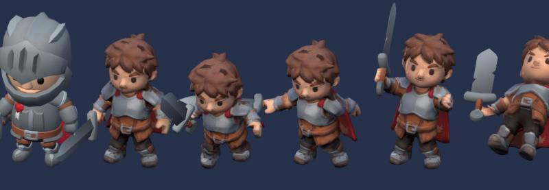
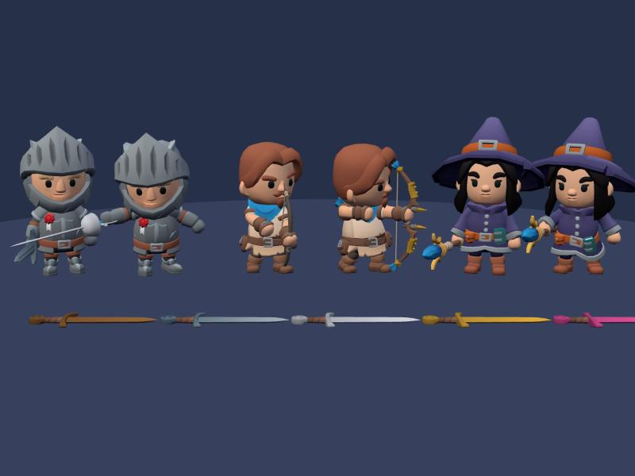

# מודלים ואנימציות בתלת-ממד: מאיפה לוקחים

סקר של מקורות חינמיים וזולים, 30.10.2026. Claude הוריד ובדק בפועל את החבילות שמסומנות ב-✔.
הקשר: הפרקים "תלת-ממד עם דמויות חינמיות", "התקדמות שרואים" ו"מבצע הגרפיקה" ב-[game-design.md](../game-design.md).

## ההמלצה: שלוש חבילות, כולן חינם ו-CC0

**הגילוי החשוב:** ל-KayKit יש גרסאות חדשות (אוקטובר-דצמבר 2025) שלא ידענו עליהן. הן על **אותו שלד בדיוק** כמו הדמויות שכבר במשחק: אותם 23 שמות עצמות ואותה תנוחת בסיס (בדקתי עצם-עצם). השלד הישן שלנו הוא אותו דבר ועוד 18 עצמות עזר, שהמשחק כבר מתעלם מהן. כלומר: כל מה שבחבילות החדשות נכנס בלי התאמת שלד.

| # | חבילה | מה זה נותן לנו | הצעד הבא |
| --- | --- | --- | --- |
| 1 | ✔ **KayKit Adventurers 2.0** | **לוחם (Knight), צייד (Ranger) וקוסם (Mage)** = שלוש הדמויות הפותחות. לצייד יש קשת אמיתית, אשפה וחצים, אז הקשת-יד יכולה לצאת. ועוד ברברי ונוכל לבוס, למבוקש ול-NPC | ב-`tools/build3d.js`: מקור הדמויות עובר ל-2.0, ומוסיפים `ranger` ו-`mage` לטבלה `CHARS`, ואת `bow` ו-`staff` ל-`PROPS` |
| 2 | ✔ **KayKit Character Animations** | 161 אנימציות על אותו שלד. כל מה שחסר לנו: התחמקות לארבעה כיוונים, הטלת כישוף וזימון, מתיחת קשת ושחרור, חסימה, תגובות פגיעה, עמידה בהמתנה, עידוד ונפנוף, ועבודה ל-NPC (פטיש לנפח, חפירה, ישיבה) | ב-`build3d.js`: טבלת `ANIMS` קוראת מהקבצים של החבילה (`Rig_Medium_*.glb`). כל סקיל מקבל אנימציה בשורה אחת ב-`LOOK3D` |
| 3 | ✔ **KayKit Bits: Fantasy Weapons + Medieval Hexagon** | **נשקים:** 31 מודלים (חרבות, גרזנים, פטישים, קשתות, מטות, שרביט, חנית, מגנים), 64 עד 2,400 משולשים כל אחד. **כפר:** נפחייה, שוק, פונדק, כנסייה, מכרה, מנסרה, טירה, בתים, כל אחד ב-4 צבעים. **ויש פיגומים ושלושה שלבי בנייה (A, B, C)**, בדיוק בשביל "בניין שגדל" | נשקים: שורה ב-`PROPS` לכל נשק, וחומר = החלפת טקסטורה (ראו "חומרי נשק"). כפר: מחכה לסשן הכפר, שמחליט אם הכפר מצויר בתלת-ממד |

**למה דווקא אלה:** חינם, CC0 (מותר הכל, בלי קרדיט), אותו אמן ואותו סגנון כמו מה שכבר במשחק, ובלי עבודת שלד. כל השאר בסקר דורש התאמת שלד, נראה אחרת או עולה כסף.

## מה בדקתי בפועל

| קובץ | גודל | משולשים | עצמות | הערה |
| --- | --- | --- | --- | --- |
| האביר שלנו היום (1.0) | 286KB | 5,012 | 41 | 23 עצמות גוף + 18 עזר |
| Knight 2.0 | 334KB | 5,800 | 23 | קסדה, מגן-פנים וגלימה כחלקים נפרדים |
| Mage 2.0 | 344KB | 6,668 | 23 | כובע וגלימה נפרדים |
| Ranger 2.0 | 473KB | 8,900 | 23 | הכי כבד. טוב לשחקן, לא לאויבים בכמויות |
| Barbarian / Rogue 2.0 | 378 / 400KB | 7,123 / 7,562 | 23 | |
| Skeletons 1.1 (Warrior) | 359KB | 5,934 | 23 | השלדים עודכנו גם הם לשלד החדש |
| חבילת אנימציות, 8 קבצים | 7.3MB | | 23 | נשאר רק מה שבוחרים, אז בפועל כמה מאות KB |
| נשקים (31 מודלים) | 3.2MB לכל החבילה | 64 עד 2,368 | | טקסטורה אחת לכולם |
| נפחייה / פונדק / טירה | | 2,410 / 2,992 / 5,659 | | שלב בנייה A: 784 |

- **קנה מידה:** הדמויות החדשות עומדות על הרצפה (גובה 0) ובגובה 2.2 עד 2.6 יחידות. המשחק ממילא מודד גובה ומתאים, אז זה לא משנה.
- **גודל המשחק:** `js/models3d.js` שוקל היום 3.6MB. כל דמות מוסיפה בערך 300KB, וכל 10 אנימציות בערך 300KB. שלוש דמויות ו-30 אנימציות חדשות = בערך 2MB נוספים. סביר, אבל לא לבחור "הכל".
- **ביצועים:** מאות אויבים × 6,000 משולשים זה הרבה לטלפון. לאויבים בכמויות: שלדים (כ-6,000) ופחות. דמויות כבדות כמו הצייד (8,900) רק לשחקן, לבוס ול-NPC.

## חלקי שריון לעלייה בדרגה

אין חבילה של קסדות וכתפיות בסגנון KayKit. אבל יש שתי דרכים זולות:

1. **להדליק ולכבות חלקים שכבר קיימים.** הדמויות מגיעות מפורקות: לאביר יש `Helmet`, `HelmetVisor` ו-`Cape` נפרדים, לקוסם `Hat` ו-`Cape`, לצייד `Cape` ו-`Quiver`. דוגמה ללוחם: דרגה 1 בלי קסדה ובלי גלימה, דרגה 2 גלימה, דרגה 3 קסדה, דרגה 4 מגן-פנים וטקסטורה מוזהבת. בלי מודל חדש אחד.
2. **שריון כחפץ צמוד לעצם, כמו הנשק.** קסדה, כתפיות או כתר לא צריכים שלד: מצמידים אותם לעצם `head` או `chest`, בדיוק כמו שהקשת מוצמדת ליד היום. לכן מבצע ג'מיני יכול לייצר חלקי שריון בלי שלב השלד, שהוא החלק הקשה.

**לא מומלץ:** Modular Character Outfits של Quaternius (12 תלבושות, 62 חלקים, CC0). פרופורציות אחרות ושלד אחר (65 עצמות), אז הוא לא יושב על הדמויות שלנו.

## חומרי נשק (עץ, ברזל, כסף, זהב, אגדי)

כל הנשקים של KayKit צבועים מטקסטורה קטנה אחת (פלטת צבעים). חומר חדש = עותק של הטקסטורה עם צבעים אחרים, בלי מודל חדש. 5 חומרים × טקסטורה של 64 פיקסלים = כמעט אפס משקל. בחבילה כבר יש חרב עץ, וב-Adventurers יש חרב עם ניצב זהב (`sword_2handed_color`), אז אפשר לראות איך זה נראה.
הזוהר לפי רמת Aging (‎+3, ‎+7, ‎+10) הוא אפקט שמצויר מעל, לא חלק מהמודל.

## אויבים מעבר לשלדים

| מקור | מה יש | מחיר | שלד | הערה |
| --- | --- | --- | --- | --- |
| **Quaternius Ultimate Monsters** | 50 מפלצות מונפשות | חינם, CC0 | לכל מפלצת שלד ואנימציות משלה | הכי הרבה גיוון בחינם. סגנון עגול וחמוד, קרוב מספיק. צבע בקודקודים ולא בטקסטורה, אז ב-`render3d.js` צריך תיקון קטן (היום הוא מניח טקסטורה) |
| **KayKit Mystery Series 4, 5, 6** | 14-15 דמויות כל אחת: אורקים, איש-זאב, פלדין, אביר שחור, ערפד, מכשפה, גולם קרח, "Monstrosity" גדולה | ‎$13.39 לסדרה (מבצע, רגיל ‎$19.99), CC0 | ככל הנראה אותו שלד (Rig_Medium), והגדולים על Rig_Large | **הכי מתאים בסגנון לבוסים.** לא בדקתי מבפנים כי בתשלום. Rig_Large הוא אותם שמות עצמות בגוף גדול יותר |
| Quaternius Bestiary | 7 מפלצות עם נשקים, 3 צבעים | חינם חלקית | שלד Quaternius | שלד אחר, אז אנימציות של Quaternius ולא שלנו |
| Quaternius Easy Enemy, Animated Monster | אויבים פשוטים | חינם, CC0 | שלד לכל אחד | בדקתי צפרדע: 4,920 משולשים, 4 אנימציות |

**ההמלצה לאויבים:** קודם Ultimate Monsters (חינם). כשמגיעים לבוסים, לשקול סדרה אחת של Mystery ב-‎$13.

## חיית מחמד ב-3 שלבים

KayKit לא עושה חיות. Quaternius Ultimate Animated Animal Pack ו-Ultimate Monsters (CC0) כן: כל חיה עם 10-13 אנימציות (הליכה, דהירה, התקפה, אכילה). בדקתי אלפקה: 2,060 משולשים, קל מאוד. 3 שלבים = 3 יצורים מאותה משפחה, או אותו יצור בגודל אחר ועם חלק נוסף. החיה של ניר ואוראל היא מועמדת טובה למבצע ג'מיני.

## אפקטים (VFX)

אף חבילה תלת-ממדית כאן לא נותנת אפקטים. Kenney Particle Pack (CC0, תמונות דו-ממד) מתאים בדיוק לשכבת הקנבס שכבר מציירת יריות וניצוצות, וזו הדרך הזולה בטלפון.

## שאר המקורות, בקצרה

| מקור | רישיון | מחיר | למה לא עכשיו |
| --- | --- | --- | --- |
| Quaternius Universal Animation Library 1+2 | CC0 | חלק חינם | 120+ אנימציות, אבל על שלד של 65 עצמות בשמות אחרים. KayKit Animations נותן אותו דבר בלי התאמה |
| Quaternius Medieval Village MegaKit | CC0 | חלק חינם | 304 חלקי קיר וגג. יפה, אבל צריך להרכיב כל בית. Hexagon נותן בתים שלמים ושלבי בנייה |
| KayKit Dungeon, Forest, Halloween, Resource Bits | CC0 | חינם | טובים לזירות ולמשאבים (עצים, סלעים, קבר, עץ ואבן). לא דחוף |
| Kenney | CC0 | חינם | דמויות קוביות בסגנון אחר. כן: אפקטים ואייקונים |
| Synty POLYGON (Fantasy Kingdom) | רישיון מוגבל במושבים | כ-‎$350, או מנוי מ-‎$30 לחודש | יקר, בנוי ל-Unity, וסגנון אחר |
| Mixamo (Adobe) | חינם, מותר בתוך משחק, אסור להפיץ את הקבצים עצמם | חינם עם חשבון Adobe | שלד אחר ותנוחת בסיס אחרת, אז צריך התאמה. ו-KayKit מכסה הכל |
| Poly Pizza | כל מודל ברישיון משלו (CC0 או CC-BY) | חינם | אוסף מעורב של אמנים. טוב לחפץ בודד, לא לבסיס |
| itch.io, חבילות CC0 אחרות | משתנה | בעיקר חינם | איכות וסגנון לא אחידים. KayKit עצמו הוא הכי טוב שם |

## מה מספרים בקהילה (Reddit ופורומים)

ניר ביקש לבדוק גם ב-Reddit. **Reddit חוסם את הכלים של Claude** (גם חיפוש, גם הורדה ישירה וגם הדפדפן), ואתרי המראה שלו לא עבדו. מצאתי רק שני שרשורים דרך חיפוש רגיל, ולכן הוספתי את הפורום של three.js, שם יש בדיוק את השאלות שלנו. אם ניר רוצה עוד מ-Reddit, הוא יכול לשלוח קישורים לשרשורים, ו-Claude יקרא אותם.

| מה למדנו | מקור | מה זה אומר לנו |
| --- | --- | --- |
| Quaternius פרסם 50+ דמויות מונפשות חינם ב-CC0, ובתגובות הוא ענה על שאלות רישיון ושימוש | [r/gamedev, 2019](https://www.reddit.com/r/gamedev/comments/dwqsl9/) | מתאים למה שמצאתי באתר שלו. אבל מדריך מ-2026 כותב "אסור להפיץ כחבילה". לבדוק את הרישיון בדף של כל חבילה, לא להניח |
| 20,000 דמויות מונפשות ב-three.js, ודמו של 3,000 שרץ בטלפון. הסוד: לא מחשבים עצמות לדמויות רחוקות, ולא מציירים מה שמחוץ למסך | [r/threejs, ינואר 2025](https://www.reddit.com/r/threejs/comments/1hw39vs/) | אם מאות אויבים יאטו את הטלפון, יש פתרון מוכח (InstancedMesh2). לא צריך עכשיו |
| ב-500 דמויות, החישוב של האנימציות (ולא הציור) הוא מה שמאט. ועצה: לאחד כל דמות לחלק אחד | [three.js forum](https://discourse.threejs.org/t/optimization-of-large-amounts-100-1000-of-skinned-meshes-cpu-bottlenecks/58196) | זה בדיוק מה ש-`render3d.js` כבר עושה (`mergeSkinned`, וזריקת עצמות העזר). עוד סיבה להעדיף אויבים עם מעט עצמות |
| כמה עצמות לטלפון: בערך 30 | [three.js forum](https://discourse.threejs.org/t/tips-for-optimizing-skinned-boned-characters/47326) | השלד של KayKit החדש: 23. מצוין. השלד של Quaternius: 65 |
| התאמת אנימציות בין שלדים: שמות עצמות זה לא מספיק, גם הכיוון של כל עצם בתנוחת הבסיס חייב להתאים, אחרת הידיים והרגליים מתעקמות | [three.js forum](https://discourse.threejs.org/t/skeletonutils-retarget-doesnt-work-with-mixamorig-skeleton-inverted-feet-backward-hands/54892), [Unreal forum](https://forums.unrealengine.com/t/animation-retargeting-problem-with-bone-orientation/374065) | לכן בדקתי ב-KayKit את תנוחת הבסיס ולא רק את השמות. וזה הסיכון בשלב השלד של פיילוט ג'מיני |
| Mixamo: מותר בתוך משחק, אסור להפיץ את קבצי האנימציה עצמם, גם לא בריפו ב-GitHub | [Adobe community](https://community.adobe.com/questions-696/redistribute-mixamo-animations-as-part-of-589455) | אצלנו האנימציות נשמרות בתוך `models3d.js` בריפו. הריפו פרטי, אבל עדיף לא להכניס Mixamo בכלל. עוד סיבה ל-KayKit |
| Tripo נחשב טוב יותר לדמויות ולשלד אוטומטי, Meshy לחפצים, ו-Hunyuan3D דורש ניקוי אחרי. "מוכן למשחק" אצל כולם הוא הבטחה שצריך לבדוק | [סקירת כלים, 2026](https://www.3daistudio.com/blog/best-ai-game-asset-generators-2026) (לא Reddit, וחלקית שיווקי) | מחזק את התוכנית: מתחילים ב-Hunyuan3D בחינם, ועוברים ל-Tripo רק אם צריך |

## מבצע ג'מיני: פיילוט על דמות אחת

### הפרומפטים (להעתיק כמו שהם)

**דף דמות (הפרומפט הראשי):**

```
Character turnaround sheet of a single fantasy hero for a mobile game, in the exact style of KayKit low-poly 3D characters: chunky stylized proportions, oversized head (about one third of total height), short stubby legs, big blocky hands, flat-shaded simple shapes, clean hand-painted flat colors with no texture noise, soft studio lighting.
Show the SAME character three times side by side, full body, in a strict T-pose (arms straight out to the sides, palms down, legs slightly apart): FRONT view on the left, SIDE view (facing right) in the middle, BACK view on the right. All three views at the same height and scale, aligned on the same ground line.
Pure white background, no shadows on the floor, no text, no labels, no frame, no props on the ground. The character holds nothing in the hands.
The character: [DESCRIPTION]
```

**את `[DESCRIPTION]` מחליפים בתיאור.** דוגמה לגיבור של ניר:

```
a young warrior in light leather and steel armor, a short red cape, brown boots, a simple belt with a pouch, short messy brown hair, friendly determined face, no helmet. Main colors: steel grey, deep red, warm brown.
```

**אם התמונה יצאה עם רקע לא לבן, צל, או ידיים לא פתוחות:**

```
Same character, same style. Fix: pure white background, no floor shadow, arms fully straight out to the sides in a T-pose, front, side and back views side by side at the same scale.
```

**חלק שריון (קסדה, כתפיות, כתר), בלי דמות:**

```
A single fantasy [helmet / pair of shoulder pads / crown] for a low-poly mobile game, in the exact style of KayKit 3D assets: chunky simple shapes, flat clean colors, no texture noise. Shown from the front and from the side, side by side, same scale, on a pure white background, no shadows, no text. Colors: [COLORS].
```

### מה ניר עושה מהטלפון

1. פותחים את אפליקציית Gemini ובוחרים יצירת תמונה.
2. **מומלץ:** מצרפים צילום מסך של דמות מהמשחק, כדי שג'מיני יראה את הסגנון. ואז מדביקים את הפרומפט הראשי עם התיאור.
3. בודקים 4 דברים: רקע לבן, שלוש זוויות (מלפנים, מהצד, מאחור), ידיים ישרות לצדדים, ונראה כמו הדמויות במשחק. אם משהו חסר: פרומפט התיקון. עד 3-4 ניסיונות.
4. שומרים את התמונה ושולחים אותה ל-Claude עם המילים "פיילוט דמות".
5. מכאן Claude ממשיך לבד, וניר מקבל קישור לראות את הדמות במשחק.

### מה Claude עושה אחר כך

1. **תמונה לתלת-ממד:** Hunyuan3D-2mv (חינם ב-Hugging Face, יודע לקבל כמה זוויות). אם האיכות חלשה: Tripo, בערך ‎$20 לחודש אחד, וניר משלם.
2. **כיווץ:** עד 6,000 משולשים וטקסטורה של 256, כמו שאר הדמויות.
3. **שלד:** Tripo מוסיף שלד אוטומטית. Claude משנה את שמות העצמות לשמות של KayKit (`hips`, `spine`, `chest`, `head`, `upperarm.l` וכו'), כדי שכל 161 האנימציות יעבדו. **זה הסיכון הגדול של הפיילוט:** אם תנוחת הבסיס שונה מזו של KayKit, האנימציות ייראו עקומות.
4. **בדיקה:** הדמות רצה, תוקפת ומתה במשחק, ליד אביר של KayKit. ניר מאשר או לא.

**שלוש השאלות שהפיילוט עונה עליהן** (מ-game-design.md): הסגנון מתאים? האנימציות יושבות טוב? כמה זה עלה?

### תוצאות הפיילוט (30.10.2026)

הדמות: הלוחם הצעיר מהדף שניר יצר ב-Gem של ג'מיני ([art/pilot/hero-sheet.jpg](../art/pilot/hero-sheet.jpg)). במשחק: `pilotHero`, ונכנס במקום האביר של הלוחם (דמות ההתחלה) רק עם `?hero=pilot` בסוף הכתובת.


משמאל האביר של KayKit, ואחריו הגיבור: עמידה, ריצה, תקיפה בחרב, עידוד ומוות. כל האנימציות הן של KayKit בלי שינוי.

1. **הסגנון מתאים?** כמעט. הפרופורציות כמעט זהות לאביר (אותו מרחק בין הרגליים, ידיים באותו גובה), אז ליד הדמויות הוא לא נראה זר. ההבדל: KayKit צבוע בצבעים שטוחים ובהירים, והגיבור צבוע מהציור של ג'מיני, עם האור והצל שבציור. לכן הוא רך וכהה קצת יותר, והפנים מעט מרוחות מקרוב. בגודל של הטלפון זה כמעט לא מורגש. לדמות הבאה: לבקש מג'מיני "flat colors, no shading", וזה יתקרב עוד.
2. **האנימציות יושבות?** כן, וזה היה הסיכון הגדול. השלד הוא השלד של האביר בלי שום שינוי, והמשקלים הועתקו מהאביר. בדקתי ריצה, תקיפה, מוות ועידוד: הידיים והרגליים לא מתעקמות. הגלימה זזה עם החזה, כמו אצל האביר.
3. **כמה זה עלה?** 0 ש"ח, וכחצי שעה של Claude. בלי Blender ובלי Tripo.

**מה לא עבד בחינם, ואיך עקפתי:** השרת של Hunyuan3D-2mv נותן צורה טובה בחינם (10 שניות), אבל הצבע שלו נכשל. Hunyuan3D-2.1 עם צבע דורש מנוי PRO (בערך ‎$9 לחודש). במקום זה הצבע נלקח ישר מהדף של ניר: כל משולש מקבל את הצבע מהזווית שרואה אותו הכי טוב. היתרון: הדמות נראית בדיוק כמו הציור. החיסרון: מקומות שאף זווית לא רואה (בתוך הגלימה, מתחת לבית השחי) מקבלים צבע של שכנים.

**איך עושים את הדמות הבאה:** הכלים ב-[tools/pilot3d](../tools/pilot3d/README.md), שישה צעדים. התנאי: דף דמות בתנוחת T עם הפרופורציות של KayKit, כמו בפרומפט למעלה. זה מה שמאפשר להשתמש בשלד של האביר בלי לשנות אותו.

| | האביר | הגיבור |
| --- | --- | --- |
| משולשים | 5,012 | 5,600 |
| טקסטורה | 256, פלטה | 512, הציור (JPEG) |
| משקל ב-models3d.js | 286KB | 362KB |

## נכנס למשחק: KayKit 2.0 (30.10.2026)


משמאל לימין: לוחם (עמידה, ותקיפה בחרב כסף), צייד (עמידה עם קשת עץ, ומתיחת קשת זהב), קוסמת (עמידה עם מטה עץ, וכישוף עם מטה אגדי). למטה: אותה חרב בחמשת החומרים.

- **הדמויות:** הלוחם = Knight 2.0, הצייד = Ranger 2.0, הקוסם = Mage 2.0. האויבים, הבוס והמבוקש נשארו כמו שהיו, כי הנשק שלהם (גרזן, סכין) הוא חלק מהדמות בגרסה הישנה.
- **הנשק ביד** מגיע מהציוד: `look.model` של הפריט ב-`GEAR.items` (למשל `w_sword_A`), והחומר לפי ה-`tier` שלו. כל משפחה (להב, קשת, קסם) יושבת ביד אחרת ותוקפת באנימציה אחרת: `GRIP3D` ב-`render3d.js`. קשת ביד שמאל, ומטה וחרב ביד ימין.
- **ההחלפה הזמנית בין חרב לקשת עוד קיימת** (היא של אוראל, "כל דמות עם הנשק שלה"). עד שהיא יוצאת, כשעוברים לסוג השני מופיעה ביד חרב עץ או קשת עץ (`GRIP3D.spare`), כדי שאף דמות לא תרביץ בידיים.
- **חומרים:** חמש טקסטורות של 64 פיקסלים (`wtex_wood` עד `wtex_legend`), עותקים של הפלטה שבהם משבצות המתכת צבועות מחדש. 8KB כל אחת.
- **אנימציות (28):** בשימוש כבר עכשיו: עמידה, ריצה, חרב, ירי בקשת ועמידה עם קשת, כישוף, פגיעה, עידוד, מוות, ושתי התקפות הבוס. מוכנות למשימות הבאות: התחמקות לארבעה כיוונים, חסימה, זימון, הטלת כישוף ארוכה, נפנוף, הליכה, ישיבה על כיסא ועל הרצפה, פטיש וחפירה (ל-NPC בכפר). להוסיף עוד: שורה ב-`ANIMS` ב-`build3d.js`.
- **משקל:** `js/models3d.js` עלה מ-6,210KB ל-8,741KB. מה הוסיף: הנשקים (כל 31, וחמשת החומרים) 1,120KB אחרי כיווץ המיקומים (`quantize`). הצייד והקוסמת 1,080KB, והאביר החדש 70KB יותר מהישן. האנימציות 1,170KB במקום 790KB. הקשת-יד והחרב הישנות יצאו (120KB).

## הערות טכניות ל-Claude הבא

- ההורדה מ-itch.io עובדת גם בלי דפדפן: POST ל-`<page>/download_url` עם `csrf_token` מהדף, ואז POST ל-`<page>/file/<upload_id>?source=view_game&as_props=1&after_download_lightbox=true`, שמחזיר קישור ישיר.
- Adventurers 1.0 ב-GitHub (מה ש-`build3d.js` משתמש בו היום) הוא הגרסה הישנה. 2.0 נמצא רק ב-itch.io. שם הקבצים השתנה: הדמויות ב-`Characters/gltf`, והאנימציות בקבצים נפרדים `Animations/gltf/Rig_Medium/*.glb` ולא בתוך הדמות.
- מקורות החבילות ואיך מורידים: בראש `tools/build3d.js`. כולן בתיקייה אחת (`C:/kk`), ובונים עם `node tools/build3d.js C:/kk`.
- שמות האנימציות השתנו בין הגרסאות: `1H_Melee_Attack_Slice_Horizontal` נהיה `Melee_1H_Attack_Slice_Horizontal`, `Idle` נהיה `Idle_A`, `Cheer` נהיה `Cheering`. לעדכן את `LOOK3D` בהתאם.
- `mergeSkinned` ב-`render3d.js` מאחד רק חלקים עם אותה טקסטורה. חלק שריון מדמות אחרת (למשל כובע הקוסם על הלוחם) יישאר חלק נפרד, כלומר עוד ציור אחד לכל דמות. זה בסדר לשחקן, לא לאויבים בכמויות.
