# קונספט: מסכים ברורים (כפר ועולם)

קונספט בלבד, לאישור של ניר. לא נגעתי בקוד המשחק. 11.11.2026. הזירה של אוראל לא נבדקה.

## בקצרה (לניר)

**מה עשיתי:** עברתי על 12 חלונות בתלת-ממד ברוחב טלפון, מול 6 העקרונות ששלחת.
**מה כבר טוב:** התפריט (גיבור, קווסטים, ספר, מפה, הגדרות) כבר מחשיך את העולם. בספר ובנפחייה השורה הבאה כבר מציצה. במפה העולם כבר מחובר בקו.
**מה חסר, 6 השינויים הכי שווים:**
1. **שורה מציצה בכל רשימה** (שוק, תרמיל, מרכז הכפר): היום בשוק לא רואים אם יש עוד למטה. זול, ושווה הכי הרבה.
2. **שלבי הצוותים על קו אחד** (המחנה, הכריתה, הדרך פתוחה), ומחיר על כל שלב. הדמיה למטה.
3. **החשכה גם בשיחה ובחלונות המבנים.** שורה אחת בקוד.
4. **שמות לא נשברים באמצע מילה** (בשוק "Mushroo/m"): כלל טקסט לכל הכרטיסים. תיקון של שורה אחת.
5. **פחות חזרות:** "צריך מרכז רמה 5" כתוב 6 פעמים, והקווסט שמוכן כתוב פעמיים.
6. **פחות לחיצות:** לקחת פרס ישר מהפס של הקווסט, בלי לפתוח חלון.
**מה מחכה לך:** לאשר את ה-6, להוריד או להוסיף. בלי עלות.

---

The rest is in English for the build sessions.

## 1. Nir's 6 principles (from the idea box, 11.11)

| # | Principle | Short test |
|---|---|---|
| P1 | Dim the world behind a window | Is the world behind darkened (and blurred)? |
| P2 | Scroll affordance | Does the next row/card peek at the edge? A clipped button you can't reach is a bug |
| P3 | Fewer options per screen | How many things compete for the first tap? |
| P4 | Steps joined by a visible line | Do multi-step flows (upgrades, quest chains, crews) read as one path? |
| P5 | Shorter tasks | Taps from "I want X" to "done" |
| P6 | A notice styled like an ad gets skipped | Do notices look like normal content, not a popup/promo? |

Plus Nir's note: the UI should belong to the new "toy" look (look v2, `docs/concept-visual-language.md` §1 UI: wooden frames, gold trim, thick outlines, big round buttons).

## 2. What I checked and how

- 3D, 915×412 (landscape phone), offline, fresh local save (no cloud, no real save). Script: open each window from a mid-game village (buildings at level 4, bag stocked), then the world and map.
- Dim (P1) also verified in `css/style.css`: `.ov` 80% + blur(3px); `.gearov` 55% no blur; `.menubg` 78% + blur(2px) under every menu tab; `.qlog` windows (`#qLog`, `#bookWin`, `#wMap`, `#npcDlg`) and `#vPanel` have **no backdrop of their own**: they are dimmed only when opened through the menu.

## 3. Window by window

### Village HUD (no window)
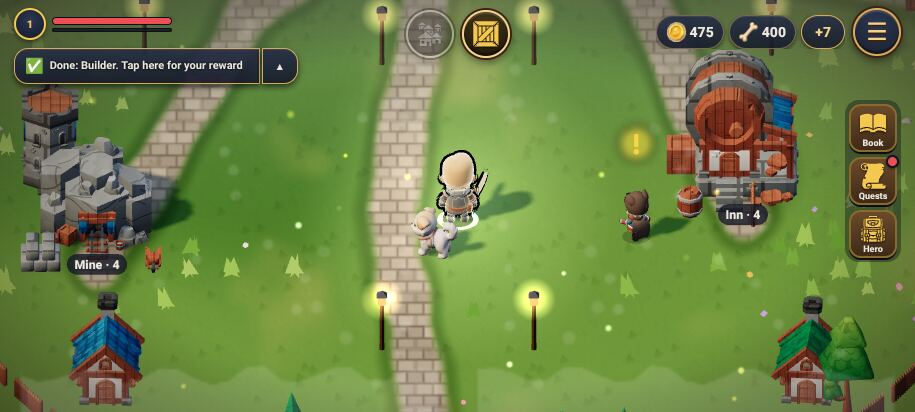
- P6: the quest strip "✅ Done: Builder. Tap here for your reward" is normal content, good. The `+7` chip next to the resources is unclear (what is 7?).
- P3: fine. Top center 2 round buttons, right rail 3, menu.

### Hero / gear (menu tab)
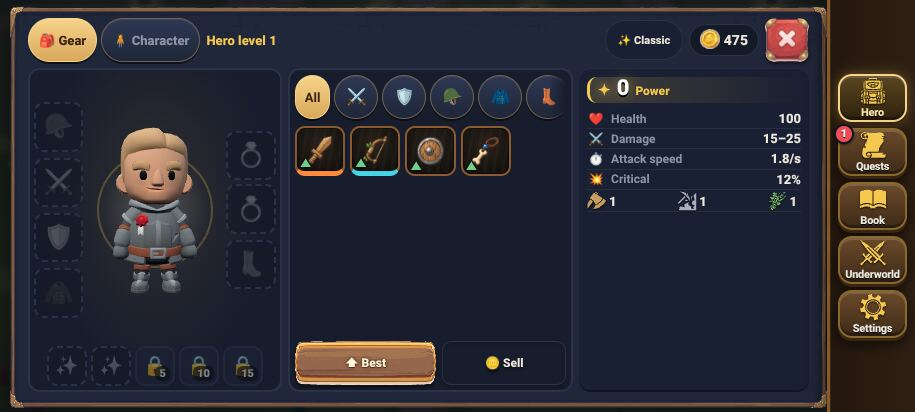
- P1 ✓ (menu backdrop).
- P2 ✓ partly: the filter chips row is cut at the right edge (the next chip peeks). The item grid has no peek when it fills.
- P3 ✗: 3 columns + 2 top tabs + 6 filters + Best + Sell + skin chip + coins = ~15 targets on the first look. Suggest: filters collapse to "All" + the slot you tapped on the doll (tap an empty slot = filter to it). One less row.
- P5: "Best" is the shortcut, good. Empty doll slots while Best is lit: Best could pulse once.

### Quests (menu tab)
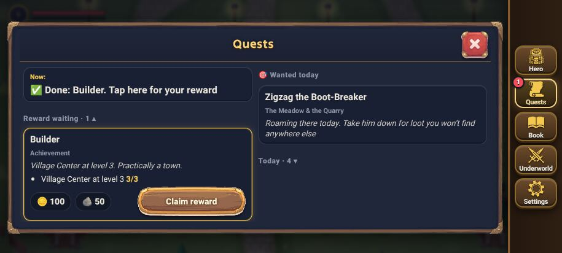
- P1 ✓.
- P3 ✗ duplicate: "Now: Done: Builder. Tap here for your reward" and the "Builder" card below say the same thing. When the "Now" quest is the waiting reward, hide the "Now" row.
- P2 ✗: sections collapse ("Today · 4 ▾"), so the window looks complete with 4 hidden quests. Show the first card of a collapsed section half-cut under its header.
- P4: quest chains (story `kind:'story'`) are listed as separate cards. Small numbered path "1 → 2 → 3" on story quests (later, not top 5).

### Adventure Book (menu tab)
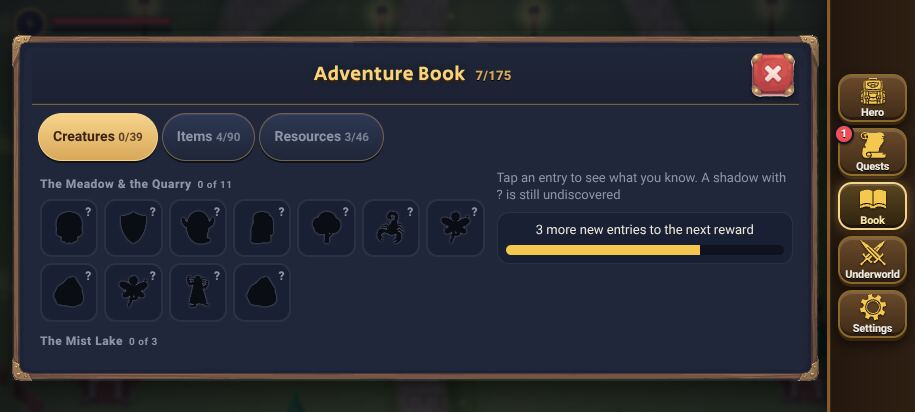
- P1 ✓, P2 ✓ (next region "The Mist Lake 0 of 3" peeks at the bottom). P3 ✓ 3 tabs. Model screen, nothing to do.

### Market (building window)
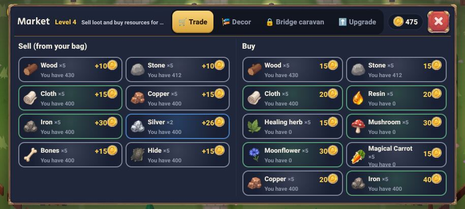
- P1 ✗ no backdrop (world shows at the corners; small effect since the panel covers ~95%).
- P2 ✗ **most important**: the Buy column ends exactly on a card edge (Copper/Iron), so you can't tell if there is more. Same for Sell.
- P3 ✗: 4 tabs + 18 cards. Each card repeats "You have N" (already shown on Sell). Buy cards could drop "You have".
- Text: header subtitle truncated "Sell loot and buy resources for …". Drop the subtitle in the market (the tab says Trade).
- **Names break (coordinator's find, 844×390):** item names can split mid-word ("Mushroo/m", "Moonflow/er"). Cause: `#vPanel.bw .tcard .nm{overflow-wrap:anywhere}` (css/bwin.css:71), which allows a break between any two letters once the column gets narrow. At 844 even when the break falls on a space, two-word names ("Healing herb", "Magical Carrot") take 2 lines and push "You have 0" against the card bottom:

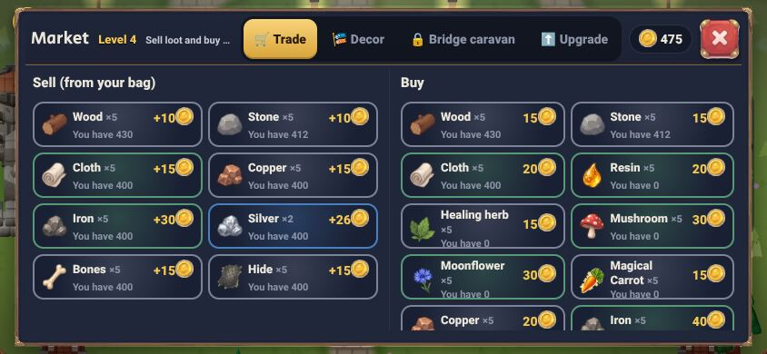

### Text rules for every card (new, from the market finding)
1. **Never break inside a word.** Names use `overflow-wrap:normal; word-break:normal; hyphens:none`. `anywhere` / `break-all` are not allowed on names (only on URLs/codes).
2. **A name gets max 2 lines**, then an ellipsis (`-webkit-line-clamp:2`), and the full name is in `aria-label`/the details view. A name that does not fit on 1 line at 844 is a sign the card is too narrow, not that the text should shrink.
3. **Card minimum width**: 150 px for a card with icon + name + price (the forge grid already uses `minmax(150px,1fr)`). Below that, the grid drops a column instead of squeezing.
4. **Fixed rows, not free flow:** icon | name (1–2 lines) | price on the right, `nowrap`; the secondary line ("You have N", "×5") is one line, `nowrap`, ellipsis. The card height is set for 2 name lines so cards in a row stay even.
5. **Sizes stay ui-guide §2:** name 13 bold, secondary 11, price 14. No text under 11 to make it fit.
6. **Bot check:** in every open window at 844×390, for each `.nm`, any line break whose previous character and next character are both letters = fail (Range `getClientRects` per character, or compare the word's width to its line). Also: no text box whose `scrollWidth > clientWidth` without an ellipsis.

### Sawmill: Output tab (building window)
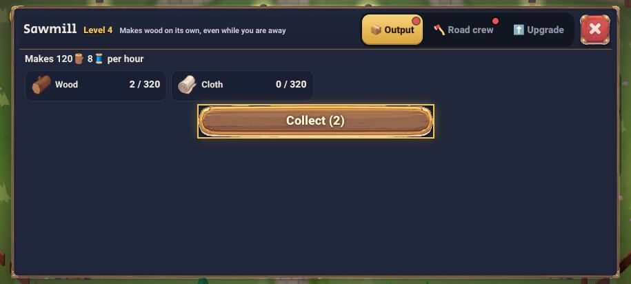
- P3: good, one button. But 2 red dots at once (Output + Road crew): ui-guide §6 says dots only where there is something to do; the crew dot shows even when you can't afford the stage? (verify when building).
- 60% empty panel: the window could be a "small task" size (ui-guide §4, 60–75% width) with the world dimmed around it.

### Sawmill: Road crew tab (crews, 3 stages)
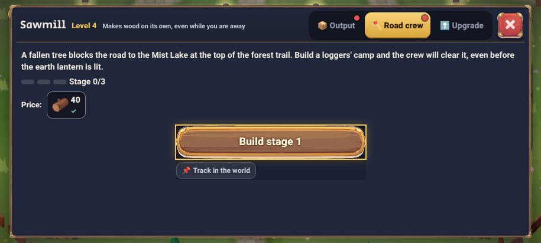
- P4 ✗ **the main case**: "Stage 0/3" as 3 grey pills, no names, the price of only the current stage, 3 lines of story text. Nir can't see where it leads.
- P5: "📌 Track in the world" is a second button under the main one; fine.
- Same component should serve the other 3 projects (`cutterShop`, `tunnelCrew`, `caravan` in `VPROJ.list`).

**Mockup (annotated screenshot, the only one):**
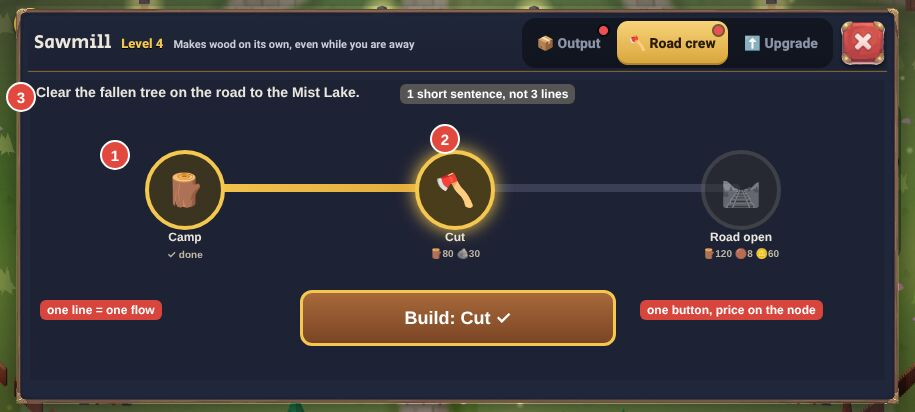
1. Three round nodes on one thick line: done (gold ✓), current (glowing), locked (grey). The line fills gold up to the current node.
2. The price sits under each node, so the whole road is visible; one "Build: Cut" button.
3. One short sentence instead of three lines of story (the story goes to the first time the tab opens).
Same toy language as the HUD: round gold rings like the skill button, wood button.

### Forge (building window)
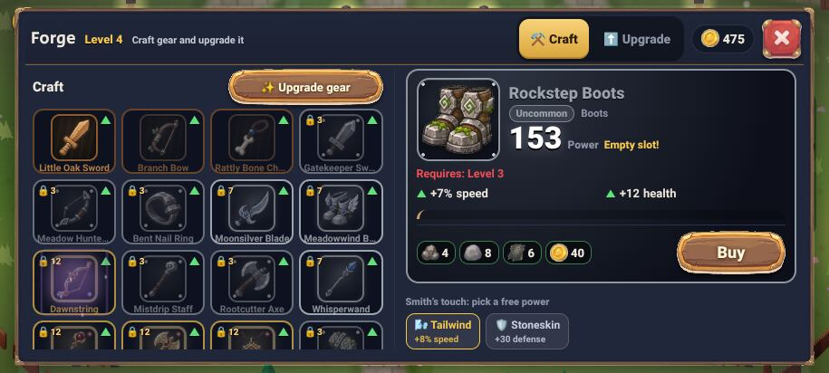
- P2 ✓ (4th row peeks). P3 ✗ 2 tabs + "Upgrade gear" + 16 cards + detail + 2 power chips.
- Clarity: "Requires: Level 3" in red next to an active "Buy". It is the level to **wear** (`itemroll.js:44`), not to buy, so it is not a bug, but it reads like one. Say "Wear at Level 3".

### Village Center (building window)
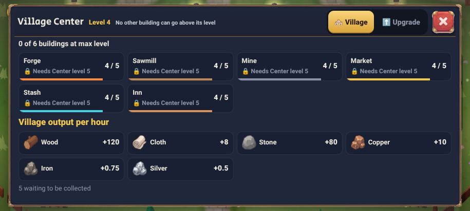
- P3 ✗: "🔒 Needs Center level 5" repeated on all 6 building cards. One line on top ("All buildings are capped by the Center. Upgrade it →") and the cards show only "4/5".
- P4: the progress bars per building are good; the Center itself could show its own path (levels 1→5 as nodes, same component as crews).

### Settings (menu tab)
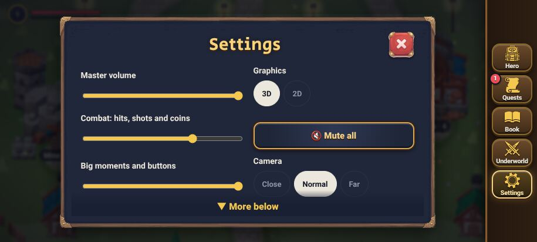
- P1 ✓. P2 ✓ already has "▼ More below". P3 fine. Could swap the text arrow for a real peek, low priority.

### NPC talk
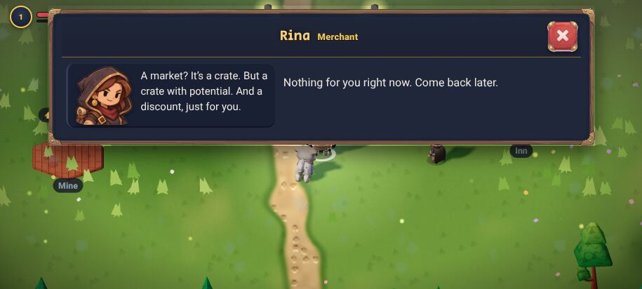
- P1 ✗: no dim at all; the bright world competes with the text. ui-guide §4 asks 50–60% for a small task. Suggest a lighter dim (40%) so the NPC behind is still seen.
- P5 ✓ short.

### World HUD and Map
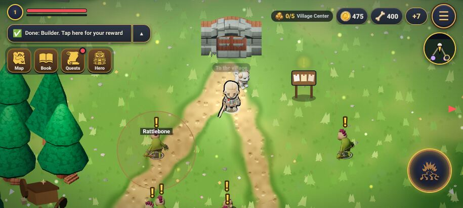
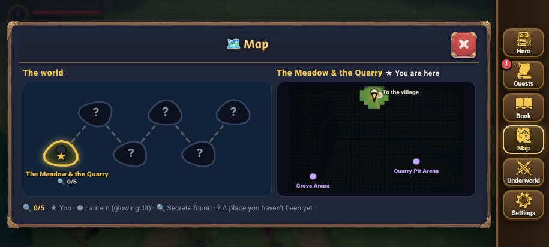
- World HUD: P3 fine. The quest strip has a ▲ toggle next to it: unclear.
- Map: P1 ✓, P4 ✓ (regions joined by a dashed line: the exact pattern Nir asked for; reuse it for crews). Legend line at the bottom is long; fine.

### Ad-like notices (P6)
The welcome/daily windows (`#ovWelcome`, `#ovDaily`) and "How to play" open as full popups on entry, the most ad-like pattern in the game. Not screenshotted (my script closes them to reach the windows). Suggest later: show them as a card in the Quests tab / a dot on the menu, not a popup. Needs Nir's taste, so not in the top 5.

## 4. Top 5: value / effort

| # | Change | Value | Effort | Files |
|---|---|---|---|---|
| 1 | **Peek in every list**: list areas end on a half row + a soft fade at the bottom (market Buy/Sell, gear grid, quest collapsed sections, center cards) | High (P2, also catches clipped buttons) | Low: CSS on the scrolling containers, one shared class | css/style.css, quests.js (collapsed section shows 1 card) |
| 2 | **Stages on a line** for the 4 village projects (mockup) | High (P4, the new crews feature) | Medium: one render function in vproj.js, used by `vpBldTab` and `vpTab` | js/vproj.js, css |
| 3 | **Dim behind talk and building windows** (`#npcDlg` 40%, `#vPanel` 55% like `.gearov`) | Medium (P1) | Very low: 2 CSS rules (a `body:has(...)` backdrop) | css/style.css |
| 4 | **Cut repeats**: Center "Needs level 5" ×6 → 1 line; hide quest "Now" row when it is the waiting card; market Buy cards without "You have"; no market subtitle | Medium (P3) | Low | bwin.js, quests.js, lang.js (en only) |
| 4b | **Text rules for cards** (no mid-word breaks, 2-line clamp, min card width 150): fixes the market names | Medium–high (looks broken today) | Very low: css/bwin.css:71 + a clamp; bot check | css/bwin.css, tools/check.js |
| 5 | **Claim from the strip**: tapping "✅ Done: X" claims the reward right there (coins fly to the counter), no window | Medium (P5, the most repeated tap in the village) | Low–medium: `questAct` already exists | quests.js |

Order: 3, 1 and 4b first (CSS, one session, no conflicts), 2 in its own session (vproj.js), 4 and 5 together (quests.js + bwin.js). 2 does not touch the same files as 1/3 except CSS sections, so they can run in parallel.

Bot check for each: 1: a list element whose last child is fully visible while `scrollHeight > clientHeight` = fail. 2: the crews tab has 3 nodes and 2 line segments. 3: computed backdrop under `#npcDlg` and `#vPanel` is not transparent. 5: tapping the strip raises coins and closes the quest.

## 5. Self-review

1. **Does this answer what Nir asked?** Yes, all 6 principles checked on every main window in village + world, with a screenshot each, top 5 by value/effort, and one mockup. P6 (ad-like) got only a note, because the popups are a taste question for Nir, not a fix.
2. **What did I miss?** (a) The inn, stash and mine windows were not shot separately; they use the same `bwBuilding` frame as the mill, so the same findings apply. (b) Windows with a long list (late-game bag with 60 items) were not tested; the peek rule matters more there. (c) The toy look on the panels themselves (flat navy cards vs. chunky toy cards) is a bigger visual job, left for a separate concept after look v2 lands. (d) The 10th time: "claim from the strip" must not claim by accident while walking; tap target stays the existing strip, no swipe.
3. **Code check:** dim values read from css/style.css (`.ov`, `.gearov`, `.menubg`, no backdrop on `.qlog` and `#vPanel`); the forge "Requires" is the wear level (`itemroll.js:44`), not a buy lock; the 3 stages + prices come from `VPROJ.list` and need no data change. Risk: #2 changes a tab another session may touch (village region crews part 2); start it after those PRs merge.
