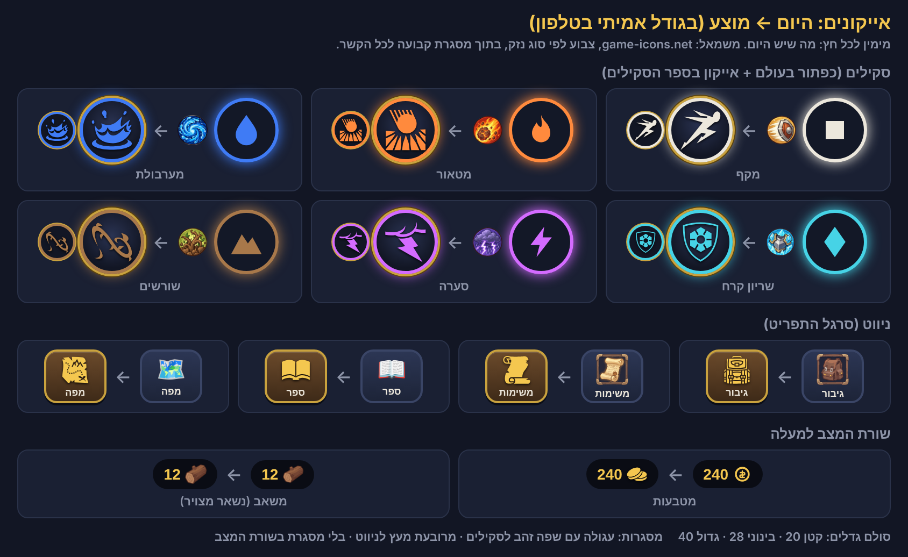

# קונספט: אייקונים אחידים מ-game-icons.net

ניר, 7.11.2026: "אני לא מרוצה מהאייקונים שלנו היום. הגודל לא מרגיש נכון, והם לא מרגישים חלק מנושא אחד."
מסמך לאישור לפני שבונים (כלל 15: קודם קונספט). אין כאן שינוי בקוד המשחק.

## 1. מה יש היום (הבדיקה)

**ארבעה סגנונות שונים לאותו דבר:** תמונה מצוירת (PNG), אימוג'י, קו דק (SVG), וצורה גאומטרית.
**יותר מ-13 גדלים שונים.** הדוגמאות הבולטות:

- **כפתור סקיל בעולם (66, הראשי 84):** בפנים רק סמל סוג הנזק (ריבוע, להבה, טיפה) ב-34 או 40. לכן שני סקילים של אש נראים אותו דבר. הציור של הסקיל לא מופיע בכלל על הכפתור.
- **אותו סקיל בספר ובעץ:** ציור PNG ב-28, ובכותרות 1.4em (בערך 20). בזירה הציור ממלא את כל העיגול. כלומר סקיל אחד מופיע בשלוש צורות.
- **סרגל התפריט:** "גיבור" ו"משימות" ציור PNG ב-30, ו"ספר", "מפה", "זירה", "הגדרות" אימוג'י ב-22. ארבעה כפתורים ליד שניים, בשני סגנונות ובשני גדלים.
- **קיצורים בצד (48):** אימוג'י ב-20 עד 24.
- **שורת המצב:** מטבעות בקו דק ב-18, וכפתור ציוד באימוג'י ב-16.
- **משאבים:** 9 גדלים שונים: 16, 19, 22, 24, 26, 30, 32, 42 ו-70% מהמשבצת.
- **סקילים קטנים:** לחש 22, אולטימטיבי 30, ברכה 30, רשימת ספר 22.
- **נשקים (`ICON` ב-combat.js):** 3 ציורי קו דק.
- **דיוקנאות תושבים:** PNG ב-84 (בסדר, זה דיוקן ולא אייקון).

## 2. המערכת המוצעת: מראה אחד

**הצורה:** צללית מלאה מ-game-icons.net (יותר מ-4,000 אייקונים, כולם באותו קו). צבע אחד, בלי פרטים קטנים, ולכן קריא גם ב-20 פיקסלים.

**הצבע:** לפי הכלל הקיים. סקיל ונשק בצבע סוג הנזק. זהב לשלל, למטבעות ולניווט.

**מסגרת אחת לכל הקשר:**
- **סקיל:** עיגול כהה, שפה בצבע סוג הנזק, וטבעת זהב דקה מסביב. אותה מסגרת בגדול על הכפתור ובקטן בספר ובעץ. כך כל סקיל נראה אותו דבר בכל מקום.
- **ניווט:** ריבוע עץ עם שפת זהב, צללית זהב (הסגנון של `icons/ui/res` ושל #75).
- **שורת המצב:** בלי מסגרת, צללית זהב על הכדור הכהה שכבר קיים.

**סולם גדלים: שלושה בלבד** (בפיקסלים של המסך, 844x390):
- **קטן 20:** בתוך טקסט, שורת המצב, רשימות, משאבים בשורה.
- **בינוני 28:** ניווט, משבצות בספר ובעץ, משאב במשבצת.
- **גדול 40:** בתוך כפתור סקיל (66, וגם בראשי 84).

**מה נשאר מצויר:** הציוד (`icons/ui/gear`), המשאבים (`icons/ui/res`), הדיוקנאות (`icons/ui/npc`) ותיבת היומי. אלה חפצים ודמויות, והציור שלהם טוב. הם רק עוברים לסולם הגדלים (במקום 9 גדלים, שלושה).
**מה מתחלף:** סקילים (כפתור, ספר, עץ), סרגל התפריט והקיצורים, שורת המצב, ונשקים (`ICON`).
**הזירה:** של אוראל. לא נוגעים. אם ירצה, אותה מערכת מוכנה בשבילו.

**איך זה ייבנה (בקצרה):** קובץ נתונים אחד `js/gicons.js` עם הצורות כטקסט (כי מ-`file://` אי אפשר לטעון קבצים), ופונקציה אחת `gIco(שם, גודל, צבע)`. סקיל חדש = שורה אחת עם שם אייקון. החלפת סגנון בעתיד = מקום אחד.

## 3. האייקונים בדוגמה

| במשחק | אייקון | יוצר |
|---|---|---|
| מקף (פיזי) | sprint | Lorc |
| מטאור (אש) | meteor-impact | Lorc |
| מערבולת (מים) | water-splash | Lorc |
| שריון קרח (קרח) | ice-shield | Lorc |
| סערה (ברק) | lightning-storm | Lorc |
| שורשים (אדמה) | vine-whip | Lorc |
| גיבור | backpack | Delapouite |
| משימות | scroll-unfurled | Lorc |
| ספר | open-book | Lorc |
| מפה | treasure-map | Lorc |
| מטבעות | two-coins | Delapouite |

## 4. קרדיט

הרישיון (CC BY 3.0) מחייב שם יוצר, קישור לרישיון, ולציין ששינינו (צבע ומסגרת).

- **בהגדרות:** שורה קטנה בתחתית, "קרדיטים", שפותחת את הטקסט. נכנסת ל-lang.js בעברית ובאנגלית.
- **בריפו:** `docs/credits.md` עם רשימת כל האייקונים והיוצרים (נוצרת אוטומטית מהקובץ `js/gicons.js`).

הטקסט המדויק:

> Icons by Lorc, Delapouite and other contributors from game-icons.net, licensed under CC BY 3.0 (https://creativecommons.org/licenses/by/3.0/). Colors and frames were changed.
>
> אייקונים: Lorc, Delapouite ויוצרים נוספים מ-game-icons.net, ברישיון CC BY 3.0. הצבעים והמסגרות שונו.

## 5. כמה עבודה

שני PRs, סשן אחד, בערך 2 עד 3 שעות עבודה של Claude:
1. **המערכת + סקילים:** `js/gicons.js`, כלי שמעתיק את האייקונים שנבחרו מהריפו של game-icons, כפתורי הסקילים בעולם, ספר הסקילים והעץ (כ-40 סקילים).
2. **ניווט, שורת המצב, נשקים, סולם הגדלים לציור הקיים, וקרדיטים.**

משקל: כ-60 אייקונים, כ-100KB טקסט. לא מורגש בטעינה.

## מה לא חשבת עליו

- **סקיל בלי אייקון מתאים:** לרוב יש. אם לא, צללית קרובה, ושם האייקון נרשם ליד הסקיל כדי להחליף בקלות.
- **הציורים מ-Creative Claw לסקילים** (`icons/ui/skills`) יוצאים משימוש בעולם. לא מוחקים אותם: הזירה עדיין משתמשת בהם.
- **לחיצה בזמן טעינה:** היום האייקון דוהה. נשאר אותו דבר, עם אותה צללית.
