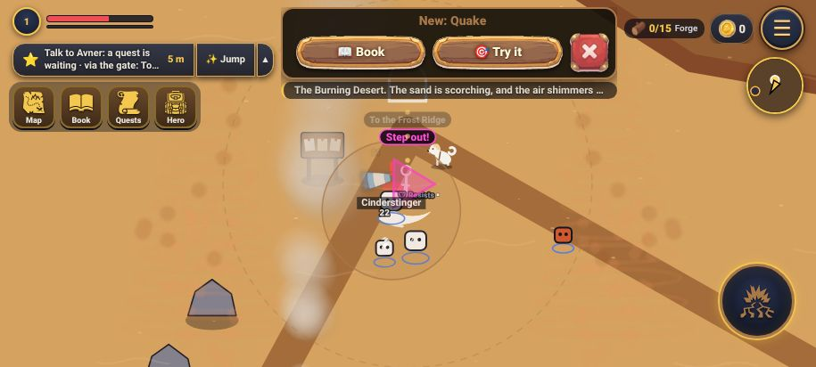

# קונספט: עולם חי (משימה ב, 11.11.2026)

אווירה לפי אזור מחבילות Mochi, דרך `fxPlay`. **רק בעולם ובכפר** (הזירה של אוראל). מסמך קונספט, בלי קוד.

## הממצא החשוב: רוב זה כבר קיים

כל חמשת הדברים מהרשימה נבנו ב-7.11 (#433, #453), ב-`js/fxworld.js` וב-`js/wxworld.js`:

- **מדבר:** אבק נמוך (`wx_dust`), עמודי אבק (`wx_devil`), וסערה עם טורנדו (`wind_tornado`).
- **סערה:** גשם כבד תמיד, וברקים עם הבזק (`wx_flash`).
- **רכס:** שלג, ומשב של סופת שלג (`wx_blizzard`).
- **יער:** קרני אור ביום (`lr_forest`) ופטריות זוהרות בלילה.
- **מים:** התזה בהליכה במים רדודים (`hit_water`), טיפות לאורך החוף, גלים, ודג קופץ באגם (`wt_jump`).

**הבעיה: כמעט לא רואים את זה.** הצילום הוא המדבר באמצע סערה (מצב `storm`), בדו-ממד, 915x412:

רואים רק שני עמודי אבק חלשים בצד, והמסך נקי לגמרי. לא מרגישים סופת חול.
**לכן המשימה היא לכוונן ולהוסיף רגעים, לא לבנות מערכת.** זה זול יותר וגם בטוח יותר.

## מה משנים, לפי אזור

כל אפקט: הנכס של Mochi, מתי ואיפה הוא מופיע, ובאיזו עוצמה (שקיפות, 0 עד 1).

### 1. סופת חול במדבר (החזק ביותר, מתחילים בו)
- **נכס:** `weather_wind_dust` (dusk) כשכבה נמוכה, ועוד `weather_wind_gust` (קווי רוח לרוחב). הגוון החולי כבר בקובץ.
- **מתי:** במצב `storm` של המדבר (25 עד 45 שניות, בערך פעם ב-2 עד 3 דקות). ב-`building` רק קווי רוח.
- **עוצמה:** 0.45 בשוליים, ו-0.15 בעיגול של כ-160 פיקסלים סביב הגיבור. ככה הסערה בשוליים והקרב באמצע נקי.
- **מקום:** שכבה אחת על כל המסך (לא אריחים נוספים), לכן זה לא מוסיף עלות.

### 2. ברקים בסערה
- **קיים וטוב.** משנים רק דבר אחד: ברק אווירה מופיע **רק רחוק** (בשמיים או בקצה המסך), ולא קרוב לגיבור.
- **למה:** בנהר הברקים (`storm-river.js`) יש ברקים **שפוגעים**, עם עיגול אזהרה. ברק של אווירה ליד הגיבור יבלבל בין "יפה" ל"תזוז!".
- **עוצמה:** הבזק עד 0.25 (היום 0.32). כשמבקשים פחות תנועה, אין הבזק (כבר קיים).

### 3. שלג נושב ברכס
- **נכס:** `weather_wind_gust` (arctic) עם `weather_snow_heavy`, באותו כיוון, כך שהשלג נראה עף הצידה ולא רק נופל.
- **מתי:** משב פעם ב-6 עד 12 שניות (קיים), ובמצב `storm` כל הזמן.
- **עוצמה:** 0.5 במשב ו-0.35 ברגיל. `snow_blizzard` נשאר רק לסערה, כי הרקע האפור שלו מכסה את הקרקע.

### 4. קרני אור ביער
- **נכס:** `god_quintet` (sunlight) ביום, `god_window` (twilight) בזריחה ובשקיעה, ו-`god_single2` (moonlight) בלילה. היום משתמשים רק ב-`lr_forest`.
- **מקום:** **קבוע בקרחות** בשולי היער, נקודות אמיתיות במפה ולא מקום אקראי במסך. ככה עוברים דרך הקרן, וזה מרגיש כמו מקום.
- **עוצמה:** 0.35, אור מוסף (`add`), עד שתי קרניים במסך.

### 5. מים: התזות ודגים
- **התזה:** `splash_corona` (ocean) כשרצים במים רדודים, במקום `splash_small` בכל צעד. פעם ב-2 צעדים, גודל 58.
- **דג קופץ:** היום רק באגם. מוסיפים גם **לנהר באחו**: `wt_jump` פעם ב-10 עד 18 שניות, רק במים שבמסך.
- **כפר:** בלי שינוי. הכפר כבר נעים (עלי כותרת, גשם קל וקשת).

## כללים לכל האפקטים

- **לא מסתירים אויבים, אזהרות או את הגיבור.** שכבת מזג האוויר מצוירת **מתחת** לאפקטי הקרב (כבר ככה, `wxDraw`). בעיגול סביב הגיבור העוצמה יורדת. **בקרב** (`LABELS.fight`) כל האווירה יורדת לחצי.
- **פחות תנועה:** כשהטלפון מבקש פחות תנועה, או ב-⚙️ ← אפקטים ← "Fewer": אין הבזקים ואין משבים, ונשארת שכבה אחת חלשה.
- **120FPS אצל ניר:** לכל היותר **שכבה אחת על כל המסך** בעולם, ועוד עד 2 אפקטים קטנים במקום. הכל בתוך המגבלות שכבר קיימות (`FXW.cap` 24, `WEATHER.max` 3). מודדים עם `tools/perf.js` לפני ואחרי.
- **נכסים:** כבר במשחק: `wx_wind_dust_dusk`, `wx_wind_gust_arctic`/`temperate`, `wx_snow_heavy_arctic`, `wt_jump`. **חסרים** (צריכים שורה ב-`tools/fx-list.json` והמרה אצל אוראל, כי החבילות לא בריפו): שלושת ה-`god_*`, `splash_corona`, ו-`wind_gust_dusk` (או שהמדבר משתמש ב-`temperate` שכבר קיים).

## סדר הבנייה

1. סופת חול (החזק ביותר, ובו רואים אם זה עובד).
2. ברקים רחוקים ושלג נושב (רק מספרים בקוד).
3. דג בנהר (הגיליון קיים), ואז קרני אור ביער והתזות בריצה (אחרי שאוראל ממיר את הגיליונות).

כל זה ב-`fxworld.js` וב-`wxworld.js`. לא נוגעים ב-`world.js` או ב-`render3d.js`.

## ביקורת עצמית

1. **האם זה עונה על מה שניר ביקש?** כן, ויותר מזה: ניר ביקש עולם חי, ובפועל הוא כבר קיים אבל לא מורגש. בלי הממצא הזה היינו בונים את אותם אפקטים פעם שנייה.
2. **מה פספסתי או חסר?**
   - ברק אווירה ליד נהר הברקים מתבלבל עם סכנה אמיתית. לכן ברקים רק רחוק.
   - בפעם העשירית: סופה קבועה מעייפת. לכן היא רק 25 עד 45 שניות בכל 2 עד 3 דקות.
   - **תלת-ממד לא נבדק:** הצילום בדו-ממד. בבנייה צריך צילום אחד בתלת-ממד, כי שם האפקטים אולי חלשים עוד יותר.
   - חמישה גיליונות חדשים תלויים באוראל (המרה). סופת החול, הברקים, השלג והדג לא תלויים בו.
3. **בדיקה בקוד:** הכל קיים ב-`fxworld.js` (`FXW.scene`, `wet`, `jump`, `gust`) וב-`wxworld.js` (`WXW.scene`). פחות תנועה (`RM`) ו"Fewer" (`fxLess`) כבר מחוברים. הסיכון: אפקט גדול על כל המסך מוריד FPS, ולכן הכלל "שכבה אחת".
