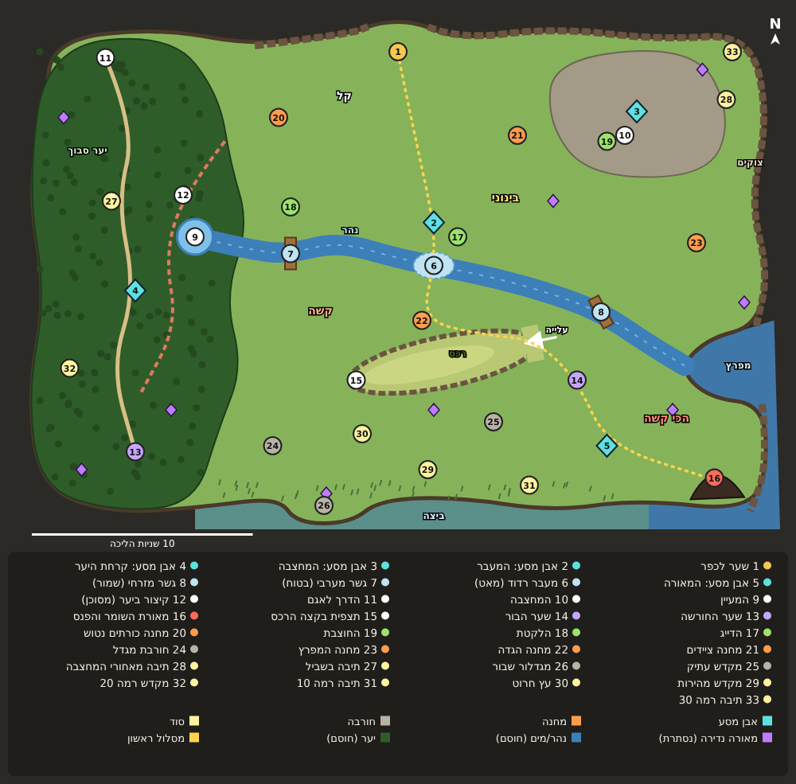

# קונספט: האחו החדש (משימה ת6, שלב 2)

ניר, 5.11.2026: "להגדיל את העולם הפתוח, להוסיף טופוגרפיה: גבעות, נחלים, יערות... ולא סתם אזור בצורת ריבוע". ואחרי הגרסה הראשונה: "הייתי שמח שמפת העולם תהיה ממש גדולה, משהו שלוקח זמן להגיע מקצה לקצה".
התוכנית המלאה: [plan-world-terrain.md](plan-world-terrain.md). זה רק שרטוט לאישור, בלי קוד.

## הרעיון בשורה אחת

**גדול, אבל אף פעם לא ריק.** הנהר הוא קו הקושי: מצפון לו אחו פתוח ליד השער, ומדרום לו הרכס, שערי הזירה והמאורה של השומר. במערב יער שעוברים בו רק בשביל. ארבע אבני מסע מקצרות את הדרך מהפעם השנייה.

## הגודל

- היום 2100×1400. החדש **6300×4200, פי 3 בכל צלע** (פי 9 בשטח).
- השחקן הולך 185 פיקסלים בשנייה (`MOVE.speed` ב-state.js). מקצה לקצה בקו ישר: כ-35 שניות. עם עקיפה של נהר ויער: כדקה.
- **33 מקומות ממוספרים ועוד 9 מאורות נסתרות**, לעומת כ-12 היום. בממוצע יש משהו כל 4-5 שניות הליכה, כלומר 10-15 שניות כשנלחמים בדרך.

## אבני מסע (2-5 במפה)

- ארבע אבנים: ליד המעבר, במחצבה, בקרחת היער וליד המאורה.
- אבן נפתחת כשמגיעים אליה ברגל, עם חגיגה קטנה (`celebrate`).
- אבן פתוחה מאפשרת לקפוץ לכל אבן פתוחה אחרת, וגם מהכפר (כפתור ליד השער).
- אין אבן ליד השער, כי השער עצמו הוא נקודת הכניסה. אין אבן בתוך המאורה: את המטר האחרון לשומר הולכים ברגל.
- הפעם הראשונה מרגישה עצומה, והעשירית קצרה.

## מה כל מקום

**מסלול ראשי ומעברים:** 1 שער לכפר. 6 מעבר רדוד (הדרך הישרה, מאט). 7 גשר מערבי (בטוח, ארוך). 8 גשר מזרחי (קרוב למאורה, שמור). 9 המעיין שבו הנהר מתחיל, בתוך היער.

**מקומות גדולים:**
- 10 המחצבה (סלעים, נחושת, ברזל).
- 11 הדרך לאגם, בתחילת שביל היער, עם בול העץ ושלט "רמה 5".
- 12 קיצור ביער: חוצה את היער הסבוך, עם עצים מהלכים ורוחות.
- 13 שער החורשה ו-14 שער הבור (הזירה).
- 15 תצפית בקצה המערבי של הרכס.
- 16 מאורת השומר והפנס, במערה בצוק הדרום-מזרחי, הכי רחוק מהשער.

**דמויות:** 17 הדייג על גדת הנהר. 18 הלקטת ליד הגשר המערבי. 19 החוצבת במחצבה.

**חדשים, כדי שלא יהיה ריק:**
- מחנות אויבים: 20 מחנה כורתים נטוש (הפינה הריקה בין השער ליער), 21 מחנה ציידים, 22 מחנה הגדה ו-23 מחנה המפרץ.
- חורבות: 24 חורבת מגדל (הפינה הדרום-מערבית), 25 מקדש עתיק מתחת לרכס, ו-26 מגדלור שבור בקצה הלשון שנכנסת לביצה.
- מחנה הוא קבוצת אויבים חזקה עם תיבה. חורבה היא מקום לאירוע או סוד.

**סודות (secrets.js):** 27 תיבה בשביל היער, 28 תיבה מאחורי המחצבה, 29 מקדש מהירות, 30 עץ חרוט (אוצר קבור), 31 תיבה רמה 10 בשולי הביצה, 32 מקדש רמה 20 ביער העמוק, ו-33 תיבה רמה 30 על מדף בצוק.

**מאורות נדירות (◆ סגול, משימה ת8):** 9 מקומות נסתרים, 2-3 לכל מפלצת נדירה. אין חץ ואין סימון במפה עד שמוצאים. הם ביער העמוק, בסדק במחצבה, בקני הסוף בלשון, בחוף המפרץ ומאחורי הרכס.

**מה שלא על המפה:**
- הנמסיס, הסודות של פיוחו והמבוקש מופיעים ליד קבוצות אויבים או ליד השחקן, אז הם עוברים לבד, בתנאי שהבדיקה "לא בתוך מים או יער" (שלב 3) חלה גם עליהם.
- עומק הצל (depths.js) בונה קומות מהמקומות של הקבוצות, ולכן גם הוא עובר לבד.

## הצורה: לא מלבן

- **צפון:** צוקים עם בליטות, והשער בשקע ביניהם.
- **מזרח:** צוקים, ו**מפרץ** שנכנס פנימה. הנהר נשפך אליו.
- **דרום:** ביצה, ו**לשון יבשה** שנכנסת לתוכה עם המגדלור השבור בקצה.
- **מערב:** יער סבוך עד הקצה.

## מה כל מכשול עושה במשחק

- **נהר:** חוסם. עוברים בשני גשרים, במעבר הרדוד (חצי מהירות), או סביב המעיין דרך שביל היער.
- **יער סבוך:** חוסם, חוץ מהשביל והקיצור. מסתיר: אויב מבחוץ לא רואה אותך כשאתה בפנים.
- **רכס:** מוארך, וצוק מכל הצדדים. **עולים רק מהקצה המזרחי** (החץ הלבן), והולכים לאורכו עד התצפית בקצה המערבי. מלמעלה רואים את כל המקורות באזור.
- **צוק:** הגבול בצפון ובמזרח. חוסם לגמרי.
- **ביצה ומפרץ:** מים עמוקים חוסמים, ושוליים רדודים מאטים.

## המסלול הראשון (הקו הצהוב)

1. יוצאים מהשער (1) לאחו פתוח וקל. קרב ראשון בדרך.
2. אבן המסע הראשונה (2), עם הדייג (17) לידה. מכאן אפשר לחזור לכאן תמיד.
3. **ההחלטה הראשונה:** המעבר הרדוד (6), שהוא ישר אבל איטי ויש בו רוחות, או אחד הגשרים.
4. מעבר לנהר הכל קשה יותר. מחנה הגדה (22), ואז העלייה לרכס. אפשר לעלות לתצפית או להמשיך.
5. ליד שער הבור (14) ממשיכים לאבן המאורה (5), ומשם ברגל למאורה (16).

**כ-28 שניות הליכה נקייה, ו-4-5 דקות עם הקרבות.**

## קושי

לפי המרחק מהשער, כמו `zones` היום, רק בקנה מידה של המפה:
- **קל:** עד 1100.
- **בינוני:** עד 2000. בערך עד הנהר.
- **קשה:** עד 3200.
- **הכי קשה:** מעבר לזה. המאורה, היער העמוק בדרום-מערב והלשון.

השחקן רואה את הקווים: הנהר, ואחר כך הרכס.

## ביצועים בעולם גדול

היעד: 120 FPS בטלפון של ניר.

- **הקרקע:** היום היא נאפית לתמונה אחת בכניסה (ground.js, `res:2.5`). במפה החדשה זו תמונה של כ-2700×1900, וזה עוד עובד. אבל כל חידוד או הגדלה נוספים שוברים את זה. לכן **מחלקים לאריחים** (למשל 4×3), אופים רק את האריחים שליד השחקן, ומשחררים את הרחוקים.
- **חפצים:** עצים, סלעים ומקורות מצוירים רק במרחק של כמסך וחצי מהמצלמה. העצים במופע אחד (instancing), כי ביער יהיו מאות.
- **אויבים:** קבוצה רחוקה ישנה ולא חושבת. היא נוצרת רק כשמתקרבים, כמו `far` היום, ובפעם הראשונה גם האויבים עצמם.
- **חיפוש דרך:** רשת של 40 פיקסלים, כ-16 אלף משבצות. מחשבים פעם אחת בכניסה לאזור, ולא בכל פריים.
- **מדידה:** כלי ה-FPS מ-#336 רץ על המסלול הראשון בכל שלב, לפני מיזוג.

## ביקורת עצמית

- **האם זה באמת לא ריבוע?** כן, בשרטוט: מפרץ, לשון, יער עד הקצה ובליטות. בתלת-ממד זה יחזיק רק אם הצוקים והעצים בקצה צפופים וגבוהים מספיק כדי להסתיר שיש קצה.
- **איפה עלול להיות ריק:** המרכז-מזרח שבין המחצבה לנהר (ליד 23), והדרום-מערב שבין היער לרכס. שתי הפינות הקודמות קיבלו מחנה (20) וחורבה (24), אבל צריך לבדוק ברגל אחרי הבנייה.
- **איפה מבלבל:**
  - הנהר מתחיל במעיין, ואפשר לעקוף אותו דרך היער. זה מכוון, אבל המעיין צריך להיראות כמו מקום.
  - הרכס עם עלייה אחת: שחקן ינסה לעלות מצד אחר. הצוק צריך להיראות כמו צוק, וגם השביל בעלייה צריך להיראות.
- **השומר זז מהמחצבה למאורה.** זה נוגע ב-story.js וב-giant.js, שסשן אחר עובד עליהם עכשיו. בונים את זה רק אחרי שהעבודה שלו נכנסה.
- **הכי מסוכן לבנות:**
  1. חסימה וחיפוש דרך: הבוט, האויבים, פיוחו והמבוקש הולכים היום בקו ישר.
  2. הגודל: פי 9 בשטח, אז כל דבר שרץ על כל העולם בכל פריים יאט.

  לכן שלב 3 (מנוע המפה) נבנה ונמדד לפני שמוסיפים את המקומות.
- **גם מפת העולם (worldmap.js) ומיני-מפה** צריכות להתעדכן, אחרת השחקן ילך לאיבוד במפה כזו.
- **מה לא נכנס:** סוג נזק מים ליד הנהר, מפל, ומזג אוויר.

## מחכה לניר

ניר אישר את הכיוון (5.11), עם קנה מידה גדול, אבני מסע, קו חיצוני לא ישר, רכס, ומילוי הפינות. השרטוט הזה מיישם את כל אלה. אחרי מבט אחרון: שלב 3, מנוע המפה.
