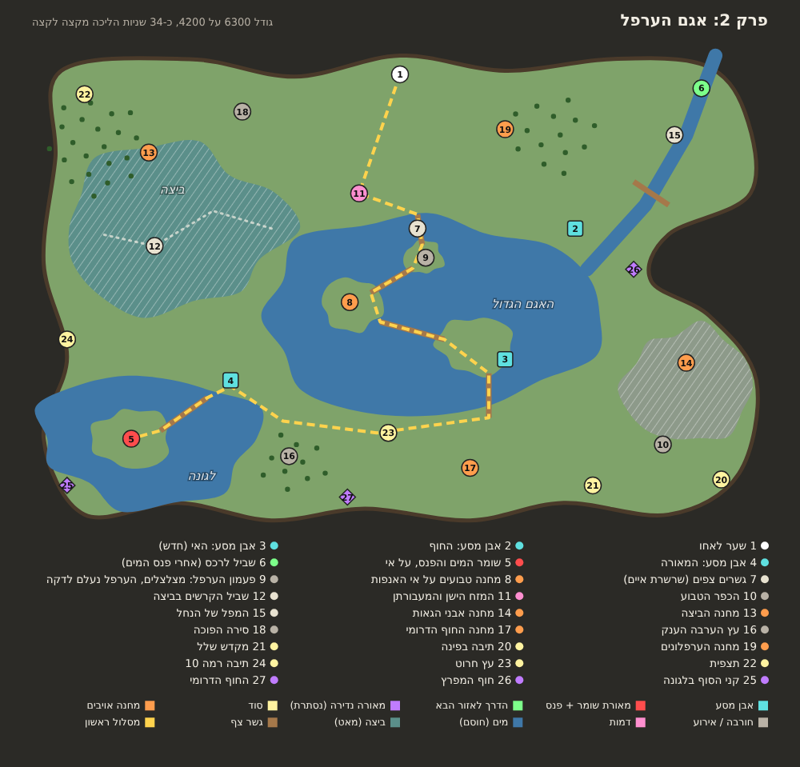
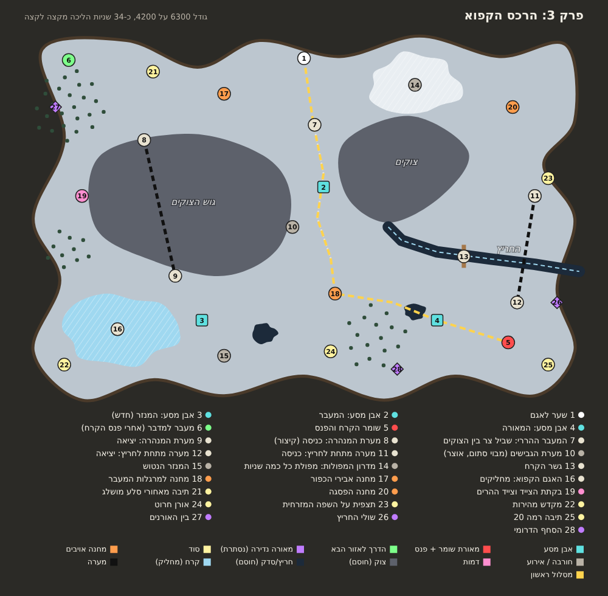
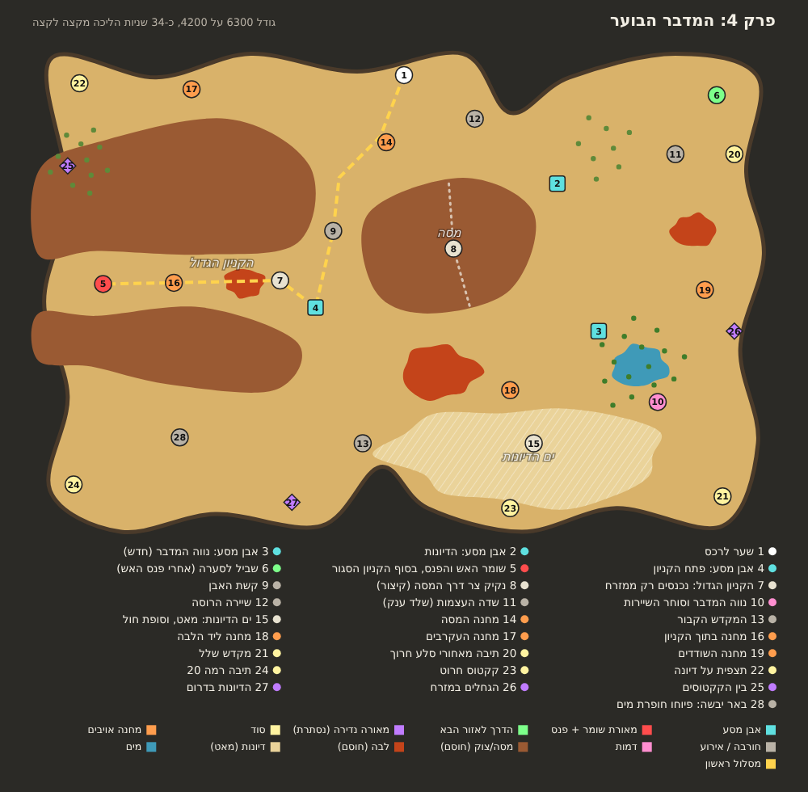
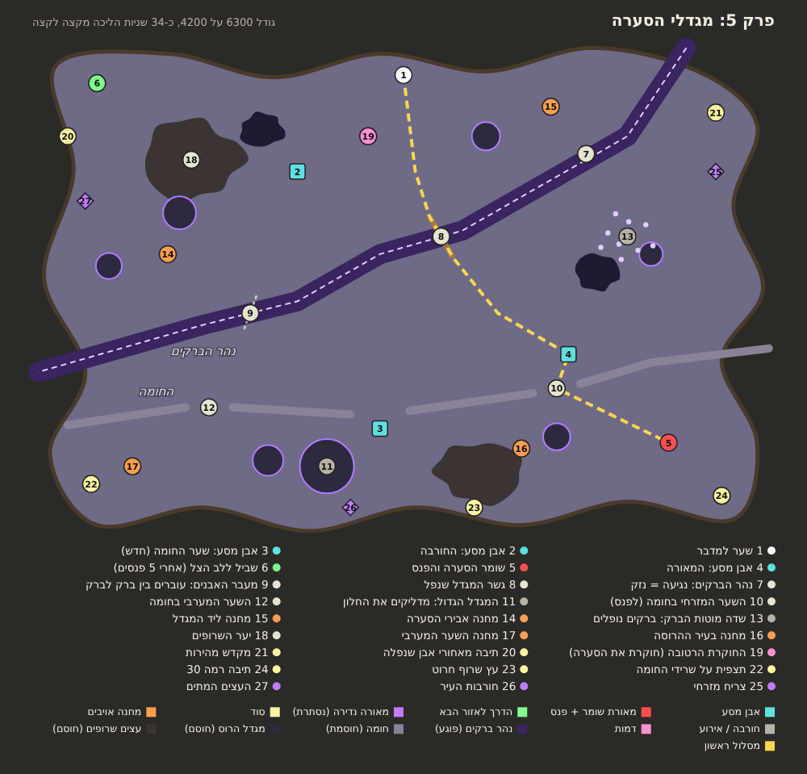
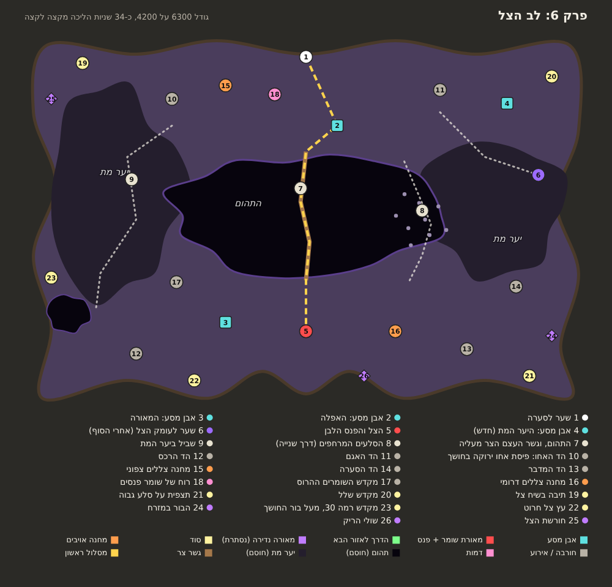

# קונספט: חמשת האזורים הגדולים (משימה ת14)

ניר רוצה עולם ענק ו-30-40 שעות משחק ([plan-longevity.md](plan-longevity.md), [plan-world-terrain.md](plan-world-terrain.md) שלב 6). המדידה ([playtime-2026-11-05.md](playtime-2026-11-05.md)) מראה שכל אזור היום קצר מדי.
זה רק שרטוט לאישור, בלי קוד. אותה שיטה כמו [האחו](concept-meadow.md).

## מה משותף לכל החמישה

- **גודל:** 6300×4200, כמו האחו (היום 2100×1400). פי 9 בשטח.
- **צורה:** גבול טבעי ולא ריבוע. לכל אזור יש מכשול אחד גדול שמכתיב את הדרך, ולא רק "בריכות" כמו היום.
- **בכל אזור:** 3 אבני מסע (אחת חדשה), מאורת שומר עם הפנס, 3 מאורות נדירות, 5 הסודות הקיימים, השער חזרה, והדרך לאזור הבא.
- **נקודת עניין:** 26-28 מקומות בכל מפה. **המקום הכי רחוק מנקודת עניין הוא 5-6.6 שניות הליכה** (נמדד בסקריפט). כלומר משהו כל 10-15 שניות עם הקרבות בדרך.
- **דמות אחת חדשה בכל אזור.** היום אין שם דמויות בכלל (`noNpc`). דמות אחת נותנת לאזור קול, ולא רק אויבים.
- **מה עובר לבד:** עומק הצל (בונה קומות מהמקומות של האויבים), הנמסיס, המבוקש והדייג באגם (דגים בכל מים של האגם).
- **המספרים הישנים מוכפלים פי 3** (סודות, פנסים, נדירות), ומוזזים רק כשנפלו בתוך מכשול.

## 1. אגם הערפל: ביצות, איים וגשרים צפים

- **הרעיון:** האגם באמצע, ושרשרת איים עם **גשרים צפים** חוצה אותו. זה הקיצור. מסביב: ביצה מערבית שמאטה, ולגונה שבה **השומר על אי**.
- **חדש:** פעמון הערפל (מצלצלים, והערפל נעלם לדקה), הכפר הטבוע, המעבורתן במזח, אבן מסע על אי.
- **המסלול הראשון:** כ-40 שניות הליכה נקייה. הכי ארוך מהחמישה, וזה בכוונה: האגם הוא הראשון אחרי האחו.

**ביקורת עצמית**
- **שונה מהאחו?** כן. באחו הולכים סביב מכשול. כאן הולכים **עליו**, מאי לאי. אבל ביצה דומה ללשון של האחו, אז לא מוסיפים שם עוד מגדלור.
- **איפה עלול להיות ריק:** הקצה המערבי של הביצה, ליד (22). מחנה הביצה (13) עוזר, אבל צריך לבדוק ברגל.
- **הכי מסוכן לבנות:** גשר צף הוא דרך צרה מעל מים. הבוט, פיוחו והאויבים צריכים חיפוש דרך שמכיר גשרים. וגם קרב על גשר צר בטלפון עלול להיות מתסכל, אז הגשרים רחבים.

## 2. הרכס הקפוא: צוקים, מעבר הררי ומערות

- **הרעיון:** שני גושי צוקים חוסמים את האמצע. הדרך היחידה דרומה היא **המעבר ההררי** הצר (7). שתי **מערות** הן קיצורים: מנהרה מתחת לגוש המערבי, ומערה מתחת ל**חריץ** בקרח. השומר מעבר לחריץ.
- **חדש:** מדרון המפולות (מפולת כל כמה שניות), אגם קפוא שמחליקים בו, המנזר הנטוש, מערת הגבישים עם אוצר, וצייד ההרים.
- **המסלול הראשון:** כ-26 שניות.

**ביקורת עצמית**
- **שונה מהאחו?** כן. האחו פתוח עם קווים. כאן **צר**: מעבר אחד, ומערות.
- **איפה עלול להיות ריק:** הצפון-מזרח בין המפולות (14) למחנה הפסגה (20). הוא סגור בין צוק לחריץ, אז צריך לשם סיבה: התצפית (23) והמערה (11).
- **הכי מסוכן לבנות:** מערות. "נכנסים כאן, יוצאים שם" זה טלפורט קצר עם מסך חושך, ולא מערה אמיתית בתלת-ממד. אם זה ייראה זול, מוותרים על מערה אחת.

## 3. המדבר הבוער: קניונים ונווה מדבר

- **הרעיון:** שלוש **מסות** (רמות סלע) יוצרות **קניון סגור**: נכנסים אליו רק ממזרח, והשומר בסופו. **נווה המדבר** במזרח הוא המקום היחיד עם מים, עצים וסוחר. בדרום **ים דיונות** שמאט.
- **חדש:** קשת האבן, נקיק צר דרך המסה (קיצור), שדה העצמות עם שלד ענק, המקדש הקבור, באר יבשה שפיוחו חופרת בה, וסוחר השיירות.
- **המסלול הראשון:** כ-22 שניות.

**ביקורת עצמית**
- **שונה מהאחו?** כן. הקניון הוא מסדרון עם קירות, ולא שטח פתוח עם נהר.
- **איפה עלול להיות ריק:** הצפון-מזרח ליד השביל לסערה (6), ובתוך הקניון עצמו, שארוך וסגור. לכן יש בו מחנה (16) ולבה (באמצע).
- **הכי מסוכן לבנות:** קניון סגור = מבוי סתום. מי שמת בפנים חוזר לאבן בפתח (4), וזה בסדר. אבל אם השומר ירדוף החוצה מהקניון, הוא יחסום אותו. צריך רצועה קצרה.

## 4. מגדלי הסערה: נהר ברקים ומגדלים הרוסים

- **הרעיון:** **נהר ברקים** חוצה את המפה באלכסון: נגיעה בו פוגעת. חוצים בשתי דרכים: **גשר מגדל שנפל** (8), או **מעבר אבנים** שעוברים בו בין ברק לברק (9). בדרום **חומה שבורה** עם שלושה שערים, והעיר ההרוסה מאחוריה.
- **חדש:** המגדל הגדול (מדליקים את החלון), שדה מוטות ברק שמושכים ברקים, החוקרת הרטובה, ושני מגדלים נוספים.
- **המסלול הראשון:** כ-23 שניות.

**ביקורת עצמית**
- **שונה מהאחו?** חלקית. נהר עם גשר זה הרעיון של האחו. מה ששונה: הנהר **פוגע**, ומעבר האבנים הוא תזמון ולא מקום. אם זה לא מספיק, המכשול השני (החומה) הוא מה שנותן אופי.
- **איפה עלול להיות ריק:** הקצה המזרחי באמצע (6.6 שניות, הכי ארוך מהחמישה), בין המוטות (13) לצריח (25).
- **הכי מסוכן לבנות:** מעבר האבנים. "לעבור בין ברק לברק" צריך להיות ברור מאוד בטלפון, אחרת זה נראה כמו באג שפוגע בך.

## 5. לב הצל: יער מת ותהום

- **הרעיון:** **תהום** ענקית באמצע, ו**יער מת** סוגר את שני הצדדים. לפנס הלבן מגיעים בשלוש דרכים: **גשר העצם** הצר ישר מעל התהום, **הסלעים המרחפים** במזרח, או שביל ארוך ביער המערבי.
- **חדש:** **חמישה הדים**: פיסה קטנה מכל אזור קודם (אחו ירוק בחושך, אגם, רכס, מדבר, סערה), כל אחת עם אויבים משם. זה הסיפור: הצל אסף את כולם. גם רוח של שומר פנסים, ומקדש השומרים ההרוס.
- **השער לעומק הצל** (אחרי הסוף) בקרחת ביער המזרחי, ליד אבן מסע חדשה.
- **המסלול הראשון:** כ-18 שניות. הקצר ביותר, כי הוא ישר מעל התהום. זה בכוונה: הסוף מרגיש ישיר ומפחיד.

**ביקורת עצמית**
- **שונה מהאחו?** מאוד. הלב של המפה הוא חור.
- **איפה עלול להיות ריק:** הפינה הדרום-מערבית (5.9 שניות), ליד המקדש של רמה 30 (23) ובור החושך.
- **הכי מסוכן לבנות:** החושך. היום רואים רק עיגול סביב הגיבור. במפה ענקית עם תהום ויער, שחקן ילך לאיבוד. צריך שהתהום תזהר בסגול, ושהמפה המלאה (🗺️) תעבוד כאן היטב.

## ביקורת עצמית על הכל

- **האם זה עונה על מה שניר ביקש?** גודל: כן, פי 9. אופי לכל אזור: כן, לכל אחד מכשול אחר (גשרים, מעבר צר, קניון סגור, נהר שפוגע, חור באמצע). **אבל שטח לבד לא מוסיף 30 שעות.** לפי המדידה, רוב השעות יבואו מטיפוס בדרגות. השטח נותן מקום לטפס בו.
- **מה חסר:**
  - כל השערים חזרה (1) באותו מקום, באמצע הצפון. פשוט לבנות, אבל חוזר על עצמו.
  - חמש דמויות חדשות = טקסטים בעברית ובאנגלית, וקווסט קטן לכל אחת. לא נכנס לשרטוט.
  - מכניקות חדשות (פעמון, מפולות, ברקים, החלקה, מערות): כל אחת היא עבודה. **מציע לבנות קודם את המפות בלי המכניקות**, ולהוסיף אחת לאזור אחר כך.
- **הכי מסוכן:** חיפוש הדרך, אותו סיכון כמו באחו, אבל כפול חמש. ומפה מלאה (🗺️) חייבת לעבוד בכל אזור.
- **סדר בנייה מומלץ:** שניים במקביל, כמו בתוכנית. אגם + מדבר קודם (הכי שונים זה מזה), אחר כך רכס + סערה, ולב הצל אחרון.

## איך מעדכנים שרטוט

`python3 docs/concept/regions/make.py` כותב את ה-SVG ומדפיס את אורך המסלול ואת המקום הכי ריק. `node docs/concept/regions/png.js` מייצר PNG.
