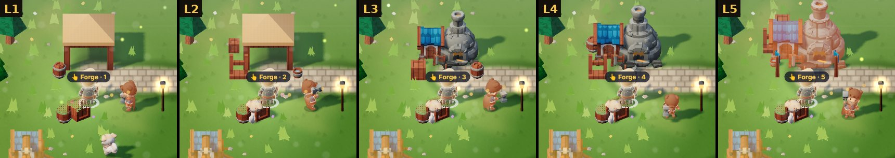
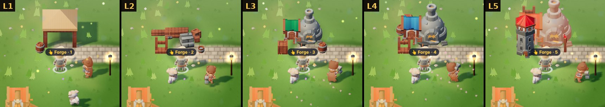
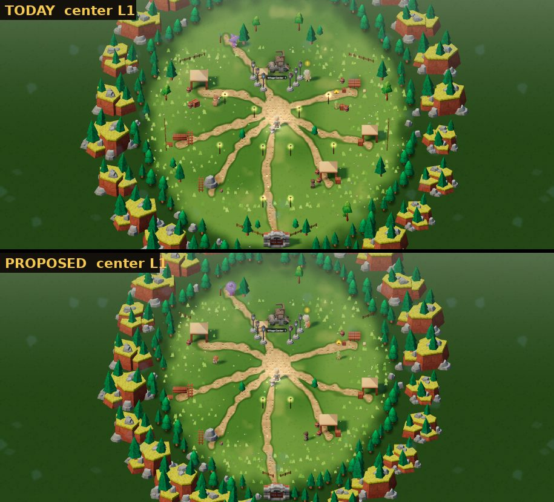
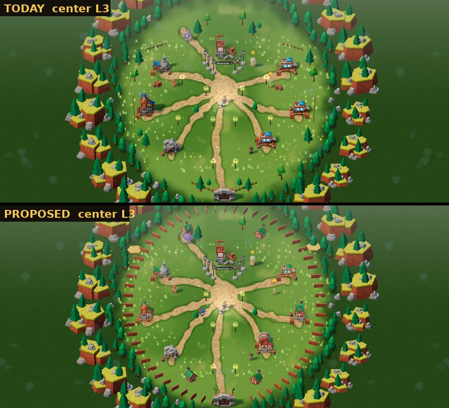
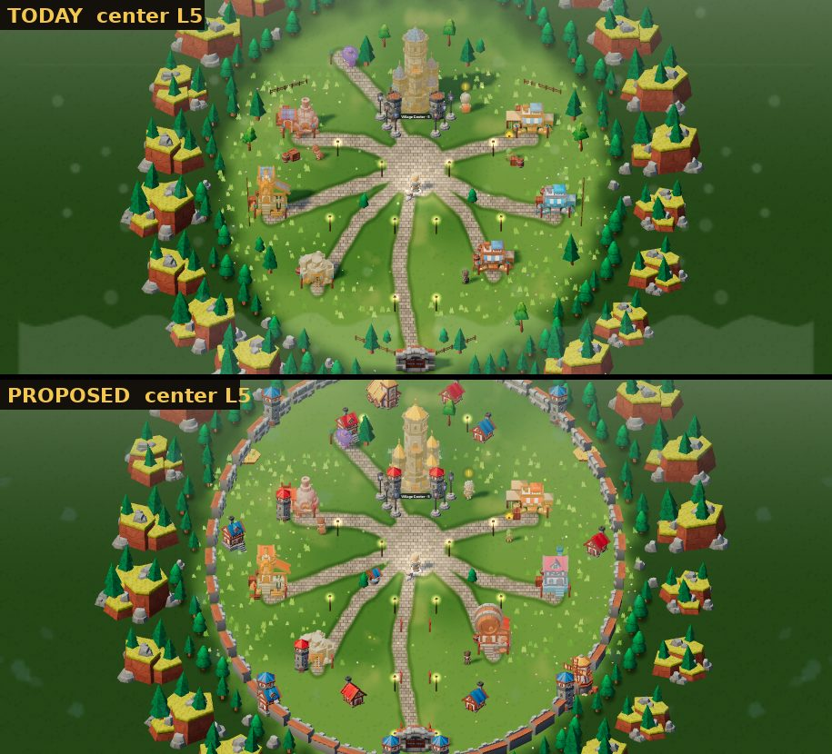
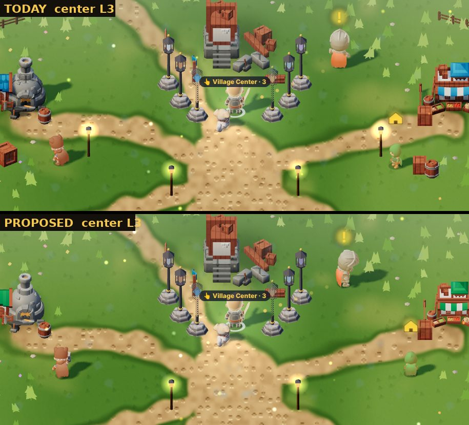

# קונספט: הכפר גדל, סבב 2 (10.11.2026)

ניר, 10.11: "לא קיבלתי את הכפר, לא רואים בו שינוי וצמיחה". חלק 1, רגע הבנייה, נבנה ב-#627. כאן חלקים 2 ו-3, **לאישור של ניר לפני שבונים**.

כל הצילומים בתלת-ממד, 915x412, ביום, עם המודלים טעונים. **"היום"** = main כמו שהוא. **"מוצע"** = אב-טיפוס אמיתי בתוך המשחק, עם מודלים חינמיים מאותה חבילה (KayKit Medieval Hexagon, CC0) שעוד לא בריפו. הקוד של האב-טיפוס לא נכנס למשחק.

## 2. כל רמה של מבנה נראית אחרת

הכלל: **בכל רמה משתנה לפחות אחד מאלה, שרואים במצלמה של המשחק:** צורה (מבנה אחר), גובה (מגדל או קומה), צבע גג (ירוק עץ פשוט → כחול → אדום/זהב), או אביזרים גדולים.

הנפחייה, רמות 1 עד 5, היום:

מוצע:

- **L1 אוהל** (כמו היום). **L2 שלד עץ** עם ערימות קרשים, במקום אותו אוהל עם עוד ארגז (היום L1 ו-L2 כמעט זהים).
- **L3 נפחייה עם גג ירוק** (עץ פשוט). **L4 גג כחול** + גדר אבן + מתלה נשקים. **L5 גג אדום + מגדל אבן** לידה, דגלים וזוהר אש.
- **אותו דפוס לכל המבנים:** מנסרה, מכרה, שוק (ירוק → כחול → אדום). הפונדק מקבל את **מבנה הטברנה** (היום הוא משתמש במודל של השוק). המחסן: בית אבן. המרכז ב-L5: **טירה זהובה** עם שני מגדלים.
- **חולשה שנשארת:** בין L3 ל-L4 ההבדל הוא בעיקר הצבע. כדי לחזק: עשן מהארובה מ-L4, ואור חם בחלונות. זה מוסיף אפקט, לא מודל.

## 3. הכפר כולו גדל עם רמת המרכז

מבט על (המצלמה רחוקה פי 3, רק כדי לראות את כל הכפר):

**L1: מחנה.** מעט פנסים, שבילי עפר צרים, בלי גדר. כמעט כמו היום, וזה בכוונה: L1 צריך להרגיש עני.

**L3: כפר.** גדר עץ סביב, 4 בתים, באר, שדות חיטה, דגלים ליד השער. הגבול זז החוצה (600 → 700).

**L5: עיירה עם חומה.** חומת אבן עם 6 מגדלים ושער, 9 בתים בצבעים, טחנת רוח, כנסייה, 14 פנסים, דגלים לאורך הדרך הראשית, שבילי אבן. הגבול 800.

### ⚠️ מה למדתי מהצילומים: במצלמה של המשחק כמעט לא רואים את זה

הצמיחה קורית בשוליים, והמצלמה הרגילה רואה רק את הכיכר. ליד המרכז, L3 היום ו-L3 המוצע נראים כמעט אותו דבר:

(ב-L1 וב-L5 אותו דבר: `village-L1-plaza.jpg`, `village-L5-plaza.jpg` באותה תיקייה.)

לכן ההצעה כוללת גם שני דברים שרואים מהכיכר:
1. **הכיכר עצמה גדלה:** באר במרכז מ-L2, דוכנים וספסלים מ-L3, מזרקה ודגלים מסביב ב-L5. כל אלה במרחק שהמצלמה רואה.
2. **מבט על לרגע כשהמרכז עולה רמה:** רגע הבנייה של המרכז (מ-#627) מתרחק לשנייה וחצי ומראה את כל הכפר, עם מה שנוסף מסומן. כך ניר רואה את הגדר, החומה והבתים החדשים לפחות פעם אחת.

**עוד דברים שלא נראים באב-טיפוס ונכנסים לבנייה:**
- **תושבים שהולכים:** מ-L3, 2-3 כפריים ברקע (דמויות KayKit שכבר בריפו) הולכים בין הבתים לבאר. מ-L5 עוד 2.
- **שבילים:** L1 עפר צר, L3 עפר רחב עם אבנים בשוליים, L5 אבן (היום רק L5 משתנה).
- **מקומות ריקים:** מבנה שעוד לא נבנה מסומן כחלקת עפר (`building_dirt`) ולא כפיגום, כדי שרואים לאן הכפר יגדל.

## עלות וביצועים (120 FPS אצל ניר)

- **חדש בריפו:** כ-25 מודלים (בתים, באר, טחנה, כנסייה, מגדלים, חומה, גדר, דגלים בצבעים). אחרי הקטנה כ-1-1.5MB, **נטענים רק בכניסה לכפר** (כמו vx_ היום, m3d.js).
- **ציור:** החומה והגדר הן עשרות חתיכות זהות. הן ייבנו כגוף אחד (merge) או InstancedMesh, כלומר ציור אחד במקום 45. הבתים כ-15 מודלים קטנים. הכפר בלי אויבים, אז יש מקום.
- **בלי כסף:** הכל CC0. בלי Creative Claw.

## מה אני צריך מניר

אישור לכיוון (או מה לשנות), ובמיוחד:
1. **צבעי הגגות** לפי רמה (ירוק → כחול → אדום/זהב). מתאים?
2. **חומה ב-L5** וגבול שגדל (600 → 800): הכפר נעשה יותר גדול להליכה. בסדר?
3. **מבט על לרגע** בשדרוג המרכז: כן או לא?

אחרי האישור: PR אחד למבנים (חלק 2), ואחריו PR לכפר כולו (חלק 3), כל אחד עם צילומים לפני ואחרי.
