# קונספט: שפה ויזואלית אחידה (כפר ועולם פתוח)

שלב 1 בלבד: קונספט לאישור של ניר. לא נבנה כלום, לא נגעתי בקוד המשחק. 11.11.2026.

## בשורה אחת (לניר)

**המראה:** "צעצוע" בסגנון רובלוקס: דמויות קומפקטיות מחלקים ברורים, פנים פשוטות, גושי צבע רחבים, בלי ברק מתכתי ובלי רעש. הגיבור תמיד הדבר הכי קל למצוא על המסך.
**מה משתנה:** גופי האויבים (היום 7 סוגים בעולם יושבים על 4 גופים בלבד, ולכן נראים אותו דבר), המבנים והחפצים בכפר, האור, והממשק באותה שפה.
**מה נשאר:** הדמות שלך ושל אוראל בדיוק כמו שבחרתם, כל המכניקות, המצלמה, הפגיעות, הזמנים וההתקדמות. הזירה של אוראל לא נוגעים.
**ההמלצה:** פיילוט קטן קודם (אויב אחד, פינה אחת בכפר, שכבת "הגיבור בולט") בחינם, ורק אם הוא טוב ממשיכים לשאר.
**מה מחכה לך:** לאשר, לשנות או לפסול את הכיוון. אין הוצאה כספית בהמלצה.

---

The rest is in English for the build sessions.

## 1. The look

**In words.** Original "blocky toy" style, Roblox-inspired in proportion only (not a copy of Roblox art or assets):
- **Bodies:** compact, head about 1/4 of height, clearly separated head / torso / arms / mitten hands / legs / boots. Simple faces (dot eyes) that read at phone size.
- **Surfaces:** broad flat color blocks with one soft gradient (the KayKit palette-strip method we already use), matte, no metallic shine, no texture noise, no tiny details.
- **Readability layer:** a thin dark outline on characters and a light rim, a bright ring under the player, calm low-contrast ground so characters pop.
- **Enemies:** every type has its own head shape, shoulder line, gear and stance, so the silhouette alone tells them apart. Color keeps its existing meaning only (damage type ring, `DMG`), never the only difference.
- **Environment:** modular chunky buildings, few big props instead of many small ones, flat light walkable ground, darker/taller boundaries.
- **UI:** the same toy language: wooden frames with gold trim (already ours), thick outlines, big round skill buttons.
- **VFX:** short, sharp, small (one slash arc, one spark), never covering the hero. Matches the existing combat-drama rules.

**Mockups** (Creative Claw, theme `fun-house`, 4 images, 76 credits; 5,098 left). These are style targets, not final art.

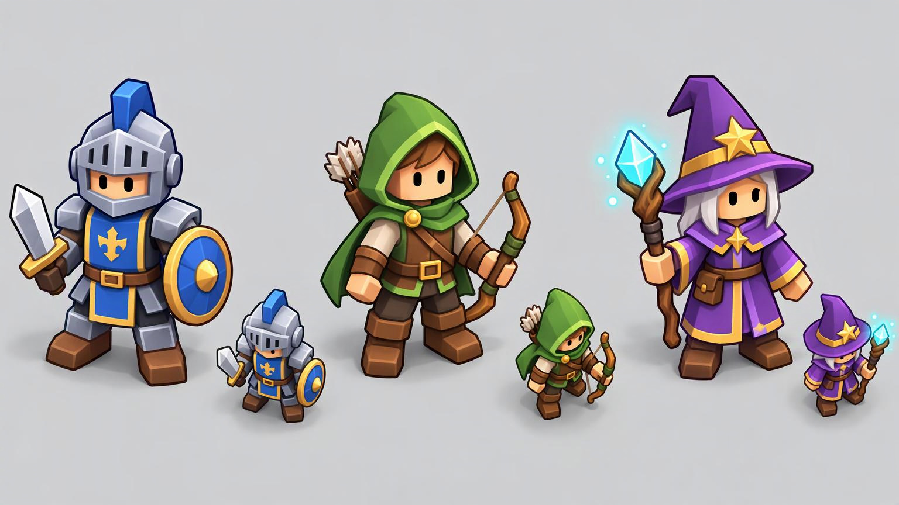
**Player.** The three classes, large and at game-camera size. *What stays:* each class's identity (knight blue helmet and shield, ranger green hood and bow, mage purple hat and crystal staff), the selected skin and equipped items. *What changes:* only the shared readability layer (outline, rim, ground ring). Nir's and Orel's own heroes keep their own models; no generic body ever replaces them.

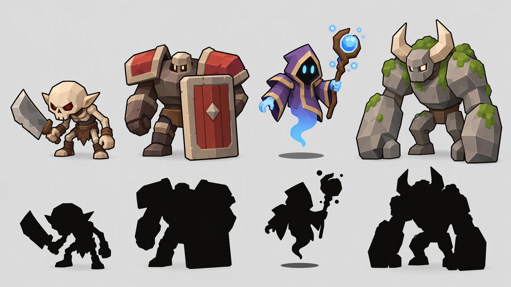
**Enemies (top: color, bottom: pure silhouette).** Grunt (hunched, big skull, cleaver), shield brute (huge shoulders, tiny head, tower shield), hover wisp (hood, no legs, tail, floats over a shadow disc, keeps its hover role), horned golem (long arms, horns). Each stays recognizable in black.

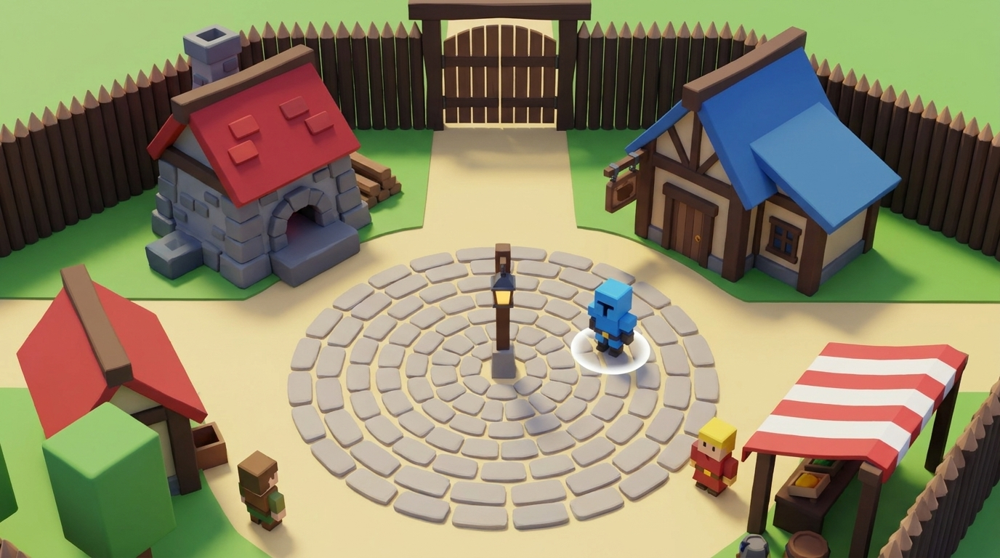
**Village plaza** at the game camera. Note: this mock leans voxel/Minecraft in the paving and the hero. The target is rounder, smoother blocks (Roblox/KayKit), not cubes.

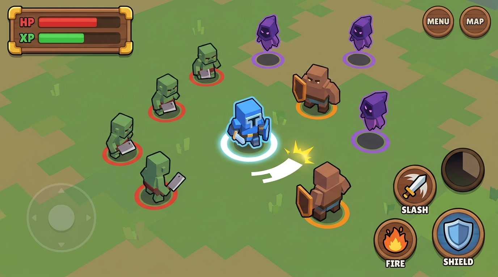
**World fight + UI** at landscape phone framing. Shows the goal: the hero found in under a second, three enemy shapes, small VFX. *Caveat:* the ring colors in the mock are decorative; in the game they stay damage-type colors. Labels and button layout follow `docs/ui-guide.md`, not the mock.

**Before (today, 3D, offline bot):**

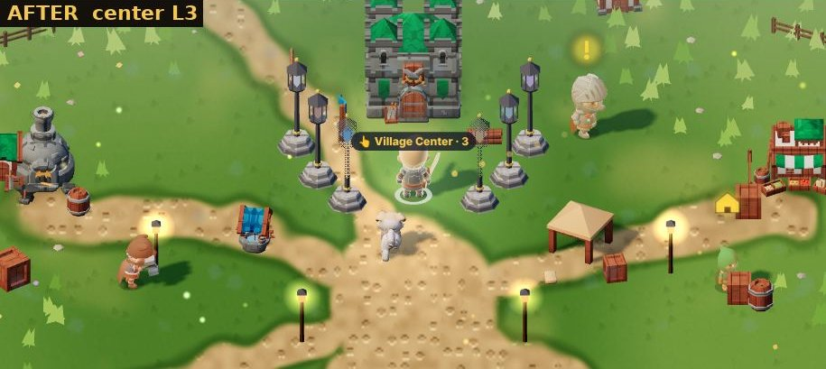
Village center L3 today (from `docs/shots/village-whole-L3-plaza.jpg`, 10.11). Readable, but the hero is small and pale, and props and NPCs share its colors.

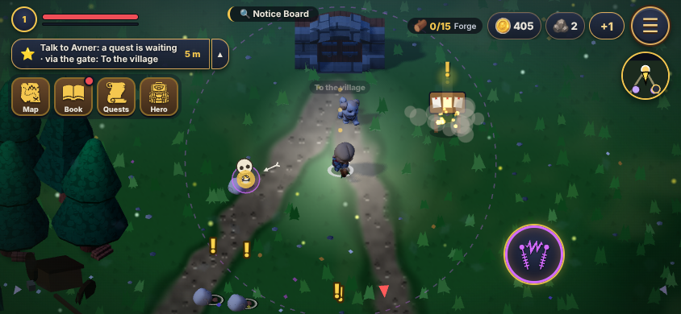
Open world at the gate today, from `node tools/check.js --shots --seed 3` (offline fixture, 844×390, 3D). The hero (center) is a dark shape on dark grass; the enemy near the gate and the hero read at a similar value. This is the main readability gap.

**What the code shows today** (the real problem, not only taste):
- In the open world (`world.js`) 7 enemy types use 4 bodies (`LOOK3D` in `render3d.js`): grunt and crawler = `minion`; shield and treant = `warrior` skeleton; wisp = `skelMage`; golem = `barbarian`; sprite = `mage`.
- `sprite` uses the **same body as the player's mage class**, and `golem` the same body as the smith and innkeeper NPCs. An enemy can look like the player or a villager.
- Crowd enemies are about 6,000 triangles each (`docs/3d-assets.md`), heavy for "many at once".

## 2. What I'd touch, and what not

**Touch (village + open world only):**
| Area | Files | How |
|---|---|---|
| World enemy looks | `js/render3d.js` (`LOOK3D` new world-only keys, e.g. `w_grunt`), `tools/build3d.js`, `js/m3d/*` | Chosen only when `S.wd` (open world) is set. Same keys, sizes (`h`, `foot`) and hit sizes as today |
| New enemy bodies / gear | `tools/blender/` (gear add-ons), Quaternius/KayKit sources via `build3d.js` | Same 23-bone KayKit rig where possible, so all 161 animations keep working |
| Village buildings, props | `VIL3D` in `render3d.js`, `js/village.js` (draw only) | Same footprint and collision; only the model/palette changes |
| Open-world props, ground | `js/terrain.js`, `js/wxworld.js` (draw only) | Calmer, lower-contrast ground; bigger simpler props |
| Readability layer | new `js/look-style.js` (one config object) + few hooks in `render3d.js` | Outline, rim, player ring. Off in the arena |
| UI skin | `css/style.css`, `js/ui.js`, `js/gearui.js` (style only) | Same layout, positions and sizes per `docs/ui-guide.md` |

**Do not touch:**
- **Orel's arena and Underworld** (`run.js`, `spawn.js` arena logic, `arenas.js`, `arenaui.js`, MOBA/Underworld files, `mon_*` arena monsters, arena `LOOK3D` keys). Not changed, not reused. Proof later: arena screenshots before/after identical. If the style should go there, it's proposed to Orel, and he decides.
- Player models and skins (`knight`, `ranger`, `mage`, `nirHero`, `orelHero`, `pilotHero`, `SKINS` in `rig.js`): shapes unchanged, only the opt-in readability layer.
- All logic: camera, collision, hitboxes, combat rules, skills, timings, spawns, progression, save format. Visual randomness never uses the gameplay random stream.
- Nothing deleted. Old models stay in the build; the new look is behind a flag (`?look=v2`) until Nir approves the switch.

## 3. Evidence plan (for the build phase)

All gameplay evidence from `tools/check.js` only (offline fixture: network blocked, fake cloud server, no real save, no live site).
1. **Changed files** list per PR, matching the table above. `git diff --stat` shows no arena file.
2. **Native landscape screenshots** at 844×390 (phone) and 1180×820 (iPad), same `--seed` before and after: village plaza, world fight with 10+ enemies, gear window, HUD. Plus an arena shot before/after that must be identical.
3. **Motion evidence** per renewed enemy: frame strips of spawn, walk, attack and death at native game size (not a viewer render), from the bot run.
4. **Silhouette test:** each enemy as solid black at game size; all must be distinguishable.
5. **Performance** (diagnostics, not assumed bugs): first-spawn cost (ms for the first spawn of each new model, lazy load from `js/m3d/`), memory (JS heap + GPU geometry before/after), 20 enemies spawning in one frame, UI element positions over consecutive frames and after spawn protection ends. Triangles per enemy (target ≤ 2,500 for crowd enemies, ≤ 8,000 for heroes), draw calls per enemy, added MB to `js/m3d/`.
6. **Roblox counts (targeted, not verified):** per asset record triangles, texture size, material count, bone count, scale and pivot. Roblox Studio limits are noted from its docs only; no Studio import or test.

## 4. Options and cost

| Option | What it gives | Effort (Claude) | Money |
|---|---|---|---|
| **A. More CC0 packs we already use** (KayKit Skeletons/Adventurers, Quaternius Ultimate Monsters: 15 big + 19 blob + 16 flying, already downloadable via the `build3d.js` path) | Fast distinct enemy bodies (orc, ninja, mushroom, flyers keep hover). Pipeline exists | ~1 session per 3-4 enemies | 0 |
| **B. Blender-from-code** (`tools/blender/`, research branch `research/own-models`) | Gear that changes silhouettes: shoulder pads, horns, cleavers, tower shields, hoods; modular village pieces in our palette. 300-1,000 tris, 13-60KB each | 15-30 min per piece | 0 |
| **C. Hunyuan3D pipeline** (#623, `docs/concept/hunyuan-pilot.md`) | Unique organic bodies (golem, wisp) from a mockup image, reduced to ~600 tris, rig copied with `tools/trellis/reskin.py` | 1-2 h per creature; free GPU quota is small and some tools are broken | 0 (HF PRO 9$/month raises quota: Nir's call) |
| **D. Paid packs / AI mesh sites** (stylized character packs on itch/Unity store ~10-60$ one-time; Meshy or Tripo ~20$/month) | More choice, but mixed artists and often painted textures, not our flat palette | Same as A plus restyling | **Nir decides** |

**Recommendation:** A + B on the existing KayKit rig (no new animation work, no money), C only for 1-2 hero-enemies if A/B can't reach the shape. Start with a **pilot**: (1) the readability layer, (2) one world enemy (grunt → `w_grunt`) with a new silhouette, (3) one village corner (plaza + forge). Show Nir the evidence from §3 for the pilot before doing the rest.

## 5. Self-review (3 questions)

1. **Does it answer what Nir asked, not an easier version?** Yes for the concept scope: look in words + mockups for player, enemies, village and UI; touch/don't-touch with the arena excluded; evidence plan; options with cost. Gap: the mockups are 2D images, not in-engine, so they show direction, not proof. The pilot is where in-engine proof comes from.
2. **What did I miss?** (a) Shared `LOOK3D` keys: grunt/shield/wisp are used by both the arena and the world, so the new look must use world-only keys or the arena changes by accident. (b) NPCs share bodies with enemies and heroes; NPC renewal is in scope (village) but listed after enemies. (c) The village mock drifts toward voxel; the target is rounder blocks. (d) Orel's hero visits the village too: the readability layer touches it visually. It's opt-in, and Orel can veto it for his hero. (e) iPad framing is not mocked, only planned in evidence.
3. **Code check: does it exist already, what's the risk?** KayKit palette method, Blender-from-code, Quaternius pipeline and lazy-loaded `js/m3d/` already exist, so most of this is content, not new systems. Risks: `js/m3d/` already 9MB, so every new body must replace weight, not just add it; outline shader cost on the phone must be measured; KayKit's rounded style vs "Roblox blocky" is a taste call only Nir can make after seeing the pilot.

## 6. Pilot results (11.11.2026, PR #666)

Nir approved the free pilot (A+B), then liked it (11.11: "אוהב את הסטייל החדש"). **Now on by default** in the village and open world; `?look=v1` turns it off for comparison. The arena and Underworld never change.

**What's in it**
- **Hero:** thin dark outline (about 2.5 px at the phone camera) + an edge-only light rim on the selected hero's own model. Model, skin and gear never replaced. The existing white ground ring (`readable3d.js`) is reused. The rim is `rim-world.js`'s own (merged in #664): look v2 only turns it up in daylight, so there's one rim shader, not two. (11.11 fix: vfx.js's warm rim was still on top and bleached the hero white; v2 now turns it off. Village NPCs also lose their emissive `tint`, which washed Avner, the merchant and the priest out.)
- **One world enemy, new silhouette:** the world grunt is drawn as Quaternius Orc_Skull (CC0), reduced to **2,399 triangles** (today's grunt body: 5,288), 1 material, 128px texture, 43 joints. Same type, hp, size, hit size and timings. Only `foeKey(e)` in `render3d.js` changes, and only when `S.wd` is set.
- **Village corner:** the street lamps around the plaza become rounder toy lamps. A round floor disc and a curb-stone ring were tried and removed (Nir didn't read the disc as a plaza; the stones alone read as scattered pebbles). Visual only.

**Evidence** (`node tools/look-v2-shots.js`, offline: new browser context, every http(s) request answered locally, no real save. Same seed, before vs v2)

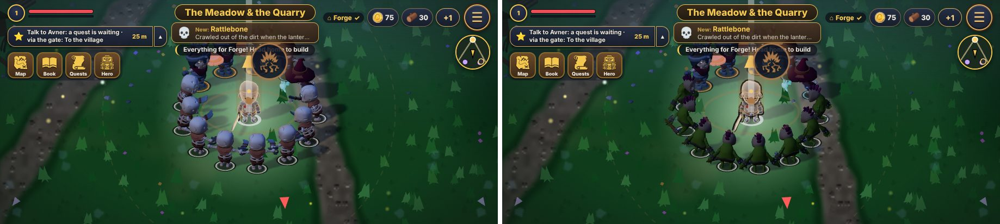
World, phone 915×412 (3D, Nir's screenshot size; 844×390 copies in the same folder): 8 grunts + 3 shields + 2 wisps. Before (left) grunts and shields are the same skeleton family; v2 (right) the grunts are green orcs, told apart by shape.

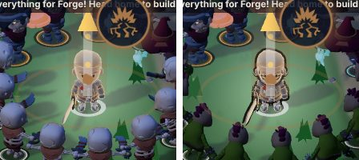
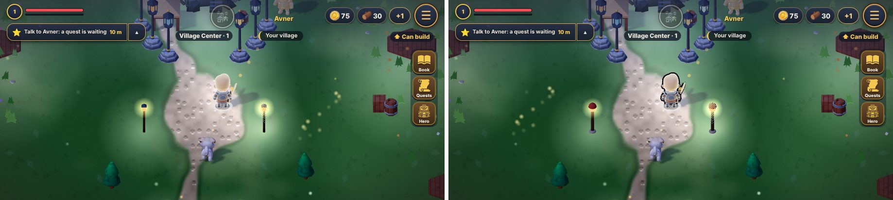
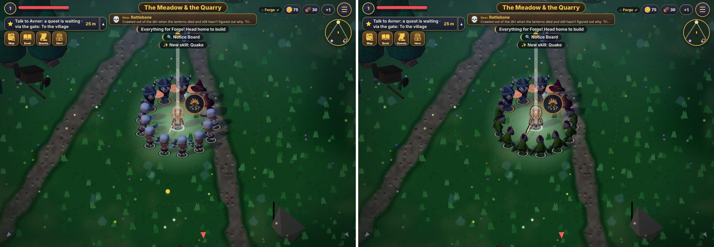
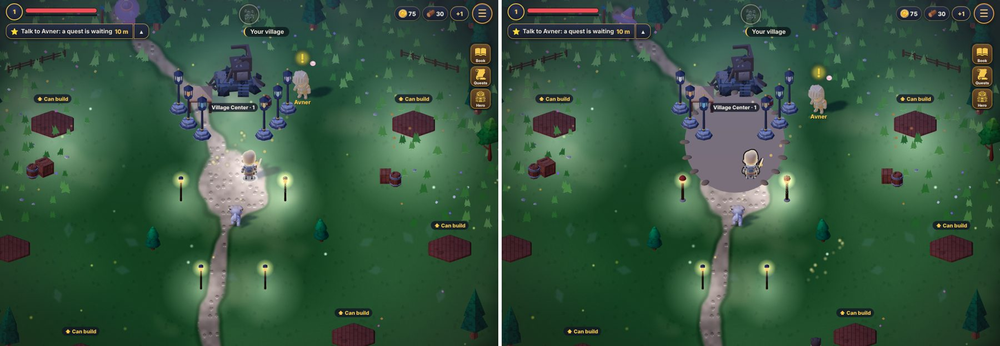

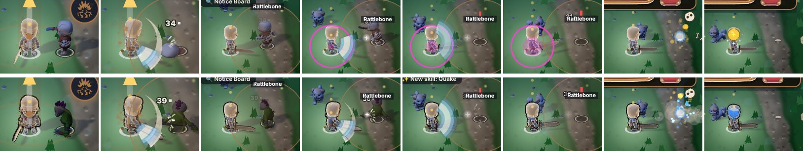
Motion, one grunt next to the hero (top: before, bottom: v2): spawn, spawn, walk, walk, attack, attack, death, death. Spawn, walk and death read clearly. **The attack frames are not usable in either row**: the enemy is not visible in them, before or v2. That's my test setup, not the new body, and it is still open (see below).

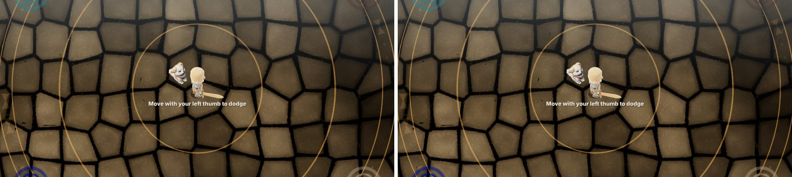
**Arena untouched:** the arena scene (HUD hidden) is **pixel-identical** with v2 and with `?look=v1`: 0 of 376,980 pixels (915×412), 0 of 329,160 (844×390) and 0 of 967,600 (iPad). One earlier run differed only because the hero was mid hurt-blink (`render3d.js` hides the hero every other step while `P.inv>0`); shots now clear `P.inv` first.

**Numbers** (SwiftShader on the CPU, so compare before vs v2, not absolute phone FPS. Full data: `pilot/phone915-report.json`, `pilot/phone-report.json`, `pilot/ipad-report.json`. 915×412, final code (v2 default, no plaza disc): 20-at-once frame 32 ms v1 / 25 ms v2, 0 errors, HUD steady)
| | before | v2 |
|---|---|---|
| Grunt body triangles | 5,288 | 2,399 |
| Console errors (whole run) | 0 | 0 |
| HUD positions over 40 frames (incl. after spawn protection) | 1 distinct | 1 distinct |
| GPU geometries / textures (phone) | 336 / 137 | 345 / 131 |
| Frame with 20 grunts spawning, wall ms (phone / iPad) | 29 / 15 | 24 / 24 |
| Same again, warm (phone / iPad) | 18 / 21 | 23 / 13 |
| JS heap MB after (phone / iPad) | 29.3 / 30.8 | 35.2 / 32.2 |
| Added download | | 138 KB (`js/m3d/mon_orcSkull.js` + anims), lazy |

- No spawn hitch measured: the first 20-at-once frame is in the same range as a normal frame in both modes. One v2 frame later in the phone run took 1,270 ms, and a before run in an earlier pass had a 1,103 ms frame. Both look like SwiftShader shader compiles or GC in this CPU-only browser, not a v2 cost. Worth one look on Nir's phone.
- Heap: v2 is 1-6 MB higher in these runs (the extra body, animations, outline meshes). Run-to-run noise is about ±1 MB.

**Roblox (targeted, not verified):** mon_orcSkull 2,399 tris, 1 material, 128×128 texture, 43 joints. Plaza and lamps: code-built primitives (spheres, cylinders, a disc), no textures. Nothing was imported to or tested in Roblox Studio.

**Still open**
1. Attack frames in the motion strip (test setup).
2. (Resolved: the plaza floor disc was removed.)
3. Outline cracks are possible at hard edges of flat-shaded parts (split normals). Not visible at phone size in these shots.
4. Next steps only if Nir likes the pilot: more world enemies (shield, wisp), NPC bodies, the rest of the village.

## 7. Phase 2: four more world enemies (11.11.2026, PR #671)

Each common world role now has its own body, so a crowd reads by shape, not by color. Same type, hp, size, hit size and timings; only the look key (`LV2.swap` / `LV2.looks` in `js/look-v2.js`). Village and world only, on by default, `?look=v1` turns it off.

| Enemy | Before | v2 | Triangles | Why |
|---|---|---|---|---|
| grunt (phase 1) | KayKit skeleton minion | orc with skull helmet (Quaternius Orc_Skull) | 2,399 | |
| wisp | skeleton mage + staff | horned shadow, no legs, keeps the hover (Quaternius Flying "Ghost") | 2,000 | magic flyer |
| shield | skeleton warrior + small round shield | same skeleton and anims, a tall upright tower shield + round shoulder pads, built in code (`lv2Gear`) | rig + ~300 | wide and square from above |
| sprite | **the player mage's body**, tinted green | small bee (Quaternius Flying "Armabee") | 1,799 | plant fairy, no longer the player's body |
| golem | **the smith/innkeeper's body**, tinted | stone idol brute (Quaternius Big "Tribal", tinted stone) | 2,799 | no longer a villager's body |

All Quaternius models are CC0, not used by the arena, and lazy-loaded (`js/m3d/`, +309 KB in total). Built with `node tools/build3d.js <kk> --only monsters --mon=wispGhost,spriteBee,golemIdol` (only those; the arena's monsters are untouched).

**Evidence** (`tools/look-v2-shots.js`, offline, fresh context, no save writes; 3D; before = `?look=v1`)

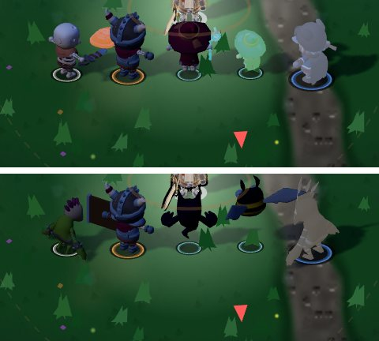
One of each role, 915×412 (top: before, bottom: v2). Left to right: grunt, shield, wisp, sprite, golem.

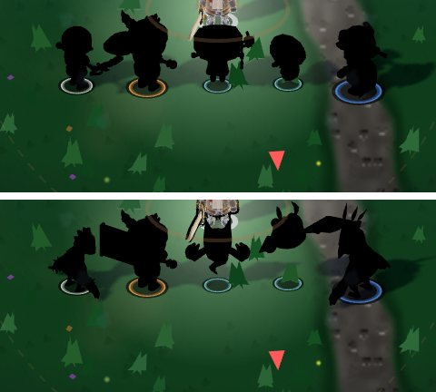
Silhouette test: the same row with every enemy drawn flat black. Before, four of the five are round-headed humanoids of about the same outline. In v2 every role has its own outline: hunched spiky orc, tall slab shield, horned legless ghost, winged bee, crested heavy idol.

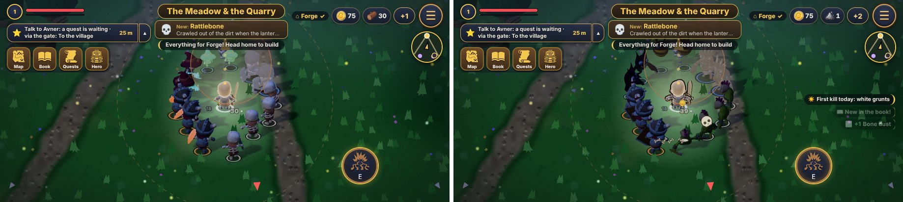
A crowd of 13 (4 grunts, 3 shields, 2 wisps, 2 sprites, 2 golems), 915×412. Also at 844×390: `phase2/p844-*.jpg`.

- **Arena untouched:** the arena scene is pixel-identical with v1 and v2: 0 of 376,980 pixels (915×412) and 0 of 329,160 (844×390).
- **Console errors:** 0 in every run.
- **First-spawn cost** (wall ms of the frame in which each type first appears, SwiftShader; v1 / v2, 915×412): grunt 11 / 1,484, shield 8 / 11, wisp 10 / 18, sprite 8 / 13, golem 8 / 13. At 844×390: grunt 1,310 / 18, others 8-22 in both. The one ~1.3-1.5 s frame shows up on the first enemy of the session in **both** modes (the first enemy shader compile in this CPU-only browser), not on a new body. Every new v2 body costs 11-19 ms on its first frame.
- **HUD:** steady over 40 frames in both modes.
- **Roblox (targeted, not verified):** each body is 1 material and one 32-128 px palette texture, 13-43 joints. The shield gear is primitives (boxes, spheres, a torus).

**Still open:** the motion strip's attack frames (test setup, as in phase 1). The shoulder pads are small at phone size; the tower shield carries the silhouette.

## 8. Village stage 2 (11.11.2026)

Nir approved the toy style (Roblox-like proportions, rounder blocks, flat colour, matte). Stage 2 is the village only, behind the same v2 switch (`?look=v1` shows the old look). Visual only: positions, sizes, collision, roles and timings are unchanged.

**What's in it**
- **Smith and innkeeper, own bodies.** They shared the golem's barbarian body. Now each is a toy figure made of rigid rounded parts (like Roblox R6 parts), skinned in `tools/blender/village_v2.js` onto the **same KayKit skeleton**, so every NPC animation (idle, walk, hammering, wave, cheer) plays unchanged. Smith: square beard, goggles on the forehead, red shirt, heavy leather apron, bracers, keeps his hammer. Innkeeper: ginger hair with a bun, curled moustache, green vest, cream apron, a mug in her hand. Same height, foot and props as before (`LOOK3D.npc_*`), no tint: the toy colours carry who they are.
- **Forge yard:** anvil on a stump in front of a small blade rack, a coal bucket with glowing embers, barrel, crate, log pile, fence, red banner.
- **Market row:** striped stalls with produce (the market's stall and tents, and the plaza stalls), sacks, crates, an apple crate, barrels, yellow pennants.
- **Gate:** two chunky posts (stone base, wooden pillar, red cap), a thick beam under a red roof, a hanging sign, two warm lanterns. Open between the posts as before.
- No decorative floor shapes (Nir didn't read the plaza disc).

**How it's built** (`tools/blender/README.md` for the method): `node tools/blender/village_v2.js rig` (the skeleton from the existing barbarian), `blender -b --python tools/blender/build_village.py -- tools/blender art/village-v2/raw`, `node tools/blender/village_v2.js pack`. One tiny palette texture (64×16, nearest filtering) shared by every piece. In the game (`js/look-v2.js` part 4): each piece swaps one KayKit model inside a zone (`LV2.vil`, through `vPut`), the bodies swap `LOOK3D.npc_smith/inn` only while drawing (`syncNpcs`). A piece that is still loading is drawn the old way, and the village rebuilds once when it arrives. `tools/build3d.js` and the enemy keys are untouched.

**Numbers**
| piece | triangles | file (KB, lazy `js/m3d/`) |
|---|---|---|
| smith body (was barbarian, 5,285) | 4,276 | 54 |
| innkeeper body | 3,456 | 47 |
| gate | 1,432 | 27 |
| stall | 1,776 | 32 |
| anvil + rack | 1,752 | 30 |
| barrel / crate / apple crate / sack | 484 / 628 / 964 / 456 | 13 / 13 / 18 / 11 |
| coal bucket / logs / fence / banner / pennant | 484 / 1,380 / 856 / 400 / 80 | 17 / 25 / 17 / 10 / 6 |
| **total added download** | | **about 320 KB**, lazy, only in the village with v2 |

**Evidence** (`node tools/look-v2-village-shots.js`, offline: new browser context, every http(s) request answered locally, no real save, before = `?look=v1`):

All images 3D, before (left, `?look=v1`) and v2 (right), same seed. Phone 915×412 (Nir's size), daytime (`?tod=day`):

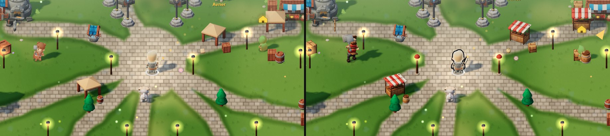
The plaza at village level 4: striped stalls with goods instead of the plain tents, the smith (left) in his own body.

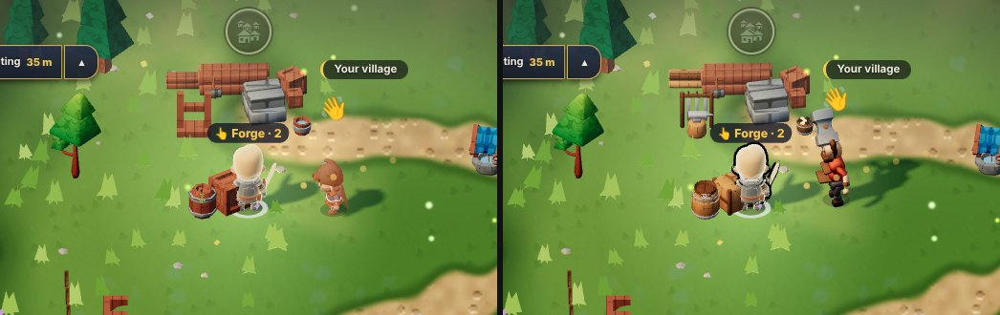
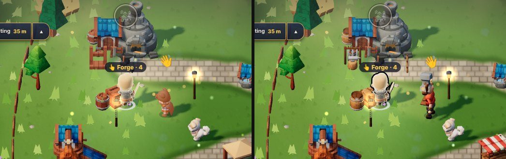
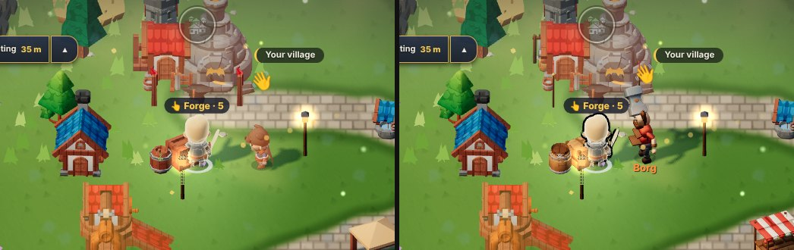
Forge yard at levels 2, 4 and 5: coal bucket, logs, anvil + blade rack, barrel, fence, red banners.

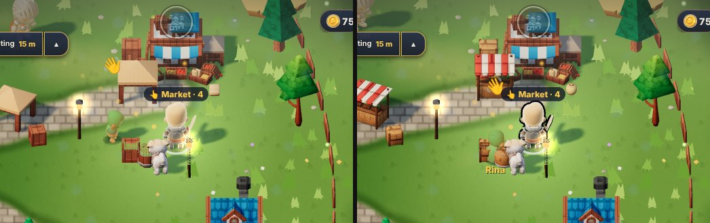
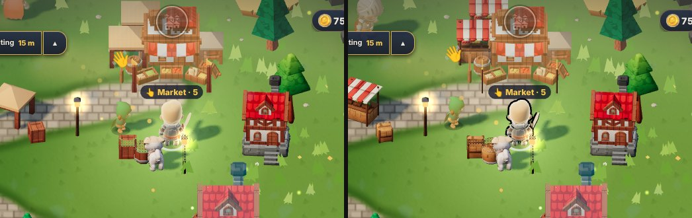
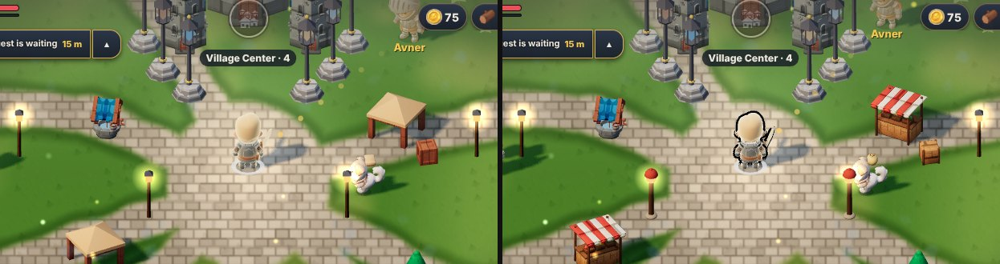
Market row: stalls, sacks, crates, apple crate, yellow pennants.

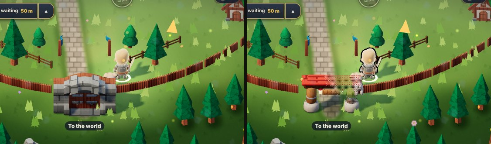
The gate. The hero stands just behind it, so the game's see-through effect (`readable3d.js`) dithers the part of the roof in front of him: an existing feature, the same for any object between the camera and the hero.

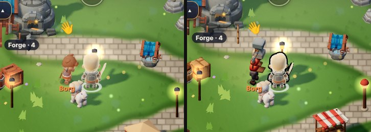
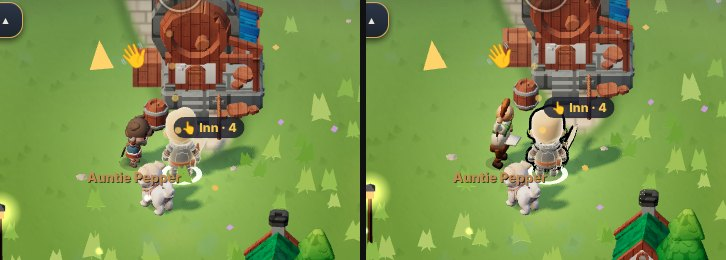

Night (`?tod=night`, the village's brighter night) and other sizes:

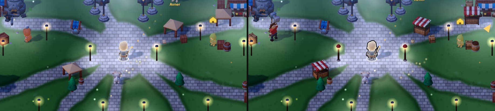
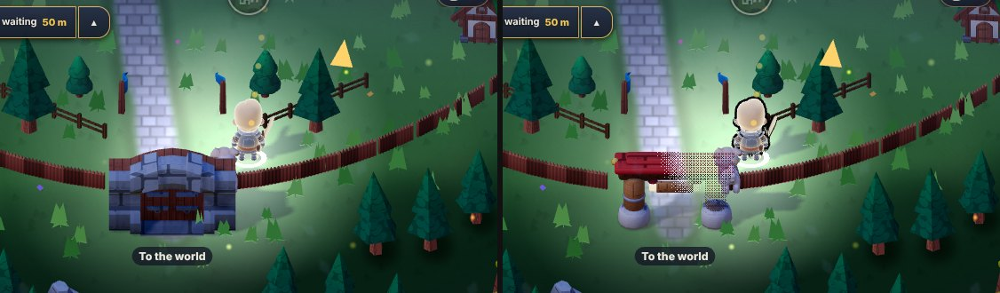
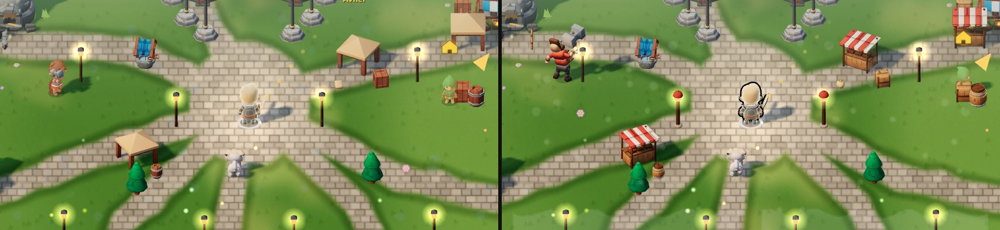
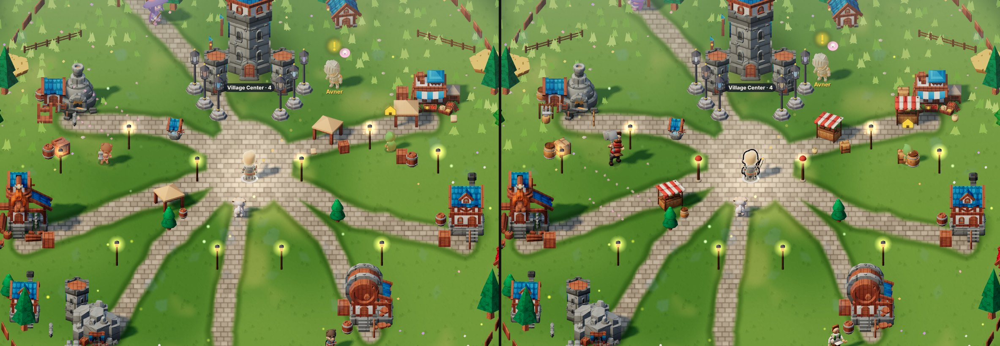
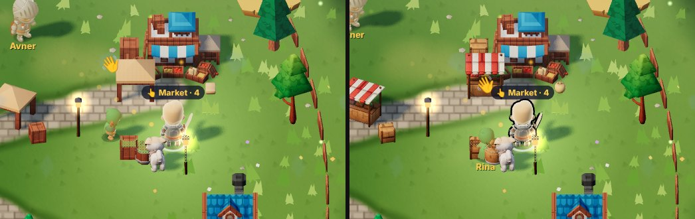

**Checks** (reports: `village2/*-report.json`)
- **Arena untouched:** the arena scene (HUD hidden) is pixel-identical before and v2: 0 of 376,980 pixels (915×412, day and night), 0 of 967,600 (iPad), 0 of 329,160 (844×390, night run). One 844×390 day run had 1,453 scattered pixels (and one earlier 915 run 1,476): small dark specks, the scene identical by eye. A separate arena-only check (v1, v2, v2 again, v1 again, all in one browser) gave 0 differences in every pair, so this is run-to-run noise in the long evidence script, not v2. Look v2 does nothing in the arena (`lv2Here()` is false there, `lv2VilKey` only runs with `S.vil`).
- **Console errors:** 0 before, 0 v2, in all 7 runs (4 sizes/times × village levels 2, 4, 5).
- **Load:** every v2 piece loaded, none failed. Decode time per piece 10 to 80 ms (SwiftShader, CPU), lazily in the village only; the old model shows meanwhile and the village rebuilds once. With a save that has a village, the opening fetches the pieces the current village shows (`M3D.bootKs`, `lv2VilBoot`), so `tools/check.js` still sees nothing loaded without need.
- **Roblox (targeted, not verified):** bodies 4,276 / 3,456 tris, 1 material, 64×16 texture, the 23 KayKit bones (+18 helper bones, unused) with rigid weights; props 80 to 1,776 tris, 1 material each. Nothing imported to Roblox Studio.

**Still open**
1. The bodies are rigid parts: at strong bends (elbow, waist) the parts overlap or show a small gap, by design (toy figure). Not visible at phone size in these shots.
2. Other NPCs (merchant, priest, residents) and the rest of the village (houses, mill, mine) are next, only if Nir wants them.
