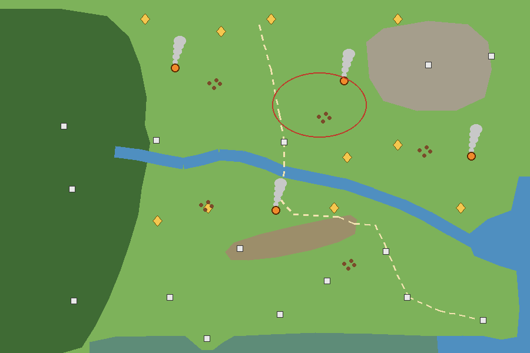

# קונספט: עולם שיש בו חיים (בין המפלצות)

ניר, 7.11.2026 (בסרטון משחק): האזורים הפתוחים מרגישים ריקים. מישורים ירוקים רחבים, ובין מפלצת למפלצת אין על מה לשים את העין.
זה רק קונספט לאישור, בלי קוד. המטרה: למלא את המקום **במשמעות, לא בקישוט**. כל דבר חדש נותן סיבה ללכת אליו.

**מקרא:** ⬜ מה שכבר יש (מחנות, חורבות, אבני מסע, שערים, סודות) · 🟠 מחנה עם מדורה ועשן שרואים מרחוק · 🔶 שריד קטן עם שלל · 🟤 להקת חיות שבורחת · 🔴 המישור שהכי ריק היום.

## מה יש היום בכל אזור

כל אחד מששת האזורים (אחו, אגם, רכס, מדבר, סערה, צל) בגודל 6300×4200. חציה בקו ישר: כ-35 שניות הליכה.

- **ציוני דרך** (`map.marks`): 9 עד 14 לאזור. מחנות, חורבות, מקדש, מגדלור. **מצוירים, אבל לא עושים כלום** אם אין קווסט שמוביל אליהם.
- **סודות** (secrets.js): 5 לאזור. תיבה, מקדש ברכה, תצפית ועץ חרוט. מוסתרים בכוונה, בלי סימן.
- **אבני מסע:** 4 לאזור. **שערים:** 2-3. **מאורות נדירות:** כ-9 באחו.
- **דמויות בעולם:** 2-3 לאזור (worldnpc.js), ולוח מודעות.
- **אירועים** (events.js): גל שלדים, עגלה הפוכה או מטר אבנים, פעם ב-80 עד 130 שניות.
- **פיוחו מריחה** (petscent.js): פעם בכמה דקות רצה לסוד.
- **מקורות משאבים ואויבים** בצפיפות נמוכה.

**מה חסר:** כמעט הכל מוסתר, נדיר או נקבע בזמן. בין לבין, ההליכה עצמה ריקה. ובמישור הפתוח (🔴) לא רואים כלום מרחוק, אז אין לאן להימשך.

## 9 רעיונות

**1. מחנות חיים** 🟠 · עלות S
- **רואים:** עמוד עשן ממדורה, גבוה, נראה מקצה המסך. ליד האש יושבת דמות.
- **למה הולכים:** העשן מושך. הדמות אומרת שורה אחת (רמז לסוד, שמועה על נדירה, בדיחה).
- **פרס:** בביקור הראשון מתנה קטנה, ואחר כך ריפוי ליד האש.
- **איפה:** כל המחנות שכבר קיימים (`camp`), 4-6 לאזור. אין צורך במקומות חדשים.

**2. שרידים** 🔶 · עלות S
- **רואים:** עגלה שבורה, שלד עם תרמיל, ארגז שנפל, אוהל קרוע. עם ניצוץ קטן.
- **למה הולכים:** נראה שאפשר לקחת משהו.
- **פרס:** שלל קטן פעם אחת, ולפעמים פתק (רעיון 6).
- **איפה:** **ממלאים לבד** כל חלק במפה שאין בו כלום (הכללים למטה). כ-10 לאזור, בלי לצייר מפה מחדש.

**3. חיות שבורחות** 🟤 · עלות M
- **רואים:** להקה קטנה (צבאים באחו, ברווזים באגם, יעלים ברכס, לטאות במדבר, עורבים בסערה, רוחות קטנות בצל). כשמתקרבים הן בורחות.
- **למה הולכים:** תנועה מושכת את העין. פיוחו רודפת אחריהן.
- **פרס:** בעיקר תחושה. לפעמים חיה זהובה שמשאירה מטבעות.
- **בונוס:** **נשרים חגים** במדבר מעל שריד. החיות מצביעות על משהו.

**4. ציון דרך גבוה** · עלות S-M
- **רואים:** דבר אחד ענק לאזור: עץ עתיק, פסל שבור, עמוד אור, ספינה תקועה. נראה מכל מקום ומופיע כחץ קטן בקצה המסך.
- **למה הולכים:** סקרנות.
- **פרס:** למטה סוד או מקדש (מחברים אותו לסוד קיים).
- **איפה:** אחד לאזור, במקום הריק ביותר.

**5. הצלת נוסע** · עלות M
- **רואים:** נוסע מוקף מפלצות, עם קריאה לעזרה.
- **למה הולכים:** מישהו צריך אותך עכשיו.
- **פרס:** שלל, ולפעמים הנוסע עובר לכפר (כמו residents.js).
- **איפה:** אירוע רביעי ב-events.js, כל האזורים. זו גרסה עם דמות של העגלה ההפוכה שכבר יש.

**6. פתקים ומפת אוצר** · עלות S
- **רואים:** דף קרוע בתוך שריד או ליד מחנה.
- **למה הולכים:** שורה אחת מהעלילה (docs/story.md). שלושה פתקים באזור יוצרים מפה.
- **פרס:** המפה מסמנת אוצר קבור, ופיוחו חופרת (כמו העץ החרוט).
- **איפה:** 3 לאזור.

**7. אבני רונות** · עלות M
- **רואים:** שלוש אבנים כבויות במעגל, כל אחת בצבע של סוג נזק.
- **למה הולכים:** פאזל קטן שמשתמש במערכת הנזק: מכים בכל אבן בסוג הנכון.
- **פרס:** תיבה טובה, פעם אחת.
- **איפה:** 1-2 לאזור.

**8. מערה קטנה** · עלות L
- **רואים:** פתח מערה עם אור בפנים.
- **למה הולכים:** אויב עלית אחד ותיבה. 30 שניות של קרב.
- **פרס:** חפץ.
- **איפה:** ברכס כבר יש 4 מקומות `cave`. יקר, ולכן אחרון.

**9. שבילי פירורים** · עלות S
- **רואים:** פרחים, אבנים ובולי עץ שנערמים בקו.
- **למה הולכים:** הקו מוביל מהדרך הראשית לנקודה (1, 2, 4).
- **פרס:** אין פרס בפני עצמו. זה קישוט שיש לו תפקיד.

## ההמלצה: 3 קודם

1. **מחנות חיים (1)**: משתמשים במחנות שכבר יש. העשן נותן משיכה מרחוק בכל אזור.
2. **שרידים (2), ממלאים לבד**: פותרים בדיוק את "המישור הריק", בשישה אזורים בבת אחת, בלי לצייר מפות.
3. **חיות שבורחות (3)**: הכי הרבה "חיים" על המסך, גם כשאין מה לאסוף.

ביחד: שתיים קטנות ואחת בינונית. כל אחת בקובץ משלה, ומספרים באובייקט אחד.

### כלל הצפיפות

- **תמיד על המסך:** לפחות דבר אחד שהוא לא אויב (עשן, חיות, שריד או ציון דרך).
- **כל ~10 שניות הליכה** (כ-1,800 פיקסלים): משהו שאפשר לגעת בו.
- **איך ממלאים:** מחלקים את האזור למשבצות של 750. משבצת שאין בה שום דבר מעניין במרחק 600, ושהיא לא מים, יער או מחצבה, מקבלת שריד. בשרטוט זה נתן 10 שרידים באחו.
- **בודקים במספרים:** tools/playtime.js כבר מודד "דקות בין דברים מעניינים". מוסיפים לו "שניות הליכה בלי כלום על המסך", ומודדים לפי אזור (התחלה, קרוב, רחוק).

## מה עוד כדאי לדעת

- **לא לכפול:** תיבות מוסתרות, הרחה של פיוחו והעגלה ההפוכה כבר קיימים. הרעיונות כאן נבנים עליהם, ולא מחליפים אותם. הסודות נשארים מוסתרים, ושרידים הם השלל הקטן והגלוי.
- **ביצועים (120 FPS):** שרידים וחיות בצורות פשוטות (props3d.js), במופע אחד לכל סוג. חיות זזות רק ליד השחקן.
- **בלב הצל חשוך:** כל דבר חדש שם צריך לזהור, אחרת לא רואים אותו.
- **שמירה:** כל מה שנלקח פעם אחת נשמר באובייקט אחד ב-SAVE, לפי מזהה קבוע (לא לפי מיקום אקראי), כדי ששרידים לא יחזרו אחרי עדכון.
- **הבוט:** כל רעיון מקבל שלב בבדיקה (`botStep`), וכל הטקסטים נכנסים ל-lang.js בעברית ובאנגלית.
- **מראה:** השרטוט הוא רק מיקומים. המראה של השרידים והחיות ייקבע בדוגמה אחת לאישור לפני שבונים בכמות.
