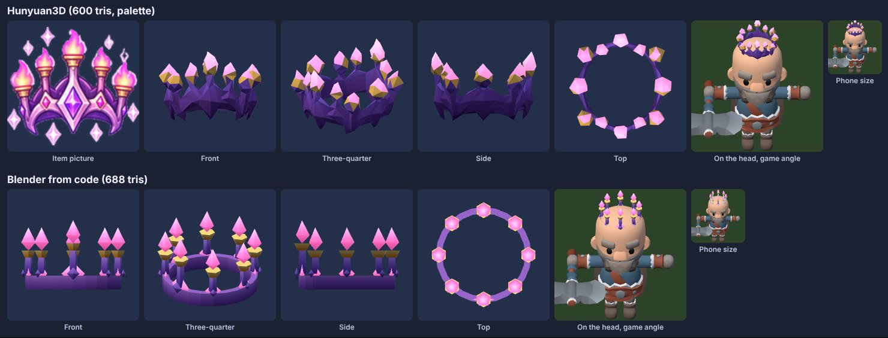
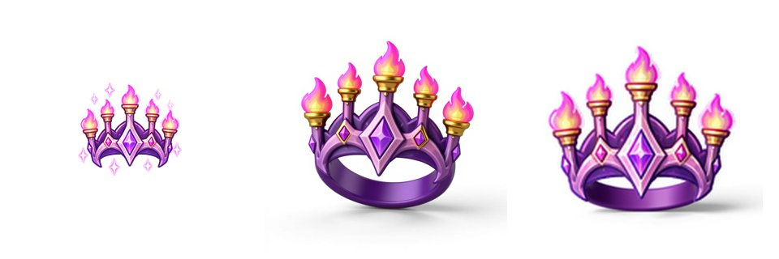
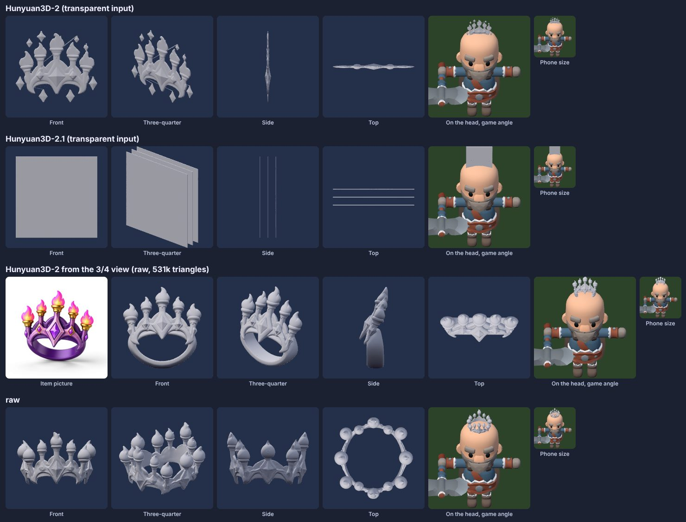

# פיילוט: פריט עם שם בתלת-ממד מ-Hunyuan3D (10.11.2026)

**השאלה:** אפשר לקחת תמונה של פריט עם שם ולקבל ממנה מודל תלת-ממד למשחק, בחינם, דרך Hugging Face?
**הפריט:** הכתר (`crown`, אגדי, אביזר). יש לו תמונה ואין לו מודל משלו. רוב הנשקים כבר קיבלו מודלים (#585, #591), אז בחרתי פריט שהוא לא נשק.
לא חיברתי כלום למשחק.

## בשורה אחת

**זה עובד, בחינם ובפחות מדקה, אבל רק עם שלב ביניים.** הכתר מ-Hunyuan דומה לתמונה יותר מהכתר שבניתי מקוד, באותו משקל. אבל מכסת המחשוב החינמית קטנה, וחלק מהכלים שם שבורים.

למעלה: Hunyuan3D אחרי הקטנה ל-600 משולשים וצביעה בפלטה שלנו. למטה: אותו כתר שנבנה ב-Blender מקוד. משמאל לימין: התמונה של הפריט, מקדימה, שלושת-רבעי, מהצד, מלמעלה, על הראש בזווית של המשחק, ובגודל של טלפון.

## מה קרה, צעד אחר צעד

1. **החיבור עובד.** הטוקן של ניר פותח את ה-Space החינמי `tencent/Hunyuan3D-2`. בניית הצורה לוקחת 8 עד 13 שניות.
2. **מהתמונה כמו שהיא יוצא לוח שטוח.** התמונה של הכתר מצוירת מקדימה, ולכן Hunyuan בנה תבליט דק, בעובי של 3%, ולא טבעת (שורה 1 בתמונת הניסיונות).
3. **שלב ביניים פתר את זה.** ביקשתי מ-FLUX Kontext, גם הוא ב-Space חינמי וגם הוא בכחצי דקה, לצייר את אותו כתר בזווית. ראשית מלמעלה מדי: יצאה טבעת שהפתח שלה פונה אלינו והקוצים יוצאים הצידה (שורה 3). אחר כך מזווית של כ-20 מעלות: יצא כתר אמיתי, טבעת סגורה עם 12 קוצים מסביב (שורה 4).
4. **התאמה למשחק, אוטומטית ב-Blender** (`tools/blender/hunyuan/to_game.py`, 3 שניות): מיישר את הכתר, מקטין מ-418,000 משולשים ל-600, ומשטיח את ההצללה כמו ב-KayKit. אחר כך הוא צובע לפי גובה, ביחס לראש של כל קוץ: טבעת סגולה, קוץ סגלגל, גביע זהב ולהבה ורודה זוהרת, מהפלטה של הנשקים.

התמונה של הפריט, הזווית מלמעלה (לא טובה), והזווית של 20 מעלות (טובה).

1: לוח שטוח. 2: גרסה 2.1 מחזירה קופסה. 3: טבעת שפונה אלינו. 4: כתר אמיתי, לפני ההקטנה.

## מה לא עבד

- **Hunyuan3D-2.1** (גם הוא Space חינמי) מחזיר קופסה שטוחה במקום הפריט, בשני ניסיונות.
- **צבע מ-Hunyuan** (`generation_all`) נכשל אצלם בשגיאה (`NameError`), אז אין טקסטורה. זה לא באמת חסר לנו, כי ממילא צובעים בפלטה.
- **טקסט לתלת-ממד** כבוי ב-Space.
- **ה-API בתשלום של Hugging Face** (Inference Providers) מחזיר 402: לחשבון של ניר אין שם קרדיט. לכן רק Spaces חינמיים.
- **הצביעה לפי גובה** היא כלל שכתבתי לכתר. פריט אחר צריך כלל משלו: כמה דקות, לא אוטומטי לגמרי. היהלומים על הטבעת לא נצבעו בנפרד.

## מספרים

| | Hunyuan3D + Blender | Blender מקוד |
|---|---|---|
| משולשים | 600 | 688 |
| קובץ GLB | 68KB | 56KB |
| דומה לתמונה | ✅ הקשתות והחודים של הטבעת | ⚠️ נקי, אבל כללי |
| סגנון KayKit | ⚠️ קצת "מקומט" | ✅ |
| זמן מחשב | כדקה (30 שניות FLUX, 13 Hunyuan, 3 Blender) | פחות משנייה |
| זמן של Claude | כחצי שעה בפעם הראשונה, ואחר כך כ-10 דקות לפריט (תמונה בזווית, ניסיון או שניים, כלל צבע) | כ-10 עד 30 דקות לפריט, 2 או 3 סבבי תיקון |
| עלות | 0, עם מכסה יומית | 0 |

- **המשקל דומה.** שני הקבצים כוללים את תמונת הפלטה. במשחק הם יידחסו כמו שאר הפריטים (meshopt ב-build3d.js), כנראה ל-35 עד 45KB, כמו `w_item_skyBow` (35KB). זו הערכה: לא הרצתי את הדחיסה.
- **המכסה:** לחשבון חינמי יש כמה דקות מחשב ביום ב-Spaces. הפיילוט כולו, כולל הניסיונות שנכשלו, צרך כ-2 דקות. כלומר כמה פריטים ביום, וכשהמכסה נגמרת מחכים למחר. Hugging Face PRO, כ-9$ לחודש, נותן מכסה גדולה בהרבה (מחקר #175).
- **מזווית המשחק** הכתר קטן מאוד בשתי הגרסאות. בגודל של טלפון רואים בעיקר כתם סגול עם נקודות ורודות-זהובות. ההבדל בין הגרסאות כמעט נעלם שם.

## ההמלצה

**להשתמש ב-Hunyuan3D לפריטים עם שם שהצורה שלהם מסובכת** (כתרים, קישוטים, דברים מתעקלים, חיות על נשק), ולהישאר עם Blender מקוד לפריטים פשוטים (מטות, חרבות, קשתות, מגנים), שם הוא נקי יותר ומהיר יותר.
הדרך שעובדת: **תמונת הפריט ← FLUX Kontext בזווית של כ-20 מעלות ← Hunyuan3D-2 ← `to_game.py` (600 משולשים + פלטה)**. כל הכלים בחינם, בתוך המכסה היומית.

**לפני שמחברים למשחק** (לא נעשה כאן): (1) שורה ב-`ITEMS` (build3d.js) ונקודת אחיזה לראש. הכתר הוא אביזר, ואין היום מקום לאביזר על הדמות: render3d.js מכיר רק `Hat` ו-`Helmet`. (2) אייקון מהמודל (`icon.js`), או השארת התמונה הקיימת. (3) להחליט אם כתר מחליף את הכובע או יושב מעליו.

## הקבצים

- סקריפטים: `tools/blender/hunyuan/`: `kontext_view.py` (תמונה בזווית), `hy_shape.py` (Hunyuan), `to_game.py` (הקטנה וצבע), `crown_code.py` (הכתר מקוד, להשוואה).
- מודלים ותמונת מקור: `art/pilot/hunyuan-crown/` (68KB, 56KB ו-32KB).
- הטוקן נקרא מהסביבה (`HF`), ולא נכתב בשום קובץ.
