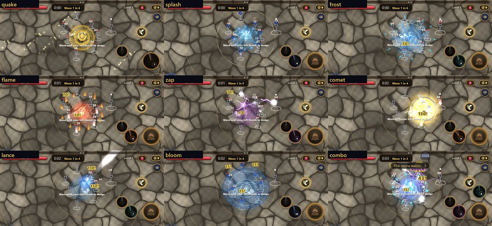
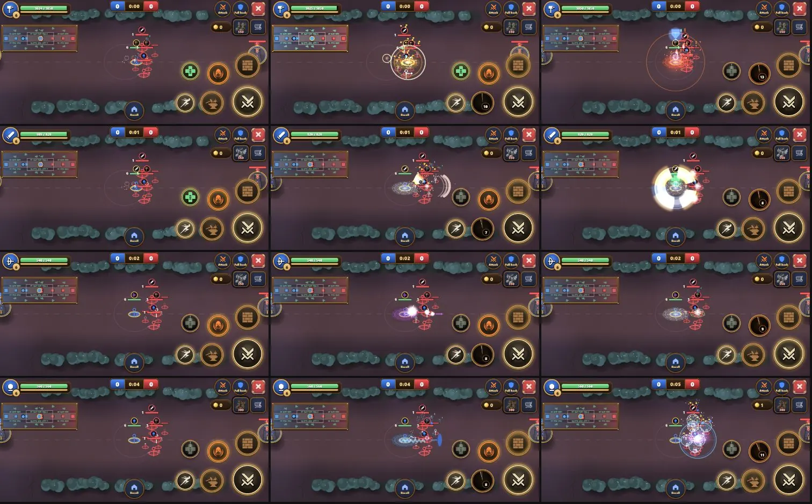
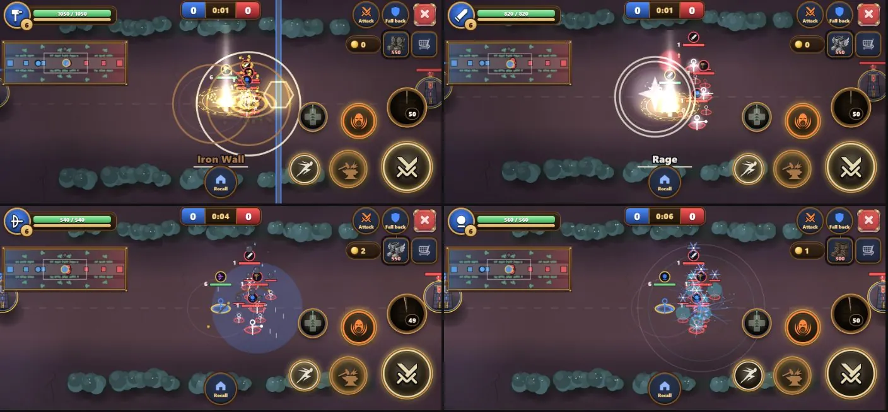

# MLBB FX: gap table (wave 0.1, ARI, 8.11.2026)

**What this is:** wave 0 of DANA's plan, [mlbb-fx-plan.md](mlbb-fx-plan.md) (#527). It's a document only, with no game code. It compares every request in Orel's prompt ("fun-house-mlbb-fx-prompt", 7 parts) against what exists on main today (`6ec7652`).
**Decisions that apply** (H1-H6, approved):
- **H1/H2:** the line-skill rule from #513/#514 wins.
- **H3:** no new hit-stop.
- **H4:** boss telegraphs are magenta.
- **H5:** extend the existing card instead of adding a second moment.
- **H6:** the arena floor is baked once, with no shader.

Hue is still the damage type.

## The short version

1. **No sheet is missing.** Every fx id the prompt names exists in `js/fx-data.js` and `tools/fx-list.json` (82 backticked names checked; 64 are fx ids, the rest are skill names). Wave 0 needs **no new conversions**.
   - Three named sheets exist but aren't used anywhere: `wko_earth`, `tr_axe_amber` and `wx_snow_blizzard_temperate`.
2. **Much of the prompt is already built** (W1/W2, #508, MBAIM, moba-fx).
   - The prompt says the player's own skills have no aim indicator. They do: `moba-aim.js` draws a range ring, line, circle or target while you drag.
   - It says towers show their range all the time. They don't: they show it only near the tower or when it's aiming at you (`moba.js:523-525`).
   - It says the underworld has no banner queue. It has one (`mbBanner.q`).
   - What's really missing is mostly **duration** (decals that stay, a fill that progresses), **trails** and a few **words**.
3. **The prompt asks for colours that break the hue rule:** a crimson warrior, an amber hunter, a gold tank and a crimson assassin. In the rows below, the colour always follows the damage type, as in `DMG`. The assassin follows #485 (purple, the diamond deathmark), which Orel approved.
4. **Two things I found on the way, which need a fix:**
   - `node tools/fx-audit.js` is **not clean on main**: it flags `sfx('ult_ready')` (`moba.js:403`), which is a sound from #495, as a broken fx id. That's a false positive. The audit should skip `sfx(` calls, a one-line fix for whoever owns `tools/fx-audit.js`.
   - `tools/moba-skill-shots.js` has **no assassin row**, so there's no "before" shot of the assassin.

**Key:**

| Mark | Meaning |
|---|---|
| ✅ | exists as asked |
| ≈ | exists in another form |
| ➕ | missing, the sheet exists, to build |
| ⛔ | conflicts with an Orel decision (the row says what replaces it) |
| 🚫 | missing sheet (no rows have this one) |

**Owner/wave:** the PR in the plan that would build it.

## "Before" shots

These are the moments as they look now. They come from `tools/skill-shots.js` and `tools/moba-skill-shots.js`, 2D, seed 7, 844x390 at 2x, on main `6ec7652`.

- Arena, 8 skills plus combo: 
- Underworld, the attack, s1 and s2 of each kit. The rows are tank, warrior, hunter and mage; there's no assassin, see above: 
- Underworld ults (wall, rage, rain, blizzard): 

Three things are visible in the shots:
- The rain ult is a flat, opaque blue disc (`sk_rain` = `rain_sky_mystic`).
- The iron wall is a gold hex shield (`sk_wall` = `shield_hex_gold`), not stone.
- The warrior's spin covers the whole cluster with an amber four-arc ring (`sk_spin`, about 290 px).

## Part 1: underworld, per kit

### Tank (earth, brown, not gold)

| Prompt asks | Status | What exists / what to do | Wave |
|---|---|---|---|
| Attack: `hit_earth` at contact | ✅ | `mbfxImpact` → `MBLIB.hit.earth` | |
| Attack: `step_dust` at the target's feet | ➕ | Small, 1 per hit. Skip it when `MBLIB.busy` is reached | 2.2 |
| Attack: 1-frame hit-stop on hero hits | ⛔ H3 | `MBFX.stop` only from 85 damage (the tank hits for 30). No new stop | |
| Attack: earth-crack decal under the slowed enemy | ➕ | `st_slow` already shows the slow. A decal only if it's quiet: `sk_anvil` at 40% alpha, `sy:0.5`, for the slow time | 2.2 |
| Anvil: `sk_anvil` + `sk_anvil_wave` | ✅ | `moba-kits.js` + `MBANIM.anvil` rocks | |
| Anvil: `tg_ring` past the radius | ⛔ H4 | `tg_*` is the boss-warning language (crimson). An expanding ring is already `sk_anvil_wave` | |
| Anvil: big shake + stop on landing | ≈ | `MBFX.shake.slam` exists. No new stop (H3) | |
| Anvil: crack decal for about 2 s | ➕ | `sk_anvil` plays once (24 frames, 0.8 s). Hold the last frame: needs a small `fxlib` option (`hold`), or `dur:2` with a fade | 2.2 |
| Anvil: `st_stun` on the stunned | ✅ | `MBLIB.stOrder` | |
| Taunt: `sk_taunt` follows | ✅ | | |
| Taunt: shield shimmer while it holds | ✅ | `MBANIM.self.taunt` = `st_defup` for `shieldT` (W2) | |
| Taunt: `sf_embers` drifting off the tank | ➕ | Fire is the taunt's dt, so the colour is right. One loop for `t` | 2.2 |
| Taunt: `st_burn` flicker on attackers | ✅ | burn-back → `st.burn` → `stOrder` | |
| Taunt: red aggro mark on the taunted | ✅ | `MBANIM.taunt` = `tg_target` (crimson) | |
| Wall: slow-mo + banner + `ult_ray` | ✅ | `mbfxUlt` + `mbfxUltLib` | |
| Wall: motion streaks on the yanked | ➕ | Procedural, per pulled unit, about 0.2 s | 2.2 |
| Wall: stone slabs one after another, `step_dust` each | ≈ / ➕ | `sk_wall` is a **gold hex shield**, which is the wrong material. There's no stone-slab sheet in the converted set. Use `sk_anvil` cracks in a row along the wall, staggered 60 ms, plus dust. Earth hue | 2.2 |
| Wall: `wko_earth` shock ring when it's up | ➕ | The sheet exists (`ko_petrify_amber`) and isn't used | 2.2 |

### Warrior (physical, white, not crimson)

| Prompt asks | Status | What exists / what to do | Wave |
|---|---|---|---|
| Attack: `slash` arc | ✅ | `MBLIB.slash` | |
| Attack: `tr_slash_crimson` trail | ⛔ hue | Crimson isn't physical. If a trail is wanted: `tr_slash_sapphire`, the steel precedent of `tr_spin_sapphire` in `MBANIM.spin` | 2.2 |
| Attack: leech orbs back to the warrior | ➕ | Procedural, 3 small orbs, **green** (the heal colour `MBLIB.heal.col`), not red | 2.2 |
| Cleave: everything | ⛔ H1/H2 | Per #514: no `sk_cleave` and no circle. The procedural white arc is the body, and the dust falls behind the shot. `st_stun` already exists. Stop only through `MBFX.stop` | after #514 |
| Spin: blade afterimages | ➕ | 2 ghost copies of `sk_spin`, rotated ±25°, at 40% alpha. **But first** make `sk_spin` smaller and decide amber vs `tr_spin_sapphire` (correction in #514) | 2.2 |
| Spin: `hit` sparks per enemy | ✅ | `mbAnimHit` | |
| Spin: green plus-particles on heal | ✅ | `MBANIM.self.heal` = `st_regen` | |
| Rage: slow-mo + banner + `ult_ray` | ✅ | | |
| Rage: `sk_rage` + `sk_rage_glow` | ✅ | | |
| Rage: ember ring at the cast | ≈ | `MBANIM.rage` = `whit_phys` burst. Embers would be fire, but rage is physical | |
| Rage: speed streaks while moving | ➕ | Procedural, behind the hero only while `mvT>0` | 2.2 |
| Rage: red screen vignette | ⛔ H4/hue | `mbfxScreen` already darkens the edges during the ult banner (1.2 s). A 5 s red edge would read as "low HP". Skip it | |
| Rage: "IMMUNE" pop on a blocked CC | ➕ | There's no `mb.w.immune` word. Add a key in lang.js (`en` only) and `mbWord` at the CC block, once per cast | 2.2 |
| Rage: ember puff on expiry | ➕ | One `whit_phys` small at the end of `rage` | 2.2 |

### Hunter (s1 lightning; attack, net and rain physical)

| Prompt asks | Status | What exists / what to do | Wave |
|---|---|---|---|
| Attack: a trail on every arrow | ≈ | `MBLIB.shot.hunter` = `shot_arrow` follows the shot. **`tr_axe_amber` is an arc**, the wrong silhouette for an arrow. A short procedural streak (as #513) | 2.2 |
| Attack: crits `hit_crit` + a bigger number | ✅ | `mbfxImpact` + `dmg_crit` + size 30 vs 24 | |
| Pierce: everything | ⛔ H1 | #513/#524 owns it. `whit_lightning` per pierced target already exists | #524 |
| Pierce: an arc between all nearby wet enemies | ➕ | Today `st_shock` shows on each wet target (`moba.js:73`), with no link between them. Draw `sk_pierce` links from target to target, only visible ones (`mbfxOn`), at most 4 | 2.2 |
| Net: everything | ⛔ H2 | Per #514: no `sk_net`, no `sk_net_root`, no green. The rope net closes for the root. "Caught!" already exists (`mbWord(o,'root')`) | after #514 |
| Net: `wtg_circle` root decal | ⛔ H2/H4 | `wtg_` is the world-danger telegraph. The closing rope net is the decal | |
| Net: speed streaks during flee | ➕ | Procedural, only while `flee` is active | 2.2 |
| Rain: `tg_circle` reticle during the 0.5 s delay | ⛔ H4 → ≈ | Not crimson `tg_`. Instead: `wcirc_phys` growing over `delay`, which is the area rule (H1: area skills keep their circle) | 2.2 |
| Rain: arrows from the sky with trails | ✅ | `MBANIM.rain.drop` = `shot_arrow` falling (W2) | |
| Rain: no flat puddle | ➕ | The shot shows it: **`sk_rain` is an opaque blue disc.** Replace it with a thin edge ring (`wcirc_phys` at low alpha) | 2.2 |
| Rain: final volley stop + `hit_heavy` + one BIG number per enemy | ≈ | `hit_heavy` (`MBANIM.rain.end`) + `mbDmg big:true` exist. Stop only through `MBFX.stop` (H3) | |
| Rain: slow-mo beat | ⛔ H3 | | |
| Rain: arrows stuck in the ground for about 2 s | ➕ | `shot_arrow` frame 0, held, `rot` straight down, 6 copies, 2 s fade. Needs the same `hold` option as the anvil | 2.2 |

### Mage (water; blizzard ice)

| Prompt asks | Status | What exists / what to do | Wave |
|---|---|---|---|
| Attack: `shot_orb` | ✅ | | |
| Attack: drip trail `wt_droplet` | ➕ | 1 droplet every 60 px of flight, `mbfxOn` | 2.2 |
| Attack: `hit_water` | ✅ | | |
| Wave: everything | ⛔ H1 | Per #514: the crest stands across the path and follows the shot | after #514 |
| Wave: spray on every hit | ✅ | `mbAnimHit` = `whit_water`/`hit_water` | |
| Wave: `st_wet` marker | ✅ | `stOrder` | |
| Bubble: the aura swells during the delay | ≈ | `sk_bubble_aura` is a static size. Grow `size` over `delay` (0.4 s) with `fxlib` `grow`, or with 3 steps | 2.2 |
| Bubble: splash ring on lift | ✅ | `MBANIM.bubble` = `wt_jump` | |
| Bubble: droplet burst on pop | ➕ | `wt_droplet` × 3 at the pop, next to `sk_bubble_halo` | 2.2 |
| Blizzard: snow fills the circle during the delay | ➕ | `wx_snow_blizzard_temperate` (unused) inside the area, alpha 0.5, for the delay only | 2.2 |
| Blizzard: `sk_blizzard` loop, `sk_blizzard_ice`, `st_freeze` | ✅ | | |
| Blizzard: frost from the screen edges | ⛔ | Like the red vignette: a screen overlay competes with the edge-of-screen warnings. Skip it | |
| Blizzard: "FROZEN!" word | ✅ | `mbWord(o,'freeze')` in ice blue (`moba-kits.js:110`) | |

### Assassin (#485 decides: purple shadow, diamond deathmark)

| Prompt asks | Status | What exists / what to do | Wave |
|---|---|---|---|
| Backstab: `hit_crit` in crimson + a stab pop | ⛔ #485 | `dmg_backstab` = `crit_burst_amethyst` (prepared, waiting for the packs; conversion is running now) | ARI → BOB |
| Shadowstep: `sf_fog` both ends | ⛔ #485 | `sk_shadowstep` = `smoke_puff_amethyst` | ARI → BOB |
| Shadowstep: a ghost streak along the dash | ➕ | Procedural, purple, 0.2 s | 2.2 |
| Shadowstep: glow on the daggers during the bonus | ➕ | `st_atkup` small on the hand while `bonusT` lasts | 2.2 |
| Vanish: rising smoke while veiled | ⛔ #485 → ≈ | `st_veil` = `swirling_motes_arcane`, own team only (fog rule) | ARI → BOB |
| Vanish: speed streaks | ➕ | Own team only, like the veil | 2.2 |
| Deathmark: skull | ⛔ #485 | Orel chose the diamond: `sk_deathmark` = `telegraph_target_diamond_amethyst` | ARI → BOB |
| Deathmark: tether to the mark | ➕ | Thin purple line, only when both ends are visible (`mbVisPt`) | 2.2 |
| Deathmark: pulse faster near detonation | ➕ | `fps` rising with time left. Needs `fxlib` to read a changing `fps`; check that it does | 2.2 |
| Deathmark: stop + slow-mo at detonation | ⛔ H3 | `sk_deathmark_burst` (#485) only | |
| Deathmark: gold flash on the Shadowstep button on refund | ➕ | CSS class on the button, 0.4 s. UI, not fx | 2.2 |

## Part 2: arena skills (`SKANIM`, W1)

All 8 skills already have cast, main, hit and status layers. Only the missing pieces are listed here.

| Skill | Exists | Missing (➕), or conflict | Wave |
|---|---|---|---|
| Quake | `sk_anvil` cracks, `sk_anvil_wave`, `debris` rocks, `hit_earth` per hit | ⛔ H4 `tg_ring` (boss language) → use a second `sk_anvil_wave` 0.15 s later. ➕ `step_dust` × 3. ➕ shake scaled to the number hit (BOB checks what quake shakes today; route it through #508's `ARFEEL.shake`). ➕ crack decal for 2 s (needs `hold`) | 1.1 |
| Splash | `whit_water` ring, 4 × `sk_wave`, `st_wet` (wet status) | ➕ `wt_wave` outward ring (unused here). ➕ `wt_droplet` per enemy, inside `hit.perFrame` | 1.1 |
| Frost | `sk_blizzard`, `whit_ice` cracks, `hit_ice` shards, `st_freeze` on combo | ➕ frost decal for 2 s (`whit_ice` held, low alpha) | 1.1 |
| Flame | `sk_rage` fire, `sf_embers`, `hit_fire` sparks, `st_burn` | Nothing missing | |
| Zap | `sk_pierce` link per hop from the hand, `whit_lightning` on the first hit, `st_shock` on combo | Nothing missing. "From the weapon tip" is `skaHand` = `AGE_FX.tip` | |
| Comet | Procedural shrinking ring for the 0.8 s delay (`skills-more.js:72`), `tower_fall` boom, `whit_fire` cracks, embers | ⛔ H4 `tg_growing` (crimson) → keep the procedural ring, or `wcirc_fire`. ➕ comet streak falling during the delay (`shot_orb` fire is missing, so use `hit_fire` stretched with `sx`). ➕ crater decal for 2 s | 1.1 |
| Lance | `sk_pierce_ray` beam, `hit_ice` tip | ≈ It's a **beam**, not a flying projectile, in gameplay (`skills-more.js`). A flying lance would change the timing → keep the beam. ➕ frost streak decal along the beam for 1.5 s | 1.1 |
| Bloom | `wcirc_water` + `water_ripple` loops, `wt_jump` | ➕ `petals` drifting (unused here; the green is the heal, and water stays blue). ➕ green +number per heal pulse: `bloom` heals 3% per 0.5 s tick (`skills-more.js:56`) with no number today | 1.1 |

## Part 3: boss telegraphs (`ARFX`, `arena-fx.js`)

| Prompt asks | Status | Note | Wave |
|---|---|---|---|
| The zone fills over the cast (edge + interior) | ➕ | Today `tg_*` sheets play static, for `wait` ≥ `minWarn`. Fill = a procedural interior scaled by the elapsed `wait`, under the sheet | 2.1 |
| Red fill | ⛔ H4 | **Magenta `#FF3DD8`**, like the world in #521 | 2.1 |
| Warning tick that speeds up | ➕ (sound) | Belongs to the sound round, not fx | sound |
| Boss white flash at cast start | ➕ | Visual only, no stop (H3) | 2.1 |
| Screen-edge pulse for the rage skull | ➕ | Magenta, low alpha, off with reduced motion | 2.1 |
| Scorch/crack decal after each hit | ➕ | At most 6, 4 s each, reusing `whit_fire`/`sk_anvil` held | 2.1 |
| Minor enemies (wisp) telegraph | ✅ | `arena-tg.js` (ATG, W5) | |

## Part 4: player aim indicators (underworld)

| Prompt asks | Status | Note | Wave |
|---|---|---|---|
| Line skills show a strip | ≈ | `mbAimArrow` (canvas, width `s.w`, the true hit width) | 1.2 |
| Point skills show a circle clamped to range | ≈ | `MBAIM` point circle + line | 1.2 |
| Unit skills highlight the target | ≈ | `MBAIM` unit ellipse + line | 1.2 |
| Using `wtg_line`/`wtg_circle`/`tg_target` sheets | ⛔ H4 | Those are danger telegraphs (crimson). The player's own aim stays in **its damage-type colour**, canvas. 1.2 only covers what's really missing: a **quick cast** (a tap without a drag) shows no indicator, so a short flash of the same shape on release | 1.2 |

## Part 5: arena floor and rings

| Prompt asks | Status | Note | Wave |
|---|---|---|---|
| Flagstones visible, less blob contrast | ➕ | In the shots the floor is large dark flagstones with seams (the arena grid above). The dark blobs aren't visible at this zoom in 2D: check in 3D and with `--gfx 2d` on a phone before building. H6: bake once | 1.3 |
| Brass rings and sigils crisp | ≈ | `ARENA_LOOK.line` exists. Check at phone zoom | 1.3 |
| Cracks toward the boss, boss glow | ≈ | Exist in `arena-look.js`. Visibility to be measured | 1.3 |
| Enemy rings = shadow + thin rim | ➕ | Today the arena shows thin white rings (see the shots), not filled discs. Underworld units have filled team discs (`glow_ally`, `MBLIB.glow`) | 1.3 |
| Tower range only when relevant, dashed | ✅ | `moba.js:523-525` (since 2.11). Nothing to build | |
| No solid disc anywhere | ➕ | The real offender is **`sk_rain`** (Part 1, hunter) | 2.2 |

## Part 6: one-tap arena entry

Nir's area (world.js). It's recorded for him, not built here.

## Part 7: UI

| Prompt asks | Status | Note | Wave |
|---|---|---|---|
| Banner queue, one centre banner | ≈ | Underworld: ✅ `mbBanner.q` (`moba.js:196`). Arena: ➕ (`arenaui.js`) | 3.1 |
| Damage numbers drift apart | ➕ | Merging per target exists. A spread for multiple targets doesn't | 3.2 |
| Crit and ult-final numbers big + `dmg_crit` | ✅ | `dmg_crit` behind the number (arena + underworld) | |
| Combo kills: word + colour from `SKILLS.combo` | ✅ | `comboShow` + `ui_juice` card (W1) | |
| Level-up `levelup` + `levelup_ring` | ✅ underworld / ≈ arena | `moba-fx.js` uses both. Arena: extend the existing card (H5) | 3.3 |
| Streak `ui_epic` flourish | ⛔ H5 → ≈ | Extend the existing streak card and pillar. No second layer | 3.3 |
| Hero kill `ko` (underworld) | ✅ | `MBLIB.ko` | |
| Boss/elite kill `ko_boss` + slow-mo (arena) | ✅ | `ko_boss` (arena-fx) + #508 slow | |

## What wave 1 and 2 need from the effects library

- **No conversions.** Every sheet named is already in `fx/`.
- **One small `fxlib` extension**, needed by 6 rows (anvil and quake cracks, rain arrows, frost decal, crater, scorch): **`hold`**, which holds the last frame for `dur` with a fade-out. It's the "small compatible extension" the #513 brief asked for, instead of fake options.
  - Proposed: `fxPlay(id,x,y,{hold:2})` = play once, then show frame `n-1`, with alpha going to 0 over the last 30% of the 2 s.
  - It belongs to whoever owns `js/fxlib.js`.
- **The `deathmark` pulse** needs `fps` read every frame. `fxFrame` already uses `f.fps` per draw, so a changing `f.fps` works, but `age*fps` jumps when `fps` changes. That needs a `t0` reset; BOB checks it.

## Self-review

1. **Does it answer the request?** Every line of the 7 parts has a row. Part 6 goes to Nir.
2. **What could be missing?**
   - The assassin "before" shot, because the tool has no row for it.
   - 3D shots: the tools are 2D only. The checks in waves 1 and 2 run in CI.
   - Part 5 floor blobs: on a phone in 3D they may look different from the 2D shot. 1.3 should start from a phone screenshot by Orel.
3. **Risk:** the 2.2 list is long, about 30 small rows. It should split by kit, 5 PRs across the files of `moba-skill-anim.js` and `moba-fx.js`, one after another, since they touch the same files.
