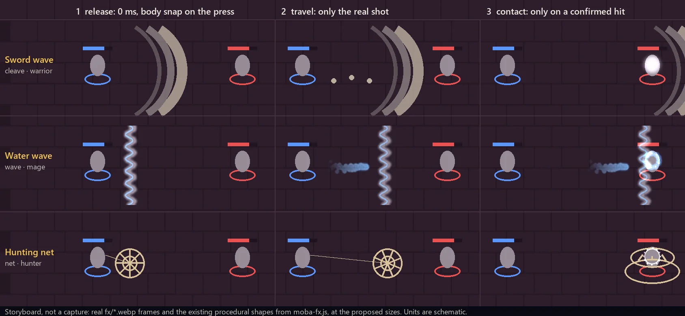

# Concept: the other line skills, MOBA style (ARI, 8.11.2026)

**Status:** waiting for Orel's approval. This is a document only, with no game code. BOB builds these **after** Orel has seen the Lightning Arrow in the game.
**Rules:** the same as in [skill-anim-mlbb.md](skill-anim-mlbb.md) (#513). This document doesn't repeat them. In short:
- the body snaps on the press, with no added windup;
- a line skill gets a line silhouette, not a ground circle;
- the strongest flash happens only on confirmed contact, with hits at `fps:60`;
- no new hit-stop (the existing `MBFX.stop` of 70 ms and the #508 tiers stay);
- fog of war, damage-type hue and the effect caps don't change;
- damage, range, speed, cooldown and hit timing don't change.

*A storyboard, not a capture: real `fx/*.webp` frames and the existing procedural shapes from `moba-fx.js`, drawn at the proposed sizes. The units are schematic.*

## One shared change for all three

At the cast, **remove the ground circle** (`MBANIM.circ`: `wcirc_phys` or `wcirc_water`, 170 px) **and the hand flash** (`MBANIM.flash`). This is the same per-skill "line" flag as the arrow, so it's one rule in `MBANIM`, not three.

**The body:** the player gets `P.skCast`, through the same single adapter as the arrow. Bots get the clip on cast in `moba-move.js`. In the underworld each clip needs a **start offset**, so that its fastest frame lands on the press. Today `heroSkip` applies only in the world and the village.

I measured the clips, decoded from `js/models3d.js` (upper-body rotation speed):

| Clip | Fastest motion | Proposed skip |
|---|---|---|
| `Melee_1H_Attack_Slice_Horizontal` (1.367 s) | 0.27-0.33 s | 0.2 |
| `Ranged_Magic_Shoot` (0.933 s) | 0.07-0.2 s | 0.15, the same as `HERO_SKIP` |
| `Melee_1H_Attack_Chop` (1.067 s) | 0.53-0.6 s | 0.5 |

## 1. The sword wave (`cleave`, warrior)

**Gameplay** (`moba-kits.js:19,66-69`, unchanged): `range:280`, `w:70`, `speed:900`, so it travels at most 0.31 s. It passes through every unit, with a 0.6 s stun and a slow.

**Today:**

| Moment | What happens |
|---|---|
| **0 ms** | The circle and `hit` flash. `sk_cleave` (amber `horizontal_slash`, 170 px) **at the caster**: it starts tiny and peaks around frame 16 (0.53 s), when the wave is already gone, which is the wrong place and the wrong time. `mbfxCleave` scatters 8 dust bits **along the whole line at once**, which previews the hitbox before the wave gets there, and shakes the screen **at the cast**. `MBANIM.cleave` adds a `slash` trail (`quick_jab`), which is almost invisible. |
| **Travel** | The procedural arc in `mbfxShots` (white and cream, 3 bands, radius `w*0.95`). Its height matches the hit width. This is the real projectile. |
| **Contact** | `mbfxHit` spray, then `whit_phys` (a star, 21 frames) on a hero or `hit` on a minion. The existing `MBFX.stop`. |

**Proposal:**

| # | Body | Effect |
|---|---|---|
| 1 | `Melee_1H_Attack_Slice_Horizontal@up`, skip 0.2 | **Remove** `sk_cleave`, the `slash` trail and the cast shake. The arc starts at the hand, and that's all. |
| 2 | follow-through | Keep the procedural arc. A dust puff falls **behind** the real shot every ~40 px, instead of along the whole line at the cast. |
| 3 | existing | `whit_phys` or `hit` at `fps:60`, hero size 90. |

**Why:** amber is gold, and in this game gold means loot and XP, while physical damage is white. The arc is already white.

**Also:** `mbfxCleave` uses `rand`, which is `Math.random`, the gameplay RNG in seeded runs. The new dust should use the `mbaRnd` pattern. Seeded runs will change once, and that's expected.

## 2. The water wave (`wave`, mage)

**Gameplay** (`moba-kits.js:28,75-82`, unchanged): `range:440`, `w:70`, `speed:620`, so it travels at most 0.71 s. It passes through, makes the target wet for 3 s, and slows it.

**Today:**

| Moment | What happens |
|---|---|
| **0 ms** | The circle and the `hit_water` flash. `sk_wave` (`water_blast`, follows the shot, 154 px: a blob of about 45 px). `sk_wave_crest` (a sine band, 140 px) stays **at the cast point** for 0.8 s, while the wave leaves. |
| **Travel** | Only the blob, which is about 45 px wide while the hitbox is 70 + the target's size. |
| **Contact** | `whit_water` (a bright disc, then a ring of drops) or `hit_water`. Wet status from `MBLIB.stOrder`. |

**Proposal:**

| # | Body | Effect |
|---|---|---|
| 1 | `Ranged_Magic_Shoot@up`, skip 0.15 | Only the crest. |
| 2 | follow-through | **The crest moves with the shot**: `follow:sh`, `rot:ang+π/2`, so it stands **across** the path, at size `w*1.4`, the real hit width. The blob stays as the core. The same two sheets as today, used in the right place. |
| 3 | existing | `whit_water` or `hit_water` at `fps:60`. The wet status doesn't change. |

## 3. The hunting net (`net`, hunter)

**Gameplay** (`moba-kits.js:25,83-86`, unchanged): `range:460`, `w:26`, `speed:820`, so it travels at most 0.56 s. It stops at the **first hero**, passes over minions, and roots for 1.2 s.

**Today:**

| Moment | What happens |
|---|---|
| **0 ms** | The circle and the `hit` flash. `sk_net` (green `hookshot_hook`, a line that grows over 46 frames, 1.5 s), so in 0.56 s it reaches only a third of its length. |
| **Travel** | `sk_net` plus the procedural rope net in `mbfxShots`, which spins, in rope colour `#D9C39A`. That's two different "nets" on top of each other. |
| **Contact** | Spray, shake and `whit_phys`. Then **four** signs of the root at once: `sk_net_root` (green growing vines), green canvas roots, the closing rope net (`mbfxMarks`) and the `st_slow` icon. |

**Proposal:**

| # | Body | Effect |
|---|---|---|
| 1 | `Melee_1H_Attack_Chop@up`, skip 0.5 (an overhand throw). The player hunter keeps the bow in the left hand. | Nothing extra. |
| 2 | follow-through | **Remove `sk_net`.** Keep the rope net, plus a thin procedural rope from the hand to the real net, drawn only when both ends are visible (`mbVisPt`). |
| 3 | existing | `hit` at `fps:60` instead of the star. **Remove `sk_net_root` and the green roots.** The closing rope net stays for the whole root, and so does the `st_slow` icon. |

**Why:** green isn't one of the damage types, and vines read as nature. The net is physical.

## Notes

- **Correction to #513:** the large gold four-arc rings in its example frame are **`sk_spin`** (amber `spin_attack`, `k:2.3` × `r:125`, about 290 px), the warrior's spin. They are not `dmg_crit` as I wrote there. `sk_spin` isn't a line skill, so it's out of scope here. It's the next candidate if Orel wants one: a smaller size and the same amber-to-white question.
- **Per cast:**

  | Skill | Sheets at release today | Proposed |
  |---|---|---|
  | Sword wave | 4 | 0 |
  | Water wave | 4 | 2 |
  | Net | 3 | 0 |

  The root goes from 4 signs to 2. The caps don't change.
- **No new assets.** No clip can do a real net throw or a two-handed water push: the chop and the shoot are the closest.
- **Shared files** (`render3d.js` for the skip in the underworld, `moba.js` for the shot hook) get the owner's OK first, as with the arrow.
- **Tests:** the same as the arrow. Also a net that hits nothing and passes over minions, a wave that ends at its range, and seeded runs before and after: the only expected change is the RNG from the cleave dust.
