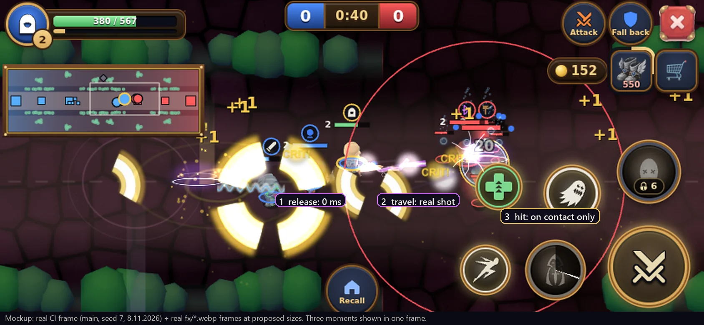

# Concept: MOBA-style skill animation, one skill (ARI, 8.11.2026)

**Status:** waiting for Orel's approval. This is a document only. No game code has changed, no asset has been converted or bought, and nothing is merged into the game.
**Scope:** the underworld games and the arena only. The world and the village are untouched.
**Brief:** Orel's "MLBB-style skill animation" brief from Drive, copied by MAX. #508 (arena feel) is treated as approved and existing: its hit-stop tiers, cast pose and Rampage stay as they are, and this proposal adds no hit-stop.

*Mockup: a real CI screenshot (main, seed 7, 8.11.2026, 844x390 landscape phone, shown at 2x), with real frames from `fx/*.webp` placed at the proposed sizes. Three moments (release, travel, contact) are drawn in one frame. HP bars, the minimap, the tower range ring and all controls stay visible. This is not a capture of running code.*

## The skill: the hunter's Lightning Arrow (`pierce`)

It is an existing directional projectile with a real travel event, so nothing is invented.

- Defined in `js/moba-kits.js:24` as `s1:{id:'pierce',kind:'line',cd:8,range:640,w:28,dmg:90,speed:1000,dt:'lightning'}`.
- Cast in `js/moba-kits.js:75-82`, and simulated in `js/moba.js:349-359`.

### What happens today, with timestamps

| Moment | Gameplay (unchanged by this concept) | Visual today |
|---|---|---|
| **0 ms**: the input frame | `mbCast` creates the shot in the same frame. It has no windup. | Four sheets start together: `wcirc_lightning` (a 170 px violet ground circle, 0.45 s, from `MBANIM.circ`), `st_shock` (90 px at the hand, `MBANIM.flash.pierce`), `sk_pierce` (150 px, follows the shot) and `sk_pierce_ray` (150 px at 40 px forward, 24 frames at 30 fps = 0.8 s). |
| **Body** | none | **The player's hunter does not move for skills in the underworld.** `P.skCast` is set only in the arena (#508 `afCast`), and `SKCAST.where` excludes `S.mb`. Bot hunters get a clip only on an auto-attack (`MBMOVE.atk`, `moba-move.js:61-62`), and `mb_hunter` holds no bow (`render3d.js:57` has no prop). |
| **0 to d/1000 s**: travel | The shot moves at 1000 px/s for up to 640 px (up to 0.64 s). It passes through every unit and stops at a wall (`moba.js:355`). | `sk_pierce` is a small orb with a short wavy tail, about 25 px on screen. There is no trail. |
| **Contact**, per unit, only inside `s.on(o)` | `mbDmg`. A hit of 85 or more by the player already triggers the existing underworld stop of 70 ms and a 2.5 shake (`MBFX.stop` and `MBFX.shake.hit`, `moba-fx.js:12,16,98`). | `mbAnimHit`: `whit_lightning` on a hero, sized `r*4` and clamped to 100-150, or `hit_light` on a minion, sized 50-90. Both run 23 frames at 30 fps = 0.77 s, starting with a white disc. |
| **End**: range reached or wall | `s.gone`. | `sk_pierce` disappears, because its follow target is gone. Nothing marks where the arrow ended. |

Fog of war already holds: `fxSeen` hides library effects at draw time, and `mbAnimHit` checks `mbfxOn` at creation.

### What is wrong, against the brief
1. **The body doesn't act.** The arrow leaves the hunter, but the hunter doesn't shoot.
2. **The wrong silhouette at release.** A directional skill gets a round ground circle plus two round flashes. That's the same "every cast is a magic circle" look the brief warns about.
3. **The travel is thin.** A 25 px orb with no trail is hard to read in a crowded fight. The mockup frame shows this: large gold crit rings (`dmg_crit` and `hit_crit`) dominate it.
4. **The contact is long and opaque.** For 0.17 s the white disc covers the target, and the tail lasts 0.6 s.

## Proof: the clips and sheets exist

**KayKit clips.** These were decoded from `js/models3d.js` with the game's own meshopt decoder (`js/vendor/three-bundle.js`). Durations are in seconds, followed by where the motion happens:

- `anim_ranged`:
  - `Ranged_Bow_Release` (1.333): **the release snap is in the first 0.07 s** (the fastest upper-body rotation in the clip), the follow-through runs 0.2-0.6 s, and the settle runs 0.67-1.33 s. This matches `HERO_SKIP.Ranged_Bow_Release:0` in `render3d.js:482`.
  - `Ranged_Bow_Draw` (1.333): the pull takes 0-0.3 s and is held until 0.8 s.
  - `Ranged_Bow_Idle` (1.567) and `Ranged_Magic_Shoot` (0.933) also exist.
- `anim_moveAdv`: `Running_HoldingBow` (0.8).
- `anim_general`: `Hit_A` (0.667).

**FXDATA.** All of these are already converted and in `fx/`; the format is cols x rows, frames, cell px:

| ID | Source | Format | Size |
|---|---|---|---|
| `sk_pierce` | bullet-projectile `lightning_bolt_amethyst` | 6x4, 24 frames, 128 px | 23 KB |
| `sk_pierce_ray` | light-ray `anamorphic_magic` | 6x4, 24 frames, 160 px | 18 KB |
| `whit_lightning` | hit-impact `electric_spark_silver` | 6x4, 23 frames, 160 px | 31 KB |
| `hit_light` | hit-impact `electric_spark_sapphire` | 6x4, 23 frames, 96 px | 16 KB |

I checked the frames in a contact sheet:
- `whit_lightning` and `hit_light`: frames 0-5 are a bright disc, and frames 6-22 are thin crack lines that fade.
- `sk_pierce_ray`: one static orb with a horizontal streak, almost the same in every frame.
- `sk_pierce`: the orb sits at the right of the cell with its tail to the left, so `rot:ang` points it along the shot.

## The storyboard (proposed)

Each moment in the storyboard ties to a real event. No timing changes.

| # | When | Body | Effect | Notes |
|---|---|---|---|---|
| 1 | **Release: 0 ms**, the same frame as `mbCast` | `Ranged_Bow_Release@up` on the upper body, so the legs keep running. It plays over `SKCAST.dur` (0.42 s), which puts the snap within the first 25 ms. | `sk_pierce_ray` at 70 px, `rot:ang`, alpha 0.85, `dur:0.1`, at the bow hand. | **Remove** `wcirc_lightning` and the `st_shock` flash for this skill. Four sheets become one. |
| 2 | **Travel**: 0 to d/1000 s | follow-through of the same clip | `sk_pierce` at 190 px instead of 150 (an orb of about 32 px), still `follow:sh`. **New:** a thin procedural streak behind the real shot, at most 90 px long, violet (the lightning hue) with a white core. | The streak is drawn from the shot's real position every frame, never from a separate path. It draws only when both its head and its tail are visible (`mbVisPt`). |
| 3 | **Contact**: only inside `s.on(o)` | the existing hit reaction; nothing is added | The same `whit_lightning` or `hit_light`, with `fps:60`: a bright core for about 83 ms, then a crack tail of about 280 ms. Hero size 90-110 instead of 100-150. | It plays only on confirmed contact. The existing 70 ms stop and 2.5 shake stay as the only "heavy" accent, and **no new stop is added**. |
| 4 | **End**: range or wall | the settle of the clip (to 0.42 s), then back to run or idle | Optional: a dim `hit_light` (40% alpha, 45 px) at the real end point. | This is decoration where the arrow actually stopped, not a victim effect. A miss stays a miss. It needs a small `end` hook in the shot loop. |

**Per cast:** 4 sheets at release become 1 sheet plus the streak. Contact effects are 40% shorter, so fewer are on screen at the same time. `perCast`, `hit.perFrame`, `room` and `FXLIB.max` don't change.

**Reduced effects (`fxLess`):** the release streak goes away. The projectile core and its streak stay, because they are the information. **Reduced motion:** nothing new shakes or stops.

**Colour:** everything stays the lightning hue (violet and white). Ally and enemy are still told apart by the existing team rings and HP bars.

## What improves
- The hunter visibly shoots: the snap happens exactly on the press, with no added delay.
- A directional skill reads as a line (streak + core) instead of a circle.
- The brightest moment moves from the cast to the confirmed contact, and the target stays visible under it.
- Fewer layers, not more.

## What the available clips cannot do
- **No aim-hold before release.** `Ranged_Bow_Draw` is a 0.3 s pull. Using it before the shot would add a windup, which is a gameplay change and is not proposed.
- **No skill-specific motion.** The KayKit set has one bow release, so the Lightning Arrow and the normal arrow share the same body motion. They differ only in the effect.
- **No bow-string or recoil motion,** because the bow models are static.
- **Bot hunters hold no bow.** `mb_hunter` has no prop. Giving it the existing `w_bow_A_withString` uses an existing model and the existing `GRIP3D.bow`, but it touches `render3d.js` (a shared file), so it needs the owner's OK.

## New assets?
**None are needed for this skill.**
- Optional later: `sniper_amethyst` from the bullet-projectile pack ("thin streak with bright round tip", catalog row 257) would give a sharper core than `lightning_bolt`. It would go through `tools/fx-list.json` and `fx-convert.py` once the packs are on disk.
- Nothing is bought or generated.

## How BOB would build it, after approval

| File | Change |
|---|---|
| `js/moba-skill-anim.js` | No circle for line skills (a per-skill flag in `MBANIM`), a new `flash.pierce`, and `fps` on hits. |
| `js/moba-kits.js:81-82` | Sizes and duration for the release streak. |
| `js/moba-fx.js` | The procedural streak, drawn from `MB.shots`, plus the fog check. |
| `js/moba-move.js` | A skill-cast clip for bot heroes, the same way as the auto-attack. |
| A small `mbCast` wrapper (`u.me`) | Sets `P.skCast={k:'zap'}`. `render3d.js:518` plays it without the `SKCAST.where` gate, so `skillcast.js` doesn't change. |

- **Coordinate with #508's `afCast`** so there is one place that sets `P.skCast`.
- **Shared files** (`render3d.js` bow prop, the `moba.js` shot-loop `end` hook) get the owner's OK first.
- **Tests:** the existing `npm run check`, with the same seed before and after: damage, range, speed, cooldown and hit timing unchanged. Also `npm run fx:audit`, plus the cases from the brief: miss, wall stop, death mid-flight, fog, reduced effects and a missing sheet.

## The decision for Orel
1. Approve this direction for the Lightning Arrow: a bow pose on release, a line instead of a circle, and the strongest flash only on contact.
2. If approved: should the same rule apply later to the other line skills (`cleave`, `wave`, `net`), each with its own short concept? Or should we stop at this one and look at it in the game first?
