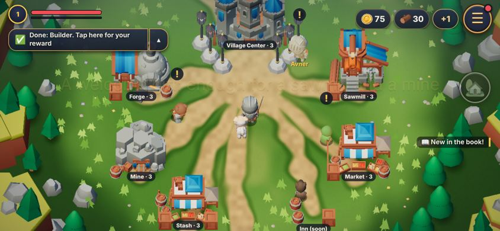
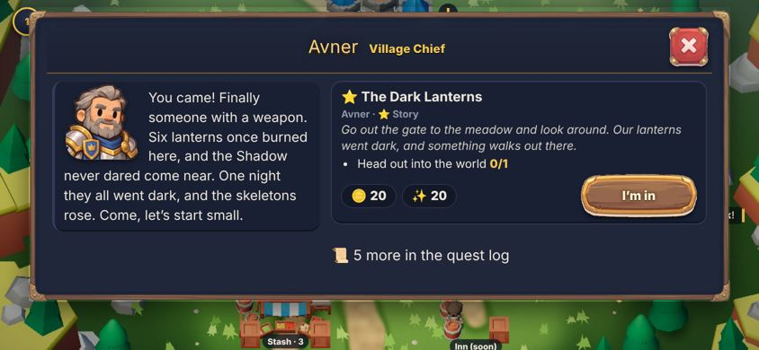
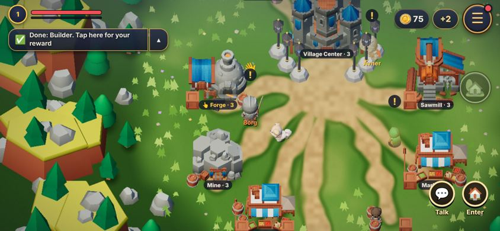
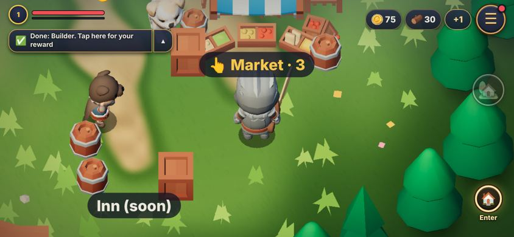
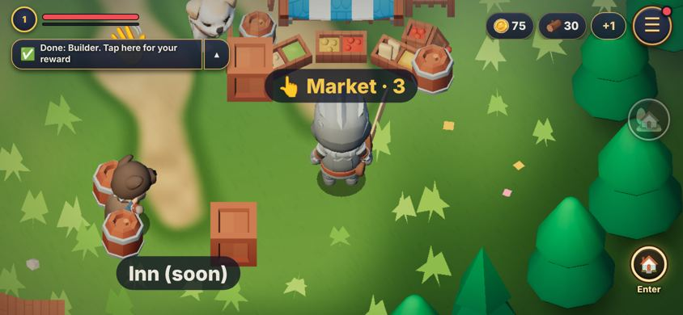
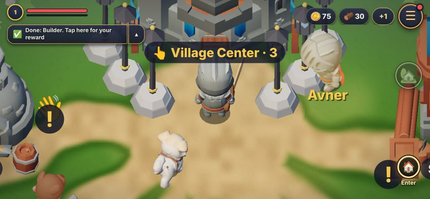
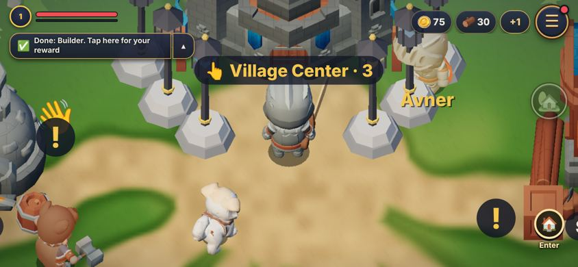
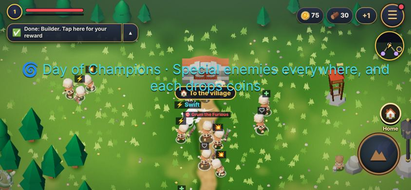
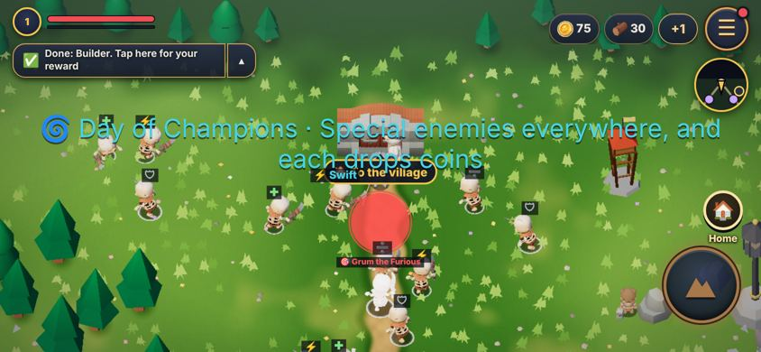

# טקסטורה למבנים: מחקר ופיילוט

> **עדכון 2.11.2026: דלוק לכולם** (ניר: "איפה הטקסטורה שביקשתי למבנים, ובכללי?"). הפיילוט הורחב: כל מודלי הכפר והטבע (עצים, סלעים, גבעות, ארגזים, גדרות), דוגמאות עבות יותר שנראות בזום הרגיל, וגודל לפי יחידות העולם. הקרקע קיבלה דוגמה לכל אזור וחלוקים בשבילים (ground.js). כבוי בזירה. `?tex=0` מכבה. הצילומים: [shots/textures2](shots/textures2). מה שלמטה הוא המחקר המקורי.

ניר, 2.11.2026: "לבדוק את האפשרות ליצור טקסטורה למבנים, כדי לגרום להם להיראות טוב יותר".
הכוונה למבנים בתלת-ממד בכפר ובעולם (KayKit). בזירה לא נגענו.

## מה יש היום

- **כל מבני הכפר הם KayKit Medieval Hexagon** (`v_castle`, `v_forge` ועוד, ב-`BUILDS` ב-tools/build3d.js). אין להם טקסטורה אמיתית: כולם צבועים מאותה תמונה קטנה (256×256) של 8×4 משבצות צבע, וכל משטח לוקח צבע ממשבצת אחת. זה הסגנון של KayKit: צבע אחיד לכל משטח.
- **החומר:** `MeshLambertMaterial` (`lambert()` ב-render3d.js), בלי מפת בליטות ובלי ambient occlusion. התאורה, הקרקע והאובך של `look-hd.js` כבר דלוקים לכולם. הצללים עוד בניסוי (`?look=hd`).
- **גודל על המסך:** בטלפון שוכב (844×390) מבנה תופס בערך 70 עד 100 פיקסלים. **זה הנתון הכי חשוב בכל ההחלטה:** פרט קטן מ-3–4 פיקסלים נעלם או מרצד. טקסטורה צריכה להיות בקנה מידה גס (אבנים, קרשים, שורות רעפים), לא תמונה מפורטת.
- **מגבלה טכנית:** המשחק נפתח גם מ-`file://`, ומשם הדפדפן לא מעביר קובץ תמונה לכרטיס הגרפי. לכן כל טקסטורה מקובץ צריכה להיכנס לקובץ JS כטקסט (base64, כמו `models3d.js`), עם תוספת של כשליש למשקל.

**שטח לפי משבצת צבע** (נמדד): הטירה 90% אבן אפורה (משבצת 2,0). המנסרה והשוק 55–65% עץ (6,0). הגגות הכחולים במשבצת 0,3. המכרה 75% סלע (2,2). כלומר: **המשבצת אומרת מה החומר.** על זה בנוי הפיילוט.

## האפשרויות

| אפשרות | הורדה | מהירות בטלפון | עבודה | תועלת |
| --- | --- | --- | --- | --- |
| **1. דוגמה לפי משבצת צבע** (הפיילוט): השיידר מזהה אבן, עץ או גג, ומוסיף אבנים, קרשים או רעפים באפור שמכפילים את הצבע של KayKit. ועוד צל רך בתחתית המבנה | 0 KB (מצויר בקנבס) | בלי ציורים נוספים. 1–3 קריאות טקסטורה לכל פיקסל של מבנה | הפיילוט: נעשה. לכל המבנים: חצי סשן | בינונית: עדין בזום הרגיל, ברור בזום קרוב ובמסך הגדול של ניר. נשאר בסגנון |
| **2. תמונות CC0** (Poly Haven, ambientCG) באותו שיידר | 20–40 KB לתמונה של 256 (×1.33 ב-base64) | כמו 1 | שעה, על בסיס 1 | נמוכה: הן צילומים מציאותיים, ולא מתאימות ל-KayKit. ב-80 פיקסלים הן הופכות לרעש |
| **3. אריחים מ-Creative Claw** בקו של fun-house (אבן, עץ ורעפים בדף אחד) באותו שיידר | כ-30 KB לשלושתם | כמו 1 | שעה, וכ-15 קרדיטים | בינונית-גבוהה: מצוירים ביד ובסגנון. שדרוג של 1, לא תחליף |
| **4. טקסטורה מצוירת לכל מבנה** (UV חדש) | 50–150 KB למבנה | כמו היום | ימים: לפתוח מחדש כל מודל ב-Blender | גבוהה אבל לא שווה: ה-UV של KayKit מצביע על משבצות צבע, ואין דרך בלי לעבוד מחדש על כל מודל |
| **5. בלי טקסטורה:** צבע לפי רמה, קווי מתאר, אור מהצד (rim) | 0 | קווי מתאר: פי שניים ציורים למבנים. השאר בחינם | שעה עד סשן | צבע לפי רמה: גבוהה ("כל התקדמות נראית"). קווי מתאר: בינונית, ויקרה |
| **6. צללים** (כבר קיימים ב-`?look=hd`) | 0 | כשליש מהמהירות (docs/visual-plan.md) | סשן (שלב 2 שם) | **הגבוהה מכולן:** המבנים "יושבים" על הקרקע |
| **7. חבילת מודלים אחרת עם טקסטורות** | MB | תלוי | ימים | לא מומלץ: החבילות החינמיות בסגנון הזה (Quaternius, Kenney) צבועות גם הן בצבע אחיד, ועם טקסטורות מצוירות הן בתשלום. גם לא יתאימו לדמויות של KayKit |

## הפיילוט

`js/tex3d.js` (קובץ חדש, כ-60 שורות). **דולק רק עם `?tex=1` בכתובת. בלי הדגל הוא לא נוגע בכלום.**
- מבני הכפר והשער (`TEX3D.models`): לאבן, עץ וגג (`TEX3D.cells`) מתווספת דוגמה, ולכל מבנה צל רך בתחתית.
- שלוש הדוגמאות מצוירות בקנבס, 256 פיקסלים כל אחת. החלפה בתמונות CC0 או מ-Creative Claw: `TEX3D.src`, בלי לגעת בשיידר.
- לא נוגע ב-render3d.js: מסמן את החומרים של המבנים (`userData.tx`), והשיידר משתנה רק להם. גם מבנה שזוהר לפי רמה שומר על הדוגמה.

| | לפני | אחרי (`?tex=1`) |
| --- | --- | --- |
| הכפר, זום רגיל |  |  |
| הנפחייה והמכרה |  |  |
| זום קרוב: גג השוק והמנסרה |  |  |
| זום קרוב: הטירה |  |  |
| העולם (רק השער משתנה) |  |  |

**מה רואים:** הרעפים על הגגות הכחולים והאבנים בנפחייה ובטירה עובדים יפה. הקרשים עדינים מדי. הסוכך המפוספס של השוק (בד) קיבל רעפים, וזה לא נכון: צריך להוציא אותו (משבצת 1,0 ו-0,3 באותו מבנה) או לתת לו דוגמת בד. **בזום הרגיל בטלפון קטן ההבדל עדין.** בזום קרוב ובמסך של ניר (1280×590) הוא ברור.

## ההמלצה

1. **קודם צללים** (שלב 2 ב-docs/visual-plan.md). זה השיפור הכי מורגש למבנים, יותר מכל טקסטורה.
2. **אחר כך הפיילוט הזה לכולם, כשלב במראה** (`tex` ב-`HD.stage` של look-hd.js, ולא דגל נפרד): 0 KB, בלי ציורים נוספים, ושומר על הסגנון של KayKit.
3. **בהמשך, אם ניר רוצה עוד:** אריחים מ-Creative Claw במקום הציור בקנבס (אפשרות 3), וצבע לפי רמה (5). CC0 מציאותי ומודלים חדשים: לא.

## מה ייקח להחיל על הכל

חצי סשן:
- להעביר את הדגל ל-look-hd (`HD.stage` או `HD.lab`), ולכבות בזירה כמו שאר המראה.
- להוציא את הסוכך של השוק ואת הבד של האוהל, ולחזק את הקרשים.
- להוסיף את הקישוטים (ארגזים, חביות, ערימות עץ ואבן) ואת השערים בעולם, ולבדוק את אזורי העולם האחרים (שלג, מדבר).
- מדידת מהירות עם `?fps` באייפון של אוראל ובטלפון של ניר. צפוי ללא שינוי, כי אין ציורים נוספים.
- אופציונלי: דף אריחים מ-Creative Claw (כ-15 קרדיטים) לתוך `TEX3D.src`. בסשן הזה Creative Claw לא נוסה, כי המחקר הראה שהבסיס צריך להיות השיידר ולא התמונה.
