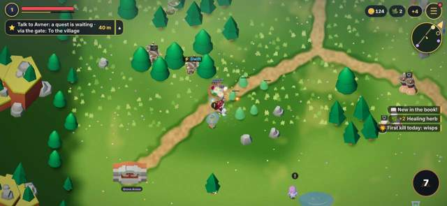
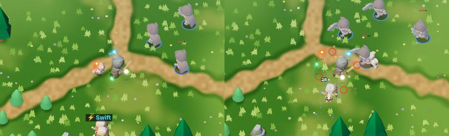
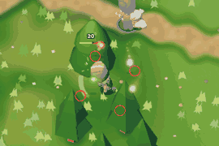
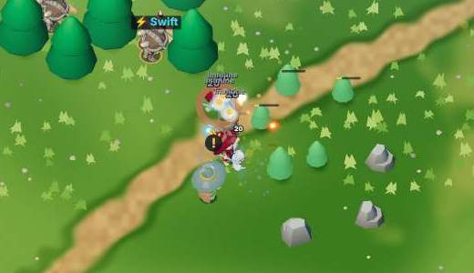
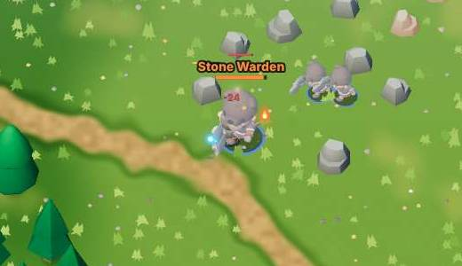

# למה הקרב בעולם לא כיף, ומה עושים: מחקר ותוכנית

נכתב ב-1.11.2026 על ידי Claude, אחרי שניר כתב: "המכניקות של הקרב צריכות שיפור... כרגע זה לא מרגיש כיף. מפריע לי שלא ברור איך האורות שמרחפים סביבי תורמים". זו הצעה. לא שיניתי קוד משחק.

## איך מדדתי

בוט שמשחק בעולם הפתוח (`tools/combat-lab/play.js`), ברוחב הטלפון של ניר (1280×590). הגיבור באמצע הדרך: לוחם ברמה 6, חרב, שלושה אורות (אש, כפור, אבן), הסקיל "רעידה". כל תרחיש שוחק פעמיים:
- **בוט פעיל:** מתקרב, בורח בחיים נמוכים, מתחמק מיריות ולוחץ על הסקיל כשהוא מוכן.
- **בוט עומד:** הולך לאויב הקרוב ועומד. בלי סקיל, בלי בריחה.

אם העומד מצליח כמעט כמו הפעיל, ההחלטות של השחקן לא משנות. נמדד כל נזק (ממי), כל הריגה, כל מכה שחטפתי וממה, וכל פעולה של אור. מריצים שוב: `node tools/combat-lab/play.js` (כ-10 דקות), והצילום הקרוב של האורות: `node tools/combat-lab/lights.js --truth`.

| | פעיל, 150 שניות באחו | עומד, באחו | פעיל, השומר האבן | עומד, השומר האבן |
| --- | --- | --- | --- | --- |
| הריגות | 126 | 56 (מת אחרי 54 שניות) | השומר נפל אחרי 85 שניות | מת אחרי 59 שניות |
| זמן הריגה של אויב רגיל | 0 עד 0.5 שניות (מכה אחת) | אותו דבר | | |
| נזק שחטפתי | 112 מתוך 125, בכל 150 השניות | 173 | **0** | 125, בשש מכות של 21 |
| החיים הכי נמוכים | 83% | 5% | 100% | 4% |
| יריות שהתחמקתי מהן | 0 (כמעט אין יריות באחו) | | 0 | |
| חלק האורות בנזק שלי | 15% | 21% | 4% | 7% |

## האבחנה: חמש סיבות

### 1. אין קרב, יש מכסחת דשא
אויב רגיל באחו נופל במכה אחת: לגרנט יש 12 עד 23 חיים (33 כפול האזור), והחרב עושה 30 (20 ×1.5 חולשה לפיזי). הבוט הורג 1.7 אויבים בכל שנייה של קרב, ו-80% מההריגות לוקחות פחות מחצי שנייה. אין רגע שבו אויב "נלחם בחזרה", ואין "וואו" של ריסוק, כי הכול נעלם באותה מהירות.

### 2. ההחלטות שלך לא משנות, והסכנה לא נראית
- בוט פעיל: 17 מכות אמיתיות ב-2.5 דקות, והחיים לא ירדו מתחת ל-83%. שום רגע לא דרש ממנו לחשוב.
- בוט עומד: מת אחרי 54 שניות. אבל ממה? **כל הנזק באחו הוא מגע** (אויב שנוגע בך) ופיצוץ של אויב "מתפוצץ". אין מכה שמתכוננת, אין סימן על הרצפה, אין משהו לקרוא ולהתחמק ממנו. אתה לא מת כי טעית ברגע מסוים, אלא כי עמדת יותר מדי זמן.
- רגעי החלטה (הסקיל מוכן, החיים יורדים מתחת ל-40%, אויב מתפוצץ, השומר): בממוצע **אחד כל 15 שניות**. ב-Archero יש החלטה כל שנייה (לעצור לירות או לזוז).
- יש סקיל אחד בלבד, והוא מוכן כל 7 שניות.

### 3. האורות: עובדים, אבל אי אפשר לראות מה הם עשו (מה שמפריע לניר)
מה כל אור עושה במספרים (`ORBIT` ב-orbit.js), ומה קרה בפועל:

| אור | מה הוא אמור לעשות | מה קרה בדקה של קרב |
| --- | --- | --- |
| אש 🔥 | 60% מהנזק של הנשק, למי שהוא עובר דרכו | 20 עד 35 פגיעות. 15-22% מכל הנזק שלי |
| כפור ❄️ | 25% נזק בקרח, מאט | נספר יחד עם האש. ההאטה לא נראית בכלל |
| אבן 🛡 | עוצר יריות, בולע מכה פעם ב-8 שניות | 0 יריות נעצרו, 0.4 עד 1.1 מכות נבלעו |
| עלה 💚 | מרפא 4% כל 4 שניות, רק כשפגוע | (נפתח ברמה 10) |
| תלתן 🍀 | ‎+8% קריטי, ‎+15% שלל | אין שום דבר שמראה אותו |

למה ניר לא מרגיש אותם:
- **האור לא נמצא איפה שהוא פוגע.** הפגיעה קורית במעגל ברדיוס 64 על הרצפה (orbit.js), והאור מצויר 26 פיקסלים מעליו, נגרר אחרי הדמות, ומקדים או מפגר עד 20° (wisps.js). בתמונה מימין, העיגולים האדומים הם איפה שהאורות באמת פוגעים:
  
  
- **הם קטנים.** ליבה של כ-9 פיקסלים במסך של 590. הדמות עצמה כ-5% מגובה המסך, והאורות מתערבבים עם הניצוצות, המספרים והדשא הבהיר:
  
- **אין חתימה.** פגיעה של אור נותנת אותו מספר לבן כמו החרב. גם האש וגם הכפור מהבהבים כשאחד מהם פוגע (`fire` ב-wispsUpdate). ההאטה של הכפור, הקריטי של התלתן והשלל הנוסף לא מוצגים בכלל.
- **המגן כמעט לא עובד באחו**, כי אין שם יריות לעצור.
- **ככל שמתחזקים, האורות עובדים פחות.** מדידה של סשן האורות (רמה 15, חמישה אורות): אור האש פועל פעם בכ-30 שניות, והכפור פעם בכ-15, כי ההתקפה האוטומטית הורגת את האויבים לפני שהם מגיעים לטבעת. גם טבעת רחבה יותר (`ORBIT.r` 90 עד 110) כמעט לא עוזרת. זו אותה בעיה כמו סיבה 1: אויב שמת במכה אחת לא משאיר לאורות במה לפגוע.

### 4. השומר האבן: שק חבטות או מלכודת, ואף פעם לא קרב
לשומר יש 2,400 חיים (גולם ×30) ורק מכת מגע, בלי שום סימן לפני. הוא הולך 35 פיקסלים לשנייה, והגיבור 185.
- צעד אחד אחורה, והוא לא פוגע אף פעם: **85 שניות של חבטות, 0 נזק**.
- עומדים מולו: שש מכות של 21, בלי אזהרה, ומתים אחרי 59 שניות.
אין רגע שבו קוראים אותו ומגיבים. לשומרים של שאר האזורים כבר יש יריות, טבעות וסימנים, לשומר הראשון אין כלום.

### 5. הכוח גדל, אבל לא מרגישים
מה שעולה (רמה, נקודות, ‎+1 עד ‎+10, סטים, כוחות) מגדיל את הנזק. אבל באחו הכול כבר נופל במכה אחת, אז עוד נזק לא משנה שום דבר שרואים: אותה מכה, אותו "פוף". ב-Vampire Survivors רואים את הכוח: יותר קליעים, מסך שמתמלא, אויבים שנמסים בגושים. אצלנו הדמות נראית אותו דבר ברמה 1 וברמה 15.

## מה עושים: 8 שינויים, לפי הסדר

כל השינויים בעולם ובכפר בלבד. הזירה לא משתנה.

### 1. השומר האבן מתכונן לפני מכה (הכי חשוב, קטן-בינוני)
- **מה:** שתי מכות עם הכנה: **רקיעה** (עיגול אדום על הרצפה שמתמלא 0.8 שניות, ואז נזק סביבו) ו**הסתערות** (פס על הרצפה, שנייה של רעד, ואז ריצה מהירה בקו). פחות חיים (פי 18 במקום 30), כדי שהקרב יהיה 30 עד 45 שניות. כשהוא מכה בסלע אחרי הסתערות: נתקע 2 שניות ומקבל נזק כפול.
- **למה כיף:** זה הרגע שבו השחקן קורא, זז ומעניש. כך עובדים Hades ו-Soulstone Survivors: האזור האדום מסוכן רק כשהוא מתמלא, ומי שזז בזמן לא נפגע.
- **קבצים:** `js/story.js` (השומר, `STORY.lanterns.earth.warden` מקבל `slam` ו-`charge`, כמו `ring` ו-`marks` של שאר השומרים).
- **מדידה:** בוט פעיל שמתחמק מסימנים חוטף פחות מ-30% מהחיים, בוט עומד מת, ובוט פעיל בלי התחמקות חוטף חצי. הקרב 30 עד 45 שניות.

### 2. רואים מה כל אור עשה (קטן)
- **מה:**
  1. האור מצויר **בדיוק** במקום שבו הוא פוגע (`S.orb.pos`), נמוך, בלי גרירה. או להפך: הפגיעה זזה למקום האור. העיקר שיהיו אותו מקום.
  2. גדול פי 1.7, עם טבעת כהה דקה שמפרידה אותו מהדשא.
  3. **פס אור** קצר מהאור לאויב בכל פגיעה, ומספר נזק בצבע של האור (כתום, תכלת) במקום לבן.
  4. אויב מואט מכפור: קרח על הרגליים. מכה שהאבן בלעה: בועה שמתנפצת וטקסט "נחסם!". ריפוי של העלה: קו ירוק מהאור לדמות. קריטי מהתלתן: תלתן קטן ליד המספר.
  5. כל אור מהבהב רק כשהוא עצמו פעל (היום אש וכפור מהבהבים יחד).
- **למה כיף:** "כל התקדמות נראית" (ההחלטה של ניר). ב-Vampire Survivors כל נשק שמסתובב נראה פוגע.
- **קבצים:** `js/wisps.js` (הציור), ושורה אחת ב-`js/orbit.js` שסופרת פגיעות לכל אור בנפרד. בזירה הציור הישן נשאר (`WISPS.where.arena`).
- **מדידה:** `tools/combat-lab/lights.js --truth`: העיגול האדום על האור בכל תמונה. ניר מצליח להגיד מה כל אור עושה אחרי דקה של משחק.
- **"אורות שיוצאים לצוד"** (סשן האורות בודק את זה ב-wisps.js, ולכן זה לא כפול כאן): אני בעד. אור שעף לאויב, פוגע וחוזר פותר יחד את "איפה הוא פוגע" ואת "הוא אף פעם לא נוגע באויב", ונראה כמו הנשקים המסתובבים של Vampire Survivors. שני תנאים: האור צריך לבחור מטרה שההתקפה האוטומטית לא בוחרת (הכי רחוקה, או עם שריון), אחרת הוא שוב יגיע לאויב מת. ובלי שינוי 3 הוא יעבוד אבל יהיה קצר מדי לראות אותו. כדאי שהקודים של סעיפים 2 עד 5 כאן (פס אור, מספר בצבע, אפקט לכל סוג) ייבנו באותו PR.

### 3. אויבים רגילים לוקחים 2 עד 3 מכות, ומכים עם הכנה (בינוני)
- **מה:** פי 2 עד 2.5 חיים לאויבים בעולם (WORLD.zones, ובלהקות PACE.weak), ולכל סוג מכה עם הכנה של 0.4 שניות: גרנט מתכופף וקופץ קדימה, גולם מרים ידיים ומכה ברצפה, מגן נועל ודוחף. האויב מאיר לבן-אדום לפני המכה. ה"מתפוצץ" מראה עיגול שמתמלא עד הפיצוץ.
- **למה כיף:** קבוצה לוקחת 3 עד 5 שניות (כמו ב-Path of Exile: "להקה צריכה לקחת כמה שניות"), ויש מה לקרוא. בלי זה, כל סימן הוא קישוט, כי האויב מת לפני שהוא מכה.
- **קבצים:** `js/world.js` (WORLD.zones, wFoes), `js/pacing.js`, `js/affix.js`.
- **מדידה:** זמן הריגה של אויב רגיל 0.6 עד 1.5 שניות. הבוט העומד מת מהר פי 2 מהפעיל. רגע החלטה כל 3 עד 5 שניות במקום כל 15.

### 4. מרגישים שהכוח גדל (קטן-בינוני)
- **מה:**
  1. האחו מתחיל קשה יותר (שינוי 3), כך שבהתחלה צריך 3 מכות ואחרי שדרוגים מכה אחת. החזרה לאחו אחרי האגם היא "וואו, אני חזק".
  2. כל שדרוג נשק (‎+1, כוח, סט) משנה משהו שרואים: שובל ארוך יותר לחרב, חץ גדול יותר, ובמדרגות (‎+3, ‎+6, ‎+9) עוד חץ או עוד קשת בהנפה.
  3. מונה הריגות ברצף (קומבו) ליד הדמות: ×10, ×25, עם צליל שעולה.
  4. כל אור נוסף (משבצת חדשה ברמות 5, 10, 15) מגיע עם חגיגה, וכל האורות גדלים מעט ברמה.
- **למה כיף:** המנוע של כל משחקי ה-survivors הוא לראות את הבילד נהיה אבסורדי.
- **קבצים:** `js/weapons.js`, `js/aging.js` (רק הזוהר), `js/fx.js`, `js/wisps.js`.
- **מדידה:** אותו בוט, אותו אזור: רמה 3 מול רמה 15. זמן ניקוי קבוצה יורד פי 3, והצילום נראה שונה.

### 5. המצלמה מתקרבת בקרב (קטן)
- **מה:** כשיש אויבים קרובים, המצלמה מתקרבת ב-15 עד 20% וחוזרת כשהשקט חוזר. היום הדמות כ-5% מגובה המסך.
- **למה כיף:** רואים את הדמות, האורות והסימנים, והמכות מרגישות גדולות.
- **קבצים:** `js/camera.js`.
- **מדידה:** הדמות 8% מגובה המסך בקרב. בדיקה בטלפון שזה לא מבחיל.

### 6. התחמקות בגלגול (בינוני)
- **מה:** כפתור אחד ליד הסקיל, או החלקה מהירה בג'ויסטיק: גלגול קצר עם חסינות של 0.3 שניות, פעם ב-3 שניות. אחרי גלגול מוצלח (מכה שעברה עליך): המכה הבאה כפולה.
- **למה כיף:** נותן תשובה לסימנים של שינויים 1 ו-3, ומחליף "לברוח" ב"לעבור דרך". כמו הדאש ב-Hades וה-dodge ב-Soulstone Survivors.
- **קבצים:** קובץ חדש `js/dodge.js`, `js/input.js`. רק בעולם.
- **מדידה:** בקרב בשומר, שחקן משתמש בו 10 עד 20 פעמים, והגלגול המוצלח מצליח בחצי מהפעמים.

### 7. קצב: שקט, בנייה ושיא עם פרס (קטן)
- **מה:** pacing.js כבר עושה בנייה, שיא ושקט. להוסיף: בסוף כל שיא **להקה עם מנהיג** (אויב עלית עם שם, הכנה למכה ותיבה), ובשקט אחריו, ערימת שלל אחת גדולה במקום הרבה קטנות.
- **למה כיף:** שיא שנגמר בניצחון ובפרס, ואז נשימה. Nex Machina: "גלים ושלבים הם נקודות עצירה במוח".
- **קבצים:** `js/pacing.js`.
- **מדידה:** רגע "מנהיג" כל דקה בערך, 8 עד 15 שניות לכל אחד.

### 8. שילובים בין האורות לנשק נראים (קטן)
- **מה:** הקומבו כבר קיים (skills.js: כפור ואז אש = נמס). כשהוא קורה בעולם: שם הקומבו גדול ליד האויב ("נמס!"), עם צליל משלו. בחלון הציוד: "האש והכפור שלך עושים יחד: נמס".
- **למה כיף:** זה "הרגע וואו" של בון כפול ב-Hades. היום הוא קורה בלי שאף אחד יודע.
- **קבצים:** `js/juice.js` (הצגה), `js/gear.js` (שורה בחלון).
- **מדידה:** כמה קומבו בדקה, ושהשם מופיע.

**להתחיל ב-1, 2 ו-3.** 1 ו-2 קטנים ונותנים את מה שניר ביקש. 3 הוא הבסיס: בלי אויבים ששורדים כמה מכות, הסימנים והאורות לא משנים כלום.

## מה למדנו ממשחקים אחרים
- **Archero:** עוצרים כדי לירות, זזים כדי להתחמק. החלטה בכל שנייה, ומעט אויבים עם התנהגות ברורה (רץ, יורה, טנק). [Game Developer](https://www.gamedeveloper.com/design/finding-the-fun-archero-part-1---gameplay), [Easegame](https://easegame.com/blog/from-easy-dodging-to-no-escape-archero-difficulty-guide)
- **Vampire Survivors:** כוח מוקדם, ומסך שמתמלא ונהיה מגוחך. הכיף הוא לראות את הבילד נהיה חזק מאוד כשאתה בקושי שורד. [Birdor](https://birdor-blog.pages.dev/vampire-survivors-low-friction-success-case-study/), [Epic](https://store.epicgames.com/news/vampire-survivors-built-genre-autoshooter-bullet-heaven)
- **סימנים מול ניקוי מהיר:** סימן לפני מכה עובד רק אם האויב שורד עד שהמכה מגיעה. אחרת הוא קישוט. [Game mechanics](https://saschb2b.github.io/game-mechanics/concepts/enemy-intent-telegraph)
- **Soulstone Survivors:** אזור אדום מסוכן רק כשהוא מתמלא, ודאש בזמן מציל. [Steam](https://steamcommunity.com/app/2066020/discussions/0/603029004750948981), [TheGamer](https://www.thegamer.com/soulstone-survivors-beginner-tips/)
- **Hades:** צורות ברורות גם בתוך אפקטים, וסימן איפה אויבים יופיעו. [Medium](https://medium.com/@Nat.Rowley/how-hades-creates-a-responsive-underworld-915715a7c2a)
- **Nex Machina:** בלי זמן מת, מצב שקוראים בפחות משנייה, גלים כנקודות עצירה, לכל אויב תפקיד. [Game Developer](https://www.gamedeveloper.com/design/game-design-deep-dive-maintaining-tension-in-i-nex-machina-i-)
- **20 Minutes Till Dawn:** המשחק בז'אנר שבו השחקן מכוון ויורה בעצמו, ומשם ההבדל שלו. [GamesRadar](https://gamesradar.com/this-new-roguelike-has-enough-hordes-to-rival-vampire-survivors-and-its-already-got-20000-steam-reviews)
- **זמן הריגה ב-ARPG:** להקה צריכה לקחת כמה שניות ולתגמל. [Path of Exile](https://www.pathofexile.com/forum/view-thread/3855273/page/10), וכוח שגדל צריך להביא מכניקה חדשה, לא רק מספרים. [Medium](https://medium.com/teeny-tiny-game-dev-essays/how-to-design-engaging-power-scaling-in-a-video-game-db64027022ec)
- **Diablo Immortal:** לא מצאתי מקור טוב, ולכן לא הסתמכתי עליו.

## לאוראל: מה מזה רלוונטי לזירה
- **האורות:** שינוי 2 נבנה ב-wisps.js, ודולק בזירה בשורה אחת (`WISPS.where.arena=true`). כדאי במיוחד שהאור יצויר איפה שהוא פוגע, כי בזירה יש הכי הרבה אויבים.
- **אפקטים:** `JUICE.where.arena=true` מדליק את המספרים הצבעוניים והעצירה בזירה.
- **הבוס שלומד:** הוא מסוכן מאותה סיבה כמו השומר: כמעט הכול מגע. סימנים לפני מכות (שינוי 1) יכולים לעבור אליו כמו שהם.
- **מדידה:** `tools/combat-lab/play.js` משחק בעולם, אבל אפשר להפעיל אותו גם בזירה (`startRun()` במקום `enterWorld`) כדי לראות אם בוט עומד מנצח כמו בוט פעיל.
