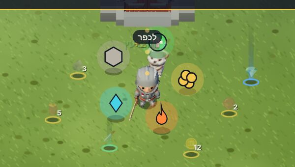
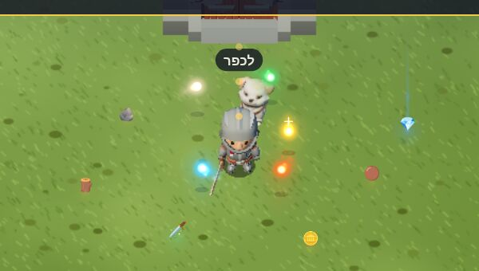
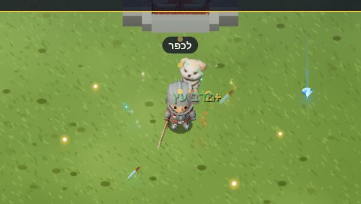
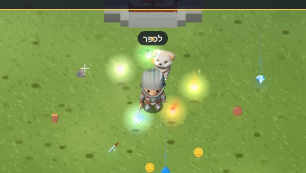
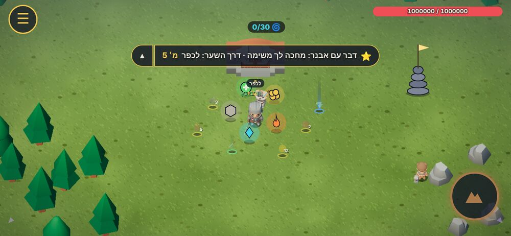
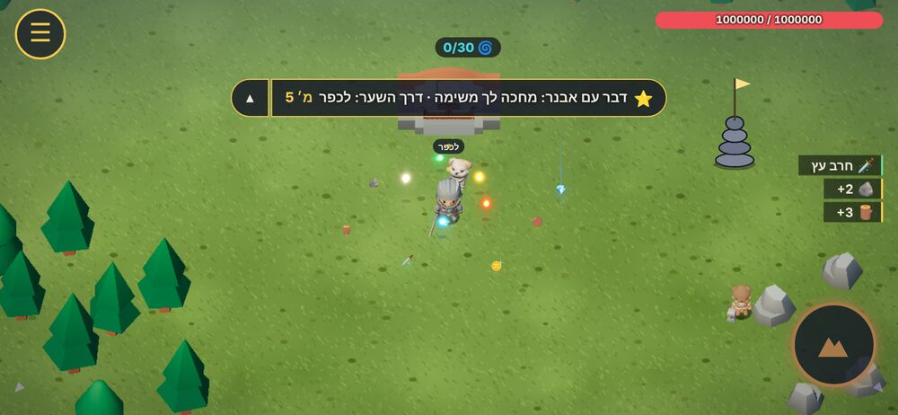
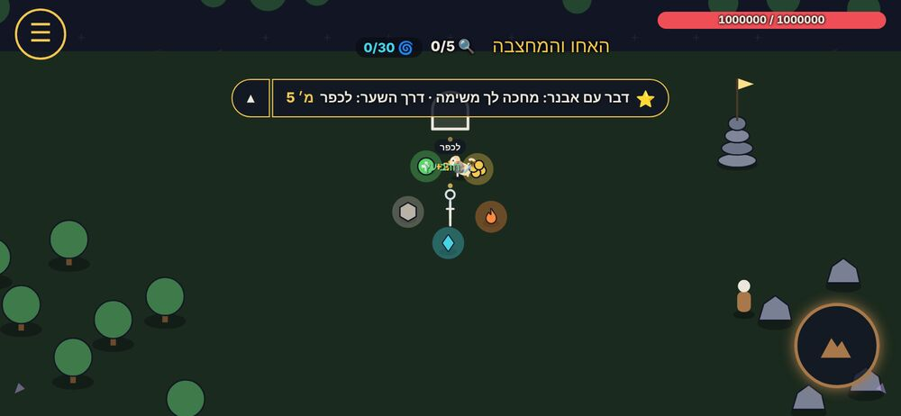
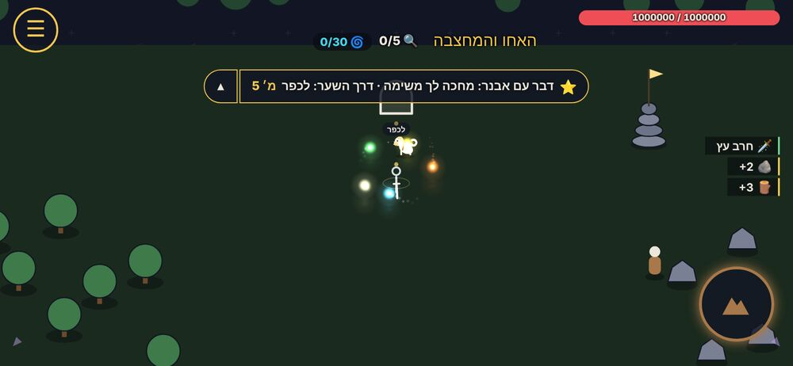

# תוכנית: אורות מרחפים, שלל על הרצפה והודעות (מחקר, 1.11.2026)

ניר (1.11): "העיגולים המרחפים זה חמוד, אבל לא נראה טוב ויזואלית, הם צריכים להיות יותר בסגנון של אורות קטנים וזוהרים שמרחפים סביבך... רוצה שתשקיע בתכנון. לבצע רק אחרי מחקר מעמיק."

מחקר ופיילוט בלבד. **שום דבר כאן לא נכנס למשחק.** הפיילוט ב-`tools/fxlab/`, מוזרק לדף רק בצילומים, ולא נטען ב-index.html.

## בקיצור: ההמלצה

1. **החפצים המסתובבים נהיים אורות (סגנון a, "גחלילית").** ליבה כמעט לבנה, הילה בצבע הסוג, שובל קצר, תנועה אורגנית שנגררת אחרי הדמות. בלי אייקון. מה החפץ עושה רואים מהחלקיקים שהוא משיר: אש מעלה גחלים, קרח מפיל פתיתים, עלה מעלה ניצוצות ירוקים לאט, תלתן מנצנץ ככוכב, ואבן יציבה ושקטה. מוכן או בטעינה רואים מהבהירות.
2. **שלל על הרצפה: כיוון 1, "נצנוץ".** בלי טבעת זהב ובלי מספר. אייקון קטן, אור רך מתחתיו בצבע הדרגה, ונצנוץ כוכב פעם בכמה שניות. קרן אור דקה רק מנדיר ומעלה.
3. **הודעות: כיוון 1, "פיד איסוף" בקצה המסך.** שורות קטנות שמצטברות ומתאחדות (‎+3 עץ ← ‎+5 עץ) ונעלמות אחרי 2.5 שניות. שום טקסט לא על הדמות. "ציוד! חרב עץ" עובר לפיד, בצבע הדרגה.

**על c בצילום:** ההילה גדולה ושטופה מדי, כי הגודל בסצנה לא כויל לזום של המצלמה. זה כיול, לא בעיה בשיטה, אבל זו עוד סיבה לא להתחיל ממנו.

למה לא האחרים: סגנון b (נחיל של נקודות קטנות) יפה מקרוב, אבל בטלפון מרחוק הוא נבלע בדשא ונראה כמו לכלוך. סגנון c (תלת-ממד) נותן לאורות לעבור מאחורי הדמות, אבל עולה יותר ותלוי בתלת-ממד, ובדו-ממד צריך את a בכל מקרה. כדאי לשמור אותו לשלב 2. בשלל, כיוון 2 (משאב רגיל = נקודת אור) **מתנגש עם האורות המרחפים**: על המסך אי אפשר להבדיל בין גחלילית לבין עץ שנפל. זו הסיבה העיקרית ש-1 עדיף.

## מה ראינו בצילום של ניר

| מה | למה זה נראה "מצויר" |
| --- | --- |
| חפצים מסתובבים | עיגול גדול ואטום עם אימוג'י (🔥, ❄️) ומשושה עם קו מתאר שחור. סגנון של ממשק, לא של אור בעולם |
| שלל על הרצפה | טבעת זהב שטוחה עם מספר לבן לידה. נראה כמו סמן במפה |
| "ציוד! חרב עץ" | באנר ענק באמצע המסך, ועוד טקסט צף מעל הראש |
| ניצוצות וטבעות | עיגולים מלאים, בלי חיבור אור. נראים כמו נקודות צבע |

## מחקר

המקורות המלאים (כ-55 קישורים): [plan-fx/research.md](plan-fx/research.md). העיקר:

**איך עושים אור שנראה אור**
- **חיבור אור (additive):** בקנבס `globalCompositeOperation='lighter'`, ב-three.js `AdditiveBlending` עם `depthWrite:false`. האור מתווסף למה שמתחתיו במקום לכסות אותו. [ics.media](https://ics.media/en/entry/11401/), [MDN](https://developer.mozilla.org/en-US/docs/Web/API/CanvasRenderingContext2D/globalCompositeOperation)
- **ליבה לבנה, שוליים צבעוניים.** בלי מרכז כמעט לבן, אש "נראית כמו כתם כתום". מצד שני, אם דוחפים הכל ללבן, הצבע נשטף, אז הצבע נשאר בהילה. [RealtimeVFX](https://realtimevfx.com/t/about-fire-from-infernal-velkoz/13491), [RealtimeVFX](https://realtimevfx.com/t/vfx-graph-color-intensity-become-white-only/21679)
- **בלי bloom אמיתי בטלפון.** UnrealBloomPass מפיל ל-20fps גם במחשב. מזייפים אותו בשתיים-שלוש שכבות אור אחת על השנייה. [three.js forum](https://discourse.threejs.org/t/unrealbloompass-poor-performance-on-macos-safari-with-intel/42606), [Glow without BloomPass](https://discourse.threejs.org/t/glow-without-bloompass/88503)
- **מכינים את הזוהר פעם אחת.** תמונה קטנה של עיגול רך (64px) לכל צבע, ו-`drawImage`. בלי `shadowBlur`, שהפיל מהירות במשחקי טלפון (מ-10ms ל-2ms בפריים כשהחליפו). [MDN](https://developer.mozilla.org/en-US/docs/Web/API/Canvas_API/Tutorial/Optimizing_canvas), [indiehackers](https://www.indiehackers.com/post/show-ih-from-10ms-to-2ms-how-i-rebuilt-my-cameras-render-engine-to-create-a-breathing-vintage-timestamp-f6f860a05a)
- **תנועה אורגנית:** לכל אור מהירות ופאזה משלו, רדיוס ש"נושם", עלייה וירידה, ונגרר אחרי הדמות בקפיץ. תדרים שלא מתחלקים זה בזה (ליסאז'ו) כדי שהתבנית לא תחזור. [Perlin flow](https://gist.github.com/erlenstar/4b8689c9df275885a6c8)

**איך משחקים אחרים עושים את זה**
- **Ori:** סיין הוא אור כחול-לבן עם שובל, גם מדריך וגם נשק. [cubed3](https://www.cubed3.com/games/reviews/nintendo-switch/ori-and-the-blind-forest-definitive-edition), [GDC: The Art of Ori](https://gdcvault.com/play/1027035/The-Art-of-Ori-and)
- **Hollow Knight:** פנס הגחליליות, ענן של זבובים זוהרים סביב הדמות. [wiki](https://hollowknight.wiki/w/Lumafly_Lantern)
- **Genshin:** יסוד = צבע. חלקיק וכדור בצבע היסוד, והגודל אומר כמה הוא שווה. [wiki](https://genshin-impact.fandom.com/wiki/Elemental_Particles)
- **Vampire Survivors:** התנ"ך מסתובב סביב השחקן. וגם הלקח ההפוך: המסך כל כך עמוס שיש מוד "בלי חלקיקים". [wiki](https://vampire.survivors.wiki/w/King_Bible), [Steam](https://steamcommunity.com/app/1794680/discussions/0/4631482569784862180)
- **Brotato, Halls of Torment:** מתג לכמות אפקטים ולמספרי נזק, כי שחקנים ביקשו. [ludo.guide](https://www.ludo.guide/guide/brotato/getting-started/controls-keybindings/accessibility-options)

**שלל על הרצפה**
- קרן אור לפי דרגה (Diablo, Borderlands), ובדיאבלו 4 גם צליל מיוחד לנדיר ביותר. [icy-veins](https://www.icy-veins.com/d4/news/uber-uniques-need-far-more-distinction-in-diablo-4/)
- הכלל של Path of Exile: אות גדול רק לשלל שמשנה מה תעשה עכשיו. השאר שקט. [poewiki](https://www.poewiki.net/wiki/Loot_filter)
- משיכה לשחקן מקרוב (Vampire Survivors: Magnet). כבר יש לנו (`P.magnet`). [wiki](https://vampire.survivors.wiki/w/Magnet)

**הודעות צפות**
- 0.6 עד 0.8 שניות, ומאחדים מכות רצופות. [gamejuice](https://gamejuice.pages.dev/articles/ui-feedback-design), [bugnet](https://bugnet.io/blog/how-to-fix-floating-damage-numbers-overlapping-into-an-unreadable-blob)
- Neverwinter הקטינו את מספרי הנזק ב-23% עד 50% והחליפו לגופן פשוט, וזה פתר את הקריאוּת. [arcgames](https://forum.arcgames.com/neverwinter/roletracker/jump/1266779)
- איסוף: עמודה אחת בקצה המסך, עם תקרה של שורות ואיחוד (x3). [Risk of Rain 2 ItemPickupList](https://thunderstore.io/c/riskofrain2/p/rfaael/ItemPickupList/)

## עשרה כללים שאנחנו מאמצים

1. אור, לא אסימון: בלי אימוג'י על האור.
2. קטן. הבהירות עושה את העבודה, לא הגודל.
3. יסוד = צבע + איך החלקיקים זזים (עולים, נופלים, עומדים, מנצנצים). עובד גם לעיוורי צבעים.
4. מצב = בהירות: מוכן בהיר, בטעינה עמום, והבזק כשהוא פועל.
5. תנועה אורגנית ונגררת, עם שובל קצר.
6. bloom מזויף משכבות, בלי `shadowBlur` ובלי עיבוד של כל המסך.
7. הזוהר מוכן פעם אחת בטעינה.
8. שלל שקט כברירת מחדל: קרן וצליל רק מנדיר ומעלה.
9. אין טקסט על הדמות: איסוף בפיד בקצה, ורק מספרי נזק וריפוי קטנים צפים.
10. תקציב איפוק: אות גדול רק למה שמשנה את הצעד הבא. מתג "פחות אפקטים" בהגדרות.

## הפיילוט

`tools/fxlab/fxlab.js` עוטף מבחוץ את `drawOrbits`, `drawDrops`, `floatText`, `banner` ו-`render3d`, בלי לשנות שורה במשחק. נדלק רק עם `?fx=` בכתובת:
- `?fx=wisps:a,drops:1,msg:1` (ההמלצה), `wisps:b,drops:2,msg:2`, `wisps:c` (תלת-ממד).
- `node tools/fxlab/shoot.js [--gfx 2d] [--only before,wisps-a]` מצלם: מסך מלא, חיתוך מוגדל ו-40 פריימים של הדמות הולכת במעגל.

### צילומים

| | |
| --- | --- |
|  לפני |  a: גחלילית (ההמלצה) |
|  b: נחיל |  c: תלת-ממד |
|  לפני, כל המסך |  אחרי (a + נצנוץ + פיד) |
|  דו-ממד, לפני |  דו-ממד, אחרי |

בתנועה (זה העיקר, כי אור נבחן בתנועה):
- [plan-fx/wisps-before.gif](plan-fx/wisps-before.gif) לפני
- [plan-fx/wisps-a.gif](plan-fx/wisps-a.gif) גחלילית
- [plan-fx/wisps-b.gif](plan-fx/wisps-b.gif) נחיל

### ביצועים

זמן ממוצע לפריים (מילישניות), 120 פריימים, 5 חפצים ו-6 ערימות שלל:

| גרסה | חפצים, תלת-ממד | שלל, תלת-ממד | כל הקנבס, תלת-ממד | כל הקנבס, דו-ממד |
| --- | --- | --- | --- | --- |
| לפני | 0.04 | 0.07 | 1.58 | 4.08 |
| a גחלילית | 0.19 | 0.15 | 1.91 | 4.07 |
| b נחיל | 0.09 | 0.13 | 1.64 | 4.08 |
| c תלת-ממד | 0.14 | 0.13 | 1.71 | 3.28 |

האורות עולים בערך 0.15ms לפריים, פחות מ-1% מתקציב של 60fps (16.7ms). בדו-ממד היו קפיצות חד-פעמיות (עד 2.5ms בפריים בודד) בזמן שהזוהר נוצר בפעם הראשונה, ולכן במשימה 1 הזוהר מוכן מראש בטעינה.

המספרים מדפדפן בלי כרטיס גרפי במחשב, אז הם יחסיים. הבדיקה האמיתית בטלפון: `?fps` (perf.js) עם `?fx=` אחרי שמחברים.

## תוכנית: משימות קטנות לפי הסדר

כל משימה ענף ו-PR משלה. בעולם ובכפר קודם. הזירה של אוראל: נדלקת רק כשהוא מחליט (שורה אחת, כמו `JUICE.where.arena`).

1. **`js/wisps.js`: האורות (סגנון a).** קובץ חדש עם `WISPS` בראש: צבעים, גודל, תנועה, חלקיקים לכל סוג, ו-`where:{world:true,village:true,arena:false}`. הזוהר מוכן פעם אחת. ההבזקים נקראים מהמונים שכבר קיימים ב-`S.orb` (`hits`, `blocked`, `shields`, `healed`), אז **אין צורך לשנות את הלוגיקה של orbit.js**. בוט: בדיקה שהאורות מצוירים ושאין שגיאות. ‎+`?fps` בטלפון.
2. **נקודת חיבור אחת ב-orbit.js (אישור של אוראל).** בראש `drawOrbits()`: `if(wispsDraw())return;`. כש-`wispsDraw` מחזיר false (בזירה, או ב-`?look=classic`), הציור הישן נשאר כמו שהוא.
3. **שלל על הרצפה: נצנוץ (כיוון 1).** ב-`drawDrops` (drops.js): בלי טבעת ובלי מספר, אור רך בצבע הדרגה, נצנוץ, וקרן דקה מנדיר ומעלה. המספרים ב-`DROPS.look`. הזוהר של הגזר הקסום נשאר, רק בספרייט.
4. **פיד איסוף: `js/feed.js`.** `feedAdd(icon,txt,col,key)`. `dropTake` (drops.js) קורא לו במקום `floatText`, ו-`loot.js:79` שולח את "ציוד!" לפיד במקום ל-`banner`. הטקסטים ב-lang.js. המקום לפי docs/ui-guide.md (צד ההתחלה, מעל הג'ויסטיק, לא על כפתורים).
5. **הודעות על הדמות.** ריפוי ומגן (orbit.js) עוברים להבזק של האור עצמו במקום טקסט. מספרי נזק: 0.7 שניות, קטנים בכ-25%, ומכות רצופות על אותו אויב מתאחדות (juice.js).
6. **מתג "פחות אפקטים" בהגדרות** (camera.js/menu.js): חצי חלקיקים, בלי שובל, בלי נצנוץ.
7. **שלב 2, אם צריך: האורות בתלת-ממד (סגנון c).** הליבה וההילה כ-`THREE.Sprite` בתוך הסצנה, כדי שיעברו מאחורי הדמות. רק אחרי מדידה בטלפון.

### מה אוראל צריך לאשר

- **orbit.js:** שורה אחת בראש `drawOrbits` (משימה 2). הלוגיקה, המספרים ב-`ORBIT` והאייקונים במסך הציוד לא משתנים.
- **הזירה:** אם ומתי להדליק שם את האורות, השלל והפיד (`WISPS.where.arena`, וכן הלאה). עד אז הזירה נראית כמו היום.
- **ההודעות "+N" מהמגן והריפוי** (orbit.js, `orbitShield` ו-`orbitUpdate`): להחליף בהבזק של האור, בעולם בלבד.

## שאלות לניר (רק טעם)

1. **כמה בולט?** האורות בצילום של a הם בגודל שנראה לי נכון לטלפון. גדול יותר = נוכח יותר, אבל מכסה את הקרב.
2. **אבן ההגנה:** אור לבן-חמים ושקט, או שאתה רוצה שהיא תיראה כמו אבן קטנה שזוהרת?
3. **הפיד:** בצד ימין (כמו בצילום) או למטה במרכז?

נכתב ע"י Claude, לפי בקשת ניר, 1.11.2026.
