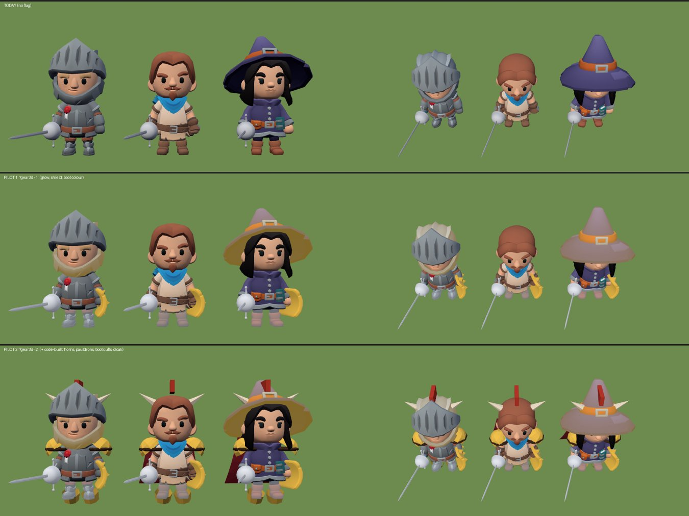

# ציוד שמשנה את המראה: מאיפה מביאים קסדה, שריון, גלימה, מגפיים ומגן

1.11.2026. ענף `research/gear-assets`. מחקר ופיילוט, לא למיזוג כמו שהוא. ממשיך את [plan-progression.md](plan-progression.md) (PR #168).

**השאלה של ניר:** "חשבתי ש-Hugging Face ו-Creative Claw מכסים לנו הכל. אם זה לא מספיק, מה יכול לשפר משמעותית את החוויה? אני רוצה פתרונות חינמיים וגם בתשלום."

**התשובה הקצרה:**
- **Creative Claw עושה רק דו-ממד** (תמונות, צלילים, וידאו). הוא נותן את התמונה שממנה מתחילים, לא את המודל.
- **Hugging Face כן עושה תמונה ← תלת-ממד בחינם**, וזה כבר עבד אצלנו: הגיבורים של ניר ואוראל ופיוחו נבנו ככה ב-30.10 (`tools/pilot3d`, Hunyuan3D-2mv). לחפץ קשיח כמו קסדה או מגן זה אפילו קל יותר, כי לא צריך שלד.
- **מה שמשנה הכי הרבה הוא לא המקור, אלא הזווית:** במשחק רואים את הגיבור מלמעלה ב-42°. ראש, כתפיים וגלימה בולטים. מגפיים כמעט לא רואים. לכן מתחילים מקסדה, כתפיות וגלימה.

## הפיילוט: מה נבדק בפועל

שלוש הדמויות (לוחם, צייד, קוסמת) עם אותו ציוד: להב כסף, קמע זהב, נעלי מהירות. משמאל מלפנים (כמו בחלון הציוד), מימין במצלמה של המשחק.
- **שורה עליונה, היום:** רק הנשק משתנה.
- **שורה אמצעית, `?gear3d=1`** (הפיילוט מ-#168): זוהר לפי נדירות, מגן ביד השנייה, צבע לנעליים. עדין. ובקוסמת הכובע מאבד את הצבע הסגול שלו, באג קטן של הפיילוט.
- **שורה תחתונה, `?gear3d=2`, חדש:** בנוסף, חלקים שנבנו בקוד מצורות פשוטות: קרניים וציצה על הראש, כתפיות בצבע המתכת של הדרגה, שרוולי מגפיים, וגלימה לצייד ולקוסמת. **זה ההבדל שרואים גם מלמעלה.** כ-460 משולשים ו-10 ציורים נוספים לגיבור בלבד (אפשר לאחד ל-3 ציורים). בלי שום קובץ חדש.
- **מה עוד לא טוב:** טבעת הכתפיות נראית מלפנים כקו שחור, והקרניים על הכובע של הקוסמת צפות. זה ליטוש של מספרים ב-`GEARCODE`, לא בעיה של הדרך.

### הדרך החינמית עם AI: מה נחסם היום, ומה צריך

ניסיתי להריץ מכאן תמונה ← תלת-ממד על קסדה ומגן. **לא עבד, משתי סיבות, ושתיהן פתירות:**
1. **מכסה של Hugging Face:** כל השרתים החינמיים (TRELLIS, Hunyuan3D-2, Stable Fast 3D) רצים ופתוחים מהסביבה, אבל בלי חשבון התשובה היא "You have exceeded your ZeroGPU runs limit". הסביבה בענן חולקת כתובת עם אחרים, והמכסה של משתמש בלי חשבון נגמרה. לפי התיעוד של Hugging Face: בלי חשבון 2 דקות ביום, חשבון חינמי 5 דקות, PRO ‏40 דקות. קסדה אחת לוקחת בערך 10 עד 30 שניות, אז **חשבון חינמי מספיק לכ-10 עד 20 פריטים ביום.**
   - **מה צריך מניר:** טוקן קריאה מ-Hugging Face (יש לו כבר חשבון, `Nirmoran`), כסוד `HF_TOKEN` בהגדרות הסביבה. שתי דקות, חינם.
2. **אישור לשלוח תמונה החוצה:** מערכת ההרשאות עצרה העלאה של אייקון מהמשחק לשרת ציבורי. נכון שעצרה: זו העלאה של קבצים שלנו. **מה צריך מניר:** לאשר פעם אחת, או שאת השלב הזה מריץ ניר במחשב שלו, כמו ב-30.10.

**הדרך המלאה לפריט אחד, כשהשניים פתורים:** Creative Claw מצייר את הפריט מלפנים ומהצד על רקע לבן (כ-12 קרדיטים, יש כ-5,400) ← Hunyuan3D-2 נותן צורה ← `decimate.py` עד 1,500 משולשים ← צבע שטוח מהציור (`paint.py`) ← מחברים לעצם הראש או היד, כמו הנשק היום. הכלים כבר בריפו, חוץ מהחיבור לעצם, שכתוב בפיילוט.

## ההשוואה

### 1. חינם, AI

| מה | מה זה נותן | מגבלה |
|---|---|---|
| **Hugging Face: Hunyuan3D-2 / 2mv** | צורה מתמונה, עד 3 זוויות. כבר עבד אצלנו על 6 דמויות | הצבע בשרת החינמי לא עובד, לכן `paint.py`. צריך טוקן חינמי (למעלה) |
| Hugging Face: TRELLIS, Stable Fast 3D | צורה וצבע מתמונה אחת | אותה מכסה. לא נבדק בפועל, נחסם |
| **Meshy, תוכנית חינמית** | 100 קרדיטים בחודש = כ-5 מודלים מתמונה (20 קרדיט לכל אחד), כולל צבע. **שלד ואנימציה כלולים גם בחינם** | רישיון CC BY: מותר, עם קרדיט. למשחק פרטי זה לא משנה. צריך הרשמה של ניר |
| Creative Claw | התמונה שממנה מתחילים, באותו סגנון של המשחק | לא עושה תלת-ממד |

### 2. חינם, חבילות וקוד

| מה | מה זה נותן | מתאים לשלד ולסגנון? |
|---|---|---|
| **חלקים בקוד (הפיילוט כאן)** | קרניים, ציצה, כתפיות, כתר, שרוולי מגפיים, גלימה, חגורה. צבע לפי דרגה | כן. מחובר לעצם, בסגנון שטוח כמו KayKit |
| **KayKit, מה שכבר במשחק** | 31 נשקים, 3 מגנים, קסדה, מגן פנים וגלימה של האביר, כובע הקוסמת, גלימה ואשפה של הצייד | כן, וכבר בשימוש |
| Quaternius Modular Outfits | 12 תלבושות | לא, שלד אחר ([3d-assets.md](3d-assets.md)) |
| Kenney | דמויות קוביות | לא, סגנון אחר |
| Poly Pizza, itch.io CC0 | פריטים בודדים של אמנים שונים | לא נבדק הפעם (Poly Pizza חסם את הבדיקה). סגנון לא אחיד |

### 3. בתשלום, חבילות

| מה | מחיר | מה משתנה |
|---|---|---|
| **KayKit Adventurers 2.0 EXTRA** ([קישור](https://kaylousberg.itch.io/kaykit-adventurers)) | בערך ‎$4 עד ‎$8, פעם אחת (הדף מציג שני מחירים, ‎$3.97 ו-‎$7.95) | **3 צבעים נוספים לכל אחת מ-8 הדמויות**, ועוד 3 דמויות (ברברי גדול עם קסדה שאפשר להוריד, דרואיד, מהנדס). אותו שלד ואותו סגנון. CC0. צבע לכל דרגה = "הדמות שלי השתנתה" בלי עבודה |
| KayKit Mystery Series ‏4 עד 6 | בערך ‎$13 לסדרה (מבצע, מ-[3d-assets.md](3d-assets.md)) | אורקים, אביר שחור, פלדין. יותר לבוסים ואויבים מאשר לציוד |
| Synty POLYGON Modular Fantasy Hero ([קישור](https://syntystore.com/products/polygon-modular-fantasy-hero-characters)) | ‎$149.99, לפעמים במבצע ‎$74.99 | 720 חלקי שריון מודולריים. **אבל:** שלד וסגנון אחרים, אז מחליפים את כל הדמויות במשחק, ובנוי בעיקר ל-Unity. רישיון ל-5 מושבים. לא מומלץ |

### 4. בתשלום, שירותים

| מה | מחיר | הערה |
|---|---|---|
| **Meshy Pro** ([קישור](https://www.meshy.ai/pricing)) | ‎$20 לחודש, 1,000 קרדיטים = כ-50 מודלים | שלד ואנימציה כלולים. מספיק חודש אחד לסדרה שלמה של ציוד |
| Tripo Professional | בערך ‎$20 לחודש (אתרים חיצוניים, הדף הרשמי חסם את הבדיקה) | יש שלד אוטומטי |
| Hugging Face PRO ([קישור](https://huggingface.co/pricing)) | ‎$9 לחודש | פי 8 מכסה בשרתים החינמיים. רק אם החינמי לא מספיק |
| אמן ב-Fiverr | בערך ‎$30 עד ‎$80 לפריט פשוט (מצאתי רק עסקה אחת עם מחיר: עד ‎$50) | איכות וסגנון תלויים באמן. יקר ואיטי לעומת השאר |

## ההמלצה: בשלבים, מהכי מורגש בפחות כסף

1. **עכשיו, חינם: חלקים בקוד + חלקי KayKit.** קסדה עם קרניים או ציצה, כתפיות, גלימה, שרוולי מגפיים, צבועים לפי הדרגה, ויחד עם פיילוט 1. זה ההבדל שרואים מלמעלה. כיום עבודה, אחרי שיהיו משבצות ראש, גוף ויד שנייה ב-gear.js (משימה 1ג ב-plan-progression).
2. **אחר כך, חינם: פריטים מיוחדים עם AI.** 5 עד 10 פריטים עם שם (קסדת השומר, מגן האגם, כתר אגדי): Creative Claw ← Hugging Face ← הכלים שבריפו. צריך מניר רק טוקן חינמי של Hugging Face. אם האיכות לא מספיקה: Meshy חינמי (5 בחודש), ורק אז Meshy Pro לחודש אחד (‎$20).
3. **אם רוצים עוד, זול: KayKit Adventurers EXTRA, בערך ‎$4 עד ‎$8.** 3 צבעים לכל דמות, אז דרגה גבוהה נראית כמו דמות אחרת. אותו שלד, בלי עבודה.

**לא מומלץ:** Synty (‎$75 עד ‎$150, מחליפים את כל הדמויות) ואמן (יקר ואיטי, כשהדרך עם AI כבר עובדת אצלנו).

## מה ניר צריך להחליט

1. **טוקן Hugging Face חינמי** לסביבה (או שהשלב הזה ירוץ אצלו במחשב). בלי זה, שלב 2 לא יוצא לדרך.
2. **האם לקנות KayKit EXTRA** (‎$4 עד ‎$8). לא חובה.
3. **טעם:** קרניים או ציצה? כתפיות בצבע המתכת או בצבע הדמות? מספיק "כן" לפיילוט, והשאר Claude מחליט.

## הפיילוט בקוד

`?gear3d=2` בכתובת (כולל את כל `?gear3d=1`). בלי הדגל לא משתנה כלום. הקוד: `GEARCODE`, `gcShape` ו-`gearCodeAdd` ב-render3d.js, ושורה ב-doll3d.js. כל חלק הוא שורה של צורות ב-`GEARCODE.parts`: עצם, מיקום, מידות וצבע (`'m'` = צבע המתכת של הדרגה). בפיילוט כל החלקים מופיעים יחד, כי עוד אין משבצות. הצילום: סקריפט Playwright שבונה את שלוש הדמויות מ-`heroLook` ומצלם מלפנים ובזווית של המשחק.

מקורות: [KayKit Adventurers](https://kaylousberg.itch.io/kaykit-adventurers), [Synty](https://syntystore.com/products/polygon-modular-fantasy-hero-characters), [Meshy pricing](https://www.meshy.ai/pricing), [Meshy credits](https://docs.meshy.ai/pricing), [Hugging Face pricing](https://huggingface.co/pricing), [ZeroGPU docs](https://huggingface.co/docs/hub/spaces-zerogpu), [Tripo, דף חיצוני](https://toolradar.com/tools/tripo-ai/pricing), [Fiverr לדוגמה](https://www.fiverr.com/scottrevies/create-stylized-and-low-poly-assets-for-your-game).
