# הקרקע בעולם: מחקר, פיילוט ותוכנית

ניר, 1.11.2026 (על צילום מהאחו: ירוק אחיד עם רשת משבצות): "צריך לעשות משהו עם הקרקע... אל תבצע עכשיו, רוצה שתשקיע בתכנון."
המסמך הזה הוא התכנון. שום דבר כאן עוד לא נכנס למשחק. הפיילוט יושב רק בענף `research/ground-plan`.

## בקצרה

- **הרשת שראית** היא הקרקע הישנה (`?look=classic`, צילום 01). שלב 1 של התוכנית הוויזואלית (#135) כבר מחליף אותה בעשב מצויר (צילום 02). אם בטלפון שלך עדיין יש רשת, כנראה שהטלפון מציג גרסה ישנה ששמורה אצלו. כדאי לבדוק את מספר הגרסה בפינת מסך הפתיחה.
- **אבל גם בלי הרשת, הקרקע ריקה:** צבע אחד, בלי שבילים, בלי מקום שהעין נתפסת בו, ושום דבר לא מחבר בין העצים לקרקע.
- **ההמלצה:** "מפה מצוירת" לכל אזור (גישה D). שבילים שמחברים את השערים, כתמים גדולים של עשב עשיר ויבש, חוף סביב המים וקצה כהה בגבול, בצבעים של כל אזור. הכל נאפה פעם אחת לתמונה כשנכנסים לאזור, אז **המחיר במהירות כמו היום**. מעל זה, בשלב 3 של התוכנית הוויזואלית: גושי עשב, פרחים ואבנים שזזים ברוח (גישה C), רק בטלפונים שעומדים בזה.
- **הכל חינם.** קוד בלבד, ואם רוצים, מודלים חינמיים של KayKit ו-Quaternius לעשב ולאבנים.
- **עבודה:** בערך 3–4 סשנים קטנים, כל אחד נכנס לבד.

## מה הופך את הרשת לבולטת

| הסיבה | למה העין רואה אותה |
| --- | --- |
| קווים בהירים דקים בין משבצות (`makeGround` ב-render3d.js: 16 משבצות עם רווח של 2 פיקסלים) | קו ישר וחד הוא הדבר הראשון שהעין מוצאת בשדה אחיד. בטבע אין קווים ישרים |
| אותו אריח כל 180 פיקסלים | חזרה מדויקת יוצרת דפוס. המוח משלים אותו לרשת גם בלי הקווים |
| שאר המסך שטוח: צבע אחד, בלי כתמים | אין שום דבר אחר שמושך את העין, אז הקווים הם "התוכן" |
| הקרקע זזה כשהמצלמה זזה | קווים שגוללים מתחת לדמות מרגישים כמו נייר משבצות, לא כמו אדמה |

**איך מעלימים:** בלי קווים בכלל (✅ כבר בשלב 1), צבע לפי המקום בעולם ולא לפי אריח, כך שאין חזרה (✅ שלב 1 חלקית, D לגמרי), ושכבה של צורות גדולות (שבילים, כתמים, חופים) שנותנת לעין משהו אחר להסתכל עליו (D).

## מה עושים משחקים אחרים (המחקר)

| משחק | מה הם עושים בקרקע | מה לוקחים |
| --- | --- | --- |
| **Dorfromantik** | פלטה קטנה וחמה לכל סוג אדמה, צבעים בקודקודים (vertex colors) במקום טקסטורות, והרבה פיזור קטן (עשב, פרחים) שמסתיר את הגבולות בין סוגי אדמה ([80.lv](https://80.lv/articles/how-dorfromantik-expands-its-cozy-world-through-minimalist-design)) | פלטה לכל אזור, ופיזור שמסתיר מעברים |
| **Townscaper** | כמעט בלי טקסטורה. הכל צבע אחיד, ואור חם מהשמש עושה את העבודה | התאורה של שלב 1 כבר כאן. הקרקע לא צריכה להיות עמוסה |
| **Kingdom Two Crowns** | שכבות עומק, אובך וחלקיקים. הקרקע עצמה פשוטה מאוד | האוויר (שלב 1) והחלקיקים (שלב 4) |
| **Genshin Impact (טלפון)** | כמה שכבות מצוירות ביד שמתערבבות לפי מפת משקלים (splatmap), ועשב אמיתי רק קרוב למצלמה ([Game Developer: splatting](https://www.gamedeveloper.com/programming/advanced-terrain-texture-splatting)) | מפת משקלים לכל אזור (זה בדיוק D), ועשב רק סביב השחקן |
| **Diablo Immortal** | מצלמה מלמעלה כמו אצלנו. שבילים, אבנים, עלים ופסולת על הקרקע "מספרים" לאן ללכת, והקצוות של האזור כהים | שבילים בין השערים, וגבול כהה |
| **Animal Crossing** | שבילים ופרחים הם חלק מהמשחק. העשב עצמו פשוט, עם נקודות צבע | פרחים בגושים, לא מפוזרים אחיד |
| **Tunic** | צבע אחיד ונקי לכל משטח, צללים רכים מתחת לכל חפץ, ושבילים ברורים | צל מגע כהה מתחת לעצים ולסלעים, כדי שלא "ירחפו" |

**השיטות, ומה מתאים לטלפון:**
- **ערבוב לפי משקל (splatting):** כמה טקסטורות (עשב, אדמה, חול) מתערבבות לפי מפה. הכי נפוץ. בטלפון מגבילים ל-3–4 שכבות ([דיון ב-Unity על טלפון](https://discussions.unity.com/t/ios-terrain-shader-with-three-texture-blending-and-grayscale-vertex-color-is-it-possible/22788), [polycount](https://polycount.com/discussion/comment/2512589)).
- **צבעים בקודקודים עם רעש:** זול מאוד, מתאים ל-low-poly (B בפיילוט). החיסרון: פרטים קטנים כמו שביל צריכים הרבה קודקודים.
- **נגד חזרה של אריח:** Inigo Quilez מציע להזיז ולסובב כל אריח באקראי, או לערבב כמה דגימות ([iquilezles.org](https://iquilezles.org/articles/texturerepetition), [Unity: stochastic texturing](https://blog.unity.com/de/technology/procedural-stochastic-texturing-in-unity)). אצלנו פשוט יותר: הצורות הגדולות מגיעות מתמונה אחת לכל האזור, והאריח הקטן רק מוסיף גרגר עדין, אז החזרה לא נראית.
- **פיזור עשב (instancing):** אלפי גושים בציור אחד. בטלפון חלש ה-vertex shader הוא צוואר הבקבוק, אז מורידים צפיפות ומכבים רוח בטלפון חלש ([WebGL vegetation](https://dev.to/keaukraine/efficient-webgl-vegetation-rendering-4g2g), [three.js forum](https://discourse.threejs.org/t/performance-optimizing-3m-instanced-grass-in-three-js/81286), [עשב ברוח](https://al-ro.github.io/projects/grass)).
- **אור וצל אפויים (baked AO):** כתם כהה מתחת לכל חפץ שלא זז, צבוע ישר לתוך מפת הקרקע. חינם בזמן ריצה, ונותן חצי מהתחושה של צללים.
- **מה מוותרים בטלפון:** מפות נורמל ומפות עומק לקרקע (במצלמה מלמעלה כמעט לא רואים), טקסטורות ענק, יותר מ-4 שכבות ערבוב, ועשב על כל המפה (רק סביב השחקן).

**מקורות חינמיים (CC0, מותר הכל בלי קרדיט):** [Kenney](https://kenney.nl) (סגנון שטוח, מתאים), [Quaternius](https://quaternius.com) (טבע low-poly: עשב, פרחים, אבנים, קקטוסים), KayKit Forest Nature (אותו סגנון כמו מה שיש לנו), [ambientCG](https://ambientcg.com) ו-[Poly Haven](https://polyhaven.com) (צילומיים. יפים, אבל לא בסגנון שלנו, ולכן לא מומלצים). סיכום רישיונות: [Cinevva](https://app.cinevva.com/guides/free-textures-hdris-materials). את הרישיון בודקים בדף של כל חבילה לפני שמורידים.

**הערה טכנית חשובה:** המשחק נפתח גם מקובץ (`file://`), ומשם three.js לא יכול לקרוא תמונה מקובץ PNG. לכן כל טקסטורה נכנסת כקוד (base64 בקובץ JS, כמו `models3d.js` ו-`sounds-data.js`), או שמציירים אותה בקוד. זו עוד סיבה להעדיף ציור בקוד.

## הפיילוט

`js/ground-pilot.js`, רק בענף הזה, נדלק רק עם `?ground=A` / `B` / `C` / `D`. כל הצילומים מאותה נקודה באחו, 1280×590.

| | מה זה | ציורים נוספים |
| --- | --- | --- |
| **A, שיידר חי** | צבע לכל נקודה לפי המקום: כתמים מרעש, שבילים מכל שער לצומת אחד, חוף סביב המים, קצה כהה בגבול. מחושב בכל פיקסל, בכל פריים | 0 |
| **B, low-poly** | משטח של משולשים קטנים, כל אחד בגוון שונה מעט, עם אותם צבעים ושבילים | 0 (‎+7,800 משולשים) |
| **D, מפה אפויה** | בדיוק המראה של A, אבל מחושב פעם אחת לתמונה בכניסה לאזור. בכל פריים רק קוראים אותה | 0 |
| **C, D ועוד פיזור** | גושי עשב שזזים ברוח, פרחים ואבנים (באחו), אבנים ושיחים יבשים (במדבר), גושי שלג וקרח (ברכס) | 3 (‎+12,000 משולשים) |

**האחו**

| לפני (הרשת, classic) | היום (שלב 1) |
| --- | --- |
| 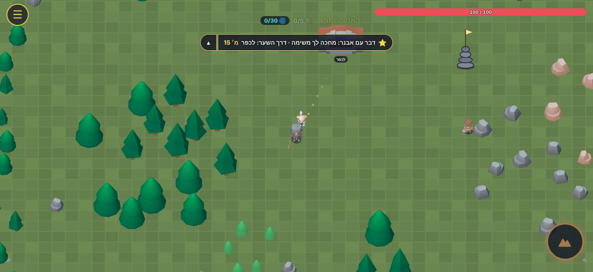 | 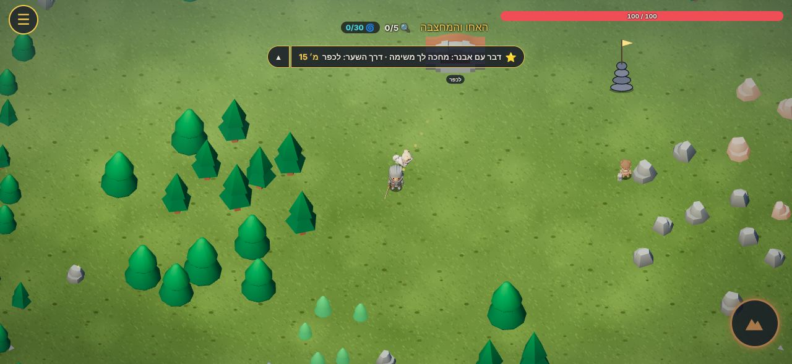 |
| **A: שיידר חי** | **B: low-poly** |
| 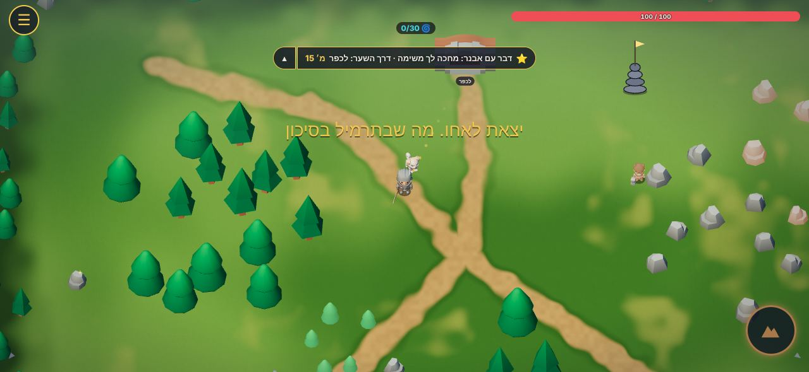 | 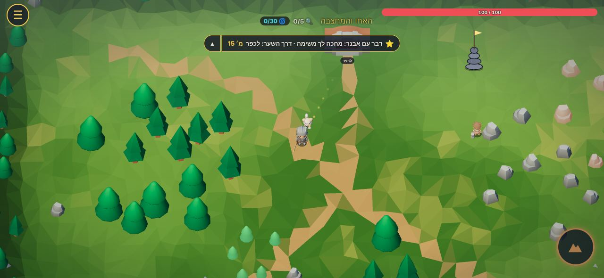 |
| **D: מפה אפויה (מומלץ)** | **C: D ועוד פיזור** |
| 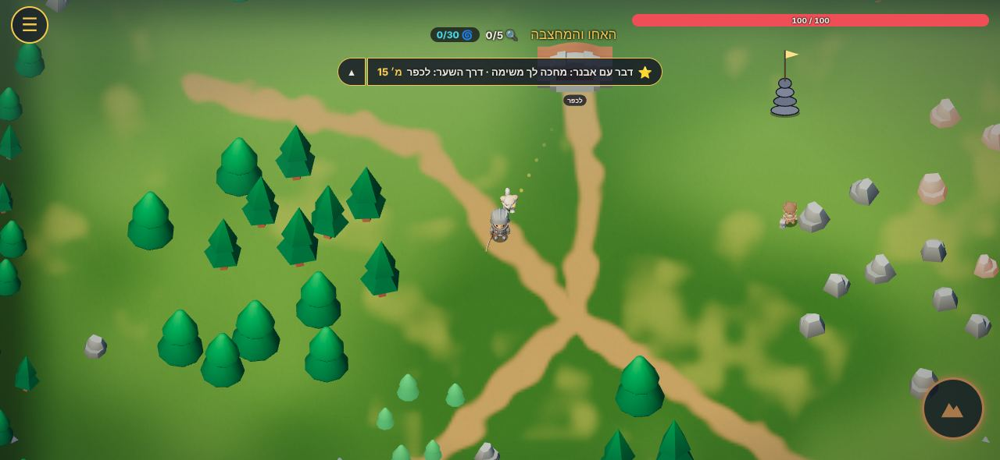 | 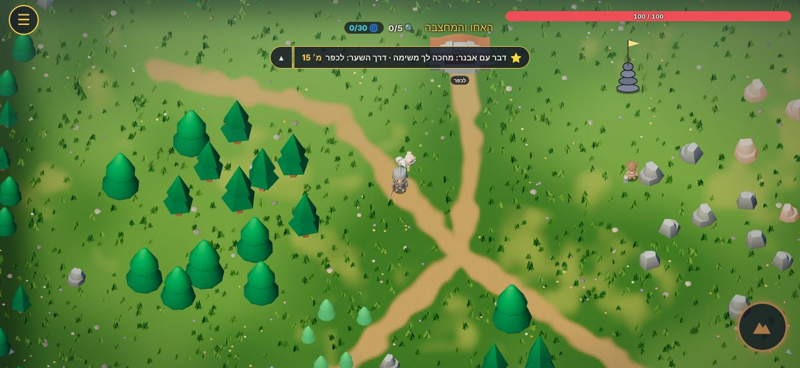 |

**המדבר**

| היום | A |
| --- | --- |
| 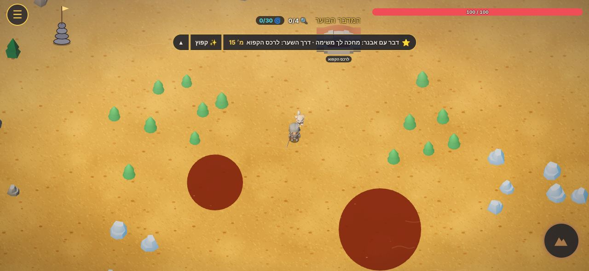 | 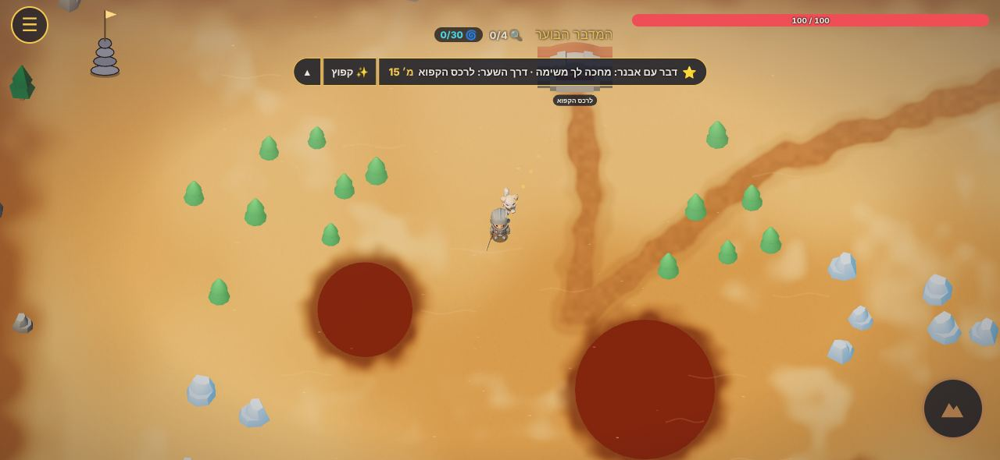 |
| **B** | **C** |
| 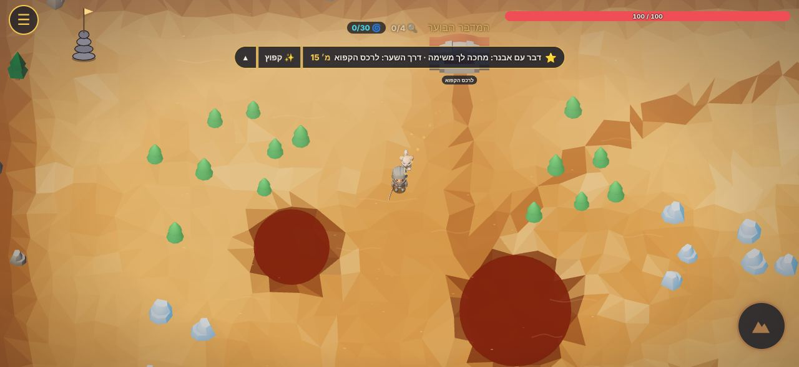 | 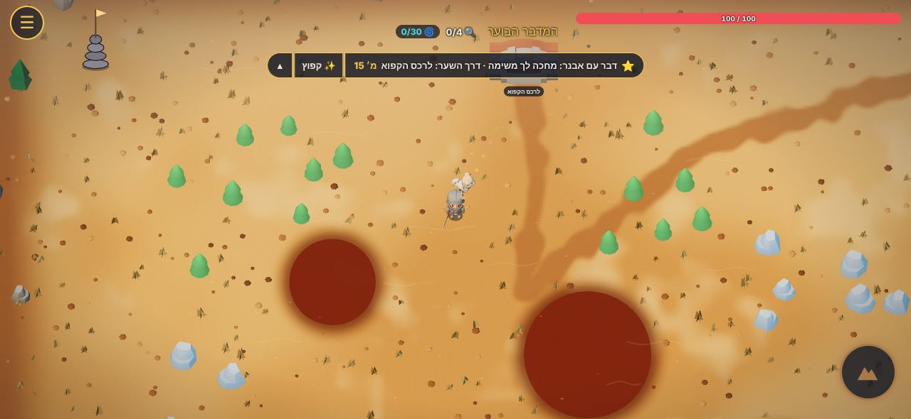 |

**הרכס (בונוס)**

| היום | C |
| --- | --- |
| 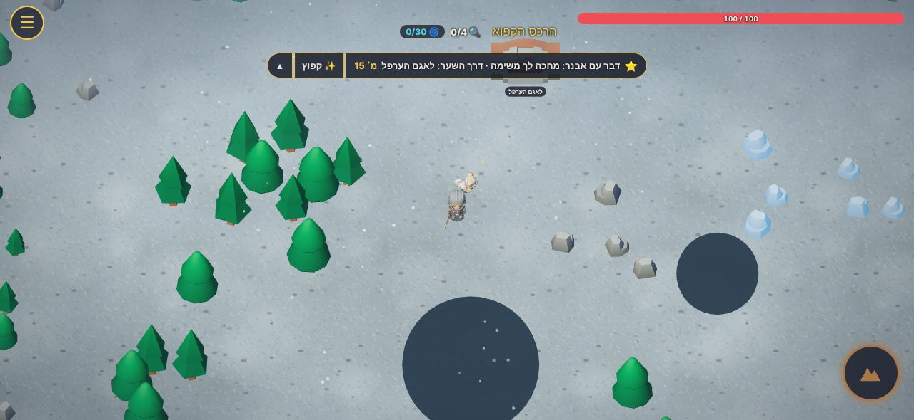 | 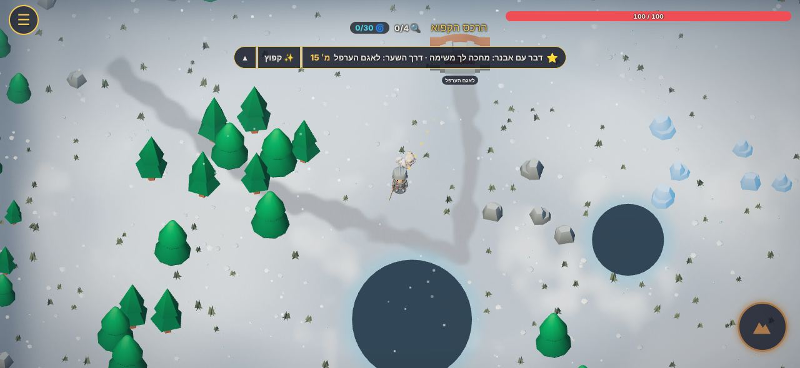 |

### מהירות

נמדד במחשב בלי כרטיס גרפי (הדפדפן מצייר במעבד), ברוחב טלפון שוכב (844×390): זמן ממוצע לציור של פריים, 15 ציורים. המספרים עצמם איטיים בהרבה מטלפון, אז מה שחשוב הוא ההשוואה. ההבדלים של עד כ-10ms הם רעש של המדידה.

| | אחו (ms לפריים) | מדבר (ms לפריים) | הערה |
| --- | --- | --- | --- |
| classic (הרשת) | 58 | 41 | |
| היום (שלב 1) | 63–67 | 42–52 | |
| A, שיידר חי | 105 (‎+60%) | 95 (‎+100%) | **יקר.** כל פיקסל מחשב רעש ומרחק מ-16 קטעי שביל ו-8 בריכות |
| B, low-poly | 55 | 47 | זול |
| D, מפה אפויה | 62–76 | 50 | **כמו היום** |
| C (D ועוד פיזור) | 114 | 63 | הפיזור עולה. באחו (2,200 גושי עשב) הכי הרבה |

**מה למדנו:**
1. A יפה אבל יקר בכל פריים, ו-D נותן את אותו מראה בחינם. לכן D.
2. **האפייה ב-JS לוקחת 1.2–1.7 שניות** בכניסה לאזור. בטלפון זה תקיעה. בגרסה האמיתית אופים בכרטיס הגרפי (מציירים את השיידר של A פעם אחת לתמונה), וזה לוקח אלפיות שנייה. לכן שם תהיה המשימה הראשונה.
3. הפיזור (C) הוא הדבר היחיד שעולה, וזה צפוי. בגרסה האמיתית: עשב רק ברדיוס סביב המצלמה (לא על כל המפה), פחות גושים, ובטלפון חלש בלי רוח או בלי עשב בכלל (לפי `GFX_AUTO` שכבר קיים).
4. B נראה נועז, אבל השבילים בו משוננים, והוא מתנגש עם הקרקע הרכה של הכפר. הוא מתאים אולי לאזורי סלע (רכס, סערה), לא לאחו.

### מה עוד ראינו בצילומים (לא קרקע, אבל אותה תחושה)

- **עצי אחו ירוקים במדבר וברכס:** הקישוטים מסביב (`worldDecor`) זהים בכל אזור. צריך ערכה לכל אזור: קקטוסים ועצים יבשים במדבר, אורנים מושלגים ברכס (Quaternius ו-KayKit, חינם).
- **"שיחים" במדבר הם כדורים ירוקים** (`v_treeB` עם זוהר). אותו דבר.
- **המים ברכס נראים כמו חורים שחורים.** קרח צריך להיות בהיר ומבריק, לבה צריכה לזהור. הצבעים ב-`W3D.regions` (pond).
- **עצים וסלעים "מרחפים"** כי אין מתחתיהם שום צל. כתם כהה אפוי במפה מתחת לכל אחד פותר את זה בלי עלות.

## ההמלצה לכל אזור

כולם מקבלים את D (מפה אפויה: פלטה, כתמים, שבילים, חוף, גבול וצל מגע). ההבדל הוא הצבעים והפיזור שמעליה.

| אזור | הקרקע (D) | פיזור (C, שלב 3) |
| --- | --- | --- |
| **אחו** | ירוק עם כתמים עשירים ויבשים, שבילי עפר בין השערים | גושי עשב ברוח, גושי פרחים צבעוניים, אבנים קטנות |
| **אגם הערפל** | ירוק-אפור לח, חוף בוצי סביב המים | קני סוף, אבנים רטובות |
| **הרכס הקפוא** | שלג עם כתמים כחלחלים, שביל אבן אפור, קרח בהיר סביב הסדקים | גושי שלג, רסיסי קרח, מעט עשב יבש |
| **המדבר הבוער** | חול עם כתמים כהים ובהירים, שביל אבן כהה, אדמה חרוכה סביב הלבה | אבנים, שיחים יבשים. בהמשך: קקטוסים |
| **מגדלי הסערה** | סלע רטוב בגשם, שלוליות סגולות | חצץ, אולי B (משולשים) לסלע |
| **לב הצל** | כמעט שחור, עם עורקים סגולים זוהרים | בלי עשב. אולי ניצוצות כהים (חלקיקים, שלב 4) |

## המשימות, לפי הסדר

כל משימה נכנסת לבד, בענף משלה, ובטלפון חלש אפשר לכבות אותה.

1. **מפה מצוירת לכל האזורים** (סשן אחד). קובץ חדש `js/ground.js` עם אובייקט `GROUND`: פלטה לכל אזור, רוחב שבילים, צפיפות כתמים. אפייה בכרטיס הגרפי פעם אחת בכניסה לאזור, שבילים שמחושבים לבד מהשערים, חוף סביב המים, גבול כהה וצל מגע מתחת לעצים, סלעים ומקורות. מחליף את הקרקע של שלב 1 בעולם. **בלי עלות במהירות.** בדיקה: צילום לפני ואחרי בכל אזור, ומדידה עם `?fps`.
2. **מים ולבה לפי אזור** (חצי סשן). קרח בהיר ברכס, לבה זוהרת במדבר, שוליים רכים. נוגע ב-`W3D.regions` ובחוף שבמפה.
3. **ערכת קישוטים לכל אזור** (סשן אחד). עצים, שיחים וסלעים מתאימים למדבר, לרכס ולסערה, מחבילות חינם (KayKit Forest Nature, Quaternius). צריך `tools/build3d.js`.
4. **עשב, פרחים ואבנים ברוח** (סשן אחד, זה שלב 3 בתוכנית הוויזואלית). רק ברדיוס סביב השחקן, 3 ציורים, רוח בשיידר. נכבה לבד בטלפון חלש. בדיקה באייפון של אוראל ובטלפון של ניר עם `?fps`.
5. **אותה מפה בכפר** (חצי סשן). שבילים בין המבנים, כיכר עפר מול הטירה. מתאים לרצועות `look` של המבנים.
6. **רשות: טקסטורה מצוירת ביד לכל אזור** (Creative Claw, בקרדיטים של איתי). גרגר עדין יותר במקום האריח שמצויר בקוד: גלי חול, נצנוץ שלג. נכנס כקוד (base64), כי מ-`file://` אי אפשר לטעון תמונה.

**איך זה מתחבר לתוכנית הוויזואלית ([visual-plan.md](visual-plan.md)):**
- **שלב 2 (צללים):** צל המגע האפוי במפה (משימה 1) נותן חלק גדול מהתחושה של צללים בחינם, גם בטלפון שלא יקבל צללים אמיתיים. כשהצללים האמיתיים דולקים, הצל האפוי נחלש קצת.
- **שלב 3 (רוח):** משימה 4 היא שלב 3. העשב יושב על הכתמים העשירים של המפה ולא על השבילים, אז שני הדברים נראים כמו מקשה אחת.
- **שלב 4 (חלקיקים ומילוי):** משימה 3 היא חצי מ"מילוי האחו". החלקיקים (גחליליות, שלג, גחלים) נשארים בקנבס, בלי קשר לקרקע.

**כמה עולה:** משימות 1–5 חינם (קוד ומודלים CC0). משימה 6 בקרדיטים של Creative Claw, אם בכלל. בלי חבילות בתשלום.

## שאלות לניר (רק טעם)

1. **רך ומצויר (D) או משולשים חדים (B)?** ההמלצה: D, כי הוא מתאים לכפר ולדמויות. B אולי רק לסלע במגדלי הסערה. (צילומים 05 ו-04)
2. **שבילים שמחברים את השערים?** ההמלצה: כן. הם גם יפים וגם מראים לאן ללכת, בלי עוד חץ על המסך.
3. **כמה עשב ופרחים?** ההמלצה: בינוני, כמו בצילום 06, ופרחים בגושים ולא בכל מקום.

## איך מנסים את הפיילוט

רק בענף `research/ground-plan`: פותחים את `index.html` עם `?ground=D` (או A, B, C) ויוצאים לעולם. אפשר להוסיף `&fps`. בלי הדגל הכל כמו ב-main.
