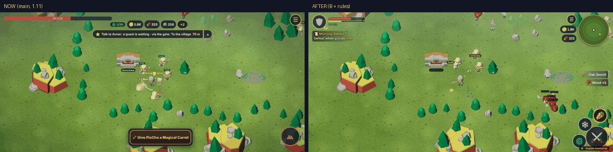

# תוכנית: סידור המסך (פרופורציות ו-HUD)

ניר, 1.11.2026, על צילום מהעולם: "צריך לסדר את איך שרואים את המשחק. צריך לעבוד על פרופורציות... האייקונים גדולים מדי וצריך לגלול בשביל קצת טקסט... אל תבצע עכשיו, רוצה שתשקיע בתכנון."

**זו תוכנית בלבד. קוד המשחק לא שונה.** מה שנוסף: המסמך הזה, הדמיות ב-[plan-hud/](plan-hud/), וכלי מדידה ב-`tools/hud-measure.js`.
התוכנית לא כוללת את הקרקע ואת האפקטים, כי סשנים אחרים מתכננים אותם. הזירה של אוראל לא משתנה.

## בקצרה

- **הבעיה איננה רק "גדול מדי".** כל דבר על המסך מקבל גודל ומקום משלו, ואין סדר עדיפויות.
  - כפתורי HTML גדולים מדי: כפתור הגזר תופס רבע מרוחב המסך, ושורת הקווסט יותר מחצי.
  - הטקסט שמצויר בעולם קטן מדי מאז שהמצלמה עלתה (#127): שמות אויבים בגודל 7.7px, ונערמים זה על זה.
  - חלונות קופצים לבד ומכסים את המשחק.
- **הפתרון:** סקאלה אחת לפי גובה המסך (4 גדלי טקסט, 3 גדלי כפתור), מפת אזורים קבועה, וכללים להודעות, לשמות ולחלונות.
- **שלושה כיוונים:** A נקי, B כמו Diablo Immortal, C כמו Genshin. **ההמלצה: B, עם הכללים של A** לטקסט שצף בעולם.
- **הביצוע:** 7 משימות קטנות. כל אחת נוגעת רק בכפר ובעולם, ונבדקת בכלי המדידה.



## 1. מה מדדנו (main של 1.11, אחרי ☰ #130 והמצלמה #127)

`node tools/hud-measure.js` מריץ את המשחק באנגלית בשני גדלים:
- 844×390, אייפון שוכב.
- 1280×590, היחס של הטלפון של ניר (2000×918).

הכלי מעמיד את המשחק בכפר, ליד תושב, בשיחה, בתפריט, בעולם ליד הבית, בקרב ובזירה. אחר כך הוא מודד כל אלמנט HTML באחוזים מהמסך, וכל טקסט שמצויר על הקנבס בגודל האמיתי שלו בפיקסלים. הגבולות שהכלי מסמן הם הכללים בפרק 3.

**כמה מהמסך הממשק תופס** (בלי חלונות):

| מקום | 844×390 | 1280×590 |
| --- | --- | --- |
| הכפר | 40% | 23% |
| העולם, ליד הבית | 58% | 29% |
| העולם, בקרב | 40% | 29% |
| הזירה (לא משתנה) | 26% | 20% |

במשחקים שבדקנו הממשק בקרב תופס בערך 12–18% מהמסך (הערכה מצילומים).

### מה גדול מדי ב-844×390 (צילומים [02](plan-hud/02-now-fight-844.png), [03](plan-hud/03-now-window-844.png), [04](plan-hud/04-now-dialog-844.png))

1. **כפתור הגזר** "🥕 Give PioCho a Magical Carrot":
   - 26.5% מהרוחב ו-12.8% מהגובה, עם מסגרת סביבו של 16.9%.
   - יושב באמצע למטה, באזור שהאגודל עובר בו.
   - "לדבר", "להיכנס" ו"לדוג" באותו סגנון.
2. **שורת הקווסט (`#guide`):** "⭐ Talk to Avner: a quest is waiting · via the gate: To the village 70 m".
   - 57.8% מרוחב המסך ו-9.2% מהגובה, באמצע העליון, מעל המשחק.
   - יש גם שורת קווסט שנייה (`📜 Morning Sweep`) מתחת לחיים, כך ששני מעקבים מוצגים יחד.
3. **החלון "To the village"** נפתח לבד כשעוברים ליד הבית.
   - 49.7% מהגובה ו-40% מהרוחב, והכפתור שבו לבד 12.3%.
   - כשמתקרבים לבית (#119) הוא מכסה בדיוק את הדרך.
4. **הפס העליון בעולם:** שם האזור, 🔍 0/5, 🌀 0/30, שלוש גלולות משאבים ו-"+4".
   - גובה 8.7%, לכל רוחב המסך. כל גלולה 34px, כמו כפתור.
   - מעליו פס החיים: ברוחב 36% מהמסך ב-1280, גדול כמעט כמו פס של בוס.
5. **"Out in the meadow. What you carry is at risk":** באנר בגודל 28px לכל הרוחב, באמצע המסך, וחופף לחלון.
6. **השיחה עם תושב:** 80% מהגובה ו-92% מהרוחב, והתוכן גבוה פי 1.9 מהחלון, אז צריך לגלול. הקווסט השני נחתך באמצע.
7. **התפריט ☰:**
   - הלשוניות בצד 15.4% גובה כל אחת, עם טקסט בגודל 11px.
   - ב-844 החלון 96% מהגובה.
   - כפתורי 🏡 ו-🎁 (13.3% כל אחד) נשארים מעל המשחק גם בזירה.

### מה קטן מדי או נערם (טקסט על הקנבס)

- **שמות אויבים מיוחדים** (Swift, Armored, Volatile): 7.7px, וב-844 נספרו 15 כאלה. הם קטנים מכדי לקרוא, ונערמים בקבוצה. כך זה נראה גם בצילום של ניר.
- **שמות שערים** ("To the village", "Grove Arena"): 8.3px.
- **"Gear! Oak Sword":** 21.8px, כפול, ובאמצע הקרב, על הדמות. זה הטקסט הגדול ביותר על המסך, ומיד אחריו "New in the book!" ו-"First kill today" באותו מקום.
- **מספרי נזק:** 12–13px, טוב. **שלל על הרצפה:** אייקון 11px ומספר, טוב, אבל לא ברור מספיק.

המסקנה: את הכפתורים צריך להקטין, ואת הטקסט בעולם צריך **לסנן**, לא להגדיל.

## 2. מחקר: איך משחקים אחרים עושים את זה

המספרים כאן הם הערכה מצילומים ומדריכים, כי אף משחק לא מפרסם מידות.

- **Diablo Immortal** (לרוחב):
  - למעלה משמאל: דיוקן עם חיים, ומתחתיו מעקב קווסט.
  - למעלה מימין: מפה קטנה וכפתורי תפריט.
  - למטה מימין: כפתור תקיפה (כ-20% מהגובה) וקשת של סקילים (11–13%).
  - Blizzard כתבה שבטלפון "האלמנטים גדולים יותר", ושבמחשב הקטינו את הדיוקן, המפה והסקילים ([Blizzard](https://news.blizzard.com/en-us/article/23797159/making-diablo-immortal-for-pc), [game8](https://game8.co/games/Diablo-Immortal/archives/376937)).
- **Genshin Impact:**
  - למעלה משמאל: כפתור תפריט ומפה קטנה (כ-20%), ומתחתיה הקווסט בשורה או שתיים.
  - פס החיים דק, למטה במרכז.
  - פעולה בהקשר היא רשימה קצרה מימין למרכז: אייקון ומילה או שתיים ("Talk"), לא משפט ([Paimon Menu](https://genshin-impact.fandom.com/wiki/Paimon_Menu), [Pocket Tactics](https://www.pockettactics.com/genshin-impact/icons)).
- **Brawl Stars:** החיים מעל הראש של הדמות, לא בפינה. התקיפה בדיוק במקום שהאגודל נוחת ([מדריך](https://lootbar.gg/blog/en/best-brawl-stars-control-settings-and-layout-guide.html)).
- **Archero ו-Survivor.io** (לעומד): כמעט אין ממשק. חיים קטנים מעל הגיבור, וזהו.
- **Vampire Survivors:** פס XP דק לכל הרוחב (כ-3%), שעון באמצע וחיים זעירים מתחת לדמות.
- **Torchlight Infinite:** אפשר להקטין את המפה הקטנה ולעשות אותה שקופה. שחקני מחשב התלוננו שהממשק "גדול וטלפוני" ([vhpg](https://www.vhpg.com/?p=39075)).
- **מדריכים:**
  - Apple: מטרת לחיצה 44pt לפעולות תכופות, ו-28pt לפעולות נדירות. טקסט 11pt לפחות. שום כפתור מעל פס הבית או החריץ. סמלים במקום טקסט לפעולות ([HIG game controls](https://developer.apple.com/design/human-interface-guidelines/game-controls), [Designing for games](https://developer.apple.com/design/human-interface-guidelines/designing-for-games)).
  - Google: מטרת לחיצה 48dp, עם רווח של 8 ביניהן. האייקון יכול להיות קטן יותר מאזור הלחיצה ([48dp](https://support.google.com/accessibility/android/answer/7101858)).
  - Game Developer: "less is more". בטלפון כ-3 פעולות על המסך, במחשב 17 ([Mobile vs Desktop UI](https://www.gamedeveloper.com/design/mobile-vs-desktop-ui-how-they-differ-in-design)).
  - שמות מעל אויבים: רק לאויב מיוחד, לבוס או לאויב שמכוונים אליו, כדי שלא ייערמו ([Ashes of Creation](https://forums.ashesofcreation.com/discussion/comment/358048)).
  - מספרי נזק: מספר בלבד, גדול רק בקריטי, ומוגבל בכמות ([Last Epoch](https://forum.lastepoch.com/t/damage-numbers-suggestions-feedback-with-mock-up/11963)).
  - הודעות: תור, עד 3 על המסך, איחוד כפולים ("Wood ×3"), ו-2–3 שניות ([toast queue](https://www.techinterview.org/post/3233475200/build-notification-toast-system/)).

**מה משותף לכולם:**
- הפינות העליונות למידע ולתפריטים, קטנים.
- בפינה הימנית התחתונה כפתור גדול אחד, וסביבו כפתורים קטנים יותר.
- פעולה בהקשר היא אייקון ליד האגודל, או מילה אחת או שתיים. **אף משחק לא שם משפט על כפתור.**

## 3. מערכת מידות אחת

כל גודל נקבע ביחידות של גובה המסך (`vh`), עם רצפה ותקרה (`clamp`). כך 844×390 וטלפון של 2000×918 נראים אותו דבר באחוזים, ושום דבר לא יורד מתחת למינימום של Apple ו-Google.
המשתנים יושבים פעם אחת ב-`:root` ב-style.css, וכל החלונות משתמשים בהם. ההדמיות בנויות בדיוק מהם ([mock.html](plan-hud/mock.html)).

**טקסט: 4 גדלים בלבד**

| שם | גודל | ב-390 | ב-590 | למה |
| --- | --- | --- | --- | --- |
| `--t1` | `clamp(11px,2.6vh,14px)` | 11 | 14 | תווית, מספר, שורת קווסט, הודעה |
| `--t2` | `clamp(13px,3.1vh,16px)` | 13 | 16 | טקסט בחלון, כפתור |
| `--t3` | `clamp(16px,4vh,21px)` | 16 | 21 | כותרת חלון |
| `--t4` | `clamp(20px,5.4vh,30px)` | 21 | 30 | רגע גדול (אזור חדש, ניצחון), עד 1.5 שניות |

**כפתורים: 3 גדלים בלבד**

| שם | גודל | ב-390 | ב-590 | מה |
| --- | --- | --- | --- | --- |
| `--b1` | `clamp(32px,7.5vh,40px)` | 32 (אזור לחיצה 44) | 40 | ☰, ✕, מפה, גלולת משאב |
| `--b2` | `clamp(44px,11vh,60px)` | 44 | 60 | כפתור הקשר, סקיל משני, כפתור ראשי בחלון |
| `--b3` | `clamp(72px,19vh,96px)` | 74 | 96 | הסקיל הראשי (כמו היום) |

**פסים:** חיים בגובה `clamp(8px,1.8vh,12px)` וברוחב `clamp(120px,26vh,170px)`, כלומר כ-15% מהרוחב במקום 36%. XP בגובה 4px.

**הגבולות שהכלי בודק** (באחוזים מגובה המסך): כפתור עד 16%, גלולה עד 9%, טקסט עד 5.5%, פס עד 3.5%, חלון עד 85%.
אפשר להוסיף את הכלל הזה לבדיקה הרגילה (`check.js`) כדי ששום PR לא יגדיל שוב משהו בלי שנשים לב.

## 4. מפת אזורים (לרוחב, בכפר ובעולם)

```
┌───────────────────────────────────────────────────────────┐
│ (🛡7) ▬▬▬ חיים         [הודעה גדולה, רק t4]     ☰•  ( מפה ) │
│       ▬ XP                                    🪙1.8K       │
│ 📜 קווסט אחד, 2 שורות                           🪵323       │
│                                                           │
│                 (המשחק. המרכז פנוי)          ┃Oak Sword    │
│                                              ┃Wood ×3      │
│                                                    (🥕)    │
│  ( ג'ויסטיק צף )                                  ❄  (⚔)   │
│  40% השמאליים                                   🌀         │
└───────────────────────────────────────────────────────────┘
```

- **למעלה משמאל:** מי אני. דיוקן קטן עם רמה, חיים ו-XP, ומתחת לזה **מעקב קווסט אחד** של 2 שורות ב-`--t1`, עד 30% מהרוחב.
  - נגיעה פותחת את הקווסטים, ו-▴ מקפל לאייקון.
  - החץ בקצה המסך (`edgeArrow`) מראה לאן ללכת, ולכן המרחק והשער לא צריכים להיות כתובים.
- **למעלה מימין:** ☰ עם נקודה. מתחתיו **עד 2 משאבים**: מטבעות, והמשאב שהשתנה עכשיו או שהקווסט צריך. השאר בתרמיל.
  - 🔍 ו-🌀 עוברים לחלון המפה.
- **מימין באמצע:** הודעות שלל, עד 3, ב-`--t1`, כל אחת 2.5 שניות, וכפולים מתאחדים.
- **מימין למטה:** הסקילים כמו היום, ו**כפתור הקשר עגול** (`--b2`) מעל הקשת, עם מילה אחת מתחתיו ("Feed", "Talk", "Fish", "Enter", "Home").
  - כשיש שתי פעולות, יש שני עיגולים זה מעל זה.
  - הסרגל התחתון באמצע נעלם. כך אזור הג'ויסטיק נשאר פנוי, והכפתור קרוב לאגודל הימני.
- **מרכז המסך:** רק המשחק. אין באנר ואין חלון שנפתח לבד.

## 5. כללי חלונות: בלי גלילה בשביל מעט טקסט

1. **החלון בגודל התוכן**, עד 85% מהגובה ועד 70% מהרוחב. לא נמתח למסך מלא כשיש שני משפטים.
2. **שאלה קצרה היא כרטיס, לא חלון.** כותרת, משפט אחד וכפתור, הכל בשורה אחת. רוחב כ-50%, ובלי רקע כהה על כל המסך ([09](plan-hud/09-window-after.png)).
3. **מעבר במקום לא נפתח לבד.** כשמתקרבים לשער, מופיעה בועה קטנה מעליו ("🏠 Village") וכפתור הקשר עגול. לחיצה עליו פותחת את הכרטיס. זה הכלל שכבר נכתב ב-for-orel.md ("מקום גדול נפתח בלחיצה").
4. **רשימה ארוכה מתחלקת לדפים, לא לגלילה.** בשיחה עם תושב: קווסט אחד בכל פעם עם ‹ ›, או שתי עמודות. הכפתור הראשי תמיד נראה.
5. **בתפריט ☰:**
   - הלשוניות בגובה `--b2` (כ-11% במקום 15%), עם תווית ב-`--t1`.
   - החלון עד 85%.
   - 🏡 ו-🎁 מוסתרים כשהתפריט פתוח.
6. **כותרת ב-`--t3`, טקסט ב-`--t2`, ✕ ב-`--b1`** עם אזור לחיצה של 44.

## 6. הודעות, שמות ושלל

- **"Gear! Oak Sword"** הופך להודעת שלל מימין: אייקון הפריט, השם בצבע הנדירות, `--t1`.
  - החגיגה (`celebrate`) נשארת, כלומר הניצוצות והעמוד, אבל בלי הטקסט הענק על הדמות.
  - טקסט גדול (`--t4`) נשאר רק לרגעים נדירים: פריט אגדי, רמה חדשה, אזור חדש.
- **"New in the book!" ו-"First kill today"** עוברים לאותו תור הודעות, ולא מצוירים על הדמות.
- **הבאנר "Out in the meadow..."** מוצג פעם אחת בכניסה הראשונה לאזור, למעלה במרכז, ב-`--t2`, ל-2 שניות. האזהרה על אובדן השלל עוברת לטיפ בכרטיס של השער.
- **שמות אויבים מיוחדים:**
  - במקום שם, אייקון קטן מעל הראש: ⚡ מהיר, 🛡 משוריין, 💥 מתפוצץ, ➗ מתפצל, ✚ מתחדש.
  - השם המלא מופיע רק לאויב הקרוב ביותר, או כשיש רק אחד על המסך.
  - הגודל קבוע במסך, לפחות 11px, ולא מתכווץ עם המצלמה.
- **שמות שערים:** גלולה קטנה ב-`--t1`, מוגדלת נגד הזום של המצלמה כדי שלא תרד מ-11px.
- **מספרי נזק:**
  - רגיל ב-`--t1`, קריטי גדול יותר. בלי שם הסקיל.
  - לכל היותר כ-12 מספרים על המסך, והישנים נעלמים קודם.
- **שלל על הרצפה:**
  - אייקון בלבד, ובלי מספר כשיש רק אחד.
  - מטבעות בקבוצה של אייקון אחד ולא עיגולי זהב עם מספרים.
  - טבעת צבע לפי נדירות, ושם רק לשלל נדיר ומעלה.

## 7. שלושה כיוונים

| | A · נקי | B · Diablo Immortal | C · Genshin |
| --- | --- | --- | --- |
| הדמיה | [05](plan-hud/05-A-clean.png) | [06](plan-hud/06-B-diablo.png) · [844](plan-hud/08-B-diablo-844.png) | [07](plan-hud/07-C-genshin.png) |
| חיים | פס קטן מעל הראש בלבד | דיוקן ופס למעלה משמאל | פס דק למטה במרכז |
| קווסט | שורה אחת למעלה משמאל | 2 שורות מתחת לדיוקן | מתחת למפה הקטנה |
| משאבים | רק מטבעות | 2 מתחת ל-☰ | 3 למעלה מימין |
| הקשר | עיגול ליד הסקיל | עיגול בקשת הסקילים | רשימת תוויות קצרות מימין למרכז |
| מפה | כפתור | מפה קטנה עגולה (חדש) | מפה קטנה (חדש) |
| מה טוב | הכי הרבה משחק על המסך | מוכר, ולכל דבר פינה קבועה | התוויות ברורות לילדים |
| מה פחות | מידע חסר: אין חיים בפינה ולא רואים משאבים | מפה קטנה היא עבודה חדשה | הרשימה במרכז מכסה את המשחק, והחיים רחוקים מהעין |

**ההמלצה: B**, עם הכללים של A לטקסט בעולם (פרק 6). שלוש סיבות:
- כל דבר מקבל פינה קבועה. זה מה שחסר היום, כי הפריטים "צפים" באמצע.
- זה הסגנון של ARPG, והמשחק שלנו ARPG.
- B הכי קרוב למפה שכבר כתובה ב-ui-guide.md, ולכן הוא לא דורש לבנות מחדש.

את המפה הקטנה אפשר לדחות: בהתחלה עיגול קטן שפותח את המפה, כמו היום.

## 8. תוכנית ביצוע, לפי סדר

כל משימה היא PR קטן משלו: לא נוגעת בזירה, ונבדקת ב-`node tools/hud-measure.js` לפני ואחרי.

1. **הסקאלה.**
   - משתני `--t1..4`, `--b1..3` ב-`:root` ב-css/style.css, בלי שינוי נראה.
   - הוספת הגבולות מפרק 3 לבדיקה. בהתחלה רק אזהרה, לא כישלון.
   - קבצים: css/style.css ו-tools/check.js. סיכון נמוך.
2. **כפתורי הקשר עגולים.**
   - "לדבר", "להאכיל", "לדוג", "להיכנס" ו"לפנס" הופכים לעיגולים בגודל `--b2` מעל הסקילים, עם מילה אחת.
   - מפתחות קצרים חדשים ב-lang.js (`pet.feedShort` וכדומה).
   - הסרגל `.bnav` באמצע נעלם בכפר ובעולם.
   - קבצים: css, index.html (אייקונים), lang.js, pet.js (רק הטקסט).
   - הזהים (`id`) נשארים, כדי שהבוט לא יישבר.
3. **שער בלי חלון קופץ.**
   - `wPanel` ו-`vPanel` לא נפתחים כשעוברים ליד. מופיעה בועה מעל השער וכפתור הקשר, והכרטיס הקטן נפתח רק בלחיצה.
   - קבצים: world.js (`worldHud`), village.js, css.
   - הבוט ב-check.js צריך ללחוץ על כפתור ההקשר לפני הכרטיס: לעדכן את `botStep`.
4. **הפינה השמאלית העליונה.**
   - דיוקן עם רמה, חיים ו-XP קטנים.
   - `#guide` ו-`qTrack` מתאחדים למעקב אחד של 2 שורות.
   - שם האזור עובר לבאנר הכניסה.
   - קבצים: css, world.js, village.js, quests.js (המעקב).
   - **בזירה `#hp` לא משתנה**, ולכן כל הכללים תחת `body.world` ו-`body.vil`.
5. **הפינה הימנית העליונה.** ☰, עד 2 משאבים (`resShown`), ו-"+N" לתרמיל. 🔍 ו-🌀 עוברים לחלון המפה. קבצים: village.js (`topLine`), world.js, worldmap.js, css.
6. **הודעות ושמות בעולם.**
   - תור הודעות שלל מימין: קובץ חדש `js/toast.js` עם המספרים ב-`TOAST`.
   - `celebrate` בלי תווית גדולה, חוץ מנדיר.
   - באנר אזור פעם אחת.
   - אייקון במקום שם לאויב מיוחד, וגודל קבוע לטקסט בעולם.
   - קבצים: toast.js חדש, fx.js, affix.js, drops.js, world.js, render.js (`floatText`).
   - **לתאם עם סשן האפקטים**, כי fx.js משותף.
7. **חלונות לפי הכללים.**
   - שיחה: קווסט אחד בכל פעם, בלי גלילה.
   - תפריט: לשוניות `--b2`.
   - כרטיס קטן לשאלות.
   - קבצים: npc.js, worldnpc.js, menu.js, ui.js, css.
8. **(אחרי שניר בוחר) מפה קטנה** בפינה, אם בוחרים בה. משימה נפרדת.

**סיכונים**
- **הזירה של אוראל:**
  - `#hp`, `#skills`, `#banner`, `#muteBtn` ו-`floatText` משותפים לזירה.
  - כל כלל CSS נכתב תחת `.vil` ו-`.world` בלבד.
  - בקוד: תנאי `S.vil||S.wd`.
  - מה שנוגע לזירה נרשם כהצעה לאוראל, ולא מבוצע.
- **הבוט** לוחץ לפי `id` ולפי טקסט. משנים טקסט, לא `id`, ומעדכנים את `botStep` כשהזרימה משתנה (שער בלחיצה).
- **אנגלית:** כל מילה חדשה נכנסת ל-lang.js עם `he` וגם `en`. המילים הקצרות צריכות להתאים גם בעברית ("להאכיל").
- **התנגשויות:** משימות 2, 4 ו-5 נוגעות כולן ב-css ובסרגל העליון, לכן ממזגים אותן אחת אחרי השנייה ולא במקביל (הלקח מ-#88 ו-#93).

## 9. שאלות לניר (רק טעם, עם המלצה)

1. **איזה כיוון: A, B או C?** המלצה: **B**.
2. **מפה קטנה בפינה, או להשאיר כפתור שפותח את המפה?** המלצה: כפתור קטן עכשיו, ומפה קטנה אחר כך אם תרצה.
3. **כפתור הקשר: אייקון ומילה ("🥕 Feed"), או רק אייקון?** המלצה: **אייקון ומילה**, כי האחיינים משחקים.
4. **משאבים למעלה: תמיד 2, או רק כשהם משתנים?** המלצה: **מטבעות תמיד, ועוד אחד שהשתנה**.

## איך מריצים

- `node tools/hud-measure.js`: כדקה, בדו-ממד.
  - הצילומים והדוח (`hud.json`) ב-`tools/hud-shots/`, שלא נכנס לריפו.
  - `--gfx 3d` לצילומים בתלת-ממד. `--lang he` בעברית.
- ההדמיות: [plan-hud/mock.html](plan-hud/mock.html), עם ‎`#A` / `#B` / `#C` / `#win-before` / `#win-after`‎ בכתובת. הרקע הוא צילום אמיתי מהעולם בלי הממשק.
