# קטלוג האפקטים של Mochi Lab

כל האפקטים בבאנדל: 44 חבילות, 5275 גיליונות. נוצר ב-`tools/fx-catalog.py`.
לכל חבילה יש דף תמונות ב-`fx-catalog/<חבילה>.webp`: הפריים האמצעי של כל גיליון, עם השם שלו.
שורה אחת לכל אפקט, והגרסאות שלו (בדרך כלל צבעים) באותה שורה. שם הגיליון = `<אפקט>_<גרסה>`.
**פריימים** = פריימים שיש בהם תוכן (הרשת היא 6 עמודות). **במשחק** = מזהה ב-`tools/fx-list.json` שכבר משתמש בגיליון.
החבילות עצמן לא בריפו (הבאנדל בתשלום והריפו ציבורי). אפקט חדש למשחק: שורה ב-fx-list.json, לפי docs/fx.md.

## חבילות

- [atmosphere-bubble-pack-vol1](#atmosphere-bubble-pack-vol1): 
- [aura-buff-field-pack-vol1](#aura-buff-field-pack-vol1): 
- [aurora-sky-fx-pack-vol1](#aurora-sky-fx-pack-vol1): 
- [block-parry-counter-pack-vol1](#block-parry-counter-pack-vol1): 
- [boss-telegraph-pack-vol1](#boss-telegraph-pack-vol1): 
- [bullet-projectile-pack-vol1](#bullet-projectile-pack-vol1): 
- [character-glow-outline-pack-vol1](#character-glow-outline-pack-vol1): 
- [confetti-fx-vol1](#confetti-fx-vol1): 
- [crystal-gem-pack-vol1](#crystal-gem-pack-vol1): 
- [cursor-hover-pack-vol1](#cursor-hover-pack-vol1): 
- [damage-numbers-pack-vol1](#damage-numbers-pack-vol1): 
- [death-ko-pack-vol1](#death-ko-pack-vol1): 
- [footstep-trail-pack-vol1](#footstep-trail-pack-vol1): 
- [halo-crown-pack-vol1](#halo-crown-pack-vol1): 
- [heart-pack-vol1](#heart-pack-vol1): 
- [heat-haze-distortion-pack-vol1](#heat-haze-distortion-pack-vol1): 
- [hit-impact-pack-vol1](#hit-impact-pack-vol1): 
- [inventory-fx-pack-vol1](#inventory-fx-pack-vol1): 
- [lava-magma-pack-vol1](#lava-magma-pack-vol1): 
- [levelup-burst-pack-vol1](#levelup-burst-pack-vol1): 
- [light-ray-pack-vol1](#light-ray-pack-vol1): 
- [map-marker-waypoint-pack-vol1](#map-marker-waypoint-pack-vol1): 
- [menu-transition-pack-vol1](#menu-transition-pack-vol1): 
- [minimap-effects-pack-vol1](#minimap-effects-pack-vol1): 
- [npc-indicator-pack-vol1](#npc-indicator-pack-vol1): 
- [pickup-pop-pack-vol1](#pickup-pop-pack-vol1): 
- [plant-nature-pack-vol1](#plant-nature-pack-vol1): 
- [procedural-balloons-vol1](#procedural-balloons-vol1): 
- [procedural-combat-fx-vol1](#procedural-combat-fx-vol1): 
- [procedural-loaders-vol1](#procedural-loaders-vol1): 
- [procedural-magic-vol1](#procedural-magic-vol1): 
- [procedural-movement-vol1](#procedural-movement-vol1): 
- [procedural-ui-juice-vol1](#procedural-ui-juice-vol1): 
- [smoke-fire-fx-pack-vol1](#smoke-fire-fx-pack-vol1): 
- [snow-globe-frame-pack-vol1](#snow-globe-frame-pack-vol1): 
- [speech-emote-bubble-pack-vol1](#speech-emote-bubble-pack-vol1): 
- [spell-cast-circle-pack-vol1](#spell-cast-circle-pack-vol1): 
- [stamp-mood-icon-pack-vol1](#stamp-mood-icon-pack-vol1): 
- [stars-constellation-pack-vol1](#stars-constellation-pack-vol1): 
- [status-effect-pack-vol1](#status-effect-pack-vol1): 
- [sword-trail-pack-vol1](#sword-trail-pack-vol1): 
- [ui-notification-pack-vol1](#ui-notification-pack-vol1): 
- [water-fx-pack-vol1](#water-fx-pack-vol1): 
- [weather-fx-pack-vol1](#weather-fx-pack-vol1): 

## atmosphere-bubble-pack-vol1

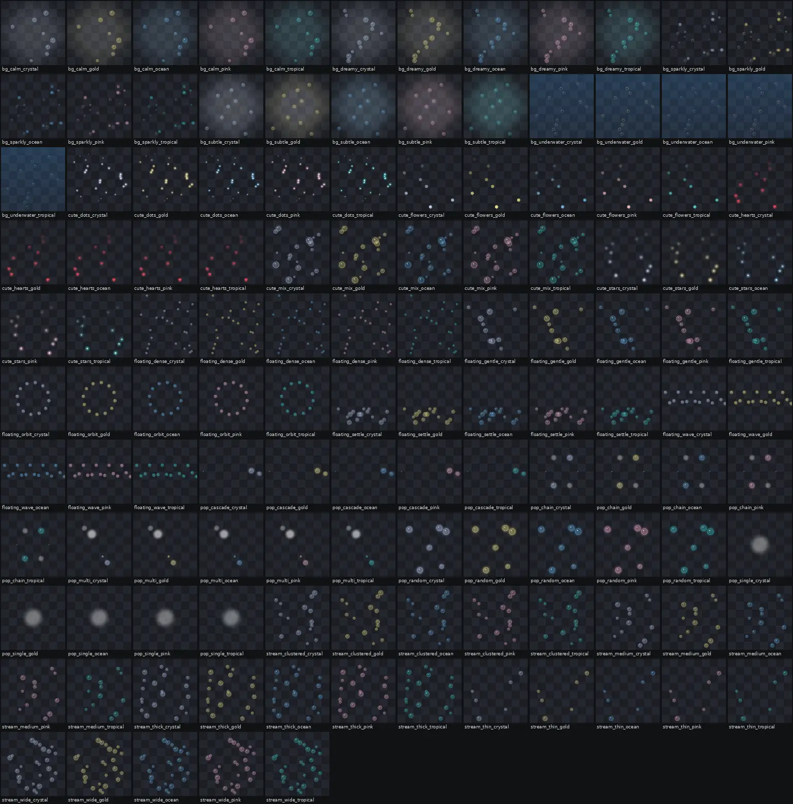

| אפקט | גרסאות | פריים | פריימים | איך נראה | במשחק |
|---|---|---|---|---|---|
| `bg_calm` | crystal, gold, ocean, pink, tropical | 512 | 24 |  |  |
| `bg_dreamy` | crystal, gold, ocean, pink, tropical | 512 | 24 |  |  |
| `bg_sparkly` | crystal, gold, ocean, pink, tropical | 512 | 24 |  |  |
| `bg_subtle` | crystal, gold, ocean, pink, tropical | 512 | 24 |  |  |
| `bg_underwater` | crystal, gold, ocean, pink, tropical | 512 | 24 |  |  |
| `cute_dots` | crystal, gold, ocean, pink, tropical | 512 | 24 |  |  |
| `cute_flowers` | crystal, gold, ocean, pink, tropical | 512 | 24 |  |  |
| `cute_hearts` | crystal, gold, ocean, pink, tropical | 512 | 24 |  |  |
| `cute_mix` | crystal, gold, ocean, pink, tropical | 512 | 24 |  |  |
| `cute_stars` | crystal, gold, ocean, pink, tropical | 512 | 24 |  |  |
| `floating_dense` | crystal, gold, ocean, pink, tropical | 512 | 24 |  |  |
| `floating_gentle` | crystal, gold, ocean, pink, tropical | 512 | 24 |  | bubbles_bg (gold) |
| `floating_orbit` | crystal, gold, ocean, pink, tropical | 512 | 24 |  |  |
| `floating_settle` | crystal, gold, ocean, pink, tropical | 512 | 24 |  |  |
| `floating_wave` | crystal, gold, ocean, pink, tropical | 512 | 24 |  |  |
| `pop_cascade` | crystal, gold, ocean, pink, tropical | 512 | 24 |  |  |
| `pop_chain` | crystal, gold, ocean, pink, tropical | 512 | 24 |  |  |
| `pop_multi` | crystal, gold, ocean, pink, tropical | 512 | 24 |  |  |
| `pop_random` | crystal, gold, ocean, pink, tropical | 512 | 24 |  |  |
| `pop_single` | crystal, gold, ocean, pink, tropical | 512 | 23 |  |  |
| `stream_clustered` | crystal, gold, ocean, pink, tropical | 512 | 24 |  |  |
| `stream_medium` | crystal, gold, ocean, pink, tropical | 512 | 24 |  |  |
| `stream_thick` | crystal, gold, ocean, pink, tropical | 512 | 24 |  |  |
| `stream_thin` | crystal, gold, ocean, pink, tropical | 512 | 24 |  |  |
| `stream_wide` | crystal, gold, ocean, pink, tropical | 512 | 24 |  |  |

## aura-buff-field-pack-vol1

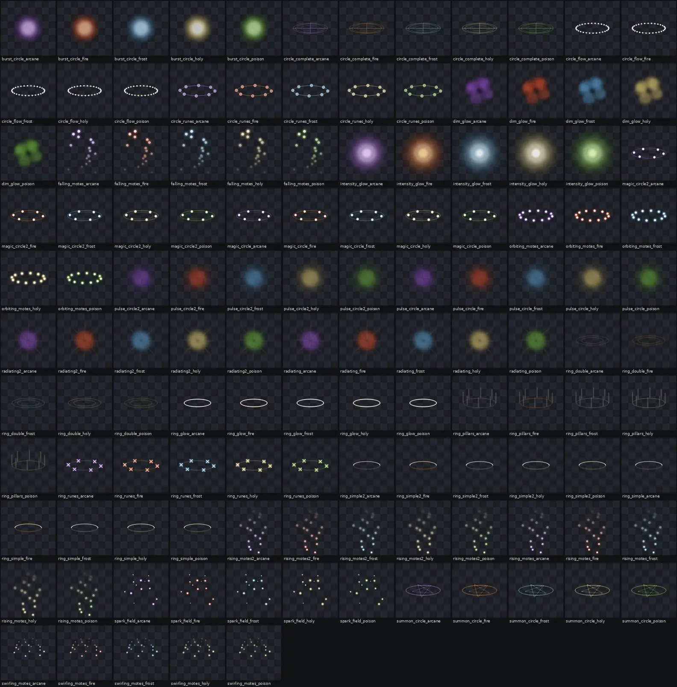

| אפקט | גרסאות | פריים | פריימים | איך נראה | במשחק |
|---|---|---|---|---|---|
| `burst_circle` | arcane, fire, frost, holy, poison | 512 | 24 |  |  |
| `circle_complete` | arcane, fire, frost, holy, poison | 512 | 24 |  |  |
| `circle_flow` | arcane, fire, frost, holy, poison | 512 | 24 |  |  |
| `circle_runes` | arcane, fire, frost, holy, poison | 512 | 24 |  |  |
| `dim_glow` | arcane, fire, frost, holy, poison | 512 | 24 |  |  |
| `falling_motes` | arcane, fire, frost, holy, poison | 512 | 24 |  |  |
| `intensity_glow` | arcane, fire, frost, holy, poison | 512 | 24 |  |  |
| `magic_circle2` | arcane, fire, frost, holy, poison | 512 | 24 |  |  |
| `magic_circle` | arcane, fire, frost, holy, poison | 512 | 24 |  |  |
| `orbiting_motes` | arcane, fire, frost, holy, poison | 512 | 24 |  |  |
| `pulse_circle2` | arcane, fire, frost, holy, poison | 512 | 24 |  |  |
| `pulse_circle` | arcane, fire, frost, holy, poison | 512 | 24 |  | sk_taunt (fire) |
| `radiating2` | arcane, fire, frost, holy, poison | 512 | 24 |  |  |
| `radiating` | arcane, fire, frost, holy, poison | 512 | 24 |  | sk_rage (fire) |
| `ring_double` | arcane, fire, frost, holy, poison | 512 | 24 |  |  |
| `ring_glow` | arcane, fire, frost, holy, poison | 512 | 24 |  | sk_bubble_aura (frost) |
| `ring_pillars` | arcane, fire, frost, holy, poison | 512 | 24 |  |  |
| `ring_runes` | arcane, fire, frost, holy, poison | 512 | 24 |  |  |
| `ring_simple2` | arcane, fire, frost, holy, poison | 512 | 24 |  |  |
| `ring_simple` | arcane, fire, frost, holy, poison | 512 | 24 |  | glow_enemy (fire), glow_ally (frost) |
| `rising_motes2` | arcane, fire, frost, holy, poison | 512 | 24 |  |  |
| `rising_motes` | arcane, fire, frost, holy, poison | 512 | 24 |  | sk_rage_glow (fire) |
| `spark_field` | arcane, fire, frost, holy, poison | 512 | 24 |  |  |
| `summon_circle` | arcane, fire, frost, holy, poison | 512 | 24 |  |  |
| `swirling_motes` | arcane, fire, frost, holy, poison | 512 | 24 |  |  |

## aurora-sky-fx-pack-vol1

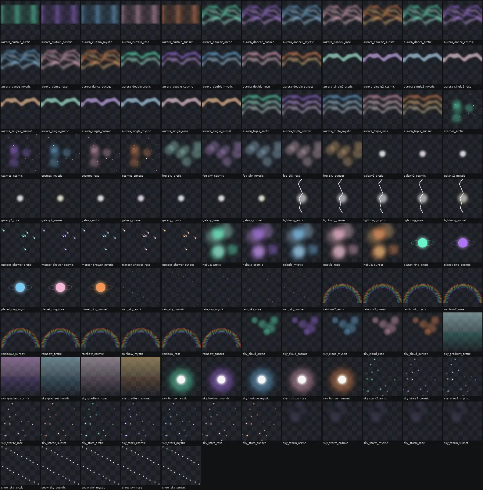

| אפקט | גרסאות | פריים | פריימים | איך נראה | במשחק |
|---|---|---|---|---|---|
| `aurora_curtain` | arctic, cosmic, mystic, rose, sunset | 512 | 24 |  |  |
| `aurora_dance2` | arctic, cosmic, mystic, rose, sunset | 512 | 24 |  |  |
| `aurora_dance` | arctic, cosmic, mystic, rose, sunset | 512 | 24 |  | aurora (arctic) |
| `aurora_double` | arctic, cosmic, mystic, rose, sunset | 512 | 24 |  |  |
| `aurora_single2` | arctic, cosmic, mystic, rose, sunset | 512 | 24 |  |  |
| `aurora_single` | arctic, cosmic, mystic, rose, sunset | 512 | 24 |  |  |
| `aurora_triple` | arctic, cosmic, mystic, rose, sunset | 512 | 24 |  |  |
| `cosmos` | arctic, cosmic, mystic, rose, sunset | 512 | 24 |  |  |
| `fog_sky` | arctic, cosmic, mystic, rose, sunset | 512 | 24 |  |  |
| `galaxy2` | arctic, cosmic, mystic, rose, sunset | 512 | 24 |  |  |
| `galaxy` | arctic, cosmic, mystic, rose, sunset | 512 | 24 |  |  |
| `lightning` | arctic, cosmic, mystic, rose, sunset | 512 | 24 |  |  |
| `meteor_shower` | arctic, cosmic, mystic, rose, sunset | 512 | 24 |  |  |
| `nebula` | arctic, cosmic, mystic, rose, sunset | 512 | 24 |  |  |
| `planet_ring` | arctic, cosmic, mystic, rose, sunset | 512 | 24 |  |  |
| `rain_sky` | arctic, cosmic, mystic, rose, sunset | 512 | 24 |  | rain (mystic) |
| `rainbow2` | arctic, cosmic, mystic, rose, sunset | 512 | 24 |  |  |
| `rainbow` | arctic, cosmic, mystic, rose, sunset | 512 | 24 |  |  |
| `sky_cloud` | arctic, cosmic, mystic, rose, sunset | 512 | 24 |  |  |
| `sky_gradient` | arctic, cosmic, mystic, rose, sunset | 512 | 24 |  |  |
| `sky_horizon` | arctic, cosmic, mystic, rose, sunset | 512 | 24 |  |  |
| `sky_stars2` | arctic, cosmic, mystic, rose, sunset | 512 | 24 |  |  |
| `sky_stars` | arctic, cosmic, mystic, rose, sunset | 512 | 24 |  |  |
| `sky_storm` | arctic, cosmic, mystic, rose, sunset | 512 | 24 |  |  |
| `snow_sky` | arctic, cosmic, mystic, rose, sunset | 512 | 24 |  |  |

## block-parry-counter-pack-vol1

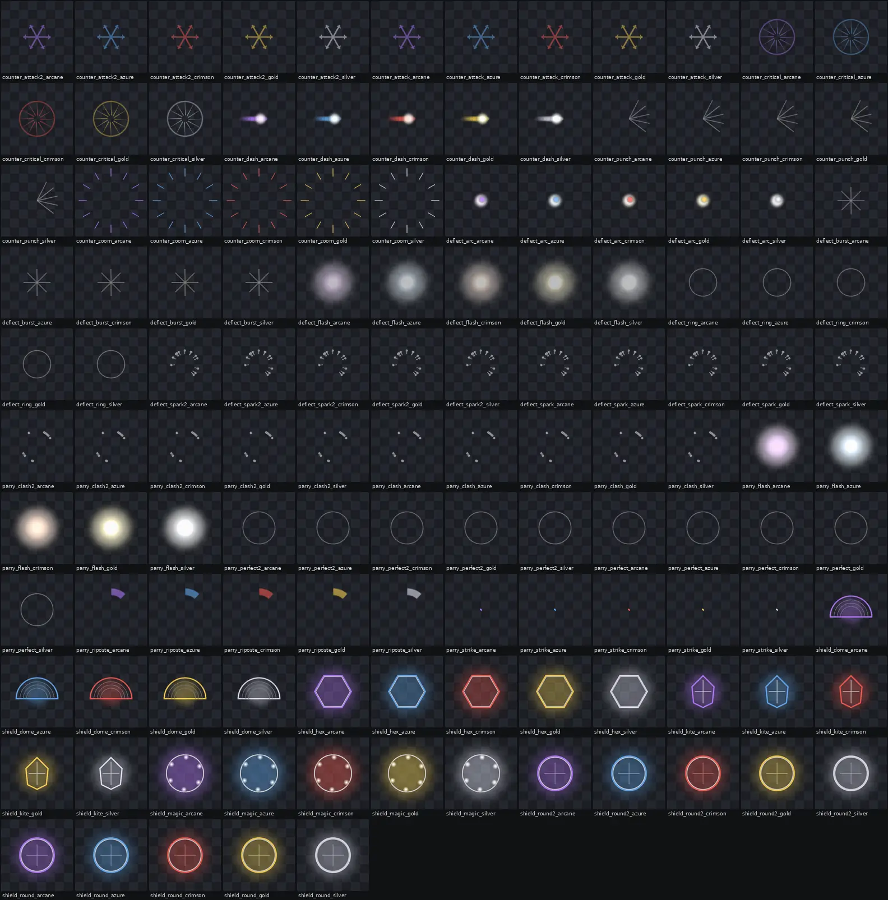

| אפקט | גרסאות | פריים | פריימים | איך נראה | במשחק |
|---|---|---|---|---|---|
| `counter_attack2` | arcane, azure, crimson, gold, silver | 512 | 23 |  |  |
| `counter_attack` | arcane, azure, crimson, gold, silver | 512 | 23 |  |  |
| `counter_critical` | arcane, azure, crimson, gold, silver | 512 | 20 |  |  |
| `counter_dash` | arcane, azure, crimson, gold, silver | 512 | 24 |  |  |
| `counter_punch` | arcane, azure, crimson, gold, silver | 512 | 23 |  |  |
| `counter_zoom` | arcane, azure, crimson, gold, silver | 512 | 23 |  |  |
| `deflect_arc` | arcane, azure, crimson, gold, silver | 512 | 24 |  |  |
| `deflect_burst` | arcane, azure, crimson, gold, silver | 512 | 23 |  |  |
| `deflect_flash` | arcane, azure, crimson, gold, silver | 512 | 12 |  |  |
| `deflect_ring` | arcane, azure, crimson, gold, silver | 512 | 18 |  |  |
| `deflect_spark2` | arcane, azure, crimson, gold, silver | 512 | 23 |  |  |
| `deflect_spark` | arcane, azure, crimson, gold, silver | 512 | 23 |  |  |
| `parry_clash2` | arcane, azure, crimson, gold, silver | 512 | 23 |  |  |
| `parry_clash` | arcane, azure, crimson, gold, silver | 512 | 23 |  |  |
| `parry_flash` | arcane, azure, crimson, gold, silver | 512 | 22 |  |  |
| `parry_perfect2` | arcane, azure, crimson, gold, silver | 512 | 20 |  |  |
| `parry_perfect` | arcane, azure, crimson, gold, silver | 512 | 20 |  |  |
| `parry_riposte` | arcane, azure, crimson, gold, silver | 512 | 22 |  |  |
| `parry_strike` | arcane, azure, crimson, gold, silver | 512 | 23 |  |  |
| `shield_dome` | arcane, azure, crimson, gold, silver | 512 | 24 |  |  |
| `shield_hex` | arcane, azure, crimson, gold, silver | 512 | 24 |  | sk_wall (gold) |
| `shield_kite` | arcane, azure, crimson, gold, silver | 512 | 24 |  |  |
| `shield_magic` | arcane, azure, crimson, gold, silver | 512 | 24 |  |  |
| `shield_round2` | arcane, azure, crimson, gold, silver | 512 | 24 |  |  |
| `shield_round` | arcane, azure, crimson, gold, silver | 512 | 24 |  | sp_barrier (azure) |

## boss-telegraph-pack-vol1

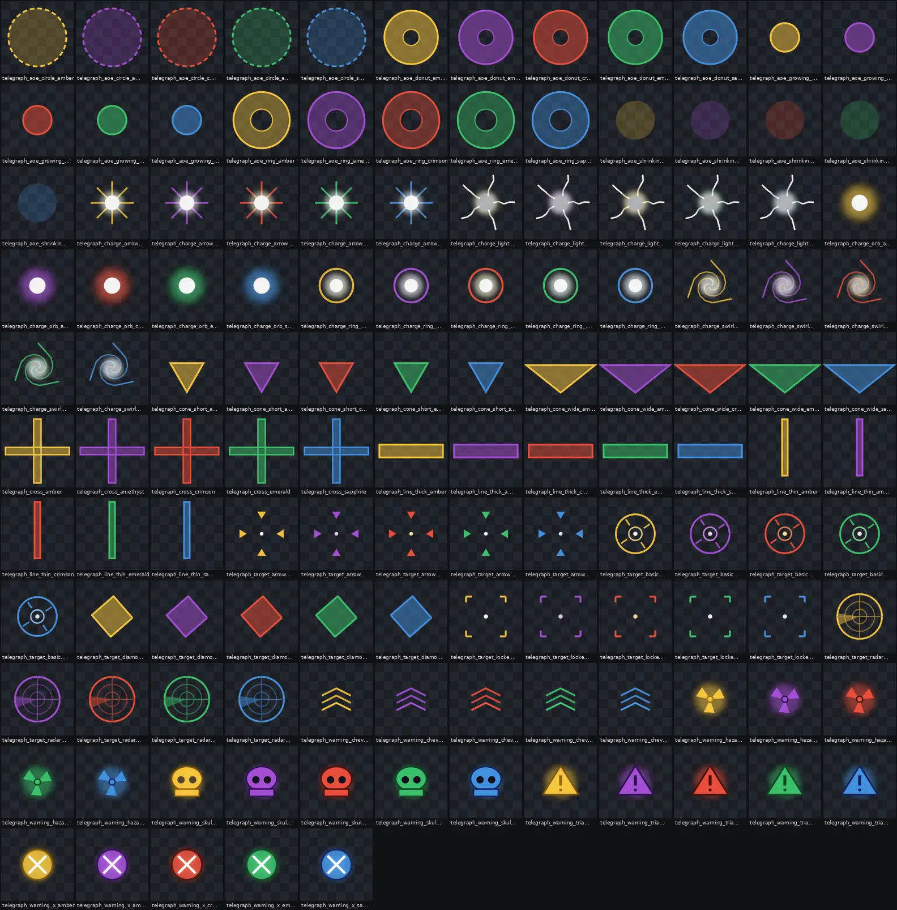

| אפקט | גרסאות | פריים | פריימים | איך נראה | במשחק |
|---|---|---|---|---|---|
| `telegraph_aoe_circle` | amber, amethyst, crimson, emerald, sapphire | 512 | 24 |  | tg_circle (crimson) |
| `telegraph_aoe_donut` | amber, amethyst, crimson, emerald, sapphire | 512 | 24 |  |  |
| `telegraph_aoe_growing` | amber, amethyst, crimson, emerald, sapphire | 512 | 24 |  | tg_growing (crimson) |
| `telegraph_aoe_ring` | amber, amethyst, crimson, emerald, sapphire | 512 | 24 |  | tg_ring (crimson) |
| `telegraph_aoe_shrinking` | amber, amethyst, crimson, emerald, sapphire | 512 | 23 |  |  |
| `telegraph_charge_arrows` | amber, amethyst, crimson, emerald, sapphire | 512 | 24 |  |  |
| `telegraph_charge_lightning` | amber, amethyst, crimson, emerald, sapphire | 512 | 24 |  |  |
| `telegraph_charge_orb` | amber, amethyst, crimson, emerald, sapphire | 512 | 24 |  | tg_charge (amethyst) |
| `telegraph_charge_ring` | amber, amethyst, crimson, emerald, sapphire | 512 | 24 |  |  |
| `telegraph_charge_swirl` | amber, amethyst, crimson, emerald, sapphire | 512 | 24 |  |  |
| `telegraph_cone_short` | amber, amethyst, crimson, emerald, sapphire | 512 | 24 |  |  |
| `telegraph_cone_wide` | amber, amethyst, crimson, emerald, sapphire | 512 | 24 |  | tg_cone (crimson) |
| `telegraph_cross` | amber, amethyst, crimson, emerald, sapphire | 512 | 24 |  |  |
| `telegraph_line_thick` | amber, amethyst, crimson, emerald, sapphire | 512 | 24 |  | tg_line (crimson) |
| `telegraph_line_thin` | amber, amethyst, crimson, emerald, sapphire | 512 | 24 |  |  |
| `telegraph_target_arrows` | amber, amethyst, crimson, emerald, sapphire | 512 | 24 |  |  |
| `telegraph_target_basic` | amber, amethyst, crimson, emerald, sapphire | 512 | 24 |  |  |
| `telegraph_target_diamond` | amber, amethyst, crimson, emerald, sapphire | 512 | 24 |  |  |
| `telegraph_target_locked` | amber, amethyst, crimson, emerald, sapphire | 512 | 24 |  | tg_target (crimson) |
| `telegraph_target_radar` | amber, amethyst, crimson, emerald, sapphire | 512 | 24 |  |  |
| `telegraph_warning_chevron` | amber, amethyst, crimson, emerald, sapphire | 512 | 24 |  |  |
| `telegraph_warning_hazard` | amber, amethyst, crimson, emerald, sapphire | 512 | 24 |  |  |
| `telegraph_warning_skull` | amber, amethyst, crimson, emerald, sapphire | 512 | 24 |  | tg_skull (crimson) |
| `telegraph_warning_triangle` | amber, amethyst, crimson, emerald, sapphire | 512 | 24 |  |  |
| `telegraph_warning_x` | amber, amethyst, crimson, emerald, sapphire | 512 | 24 |  |  |

## bullet-projectile-pack-vol1

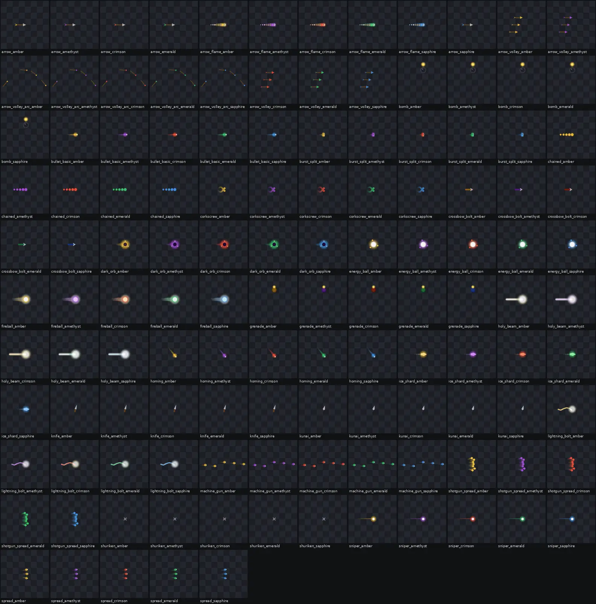

| אפקט | גרסאות | פריים | פריימים | איך נראה | במשחק |
|---|---|---|---|---|---|
| `arrow` | amber, amethyst, crimson, emerald, sapphire | 512 | 24 |  | shot_arrow (amber) |
| `arrow_flame` | amber, amethyst, crimson, emerald, sapphire | 512 | 24 |  |  |
| `arrow_volley` | amber, amethyst, crimson, emerald, sapphire | 512 | 24 |  |  |
| `arrow_volley_arc` | amber, amethyst, crimson, emerald, sapphire | 512 | 24 |  | sk_rain (amber) |
| `bomb` | amber, amethyst, crimson, emerald, sapphire | 512 | 24 |  |  |
| `bullet_basic` | amber, amethyst, crimson, emerald, sapphire | 512 | 24 |  | shot_basic (crimson) |
| `burst_split` | amber, amethyst, crimson, emerald, sapphire | 512 | 24 |  |  |
| `chained` | amber, amethyst, crimson, emerald, sapphire | 512 | 24 |  |  |
| `corkscrew` | amber, amethyst, crimson, emerald, sapphire | 512 | 24 |  |  |
| `crossbow_bolt` | amber, amethyst, crimson, emerald, sapphire | 512 | 24 |  |  |
| `dark_orb` | amber, amethyst, crimson, emerald, sapphire | 512 | 24 |  |  |
| `energy_ball` | amber, amethyst, crimson, emerald, sapphire | 512 | 24 |  | shot_orb (sapphire) |
| `fireball` | amber, amethyst, crimson, emerald, sapphire | 512 | 24 |  |  |
| `grenade` | amber, amethyst, crimson, emerald, sapphire | 512 | 24 |  |  |
| `holy_beam` | amber, amethyst, crimson, emerald, sapphire | 512 | 24 |  |  |
| `homing` | amber, amethyst, crimson, emerald, sapphire | 512 | 24 |  |  |
| `ice_shard` | amber, amethyst, crimson, emerald, sapphire | 512 | 24 |  |  |
| `knife` | amber, amethyst, crimson, emerald, sapphire | 512 | 24 |  |  |
| `kunai` | amber, amethyst, crimson, emerald, sapphire | 512 | 24 |  |  |
| `lightning_bolt` | amber, amethyst, crimson, emerald, sapphire | 512 | 24 |  | sk_pierce (amethyst) |
| `machine_gun` | amber, amethyst, crimson, emerald, sapphire | 512 | 24 |  |  |
| `shotgun_spread` | amber, amethyst, crimson, emerald, sapphire | 512 | 24 |  |  |
| `shuriken` | amber, amethyst, crimson, emerald, sapphire | 512 | 24 |  |  |
| `sniper` | amber, amethyst, crimson, emerald, sapphire | 512 | 24 |  |  |
| `spread` | amber, amethyst, crimson, emerald, sapphire | 512 | 24 |  |  |

## character-glow-outline-pack-vol1

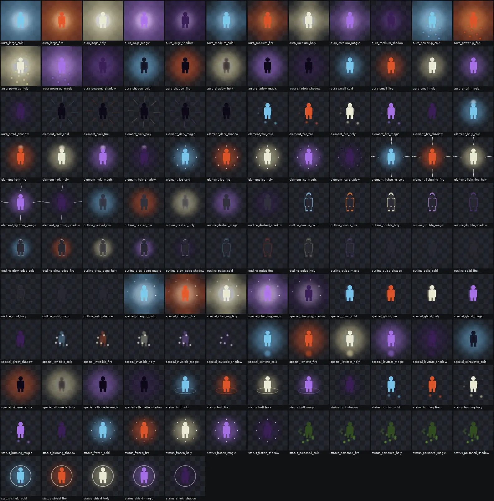

| אפקט | גרסאות | פריים | פריימים | איך נראה | במשחק |
|---|---|---|---|---|---|
| `aura_large` | cold, fire, holy, magic, shadow | 512 | 24 |  |  |
| `aura_medium` | cold, fire, holy, magic, shadow | 512 | 24 |  |  |
| `aura_powerup` | cold, fire, holy, magic, shadow | 512 | 24 |  |  |
| `aura_shadow` | cold, fire, holy, magic, shadow | 512 | 24 |  |  |
| `aura_small` | cold, fire, holy, magic, shadow | 512 | 24 |  |  |
| `element_dark` | cold, fire, holy, magic, shadow | 512 | 24 |  |  |
| `element_fire` | cold, fire, holy, magic, shadow | 512 | 24 |  |  |
| `element_holy` | cold, fire, holy, magic, shadow | 512 | 24 |  |  |
| `element_ice` | cold, fire, holy, magic, shadow | 512 | 24 |  |  |
| `element_lightning` | cold, fire, holy, magic, shadow | 512 | 24 |  |  |
| `outline_dashed` | cold, fire, holy, magic, shadow | 512 | 24 |  |  |
| `outline_double` | cold, fire, holy, magic, shadow | 512 | 24 |  |  |
| `outline_glow_edge` | cold, fire, holy, magic, shadow | 512 | 24 |  |  |
| `outline_pulse` | cold, fire, holy, magic, shadow | 512 | 24 |  |  |
| `outline_solid` | cold, fire, holy, magic, shadow | 512 | 24 |  |  |
| `special_charging` | cold, fire, holy, magic, shadow | 512 | 24 |  |  |
| `special_ghost` | cold, fire, holy, magic, shadow | 512 | 24 |  |  |
| `special_invisible` | cold, fire, holy, magic, shadow | 512 | 24 |  |  |
| `special_levitate` | cold, fire, holy, magic, shadow | 512 | 24 |  |  |
| `special_silhouette` | cold, fire, holy, magic, shadow | 512 | 24 |  |  |
| `status_buff` | cold, fire, holy, magic, shadow | 512 | 24 |  |  |
| `status_burning` | cold, fire, holy, magic, shadow | 512 | 24 |  |  |
| `status_frozen` | cold, fire, holy, magic, shadow | 512 | 24 |  |  |
| `status_poisoned` | cold, fire, holy, magic, shadow | 512 | 24 |  |  |
| `status_shield` | cold, fire, holy, magic, shadow | 512 | 24 |  |  |

## confetti-fx-vol1

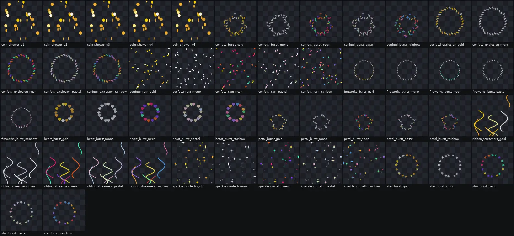

| אפקט | גרסאות | פריים | פריימים | איך נראה | במשחק |
|---|---|---|---|---|---|
| `coin_shower` | v1, v2, v3, v4, v5 | 256 | 24 |  | coins (v1) |
| `confetti_burst` | gold, mono, neon, pastel, rainbow | 256 | 23 |  |  |
| `confetti_explosion` | gold, mono, neon, pastel, rainbow | 256 | 23 |  | win_confetti (rainbow) |
| `confetti_rain` | gold, mono, neon, pastel, rainbow | 256 | 24 |  |  |
| `fireworks_burst` | gold, mono, neon, pastel, rainbow | 256 | 23 |  | win_fireworks (gold) |
| `heart_burst` | gold, mono, neon, pastel, rainbow | 256 | 23 |  |  |
| `petal_burst` | gold, mono, neon, pastel, rainbow | 256 | 23 |  |  |
| `ribbon_streamers` | gold, mono, neon, pastel, rainbow | 256 | 24 |  |  |
| `sparkle_confetti` | gold, mono, neon, pastel, rainbow | 256 | 24 |  |  |
| `star_burst` | gold, mono, neon, pastel, rainbow | 256 | 23 |  |  |

## crystal-gem-pack-vol1

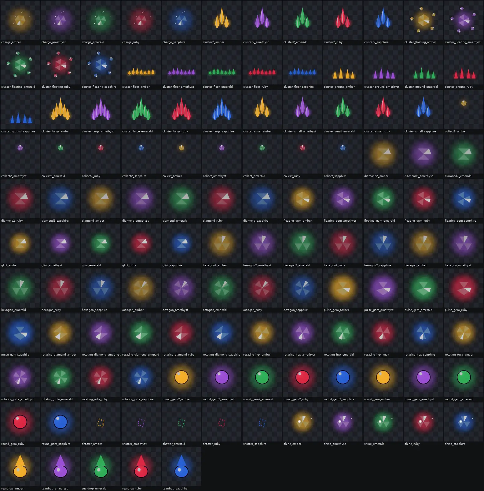

| אפקט | גרסאות | פריים | פריימים | איך נראה | במשחק |
|---|---|---|---|---|---|
| `charge` | amber, amethyst, emerald, ruby, sapphire | 512 | 24 |  |  |
| `cluster2` | amber, amethyst, emerald, ruby, sapphire | 512 | 24 |  |  |
| `cluster_floating` | amber, amethyst, emerald, ruby, sapphire | 512 | 24 |  |  |
| `cluster_floor` | amber, amethyst, emerald, ruby, sapphire | 512 | 24 |  |  |
| `cluster_ground` | amber, amethyst, emerald, ruby, sapphire | 512 | 24 |  |  |
| `cluster_large` | amber, amethyst, emerald, ruby, sapphire | 512 | 24 |  |  |
| `cluster_small` | amber, amethyst, emerald, ruby, sapphire | 512 | 24 |  |  |
| `collect2` | amber, amethyst, emerald, ruby, sapphire | 512 | 23 |  |  |
| `collect` | amber, amethyst, emerald, ruby, sapphire | 512 | 23 |  | gamble_win (amber) |
| `diamond2` | amber, amethyst, emerald, ruby, sapphire | 512 | 24 |  |  |
| `diamond` | amber, amethyst, emerald, ruby, sapphire | 512 | 24 |  |  |
| `floating_gem` | amber, amethyst, emerald, ruby, sapphire | 512 | 24 |  |  |
| `glint` | amber, amethyst, emerald, ruby, sapphire | 512 | 24 |  |  |
| `hexagon2` | amber, amethyst, emerald, ruby, sapphire | 512 | 24 |  |  |
| `hexagon` | amber, amethyst, emerald, ruby, sapphire | 512 | 24 |  |  |
| `octagon` | amber, amethyst, emerald, ruby, sapphire | 512 | 24 |  |  |
| `pulse_gem` | amber, amethyst, emerald, ruby, sapphire | 512 | 24 |  |  |
| `rotating_diamond` | amber, amethyst, emerald, ruby, sapphire | 512 | 24 |  |  |
| `rotating_hex` | amber, amethyst, emerald, ruby, sapphire | 512 | 24 |  |  |
| `rotating_octa` | amber, amethyst, emerald, ruby, sapphire | 512 | 24 |  |  |
| `round_gem2` | amber, amethyst, emerald, ruby, sapphire | 512 | 24 |  |  |
| `round_gem` | amber, amethyst, emerald, ruby, sapphire | 512 | 24 |  |  |
| `shatter` | amber, amethyst, emerald, ruby, sapphire | 512 | 24 |  | sk_blizzard_ice (sapphire) |
| `shine` | amber, amethyst, emerald, ruby, sapphire | 512 | 24 |  |  |
| `teardrop` | amber, amethyst, emerald, ruby, sapphire | 512 | 24 |  |  |

## cursor-hover-pack-vol1

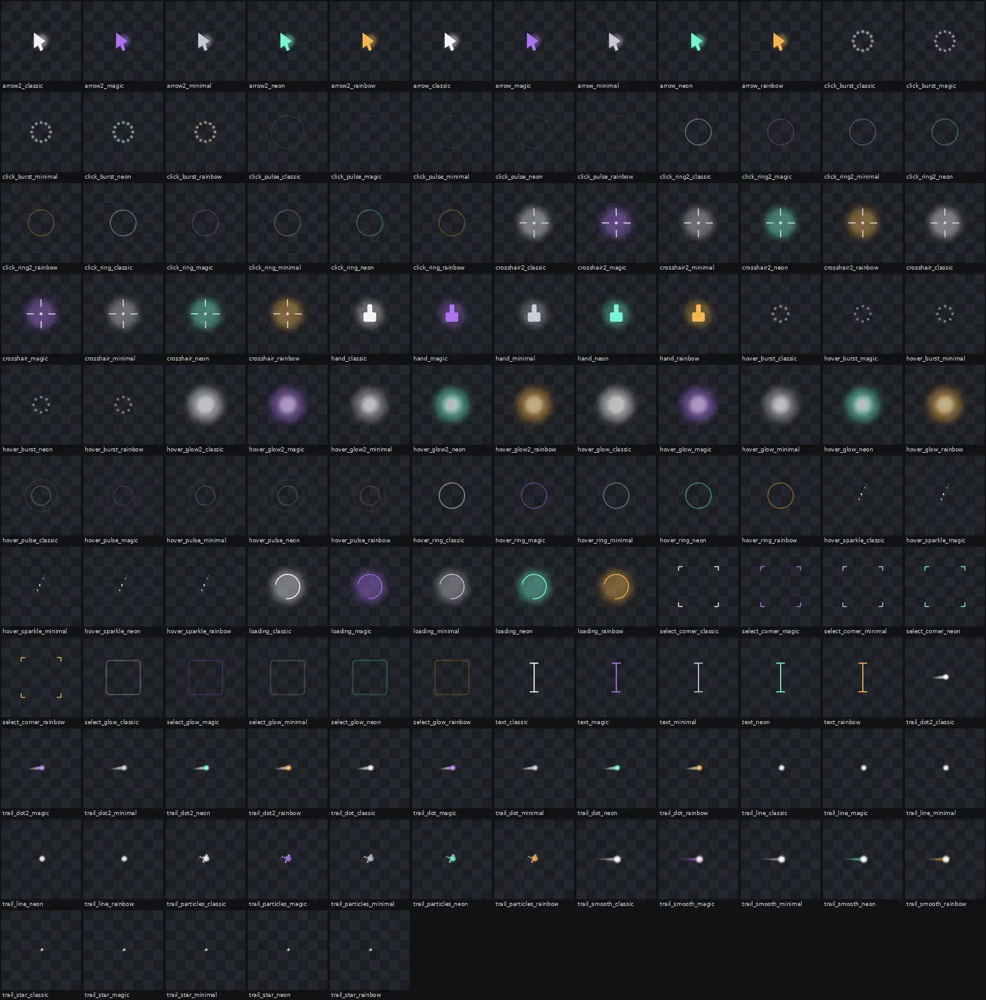

| אפקט | גרסאות | פריים | פריימים | איך נראה | במשחק |
|---|---|---|---|---|---|
| `arrow2` | classic, magic, minimal, neon, rainbow | 512 | 24 |  |  |
| `arrow` | classic, magic, minimal, neon, rainbow | 512 | 24 |  |  |
| `click_burst` | classic, magic, minimal, neon, rainbow | 512 | 23 |  | ui_click (magic) |
| `click_pulse` | classic, magic, minimal, neon, rainbow | 512 | 24 |  |  |
| `click_ring2` | classic, magic, minimal, neon, rainbow | 512 | 20 |  |  |
| `click_ring` | classic, magic, minimal, neon, rainbow | 512 | 20 |  |  |
| `crosshair2` | classic, magic, minimal, neon, rainbow | 512 | 24 |  |  |
| `crosshair` | classic, magic, minimal, neon, rainbow | 512 | 24 |  |  |
| `hand` | classic, magic, minimal, neon, rainbow | 512 | 24 |  |  |
| `hover_burst` | classic, magic, minimal, neon, rainbow | 512 | 23 |  |  |
| `hover_glow2` | classic, magic, minimal, neon, rainbow | 512 | 24 |  |  |
| `hover_glow` | classic, magic, minimal, neon, rainbow | 512 | 24 |  |  |
| `hover_pulse` | classic, magic, minimal, neon, rainbow | 512 | 24 |  |  |
| `hover_ring` | classic, magic, minimal, neon, rainbow | 512 | 24 |  |  |
| `hover_sparkle` | classic, magic, minimal, neon, rainbow | 512 | 24 |  | ui_hover (magic) |
| `loading` | classic, magic, minimal, neon, rainbow | 512 | 24 |  |  |
| `select_corner` | classic, magic, minimal, neon, rainbow | 512 | 24 |  |  |
| `select_glow` | classic, magic, minimal, neon, rainbow | 512 | 24 |  |  |
| `text` | classic, magic, minimal, neon, rainbow | 512 | 24 |  |  |
| `trail_dot2` | classic, magic, minimal, neon, rainbow | 512 | 24 |  |  |
| `trail_dot` | classic, magic, minimal, neon, rainbow | 512 | 24 |  |  |
| `trail_line` | classic, magic, minimal, neon, rainbow | 512 | 24 |  |  |
| `trail_particles` | classic, magic, minimal, neon, rainbow | 512 | 24 |  |  |
| `trail_smooth` | classic, magic, minimal, neon, rainbow | 512 | 24 |  |  |
| `trail_star` | classic, magic, minimal, neon, rainbow | 512 | 24 |  |  |

## damage-numbers-pack-vol1

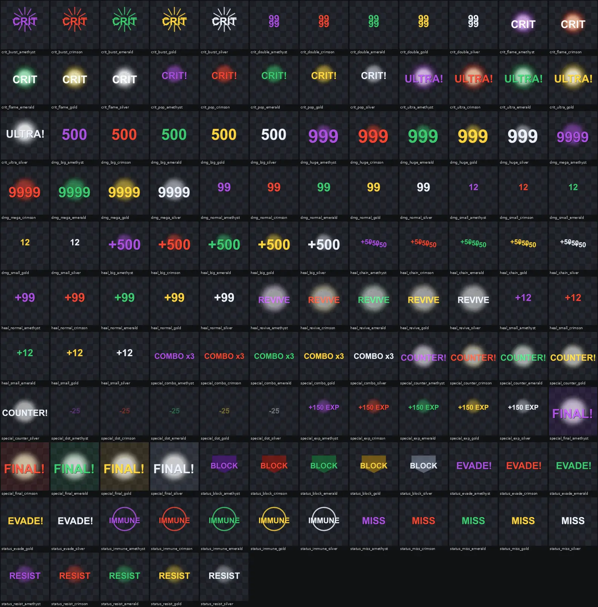

| אפקט | גרסאות | פריים | פריימים | איך נראה | במשחק |
|---|---|---|---|---|---|
| `crit_burst` | amethyst, crimson, emerald, gold, silver | 512 | 22 |  |  |
| `crit_double` | amethyst, crimson, emerald, gold, silver | 512 | 22 |  |  |
| `crit_flame` | amethyst, crimson, emerald, gold, silver | 512 | 24 |  |  |
| `crit_pop` | amethyst, crimson, emerald, gold, silver | 512 | 22 |  | dmg_crit (gold) |
| `crit_ultra` | amethyst, crimson, emerald, gold, silver | 512 | 23 |  |  |
| `dmg_big` | amethyst, crimson, emerald, gold, silver | 512 | 22 |  |  |
| `dmg_huge` | amethyst, crimson, emerald, gold, silver | 512 | 22 |  |  |
| `dmg_mega` | amethyst, crimson, emerald, gold, silver | 512 | 23 |  |  |
| `dmg_normal` | amethyst, crimson, emerald, gold, silver | 512 | 22 |  |  |
| `dmg_small` | amethyst, crimson, emerald, gold, silver | 512 | 22 |  |  |
| `heal_big` | amethyst, crimson, emerald, gold, silver | 512 | 22 |  |  |
| `heal_chain` | amethyst, crimson, emerald, gold, silver | 512 | 22 |  |  |
| `heal_normal` | amethyst, crimson, emerald, gold, silver | 512 | 22 |  |  |
| `heal_revive` | amethyst, crimson, emerald, gold, silver | 512 | 24 |  |  |
| `heal_small` | amethyst, crimson, emerald, gold, silver | 512 | 22 |  |  |
| `special_combo` | amethyst, crimson, emerald, gold, silver | 512 | 22 |  |  |
| `special_counter` | amethyst, crimson, emerald, gold, silver | 512 | 22 |  |  |
| `special_dot` | amethyst, crimson, emerald, gold, silver | 512 | 18 |  |  |
| `special_exp` | amethyst, crimson, emerald, gold, silver | 512 | 22 |  |  |
| `special_final` | amethyst, crimson, emerald, gold, silver | 512 | 23 |  |  |
| `status_block` | amethyst, crimson, emerald, gold, silver | 512 | 22 |  |  |
| `status_evade` | amethyst, crimson, emerald, gold, silver | 512 | 22 |  |  |
| `status_immune` | amethyst, crimson, emerald, gold, silver | 512 | 22 |  |  |
| `status_miss` | amethyst, crimson, emerald, gold, silver | 512 | 22 |  |  |
| `status_resist` | amethyst, crimson, emerald, gold, silver | 512 | 22 |  |  |

## death-ko-pack-vol1

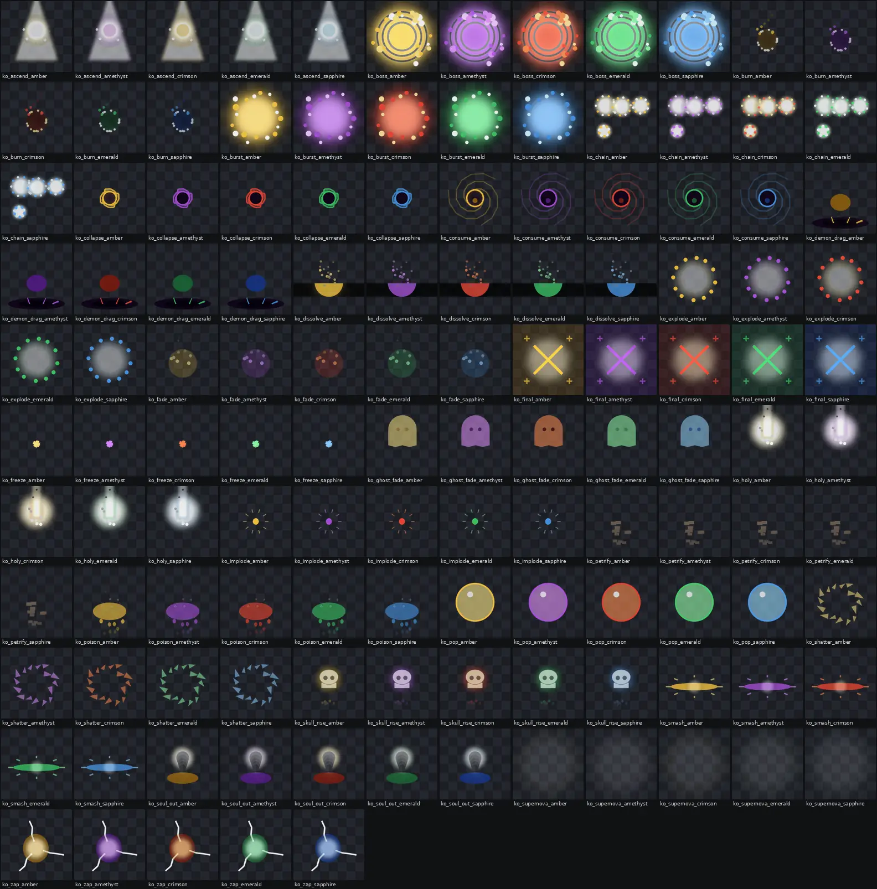

| אפקט | גרסאות | פריים | פריימים | איך נראה | במשחק |
|---|---|---|---|---|---|
| `ko_ascend` | amber, amethyst, crimson, emerald, sapphire | 512 | 24 |  |  |
| `ko_boss` | amber, amethyst, crimson, emerald, sapphire | 512 | 24 |  | ko_boss (crimson) |
| `ko_burn` | amber, amethyst, crimson, emerald, sapphire | 512 | 24 |  |  |
| `ko_burst` | amber, amethyst, crimson, emerald, sapphire | 512 | 23 |  | ko (crimson) |
| `ko_chain` | amber, amethyst, crimson, emerald, sapphire | 512 | 23 |  |  |
| `ko_collapse` | amber, amethyst, crimson, emerald, sapphire | 512 | 24 |  |  |
| `ko_consume` | amber, amethyst, crimson, emerald, sapphire | 512 | 24 |  |  |
| `ko_demon_drag` | amber, amethyst, crimson, emerald, sapphire | 512 | 24 |  |  |
| `ko_dissolve` | amber, amethyst, crimson, emerald, sapphire | 512 | 24 |  |  |
| `ko_explode` | amber, amethyst, crimson, emerald, sapphire | 512 | 22 |  |  |
| `ko_fade` | amber, amethyst, crimson, emerald, sapphire | 512 | 24 |  |  |
| `ko_final` | amber, amethyst, crimson, emerald, sapphire | 512 | 24 |  |  |
| `ko_freeze` | amber, amethyst, crimson, emerald, sapphire | 512 | 24 |  |  |
| `ko_ghost_fade` | amber, amethyst, crimson, emerald, sapphire | 512 | 24 |  |  |
| `ko_holy` | amber, amethyst, crimson, emerald, sapphire | 512 | 24 |  |  |
| `ko_implode` | amber, amethyst, crimson, emerald, sapphire | 512 | 24 |  | gamble_lose (amethyst) |
| `ko_petrify` | amber, amethyst, crimson, emerald, sapphire | 512 | 23 |  |  |
| `ko_poison` | amber, amethyst, crimson, emerald, sapphire | 512 | 24 |  |  |
| `ko_pop` | amber, amethyst, crimson, emerald, sapphire | 512 | 23 |  |  |
| `ko_shatter` | amber, amethyst, crimson, emerald, sapphire | 512 | 24 |  |  |
| `ko_skull_rise` | amber, amethyst, crimson, emerald, sapphire | 512 | 24 |  |  |
| `ko_smash` | amber, amethyst, crimson, emerald, sapphire | 512 | 24 |  |  |
| `ko_soul_out` | amber, amethyst, crimson, emerald, sapphire | 512 | 24 |  | ko_soul (sapphire) |
| `ko_supernova` | amber, amethyst, crimson, emerald, sapphire | 512 | 23 |  |  |
| `ko_zap` | amber, amethyst, crimson, emerald, sapphire | 512 | 24 |  |  |

## footstep-trail-pack-vol1

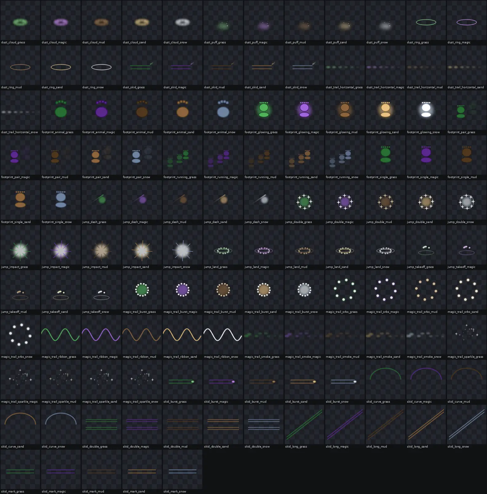

| אפקט | גרסאות | פריים | פריימים | איך נראה | במשחק |
|---|---|---|---|---|---|
| `dust_cloud` | grass, magic, mud, sand, snow | 512 | 23 |  |  |
| `dust_puff` | grass, magic, mud, sand, snow | 512 | 24 |  | step_dust (grass), step_sand (sand), step_snow (snow) |
| `dust_ring` | grass, magic, mud, sand, snow | 512 | 23 |  |  |
| `dust_skid` | grass, magic, mud, sand, snow | 512 | 24 |  |  |
| `dust_trail_horizontal` | grass, magic, mud, sand, snow | 512 | 24 |  |  |
| `footprint_animal` | grass, magic, mud, sand, snow | 512 | 22 |  |  |
| `footprint_glowing` | grass, magic, mud, sand, snow | 512 | 24 |  |  |
| `footprint_pair` | grass, magic, mud, sand, snow | 512 | 22 |  |  |
| `footprint_running` | grass, magic, mud, sand, snow | 512 | 23 |  |  |
| `footprint_single` | grass, magic, mud, sand, snow | 512 | 22 |  |  |
| `jump_dash` | grass, magic, mud, sand, snow | 512 | 24 |  |  |
| `jump_double` | grass, magic, mud, sand, snow | 512 | 23 |  |  |
| `jump_impact` | grass, magic, mud, sand, snow | 512 | 23 |  |  |
| `jump_land` | grass, magic, mud, sand, snow | 512 | 19 |  |  |
| `jump_takeoff` | grass, magic, mud, sand, snow | 512 | 23 |  |  |
| `magic_trail_burst` | grass, magic, mud, sand, snow | 512 | 23 |  |  |
| `magic_trail_orbs` | grass, magic, mud, sand, snow | 512 | 24 |  |  |
| `magic_trail_ribbon` | grass, magic, mud, sand, snow | 512 | 24 |  |  |
| `magic_trail_smoke` | grass, magic, mud, sand, snow | 512 | 24 |  |  |
| `magic_trail_sparkle` | grass, magic, mud, sand, snow | 512 | 24 |  | sp_haste (magic) |
| `skid_burst` | grass, magic, mud, sand, snow | 512 | 24 |  |  |
| `skid_curve` | grass, magic, mud, sand, snow | 512 | 22 |  |  |
| `skid_double` | grass, magic, mud, sand, snow | 512 | 22 |  |  |
| `skid_long` | grass, magic, mud, sand, snow | 512 | 22 |  |  |
| `skid_mark` | grass, magic, mud, sand, snow | 512 | 22 |  |  |

## halo-crown-pack-vol1

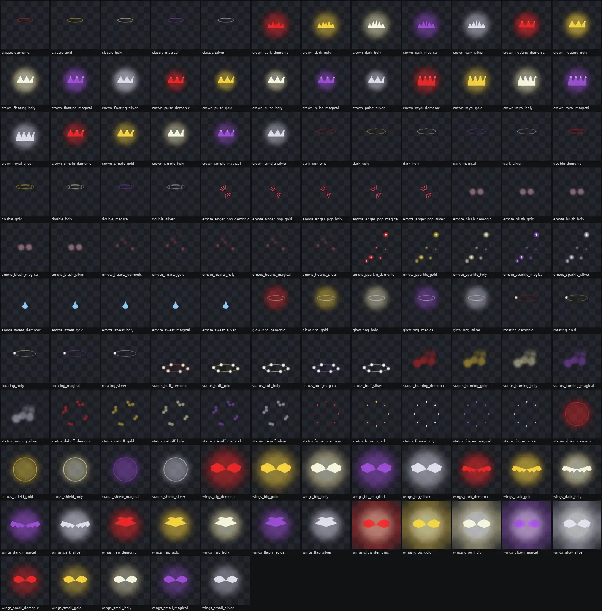

| אפקט | גרסאות | פריים | פריימים | איך נראה | במשחק |
|---|---|---|---|---|---|
| `classic` | demonic, gold, holy, magical, silver | 512 | 24 |  |  |
| `crown_dark` | demonic, gold, holy, magical, silver | 512 | 24 |  |  |
| `crown_floating` | demonic, gold, holy, magical, silver | 512 | 24 |  |  |
| `crown_pulse` | demonic, gold, holy, magical, silver | 512 | 24 |  |  |
| `crown_royal` | demonic, gold, holy, magical, silver | 512 | 24 |  | halo_ach (gold) |
| `crown_simple` | demonic, gold, holy, magical, silver | 512 | 24 |  |  |
| `dark` | demonic, gold, holy, magical, silver | 512 | 24 |  |  |
| `double` | demonic, gold, holy, magical, silver | 512 | 24 |  |  |
| `emote_anger_pop` | demonic, gold, holy, magical, silver | 512 | 24 |  |  |
| `emote_blush` | demonic, gold, holy, magical, silver | 512 | 24 |  |  |
| `emote_hearts` | demonic, gold, holy, magical, silver | 512 | 24 |  |  |
| `emote_sparkle` | demonic, gold, holy, magical, silver | 512 | 24 |  |  |
| `emote_sweat` | demonic, gold, holy, magical, silver | 512 | 24 |  |  |
| `glow_ring` | demonic, gold, holy, magical, silver | 512 | 24 |  | sk_bubble_halo (magical) |
| `rotating` | demonic, gold, holy, magical, silver | 512 | 24 |  |  |
| `status_buff` | demonic, gold, holy, magical, silver | 512 | 24 |  |  |
| `status_burning` | demonic, gold, holy, magical, silver | 512 | 24 |  |  |
| `status_debuff` | demonic, gold, holy, magical, silver | 512 | 24 |  |  |
| `status_frozen` | demonic, gold, holy, magical, silver | 512 | 24 |  |  |
| `status_shield` | demonic, gold, holy, magical, silver | 512 | 24 |  |  |
| `wings_big` | demonic, gold, holy, magical, silver | 512 | 24 |  |  |
| `wings_dark` | demonic, gold, holy, magical, silver | 512 | 24 |  |  |
| `wings_flap` | demonic, gold, holy, magical, silver | 512 | 24 |  |  |
| `wings_glow` | demonic, gold, holy, magical, silver | 512 | 24 |  |  |
| `wings_small` | demonic, gold, holy, magical, silver | 512 | 24 |  |  |

## heart-pack-vol1

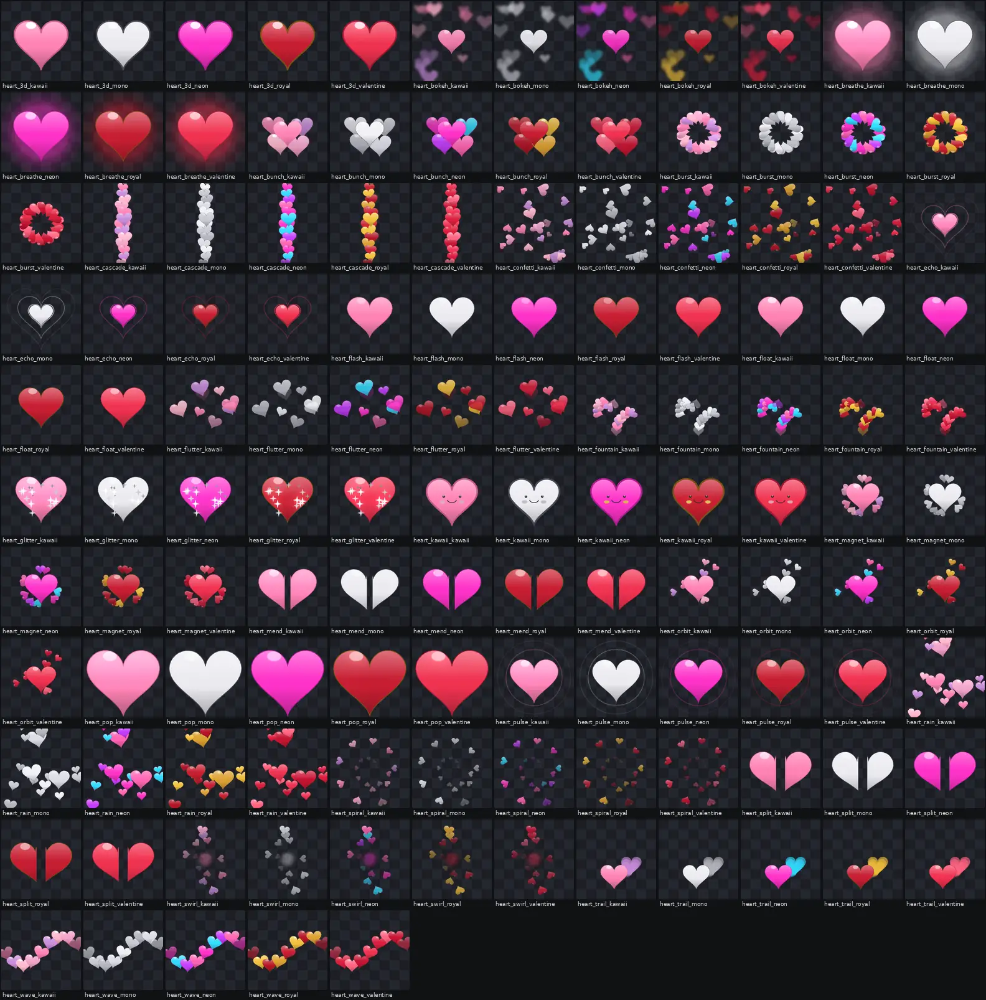

| אפקט | גרסאות | פריים | פריימים | איך נראה | במשחק |
|---|---|---|---|---|---|
| `heart_3d` | kawaii, mono, neon, royal, valentine | 512 | 24 |  |  |
| `heart_bokeh` | kawaii, mono, neon, royal, valentine | 512 | 24 |  |  |
| `heart_breathe` | kawaii, mono, neon, royal, valentine | 512 | 24 |  |  |
| `heart_bunch` | kawaii, mono, neon, royal, valentine | 512 | 24 |  |  |
| `heart_burst` | kawaii, mono, neon, royal, valentine | 512 | 22 |  |  |
| `heart_cascade` | kawaii, mono, neon, royal, valentine | 512 | 24 |  |  |
| `heart_confetti` | kawaii, mono, neon, royal, valentine | 512 | 24 |  |  |
| `heart_echo` | kawaii, mono, neon, royal, valentine | 512 | 24 |  |  |
| `heart_flash` | kawaii, mono, neon, royal, valentine | 512 | 24 |  |  |
| `heart_float` | kawaii, mono, neon, royal, valentine | 512 | 22 |  |  |
| `heart_flutter` | kawaii, mono, neon, royal, valentine | 512 | 24 |  |  |
| `heart_fountain` | kawaii, mono, neon, royal, valentine | 512 | 24 |  |  |
| `heart_glitter` | kawaii, mono, neon, royal, valentine | 512 | 24 |  |  |
| `heart_kawaii` | kawaii, mono, neon, royal, valentine | 512 | 24 |  |  |
| `heart_magnet` | kawaii, mono, neon, royal, valentine | 512 | 24 |  |  |
| `heart_mend` | kawaii, mono, neon, royal, valentine | 512 | 23 |  |  |
| `heart_orbit` | kawaii, mono, neon, royal, valentine | 512 | 24 |  |  |
| `heart_pop` | kawaii, mono, neon, royal, valentine | 512 | 23 |  | hearts (valentine) |
| `heart_pulse` | kawaii, mono, neon, royal, valentine | 512 | 24 |  |  |
| `heart_rain` | kawaii, mono, neon, royal, valentine | 512 | 24 |  |  |
| `heart_spiral` | kawaii, mono, neon, royal, valentine | 512 | 24 |  |  |
| `heart_split` | kawaii, mono, neon, royal, valentine | 512 | 23 |  |  |
| `heart_swirl` | kawaii, mono, neon, royal, valentine | 512 | 24 |  |  |
| `heart_trail` | kawaii, mono, neon, royal, valentine | 512 | 24 |  |  |
| `heart_wave` | kawaii, mono, neon, royal, valentine | 512 | 24 |  |  |

## heat-haze-distortion-pack-vol1

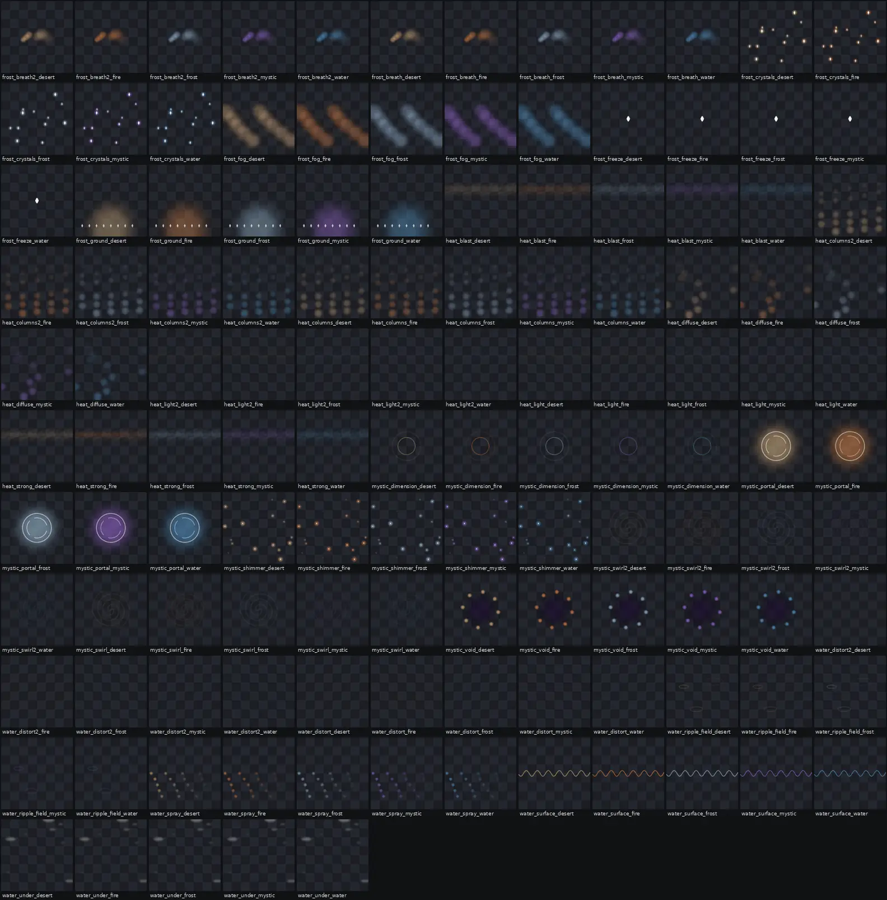

| אפקט | גרסאות | פריים | פריימים | איך נראה | במשחק |
|---|---|---|---|---|---|
| `frost_breath2` | desert, fire, frost, mystic, water | 512 | 24 |  |  |
| `frost_breath` | desert, fire, frost, mystic, water | 512 | 24 |  |  |
| `frost_crystals` | desert, fire, frost, mystic, water | 512 | 24 |  |  |
| `frost_fog` | desert, fire, frost, mystic, water | 512 | 24 |  |  |
| `frost_freeze` | desert, fire, frost, mystic, water | 512 | 23 |  |  |
| `frost_ground` | desert, fire, frost, mystic, water | 512 | 24 |  |  |
| `heat_blast` | desert, fire, frost, mystic, water | 512 | 24 |  |  |
| `heat_columns2` | desert, fire, frost, mystic, water | 512 | 24 |  |  |
| `heat_columns` | desert, fire, frost, mystic, water | 512 | 24 |  |  |
| `heat_diffuse` | desert, fire, frost, mystic, water | 512 | 24 |  |  |
| `heat_light2` | desert, fire, frost, mystic, water | 512 | 24 |  |  |
| `heat_light` | desert, fire, frost, mystic, water | 512 | 24 |  | haze (fire) |
| `heat_strong` | desert, fire, frost, mystic, water | 512 | 24 |  |  |
| `mystic_dimension` | desert, fire, frost, mystic, water | 512 | 24 |  |  |
| `mystic_portal` | desert, fire, frost, mystic, water | 512 | 24 |  |  |
| `mystic_shimmer` | desert, fire, frost, mystic, water | 512 | 24 |  |  |
| `mystic_swirl2` | desert, fire, frost, mystic, water | 512 | 24 |  |  |
| `mystic_swirl` | desert, fire, frost, mystic, water | 512 | 24 |  |  |
| `mystic_void` | desert, fire, frost, mystic, water | 512 | 24 |  |  |
| `water_distort2` | desert, fire, frost, mystic, water | 512 | 24 |  |  |
| `water_distort` | desert, fire, frost, mystic, water | 512 | 24 |  |  |
| `water_ripple_field` | desert, fire, frost, mystic, water | 512 | 24 |  |  |
| `water_spray` | desert, fire, frost, mystic, water | 512 | 24 |  |  |
| `water_surface` | desert, fire, frost, mystic, water | 512 | 24 |  |  |
| `water_under` | desert, fire, frost, mystic, water | 512 | 24 |  |  |

## hit-impact-pack-vol1

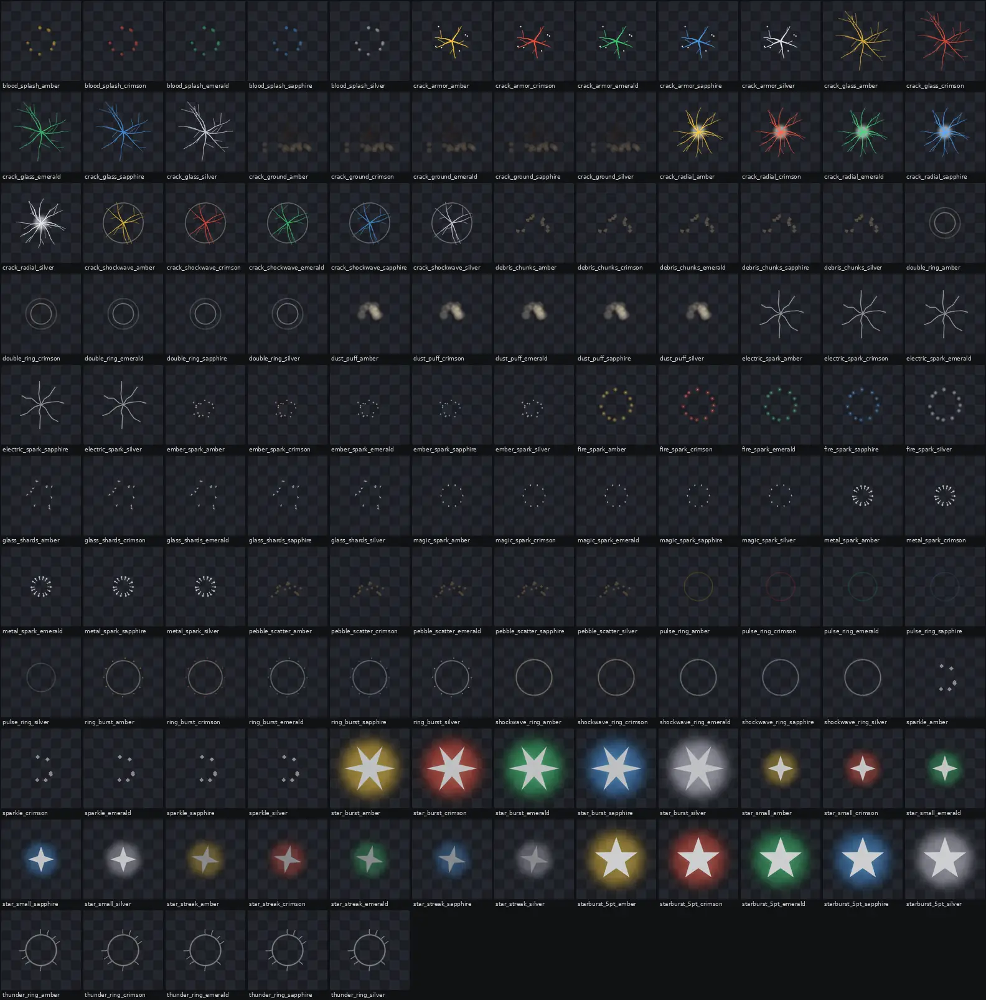

| אפקט | גרסאות | פריים | פריימים | איך נראה | במשחק |
|---|---|---|---|---|---|
| `blood_splash` | amber, crimson, emerald, sapphire, silver | 512 | 23 |  |  |
| `crack_armor` | amber, crimson, emerald, sapphire, silver | 512 | 24 |  | tower_hit (silver) |
| `crack_glass` | amber, crimson, emerald, sapphire, silver | 512 | 24 |  |  |
| `crack_ground` | amber, crimson, emerald, sapphire, silver | 512 | 24 |  | sk_anvil (amber) |
| `crack_radial` | amber, crimson, emerald, sapphire, silver | 512 | 24 |  |  |
| `crack_shockwave` | amber, crimson, emerald, sapphire, silver | 512 | 24 |  |  |
| `debris_chunks` | amber, crimson, emerald, sapphire, silver | 512 | 24 |  | debris (silver) |
| `double_ring` | amber, crimson, emerald, sapphire, silver | 512 | 19 |  |  |
| `dust_puff` | amber, crimson, emerald, sapphire, silver | 512 | 23 |  |  |
| `electric_spark` | amber, crimson, emerald, sapphire, silver | 512 | 23 |  | hit_light (sapphire) |
| `ember_spark` | amber, crimson, emerald, sapphire, silver | 512 | 23 |  |  |
| `fire_spark` | amber, crimson, emerald, sapphire, silver | 512 | 23 |  | hit_fire (crimson) |
| `glass_shards` | amber, crimson, emerald, sapphire, silver | 512 | 23 |  | hit_ice (sapphire) |
| `magic_spark` | amber, crimson, emerald, sapphire, silver | 512 | 19 |  |  |
| `metal_spark` | amber, crimson, emerald, sapphire, silver | 512 | 15 |  | hit_metal (silver) |
| `pebble_scatter` | amber, crimson, emerald, sapphire, silver | 512 | 24 |  | hit_earth (amber) |
| `pulse_ring` | amber, crimson, emerald, sapphire, silver | 512 | 23 |  |  |
| `ring_burst` | amber, crimson, emerald, sapphire, silver | 512 | 18 |  | hit (silver) |
| `shockwave_ring` | amber, crimson, emerald, sapphire, silver | 512 | 20 |  |  |
| `sparkle` | amber, crimson, emerald, sapphire, silver | 512 | 23 |  |  |
| `star_burst` | amber, crimson, emerald, sapphire, silver | 512 | 19 |  | hit_crit (amber) |
| `star_small` | amber, crimson, emerald, sapphire, silver | 512 | 21 |  |  |
| `star_streak` | amber, crimson, emerald, sapphire, silver | 512 | 18 |  |  |
| `starburst_5pt` | amber, crimson, emerald, sapphire, silver | 512 | 19 |  |  |
| `thunder_ring` | amber, crimson, emerald, sapphire, silver | 512 | 16 |  |  |

## inventory-fx-pack-vol1

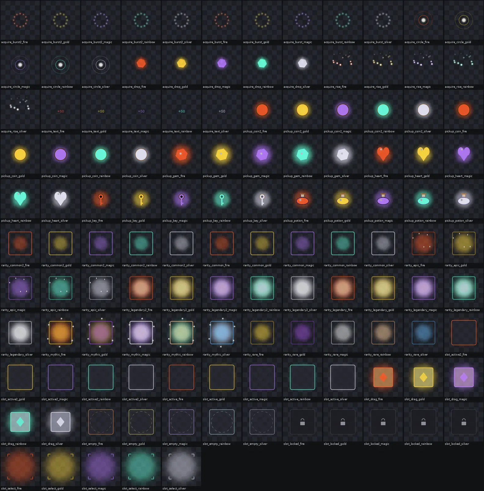

| אפקט | גרסאות | פריים | פריימים | איך נראה | במשחק |
|---|---|---|---|---|---|
| `acquire_burst2` | fire, gold, magic, rainbow, silver | 512 | 23 |  |  |
| `acquire_burst` | fire, gold, magic, rainbow, silver | 512 | 23 |  | ui_buy (gold) |
| `acquire_circle` | fire, gold, magic, rainbow, silver | 512 | 24 |  |  |
| `acquire_drop` | fire, gold, magic, rainbow, silver | 512 | 24 |  |  |
| `acquire_rise` | fire, gold, magic, rainbow, silver | 512 | 24 |  |  |
| `acquire_text` | fire, gold, magic, rainbow, silver | 512 | 16 |  |  |
| `pickup_coin2` | fire, gold, magic, rainbow, silver | 512 | 24 |  |  |
| `pickup_coin` | fire, gold, magic, rainbow, silver | 512 | 24 |  |  |
| `pickup_gem` | fire, gold, magic, rainbow, silver | 512 | 24 |  |  |
| `pickup_heart` | fire, gold, magic, rainbow, silver | 512 | 24 |  |  |
| `pickup_key` | fire, gold, magic, rainbow, silver | 512 | 24 |  |  |
| `pickup_potion` | fire, gold, magic, rainbow, silver | 512 | 24 |  |  |
| `rarity_common2` | fire, gold, magic, rainbow, silver | 512 | 24 |  |  |
| `rarity_common` | fire, gold, magic, rainbow, silver | 512 | 24 |  |  |
| `rarity_epic` | fire, gold, magic, rainbow, silver | 512 | 24 |  | ui_epic (magic) |
| `rarity_legendary2` | fire, gold, magic, rainbow, silver | 512 | 24 |  |  |
| `rarity_legendary` | fire, gold, magic, rainbow, silver | 512 | 24 |  | ui_legend (gold) |
| `rarity_mythic` | fire, gold, magic, rainbow, silver | 512 | 24 |  |  |
| `rarity_rare` | fire, gold, magic, rainbow, silver | 512 | 24 |  |  |
| `slot_active2` | fire, gold, magic, rainbow, silver | 512 | 24 |  |  |
| `slot_active` | fire, gold, magic, rainbow, silver | 512 | 24 |  |  |
| `slot_drag` | fire, gold, magic, rainbow, silver | 512 | 24 |  |  |
| `slot_empty` | fire, gold, magic, rainbow, silver | 512 | 24 |  |  |
| `slot_locked` | fire, gold, magic, rainbow, silver | 512 | 24 |  |  |
| `slot_select` | fire, gold, magic, rainbow, silver | 512 | 24 |  |  |

## lava-magma-pack-vol1

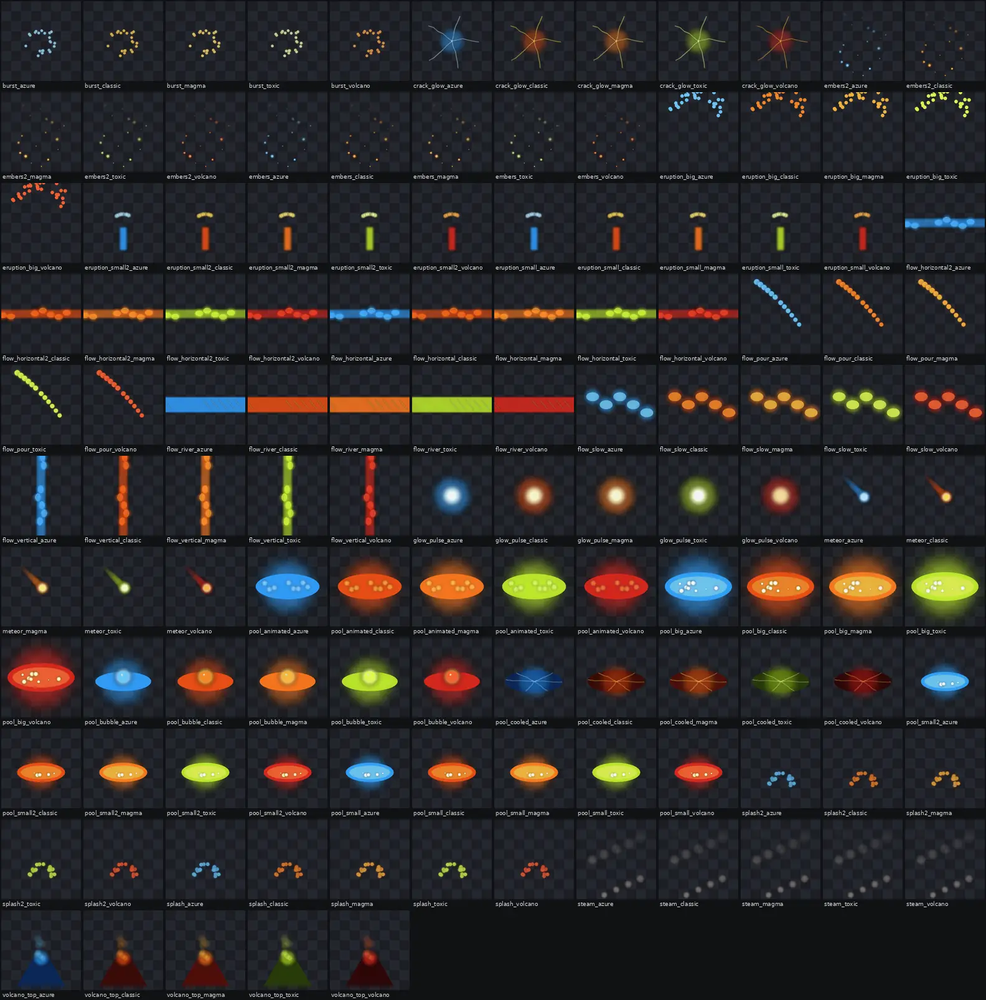

| אפקט | גרסאות | פריים | פריימים | איך נראה | במשחק |
|---|---|---|---|---|---|
| `burst` | azure, classic, magma, toxic, volcano | 512 | 24 |  |  |
| `crack_glow` | azure, classic, magma, toxic, volcano | 512 | 24 |  |  |
| `embers2` | azure, classic, magma, toxic, volcano | 512 | 24 |  |  |
| `embers` | azure, classic, magma, toxic, volcano | 512 | 24 |  |  |
| `eruption_big` | azure, classic, magma, toxic, volcano | 512 | 24 |  |  |
| `eruption_small2` | azure, classic, magma, toxic, volcano | 512 | 24 |  |  |
| `eruption_small` | azure, classic, magma, toxic, volcano | 512 | 24 |  |  |
| `flow_horizontal2` | azure, classic, magma, toxic, volcano | 512 | 24 |  |  |
| `flow_horizontal` | azure, classic, magma, toxic, volcano | 512 | 24 |  |  |
| `flow_pour` | azure, classic, magma, toxic, volcano | 512 | 24 |  |  |
| `flow_river` | azure, classic, magma, toxic, volcano | 512 | 24 |  |  |
| `flow_slow` | azure, classic, magma, toxic, volcano | 512 | 24 |  |  |
| `flow_vertical` | azure, classic, magma, toxic, volcano | 512 | 24 |  |  |
| `glow_pulse` | azure, classic, magma, toxic, volcano | 512 | 24 |  |  |
| `meteor` | azure, classic, magma, toxic, volcano | 512 | 24 |  |  |
| `pool_animated` | azure, classic, magma, toxic, volcano | 512 | 24 |  |  |
| `pool_big` | azure, classic, magma, toxic, volcano | 512 | 24 |  |  |
| `pool_bubble` | azure, classic, magma, toxic, volcano | 512 | 24 |  | lava_bubble (classic) |
| `pool_cooled` | azure, classic, magma, toxic, volcano | 512 | 24 |  |  |
| `pool_small2` | azure, classic, magma, toxic, volcano | 512 | 24 |  |  |
| `pool_small` | azure, classic, magma, toxic, volcano | 512 | 24 |  |  |
| `splash2` | azure, classic, magma, toxic, volcano | 512 | 24 |  |  |
| `splash` | azure, classic, magma, toxic, volcano | 512 | 24 |  |  |
| `steam` | azure, classic, magma, toxic, volcano | 512 | 24 |  |  |
| `volcano_top` | azure, classic, magma, toxic, volcano | 512 | 24 |  |  |

## levelup-burst-pack-vol1

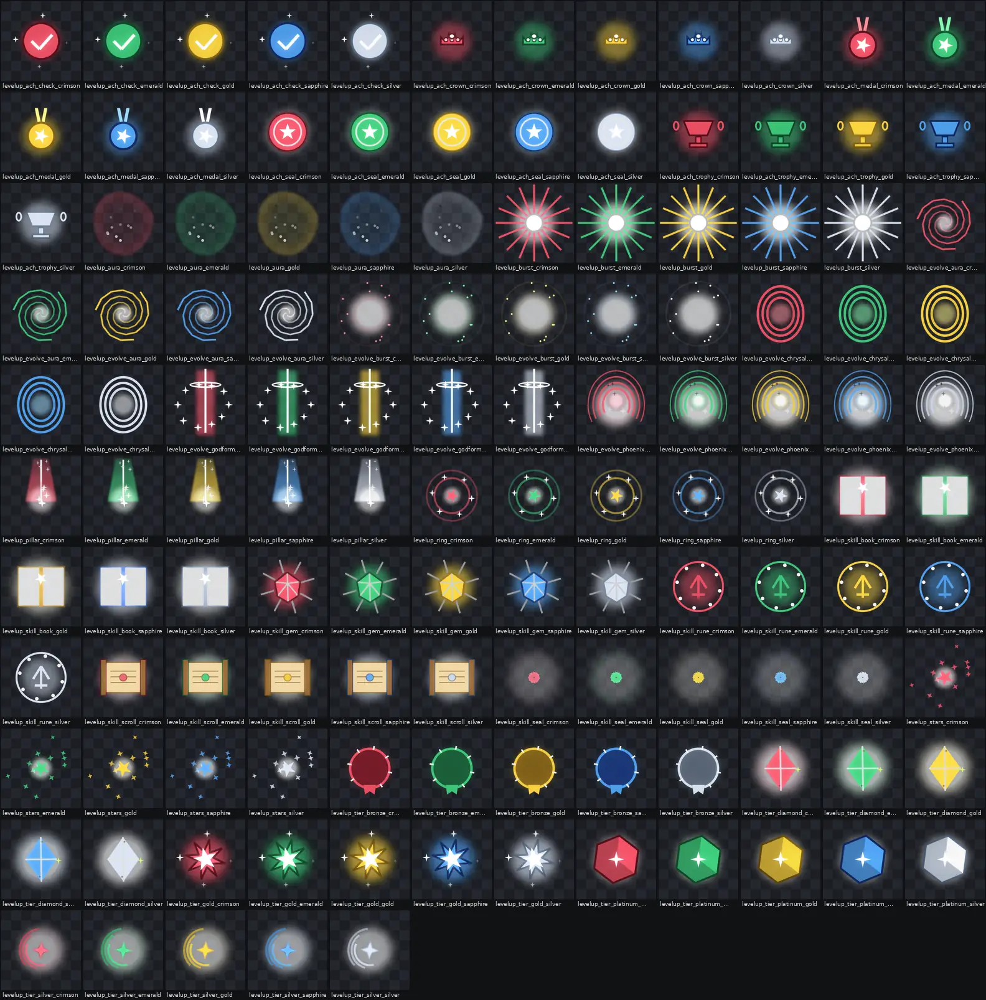

| אפקט | גרסאות | פריים | פריימים | איך נראה | במשחק |
|---|---|---|---|---|---|
| `levelup_ach_check` | crimson, emerald, gold, sapphire, silver | 512 | 24 |  |  |
| `levelup_ach_crown` | crimson, emerald, gold, sapphire, silver | 512 | 24 |  |  |
| `levelup_ach_medal` | crimson, emerald, gold, sapphire, silver | 512 | 24 |  |  |
| `levelup_ach_seal` | crimson, emerald, gold, sapphire, silver | 512 | 23 |  |  |
| `levelup_ach_trophy` | crimson, emerald, gold, sapphire, silver | 512 | 24 |  |  |
| `levelup_aura` | crimson, emerald, gold, sapphire, silver | 512 | 24 |  |  |
| `levelup_burst` | crimson, emerald, gold, sapphire, silver | 512 | 23 |  | levelup (gold) |
| `levelup_evolve_aura` | crimson, emerald, gold, sapphire, silver | 512 | 24 |  |  |
| `levelup_evolve_burst` | crimson, emerald, gold, sapphire, silver | 512 | 23 |  |  |
| `levelup_evolve_chrysalis` | crimson, emerald, gold, sapphire, silver | 512 | 24 |  |  |
| `levelup_evolve_godform` | crimson, emerald, gold, sapphire, silver | 512 | 24 |  |  |
| `levelup_evolve_phoenix` | crimson, emerald, gold, sapphire, silver | 512 | 24 |  |  |
| `levelup_pillar` | crimson, emerald, gold, sapphire, silver | 512 | 24 |  |  |
| `levelup_ring` | crimson, emerald, gold, sapphire, silver | 512 | 24 |  | levelup_ring (gold) |
| `levelup_skill_book` | crimson, emerald, gold, sapphire, silver | 512 | 24 |  |  |
| `levelup_skill_gem` | crimson, emerald, gold, sapphire, silver | 512 | 24 |  |  |
| `levelup_skill_rune` | crimson, emerald, gold, sapphire, silver | 512 | 24 |  |  |
| `levelup_skill_scroll` | crimson, emerald, gold, sapphire, silver | 512 | 24 |  |  |
| `levelup_skill_seal` | crimson, emerald, gold, sapphire, silver | 512 | 24 |  |  |
| `levelup_stars` | crimson, emerald, gold, sapphire, silver | 512 | 24 |  |  |
| `levelup_tier_bronze` | crimson, emerald, gold, sapphire, silver | 512 | 24 |  |  |
| `levelup_tier_diamond` | crimson, emerald, gold, sapphire, silver | 512 | 24 |  |  |
| `levelup_tier_gold` | crimson, emerald, gold, sapphire, silver | 512 | 24 |  |  |
| `levelup_tier_platinum` | crimson, emerald, gold, sapphire, silver | 512 | 24 |  |  |
| `levelup_tier_silver` | crimson, emerald, gold, sapphire, silver | 512 | 24 |  |  |

## light-ray-pack-vol1

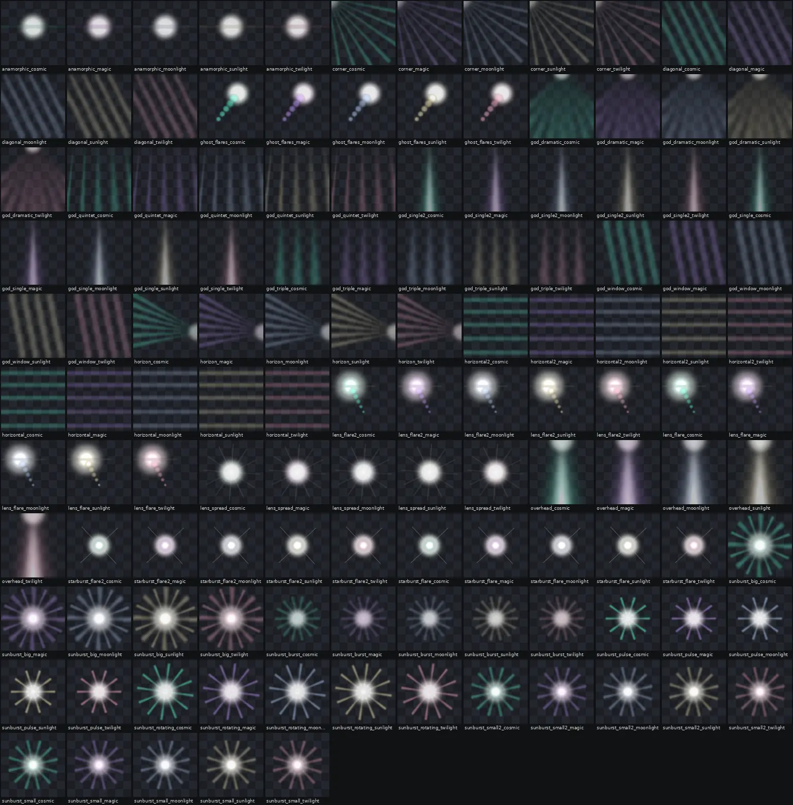

| אפקט | גרסאות | פריים | פריימים | איך נראה | במשחק |
|---|---|---|---|---|---|
| `anamorphic` | cosmic, magic, moonlight, sunlight, twilight | 512 | 24 |  | sk_pierce_ray (magic) |
| `corner` | cosmic, magic, moonlight, sunlight, twilight | 512 | 24 |  |  |
| `diagonal` | cosmic, magic, moonlight, sunlight, twilight | 512 | 24 |  |  |
| `ghost_flares` | cosmic, magic, moonlight, sunlight, twilight | 512 | 24 |  |  |
| `god_dramatic` | cosmic, magic, moonlight, sunlight, twilight | 512 | 24 |  |  |
| `god_quintet` | cosmic, magic, moonlight, sunlight, twilight | 512 | 24 |  |  |
| `god_single2` | cosmic, magic, moonlight, sunlight, twilight | 512 | 24 |  |  |
| `god_single` | cosmic, magic, moonlight, sunlight, twilight | 512 | 24 |  | ult_ray (sunlight) |
| `god_triple` | cosmic, magic, moonlight, sunlight, twilight | 512 | 24 |  |  |
| `god_window` | cosmic, magic, moonlight, sunlight, twilight | 512 | 24 |  |  |
| `horizon` | cosmic, magic, moonlight, sunlight, twilight | 512 | 24 |  |  |
| `horizontal2` | cosmic, magic, moonlight, sunlight, twilight | 512 | 24 |  |  |
| `horizontal` | cosmic, magic, moonlight, sunlight, twilight | 512 | 24 |  |  |
| `lens_flare2` | cosmic, magic, moonlight, sunlight, twilight | 512 | 24 |  |  |
| `lens_flare` | cosmic, magic, moonlight, sunlight, twilight | 512 | 24 |  |  |
| `lens_spread` | cosmic, magic, moonlight, sunlight, twilight | 512 | 24 |  |  |
| `overhead` | cosmic, magic, moonlight, sunlight, twilight | 512 | 24 |  |  |
| `starburst_flare2` | cosmic, magic, moonlight, sunlight, twilight | 512 | 24 |  |  |
| `starburst_flare` | cosmic, magic, moonlight, sunlight, twilight | 512 | 24 |  |  |
| `sunburst_big` | cosmic, magic, moonlight, sunlight, twilight | 512 | 24 |  |  |
| `sunburst_burst` | cosmic, magic, moonlight, sunlight, twilight | 512 | 24 |  |  |
| `sunburst_pulse` | cosmic, magic, moonlight, sunlight, twilight | 512 | 24 |  |  |
| `sunburst_rotating` | cosmic, magic, moonlight, sunlight, twilight | 512 | 24 |  |  |
| `sunburst_small2` | cosmic, magic, moonlight, sunlight, twilight | 512 | 24 |  |  |
| `sunburst_small` | cosmic, magic, moonlight, sunlight, twilight | 512 | 24 |  |  |

## map-marker-waypoint-pack-vol1

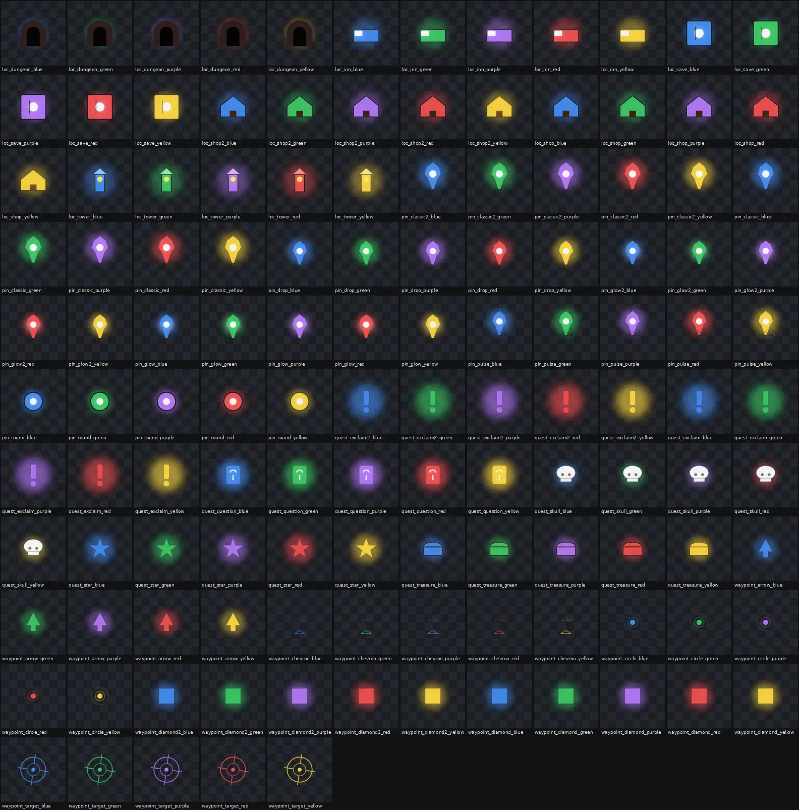

| אפקט | גרסאות | פריים | פריימים | איך נראה | במשחק |
|---|---|---|---|---|---|
| `loc_dungeon` | blue, green, purple, red, yellow | 512 | 24 |  |  |
| `loc_inn` | blue, green, purple, red, yellow | 512 | 24 |  |  |
| `loc_save` | blue, green, purple, red, yellow | 512 | 24 |  |  |
| `loc_shop2` | blue, green, purple, red, yellow | 512 | 24 |  |  |
| `loc_shop` | blue, green, purple, red, yellow | 512 | 24 |  |  |
| `loc_tower` | blue, green, purple, red, yellow | 512 | 24 |  |  |
| `pin_classic2` | blue, green, purple, red, yellow | 512 | 24 |  |  |
| `pin_classic` | blue, green, purple, red, yellow | 512 | 24 |  |  |
| `pin_drop` | blue, green, purple, red, yellow | 512 | 24 |  |  |
| `pin_glow2` | blue, green, purple, red, yellow | 512 | 24 |  |  |
| `pin_glow` | blue, green, purple, red, yellow | 512 | 24 |  |  |
| `pin_pulse` | blue, green, purple, red, yellow | 512 | 24 |  |  |
| `pin_round` | blue, green, purple, red, yellow | 512 | 24 |  |  |
| `quest_exclaim2` | blue, green, purple, red, yellow | 512 | 24 |  |  |
| `quest_exclaim` | blue, green, purple, red, yellow | 512 | 24 |  | quest_mark (yellow) |
| `quest_question` | blue, green, purple, red, yellow | 512 | 24 |  |  |
| `quest_skull` | blue, green, purple, red, yellow | 512 | 24 |  |  |
| `quest_star` | blue, green, purple, red, yellow | 512 | 24 |  |  |
| `quest_treasure` | blue, green, purple, red, yellow | 512 | 24 |  |  |
| `waypoint_arrow` | blue, green, purple, red, yellow | 512 | 24 |  |  |
| `waypoint_chevron` | blue, green, purple, red, yellow | 512 | 24 |  |  |
| `waypoint_circle` | blue, green, purple, red, yellow | 512 | 24 |  | waypoint (yellow) |
| `waypoint_diamond2` | blue, green, purple, red, yellow | 512 | 24 |  |  |
| `waypoint_diamond` | blue, green, purple, red, yellow | 512 | 24 |  |  |
| `waypoint_target` | blue, green, purple, red, yellow | 512 | 24 |  |  |

## menu-transition-pack-vol1

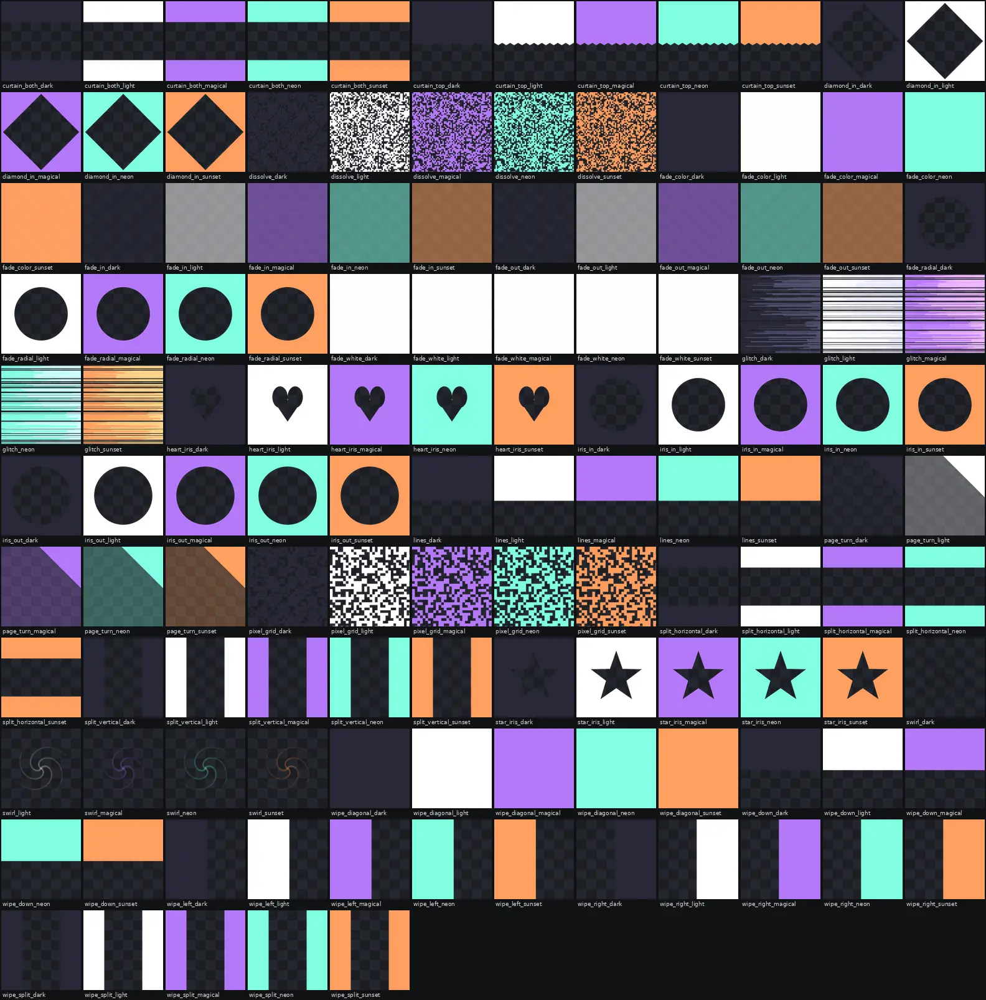

| אפקט | גרסאות | פריים | פריימים | איך נראה | במשחק |
|---|---|---|---|---|---|
| `curtain_both` | dark, light, magical, neon, sunset | 512 | 24 |  |  |
| `curtain_top` | dark, light, magical, neon, sunset | 512 | 24 |  |  |
| `diamond_in` | dark, light, magical, neon, sunset | 512 | 23 |  |  |
| `dissolve` | dark, light, magical, neon, sunset | 512 | 23 |  |  |
| `fade_color` | dark, light, magical, neon, sunset | 512 | 22 |  |  |
| `fade_in` | dark, light, magical, neon, sunset | 512 | 23 |  |  |
| `fade_out` | dark, light, magical, neon, sunset | 512 | 23 |  |  |
| `fade_radial` | dark, light, magical, neon, sunset | 512 | 24 |  |  |
| `fade_white` | dark, light, magical, neon, sunset | 512 | 22 |  |  |
| `glitch` | dark, light, magical, neon, sunset | 512 | 23 |  |  |
| `heart_iris` | dark, light, magical, neon, sunset | 512 | 24 |  |  |
| `iris_in` | dark, light, magical, neon, sunset | 512 | 24 |  | ui_trans (magical) |
| `iris_out` | dark, light, magical, neon, sunset | 512 | 24 |  |  |
| `lines` | dark, light, magical, neon, sunset | 512 | 24 |  |  |
| `page_turn` | dark, light, magical, neon, sunset | 512 | 24 |  |  |
| `pixel_grid` | dark, light, magical, neon, sunset | 512 | 23 |  |  |
| `split_horizontal` | dark, light, magical, neon, sunset | 512 | 24 |  |  |
| `split_vertical` | dark, light, magical, neon, sunset | 512 | 24 |  |  |
| `star_iris` | dark, light, magical, neon, sunset | 512 | 24 |  |  |
| `swirl` | dark, light, magical, neon, sunset | 512 | 23 |  |  |
| `wipe_diagonal` | dark, light, magical, neon, sunset | 512 | 24 |  |  |
| `wipe_down` | dark, light, magical, neon, sunset | 512 | 24 |  |  |
| `wipe_left` | dark, light, magical, neon, sunset | 512 | 24 |  |  |
| `wipe_right` | dark, light, magical, neon, sunset | 512 | 23 |  |  |
| `wipe_split` | dark, light, magical, neon, sunset | 512 | 24 |  |  |

## minimap-effects-pack-vol1

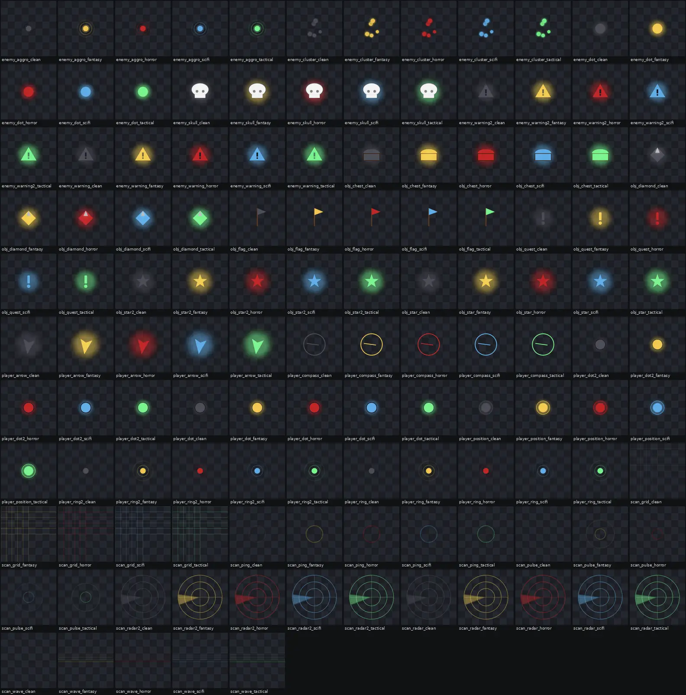

| אפקט | גרסאות | פריים | פריימים | איך נראה | במשחק |
|---|---|---|---|---|---|
| `enemy_aggro` | clean, fantasy, horror, scifi, tactical | 512 | 24 |  |  |
| `enemy_cluster` | clean, fantasy, horror, scifi, tactical | 512 | 24 |  |  |
| `enemy_dot` | clean, fantasy, horror, scifi, tactical | 512 | 24 |  |  |
| `enemy_skull` | clean, fantasy, horror, scifi, tactical | 512 | 24 |  |  |
| `enemy_warning2` | clean, fantasy, horror, scifi, tactical | 512 | 24 |  |  |
| `enemy_warning` | clean, fantasy, horror, scifi, tactical | 512 | 24 |  |  |
| `obj_chest` | clean, fantasy, horror, scifi, tactical | 512 | 24 |  |  |
| `obj_diamond` | clean, fantasy, horror, scifi, tactical | 512 | 24 |  |  |
| `obj_flag` | clean, fantasy, horror, scifi, tactical | 512 | 24 |  |  |
| `obj_quest` | clean, fantasy, horror, scifi, tactical | 512 | 24 |  |  |
| `obj_star2` | clean, fantasy, horror, scifi, tactical | 512 | 24 |  |  |
| `obj_star` | clean, fantasy, horror, scifi, tactical | 512 | 24 |  |  |
| `player_arrow` | clean, fantasy, horror, scifi, tactical | 512 | 24 |  |  |
| `player_compass` | clean, fantasy, horror, scifi, tactical | 512 | 24 |  |  |
| `player_dot2` | clean, fantasy, horror, scifi, tactical | 512 | 24 |  |  |
| `player_dot` | clean, fantasy, horror, scifi, tactical | 512 | 24 |  |  |
| `player_position` | clean, fantasy, horror, scifi, tactical | 512 | 24 |  |  |
| `player_ring2` | clean, fantasy, horror, scifi, tactical | 512 | 24 |  |  |
| `player_ring` | clean, fantasy, horror, scifi, tactical | 512 | 24 |  |  |
| `scan_grid` | clean, fantasy, horror, scifi, tactical | 512 | 23 |  |  |
| `scan_ping` | clean, fantasy, horror, scifi, tactical | 512 | 18 |  | mm_ping (fantasy) |
| `scan_pulse` | clean, fantasy, horror, scifi, tactical | 512 | 24 |  | sp_reveal (fantasy) |
| `scan_radar2` | clean, fantasy, horror, scifi, tactical | 512 | 24 |  |  |
| `scan_radar` | clean, fantasy, horror, scifi, tactical | 512 | 24 |  |  |
| `scan_wave` | clean, fantasy, horror, scifi, tactical | 512 | 24 |  |  |

## npc-indicator-pack-vol1

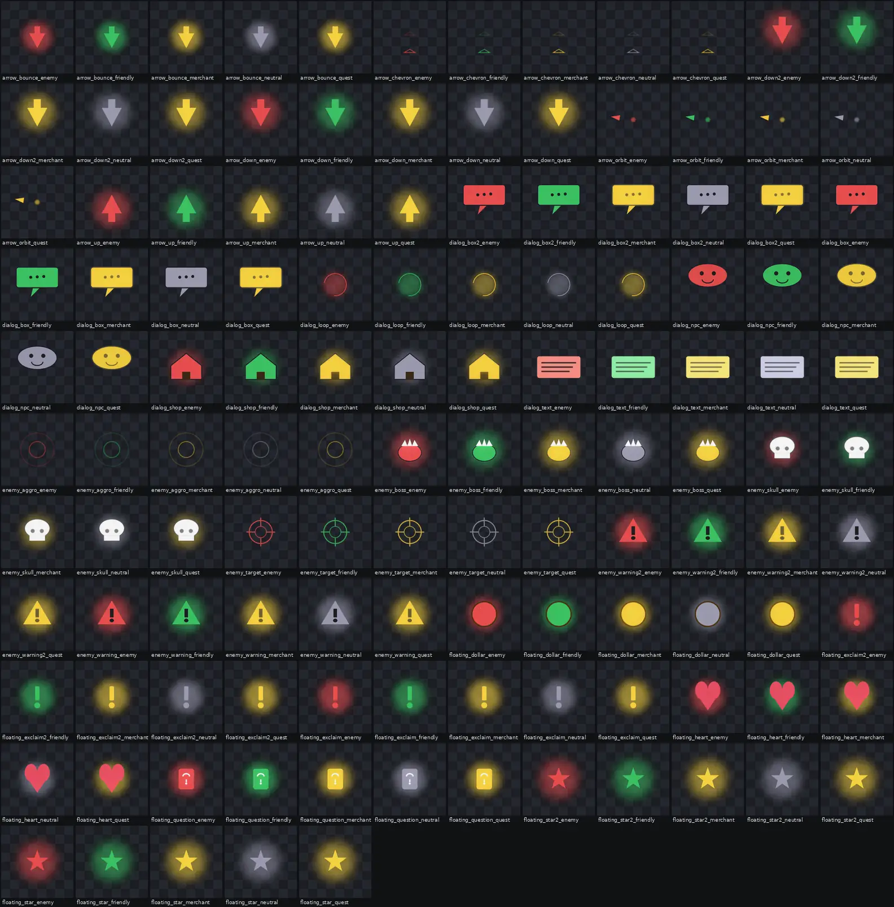

| אפקט | גרסאות | פריים | פריימים | איך נראה | במשחק |
|---|---|---|---|---|---|
| `arrow_bounce` | enemy, friendly, merchant, neutral, quest | 512 | 24 |  |  |
| `arrow_chevron` | enemy, friendly, merchant, neutral, quest | 512 | 24 |  |  |
| `arrow_down2` | enemy, friendly, merchant, neutral, quest | 512 | 24 |  |  |
| `arrow_down` | enemy, friendly, merchant, neutral, quest | 512 | 24 |  |  |
| `arrow_orbit` | enemy, friendly, merchant, neutral, quest | 512 | 24 |  |  |
| `arrow_up` | enemy, friendly, merchant, neutral, quest | 512 | 24 |  |  |
| `dialog_box2` | enemy, friendly, merchant, neutral, quest | 512 | 24 |  |  |
| `dialog_box` | enemy, friendly, merchant, neutral, quest | 512 | 24 |  |  |
| `dialog_loop` | enemy, friendly, merchant, neutral, quest | 512 | 24 |  | npc_talk (friendly) |
| `dialog_npc` | enemy, friendly, merchant, neutral, quest | 512 | 24 |  |  |
| `dialog_shop` | enemy, friendly, merchant, neutral, quest | 512 | 24 |  |  |
| `dialog_text` | enemy, friendly, merchant, neutral, quest | 512 | 24 |  |  |
| `enemy_aggro` | enemy, friendly, merchant, neutral, quest | 512 | 24 |  |  |
| `enemy_boss` | enemy, friendly, merchant, neutral, quest | 512 | 24 |  |  |
| `enemy_skull` | enemy, friendly, merchant, neutral, quest | 512 | 24 |  |  |
| `enemy_target` | enemy, friendly, merchant, neutral, quest | 512 | 24 |  |  |
| `enemy_warning2` | enemy, friendly, merchant, neutral, quest | 512 | 24 |  |  |
| `enemy_warning` | enemy, friendly, merchant, neutral, quest | 512 | 24 |  |  |
| `floating_dollar` | enemy, friendly, merchant, neutral, quest | 512 | 24 |  | npc_shop (merchant) |
| `floating_exclaim2` | enemy, friendly, merchant, neutral, quest | 512 | 24 |  |  |
| `floating_exclaim` | enemy, friendly, merchant, neutral, quest | 512 | 24 |  | npc_quest (quest) |
| `floating_heart` | enemy, friendly, merchant, neutral, quest | 512 | 24 |  |  |
| `floating_question` | enemy, friendly, merchant, neutral, quest | 512 | 24 |  | npc_turnin (quest) |
| `floating_star2` | enemy, friendly, merchant, neutral, quest | 512 | 24 |  |  |
| `floating_star` | enemy, friendly, merchant, neutral, quest | 512 | 24 |  |  |

## pickup-pop-pack-vol1

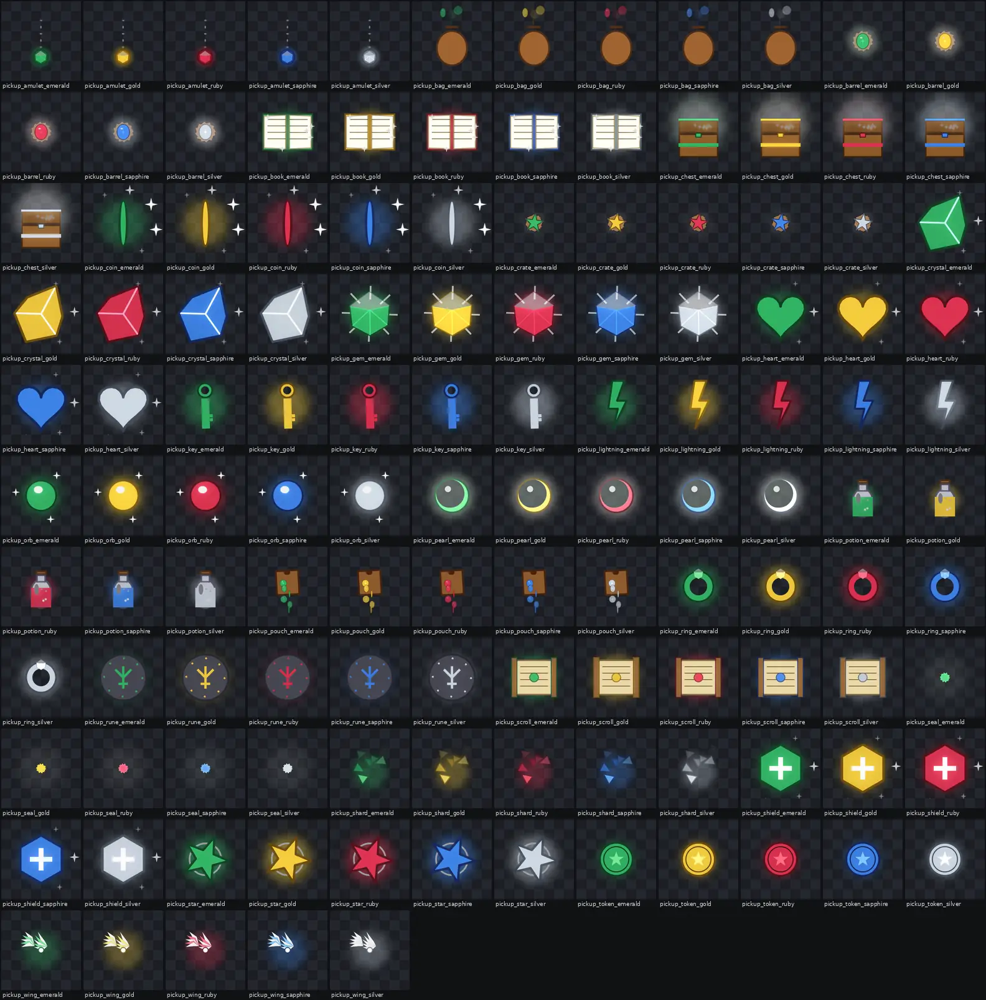

| אפקט | גרסאות | פריים | פריימים | איך נראה | במשחק |
|---|---|---|---|---|---|
| `pickup_amulet` | emerald, gold, ruby, sapphire, silver | 512 | 24 |  |  |
| `pickup_bag` | emerald, gold, ruby, sapphire, silver | 512 | 24 |  |  |
| `pickup_barrel` | emerald, gold, ruby, sapphire, silver | 512 | 24 |  |  |
| `pickup_book` | emerald, gold, ruby, sapphire, silver | 512 | 24 |  |  |
| `pickup_chest` | emerald, gold, ruby, sapphire, silver | 512 | 24 |  | pickup_chest (gold) |
| `pickup_coin` | emerald, gold, ruby, sapphire, silver | 512 | 24 |  | pickup_coin (gold) |
| `pickup_crate` | emerald, gold, ruby, sapphire, silver | 512 | 24 |  |  |
| `pickup_crystal` | emerald, gold, ruby, sapphire, silver | 512 | 24 |  |  |
| `pickup_gem` | emerald, gold, ruby, sapphire, silver | 512 | 24 |  | pickup_gem (sapphire) |
| `pickup_heart` | emerald, gold, ruby, sapphire, silver | 512 | 24 |  | pickup_heart (ruby) |
| `pickup_key` | emerald, gold, ruby, sapphire, silver | 512 | 24 |  |  |
| `pickup_lightning` | emerald, gold, ruby, sapphire, silver | 512 | 24 |  |  |
| `pickup_orb` | emerald, gold, ruby, sapphire, silver | 512 | 24 |  |  |
| `pickup_pearl` | emerald, gold, ruby, sapphire, silver | 512 | 24 |  |  |
| `pickup_potion` | emerald, gold, ruby, sapphire, silver | 512 | 24 |  |  |
| `pickup_pouch` | emerald, gold, ruby, sapphire, silver | 512 | 24 |  |  |
| `pickup_ring` | emerald, gold, ruby, sapphire, silver | 512 | 24 |  |  |
| `pickup_rune` | emerald, gold, ruby, sapphire, silver | 512 | 24 |  |  |
| `pickup_scroll` | emerald, gold, ruby, sapphire, silver | 512 | 24 |  |  |
| `pickup_seal` | emerald, gold, ruby, sapphire, silver | 512 | 24 |  |  |
| `pickup_shard` | emerald, gold, ruby, sapphire, silver | 512 | 24 |  |  |
| `pickup_shield` | emerald, gold, ruby, sapphire, silver | 512 | 24 |  |  |
| `pickup_star` | emerald, gold, ruby, sapphire, silver | 512 | 24 |  |  |
| `pickup_token` | emerald, gold, ruby, sapphire, silver | 512 | 24 |  |  |
| `pickup_wing` | emerald, gold, ruby, sapphire, silver | 512 | 24 |  |  |

## plant-nature-pack-vol1

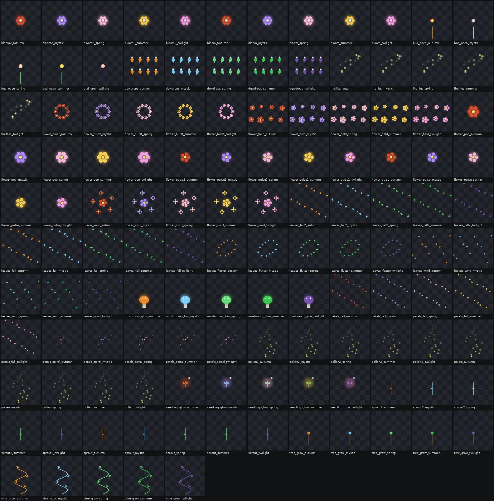

| אפקט | גרסאות | פריים | פריימים | איך נראה | במשחק |
|---|---|---|---|---|---|
| `bloom2` | autumn, mystic, spring, summer, twilight | 512 | 23 |  |  |
| `bloom` | autumn, mystic, spring, summer, twilight | 512 | 23 |  |  |
| `bud_open` | autumn, mystic, spring, summer, twilight | 512 | 24 |  |  |
| `dewdrops` | autumn, mystic, spring, summer, twilight | 512 | 24 |  |  |
| `fireflies` | autumn, mystic, spring, summer, twilight | 512 | 24 |  | fireflies (summer) |
| `flower_burst` | autumn, mystic, spring, summer, twilight | 512 | 24 |  |  |
| `flower_field` | autumn, mystic, spring, summer, twilight | 512 | 24 |  |  |
| `flower_pop` | autumn, mystic, spring, summer, twilight | 512 | 22 |  | bloom (spring) |
| `flower_pulse2` | autumn, mystic, spring, summer, twilight | 512 | 24 |  |  |
| `flower_pulse` | autumn, mystic, spring, summer, twilight | 512 | 24 |  |  |
| `flower_swirl` | autumn, mystic, spring, summer, twilight | 512 | 24 |  |  |
| `leaves_fall2` | autumn, mystic, spring, summer, twilight | 512 | 24 |  |  |
| `leaves_fall` | autumn, mystic, spring, summer, twilight | 512 | 24 |  | leaves (autumn) |
| `leaves_flutter` | autumn, mystic, spring, summer, twilight | 512 | 24 |  |  |
| `leaves_wind` | autumn, mystic, spring, summer, twilight | 512 | 24 |  |  |
| `mushroom_glow` | autumn, mystic, spring, summer, twilight | 512 | 24 |  |  |
| `petals_fall` | autumn, mystic, spring, summer, twilight | 512 | 24 |  | petals (spring) |
| `petals_spiral` | autumn, mystic, spring, summer, twilight | 512 | 24 |  |  |
| `pollen2` | autumn, mystic, spring, summer, twilight | 512 | 24 |  |  |
| `pollen` | autumn, mystic, spring, summer, twilight | 512 | 24 |  |  |
| `seedling_glow` | autumn, mystic, spring, summer, twilight | 512 | 24 |  |  |
| `sprout2` | autumn, mystic, spring, summer, twilight | 512 | 24 |  |  |
| `sprout` | autumn, mystic, spring, summer, twilight | 512 | 24 |  |  |
| `tree_grow` | autumn, mystic, spring, summer, twilight | 512 | 24 |  |  |
| `vine_grow` | autumn, mystic, spring, summer, twilight | 512 | 22 |  | sk_net_root (spring) |

## procedural-balloons-vol1

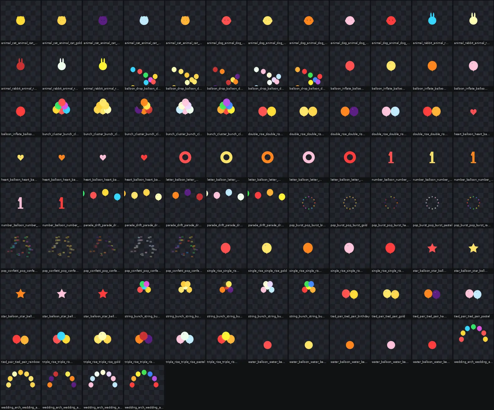

| אפקט | גרסאות | פריים | פריימים | איך נראה | במשחק |
|---|---|---|---|---|---|
| `animal_cat_animal_cat` | birthday, gold, halloween, pastel, rainbow | 512 | 48 |  |  |
| `animal_dog_animal_dog` | birthday, gold, halloween, pastel, rainbow | 512 | 48 |  |  |
| `animal_rabbit_animal_rabbit` | birthday, gold, halloween, pastel, rainbow | 512 | 48 |  |  |
| `balloon_drop_balloon_drop` | birthday, gold, halloween, pastel, rainbow | 512 | 48 |  |  |
| `balloon_inflate_balloon_inflate` | birthday, gold, halloween, pastel, rainbow | 512 | 47 |  |  |
| `bunch_cluster_bunch_cluster` | birthday, gold, halloween, pastel, rainbow | 512 | 48 |  | balloons (gold) |
| `double_rise_double_rise` | birthday, gold, halloween, pastel, rainbow | 512 | 48 |  |  |
| `heart_balloon_heart_balloon` | birthday, gold, halloween, pastel, rainbow | 512 | 48 |  |  |
| `letter_balloon_letter_balloon` | birthday, gold, halloween, pastel, rainbow | 512 | 48 |  |  |
| `number_balloon_number_balloon` | birthday, gold, halloween, pastel, rainbow | 512 | 48 |  |  |
| `parade_drift_parade_drift` | birthday, gold, halloween, pastel, rainbow | 512 | 48 |  |  |
| `pop_burst_pop_burst` | birthday, gold, halloween, pastel, rainbow | 512 | 41 |  |  |
| `pop_confetti_pop_confetti` | birthday, gold, halloween, pastel, rainbow | 512 | 48 |  |  |
| `single_rise_single_rise` | birthday, gold, halloween, pastel, rainbow | 512 | 48 |  |  |
| `star_balloon_star_balloon` | birthday, gold, halloween, pastel, rainbow | 512 | 48 |  |  |
| `string_bunch_string_bunch` | birthday, gold, halloween, pastel, rainbow | 512 | 48 |  |  |
| `tied_pair_tied_pair` | birthday, gold, halloween, pastel, rainbow | 512 | 48 |  |  |
| `triple_rise_triple_rise` | birthday, gold, halloween, pastel, rainbow | 512 | 48 |  |  |
| `water_balloon_water_balloon` | birthday, gold, halloween, pastel, rainbow | 512 | 48 |  |  |
| `wedding_arch_wedding_arch` | birthday, gold, halloween, pastel, rainbow | 512 | 48 |  |  |

## procedural-combat-fx-vol1

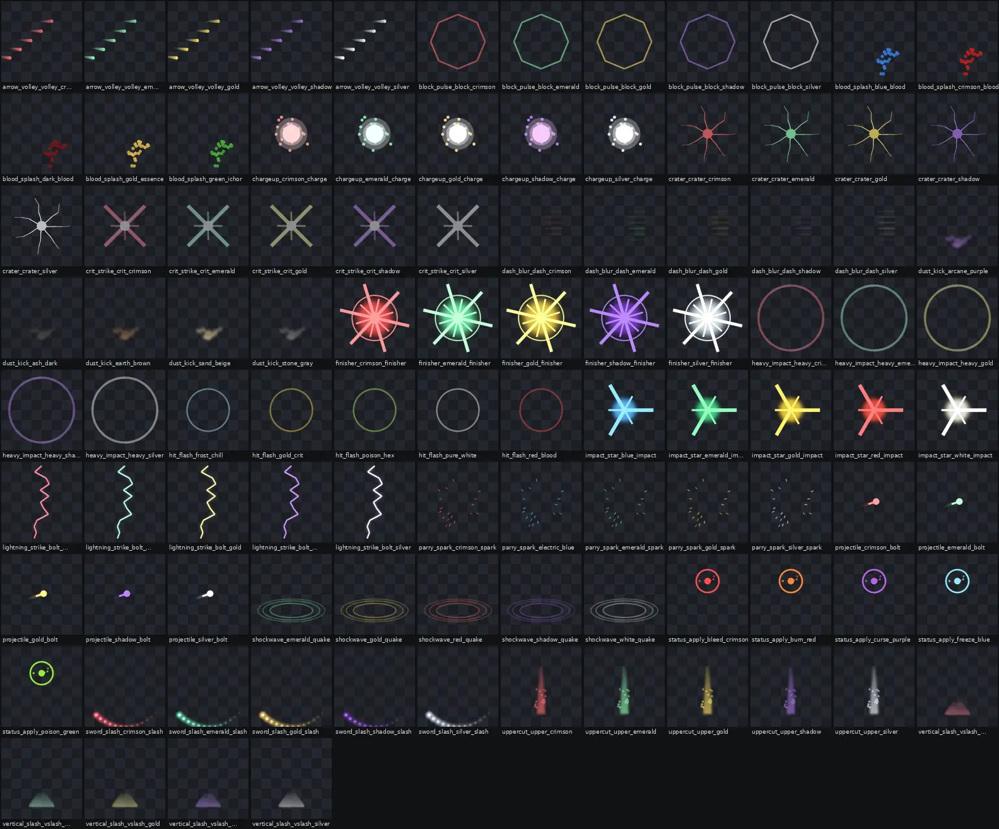

| אפקט | גרסאות | פריים | פריימים | איך נראה | במשחק |
|---|---|---|---|---|---|
| `arrow_volley_volley` | crimson, emerald, gold, shadow, silver | 512 | 46 |  |  |
| `block_pulse_block` | crimson, emerald, gold, shadow, silver | 512 | 39 |  |  |
| `blood_splash` | blue_blood, crimson_blood, dark_blood, gold_essence, green_ichor | 512 | 41 |  |  |
| `chargeup` | crimson_charge, emerald_charge, gold_charge, shadow_charge, silver_charge | 512 | 48 |  |  |
| `crater_crater` | crimson, emerald, gold, shadow, silver | 512 | 46 |  |  |
| `crit_strike_crit` | crimson, emerald, gold, shadow, silver | 512 | 38 |  |  |
| `dash_blur_dash` | crimson, emerald, gold, shadow, silver | 512 | 31 |  | sp_dash (silver) |
| `dust_kick` | arcane_purple, ash_dark, earth_brown, sand_beige, stone_gray | 512 | 48 |  |  |
| `finisher` | crimson_finisher, emerald_finisher, gold_finisher, shadow_finisher, silver_finisher | 512 | 45 |  |  |
| `heavy_impact_heavy` | crimson, emerald, gold, shadow, silver | 512 | 43 |  | hit_heavy (gold) |
| `hit_flash` | frost_chill, gold_crit, poison_hex, pure_white, red_blood | 512 | 31 |  |  |
| `impact_star` | blue_impact, emerald_impact, gold_impact, red_impact, white_impact | 512 | 38 |  |  |
| `lightning_strike_bolt` | crimson, emerald, gold, shadow, silver | 512 | 38 |  |  |
| `parry_spark` | crimson_spark, electric_blue, emerald_spark, gold_spark, silver_spark | 512 | 39 |  |  |
| `projectile` | crimson_bolt, emerald_bolt, gold_bolt, shadow_bolt, silver_bolt | 512 | 45 |  |  |
| `shockwave` | emerald_quake, gold_quake, red_quake, shadow_quake, white_quake | 512 | 36 |  |  |
| `status_apply` | bleed_crimson, burn_red, curse_purple, freeze_blue, poison_green | 512 | 46 |  |  |
| `sword_slash` | crimson_slash, emerald_slash, gold_slash, shadow_slash, silver_slash | 512 | 46 |  |  |
| `uppercut_upper` | crimson, emerald, gold, shadow, silver | 512 | 41 |  |  |
| `vertical_slash_vslash` | crimson, emerald, gold, shadow, silver | 512 | 41 |  |  |

## procedural-loaders-vol1

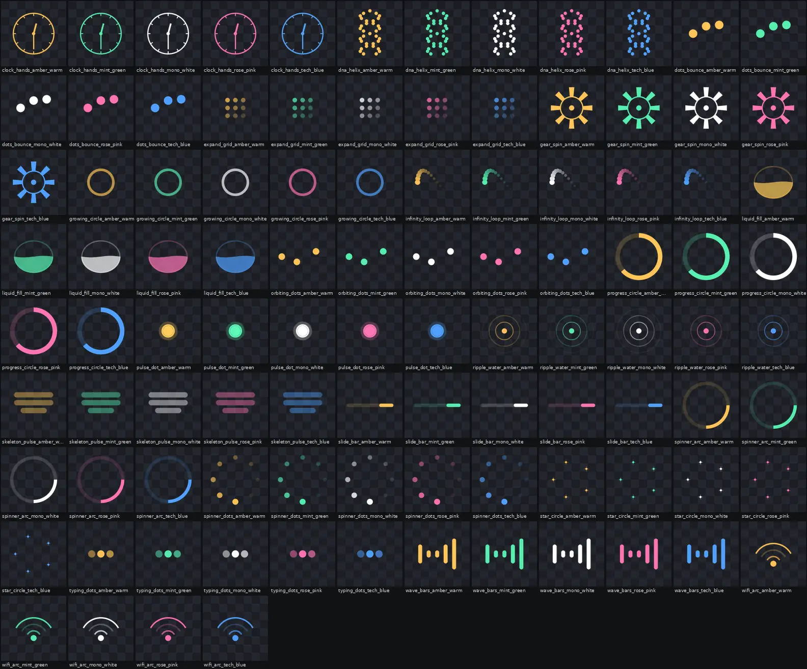

| אפקט | גרסאות | פריים | פריימים | איך נראה | במשחק |
|---|---|---|---|---|---|
| `clock_hands` | amber_warm, mint_green, mono_white, rose_pink, tech_blue | 512 | 48 |  |  |
| `dna_helix` | amber_warm, mint_green, mono_white, rose_pink, tech_blue | 512 | 48 |  |  |
| `dots_bounce` | amber_warm, mint_green, mono_white, rose_pink, tech_blue | 512 | 48 |  |  |
| `expand_grid` | amber_warm, mint_green, mono_white, rose_pink, tech_blue | 512 | 48 |  |  |
| `gear_spin` | amber_warm, mint_green, mono_white, rose_pink, tech_blue | 512 | 48 |  |  |
| `growing_circle` | amber_warm, mint_green, mono_white, rose_pink, tech_blue | 512 | 48 |  |  |
| `infinity_loop` | amber_warm, mint_green, mono_white, rose_pink, tech_blue | 512 | 48 |  |  |
| `liquid_fill` | amber_warm, mint_green, mono_white, rose_pink, tech_blue | 512 | 48 |  |  |
| `orbiting_dots` | amber_warm, mint_green, mono_white, rose_pink, tech_blue | 512 | 48 |  |  |
| `progress_circle` | amber_warm, mint_green, mono_white, rose_pink, tech_blue | 512 | 48 |  |  |
| `pulse_dot` | amber_warm, mint_green, mono_white, rose_pink, tech_blue | 512 | 48 |  |  |
| `ripple_water` | amber_warm, mint_green, mono_white, rose_pink, tech_blue | 512 | 48 |  |  |
| `skeleton_pulse` | amber_warm, mint_green, mono_white, rose_pink, tech_blue | 512 | 48 |  |  |
| `slide_bar` | amber_warm, mint_green, mono_white, rose_pink, tech_blue | 512 | 48 |  |  |
| `spinner_arc` | amber_warm, mint_green, mono_white, rose_pink, tech_blue | 512 | 48 |  | ui_load (amber_warm) |
| `spinner_dots` | amber_warm, mint_green, mono_white, rose_pink, tech_blue | 512 | 48 |  |  |
| `star_circle` | amber_warm, mint_green, mono_white, rose_pink, tech_blue | 512 | 48 |  |  |
| `typing_dots` | amber_warm, mint_green, mono_white, rose_pink, tech_blue | 512 | 38 |  |  |
| `wave_bars` | amber_warm, mint_green, mono_white, rose_pink, tech_blue | 512 | 48 |  |  |
| `wifi_arc` | amber_warm, mint_green, mono_white, rose_pink, tech_blue | 512 | 48 |  |  |

## procedural-magic-vol1

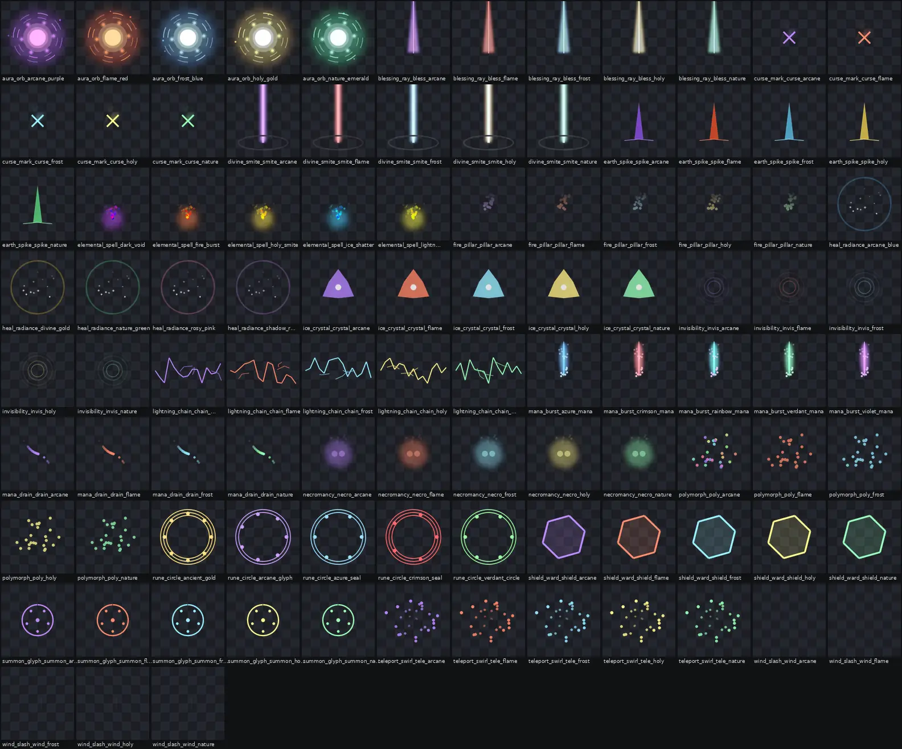

| אפקט | גרסאות | פריים | פריימים | איך נראה | במשחק |
|---|---|---|---|---|---|
| `aura_orb` | arcane_purple, flame_red, frost_blue, holy_gold, nature_emerald | 512 | 48 |  |  |
| `blessing_ray_bless` | arcane, flame, frost, holy, nature | 512 | 24 |  | sp_cleanse (holy) |
| `curse_mark_curse` | arcane, flame, frost, holy, nature | 512 | 48 |  |  |
| `divine_smite_smite` | arcane, flame, frost, holy, nature | 512 | 23 |  |  |
| `earth_spike_spike` | arcane, flame, frost, holy, nature | 512 | 24 |  |  |
| `elemental_spell` | dark_void, fire_burst, holy_smite, ice_shatter, lightning_arc | 512 | 48 |  |  |
| `fire_pillar_pillar` | arcane, flame, frost, holy, nature | 512 | 24 |  |  |
| `heal_radiance` | arcane_blue, divine_gold, nature_green, rosy_pink, shadow_revive | 512 | 48 |  | sp_heal (nature_green) |
| `ice_crystal_crystal` | arcane, flame, frost, holy, nature | 512 | 24 |  |  |
| `invisibility_invis` | arcane, flame, frost, holy, nature | 512 | 24 |  |  |
| `lightning_chain_chain` | arcane, flame, frost, holy, nature | 512 | 24 |  |  |
| `mana_burst` | azure_mana, crimson_mana, rainbow_mana, verdant_mana, violet_mana | 512 | 48 |  |  |
| `mana_drain_drain` | arcane, flame, frost, holy (פגום), nature | 512 | 24 |  |  |
| `necromancy_necro` | arcane, flame, frost, holy, nature | 512 | 24 |  |  |
| `polymorph_poly` | arcane, flame, frost, holy, nature | 512 | 24 |  |  |
| `rune_circle` | ancient_gold, arcane_glyph, azure_seal, crimson_seal, verdant_circle | 512 | 47 |  |  |
| `shield_ward_shield` | arcane, flame, frost, holy, nature | 512 | 24 |  |  |
| `summon_glyph_summon` | arcane, flame, frost, holy, nature | 512 | 48 |  |  |
| `teleport_swirl_tele` | arcane, flame, frost, holy, nature | 512 | 24 |  |  |
| `wind_slash_wind` | arcane, flame, frost, holy, nature | 512 | 13 |  |  |

## procedural-movement-vol1

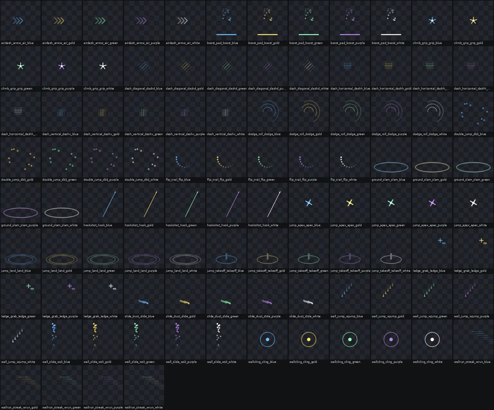

| אפקט | גרסאות | פריים | פריימים | איך נראה | במשחק |
|---|---|---|---|---|---|
| `airdash_arrow_air` | blue, gold, green, purple, white | 512 | 39 |  |  |
| `boost_pad_boost` | blue, gold, green, purple, white | 512 | 48 |  |  |
| `climb_grip_grip` | blue, gold, green, purple, white | 512 | 33 |  |  |
| `dash_diagonal_dashd` | blue, gold, green, purple, white | 512 | 32 |  |  |
| `dash_horizontal_dashh` | blue, gold, green, purple, white | 512 | 33 |  |  |
| `dash_vertical_dashv` | blue, gold, green, purple, white | 512 | 32 |  |  |
| `dodge_roll_dodge` | blue, gold, green, purple, white | 512 | 41 |  |  |
| `double_jump_dblj` | blue, gold, green, purple, white | 512 | 39 |  |  |
| `flip_trail_flip` | blue, gold, green, purple, white | 512 | 48 |  |  |
| `ground_slam_slam` | blue, gold, green, purple, white | 512 | 43 |  |  |
| `hookshot_hook` | blue, gold, green, purple, white | 512 | 46 |  | sk_net (green) |
| `jump_apex_apex` | blue, gold, green, purple, white | 512 | 33 |  |  |
| `jump_land_land` | blue, gold, green, purple, white | 512 | 40 |  |  |
| `jump_takeoff_takeoff` | blue, gold, green, purple, white | 512 | 41 |  |  |
| `ledge_grab_ledge` | blue, gold, green, purple, white | 512 | 33 |  |  |
| `slide_dust_slide` | blue, gold, green, purple, white | 512 | 41 |  |  |
| `wall_jump_wjump` | blue, gold, green, purple, white | 512 | 41 |  |  |
| `wall_slide_wsli` | blue, gold, green, purple, white | 512 | 46 |  |  |
| `wallcling_cling` | blue, gold, green, purple, white | 512 | 48 |  |  |
| `wallrun_streak_wrun` | blue, gold, green, purple, white | 512 | 48 |  |  |

## procedural-ui-juice-vol1

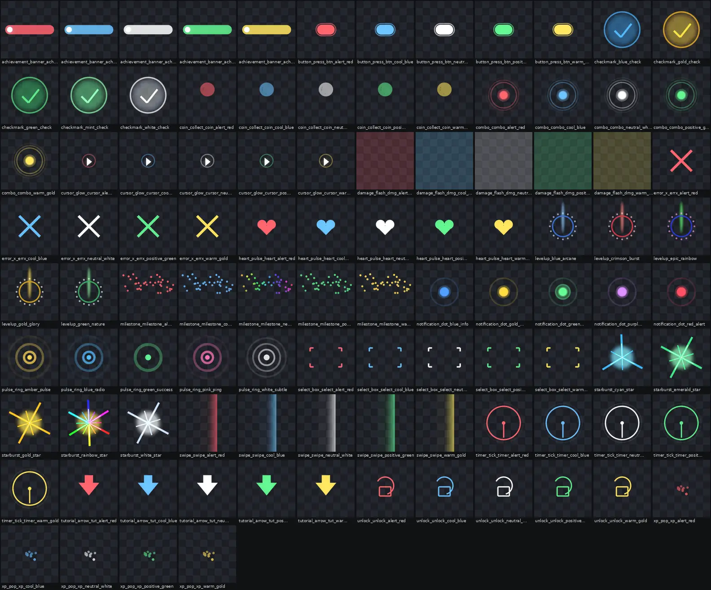

| אפקט | גרסאות | פריים | פריימים | איך נראה | במשחק |
|---|---|---|---|---|---|
| `achievement_banner_ach` | alert_red, cool_blue, neutral_white, positive_green, warm_gold | 512 | 48 |  |  |
| `button_press_btn` | alert_red, cool_blue, neutral_white, positive_green, warm_gold | 512 | 48 |  | ui_juice (warm_gold) |
| `checkmark` | blue_check, gold_check, green_check, mint_check, white_check | 512 | 47 |  |  |
| `coin_collect_coin` | alert_red, cool_blue, neutral_white, positive_green, warm_gold | 512 | 48 |  |  |
| `combo_combo` | alert_red, cool_blue, neutral_white, positive_green, warm_gold | 512 | 48 |  |  |
| `cursor_glow_cursor` | alert_red, cool_blue, neutral_white, positive_green, warm_gold | 512 | 48 |  |  |
| `damage_flash_dmg` | alert_red, cool_blue, neutral_white, positive_green, warm_gold | 512 | 23 |  |  |
| `error_x_errx` | alert_red, cool_blue, neutral_white, positive_green, warm_gold | 512 | 44 |  |  |
| `heart_pulse_heart` | alert_red, cool_blue, neutral_white, positive_green, warm_gold | 512 | 48 |  |  |
| `levelup` | blue_arcane, crimson_burst, epic_rainbow, gold_glory, green_nature | 512 | 48 |  |  |
| `milestone_milestone` | alert_red, cool_blue, neutral_white, positive_green, warm_gold | 512 | 46 |  |  |
| `notification_dot` | blue_info, gold_premium, green_active, purple_special, red_alert | 512 | 48 |  |  |
| `pulse_ring` | amber_pulse, blue_radio, green_success, pink_ping, white_subtle | 512 | 48 |  |  |
| `select_box_select` | alert_red, cool_blue, neutral_white, positive_green, warm_gold | 512 | 48 |  |  |
| `starburst` | cyan_star, emerald_star, gold_star, rainbow_star, white_star | 512 | 45 |  |  |
| `swipe_swipe` | alert_red, cool_blue, neutral_white, positive_green, warm_gold | 512 | 43 |  |  |
| `timer_tick_timer` | alert_red, cool_blue, neutral_white, positive_green, warm_gold | 512 | 48 |  |  |
| `tutorial_arrow_tut` | alert_red, cool_blue, neutral_white, positive_green, warm_gold | 512 | 48 |  |  |
| `unlock_unlock` | alert_red, cool_blue, neutral_white, positive_green, warm_gold | 512 | 48 |  |  |
| `xp_pop_xp` | alert_red, cool_blue, neutral_white, positive_green, warm_gold | 512 | 48 |  |  |

## smoke-fire-fx-pack-vol1

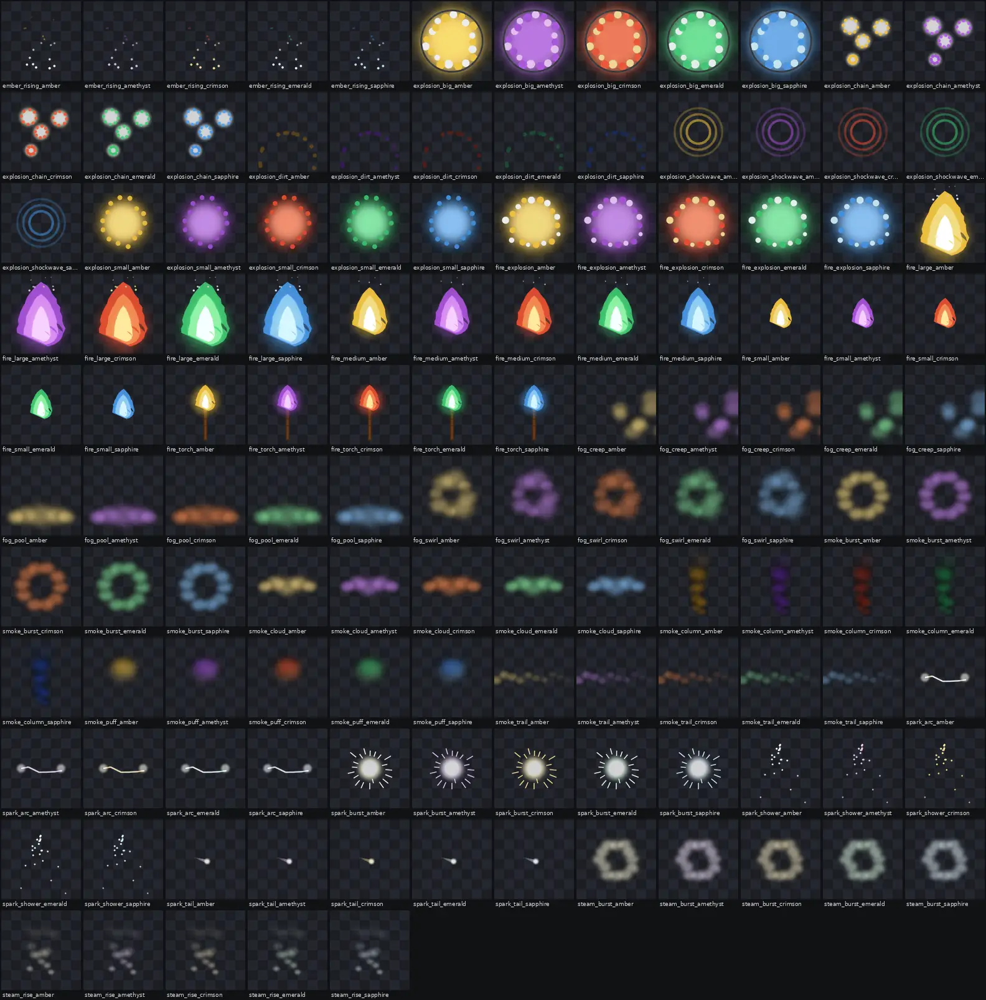

| אפקט | גרסאות | פריים | פריימים | איך נראה | במשחק |
|---|---|---|---|---|---|
| `ember_rising` | amber, amethyst, crimson, emerald, sapphire | 512 | 24 |  |  |
| `explosion_big` | amber, amethyst, crimson, emerald, sapphire | 512 | 23 |  | tower_fall (amber) |
| `explosion_chain` | amber, amethyst, crimson, emerald, sapphire | 512 | 23 |  |  |
| `explosion_dirt` | amber, amethyst, crimson, emerald, sapphire | 512 | 24 |  |  |
| `explosion_shockwave` | amber, amethyst, crimson, emerald, sapphire | 512 | 24 |  | sk_anvil_wave (amber) |
| `explosion_small` | amber, amethyst, crimson, emerald, sapphire | 512 | 23 |  |  |
| `fire_explosion` | amber, amethyst, crimson, emerald, sapphire | 512 | 23 |  |  |
| `fire_large` | amber, amethyst, crimson, emerald, sapphire | 512 | 24 |  |  |
| `fire_medium` | amber, amethyst, crimson, emerald, sapphire | 512 | 24 |  |  |
| `fire_small` | amber, amethyst, crimson, emerald, sapphire | 512 | 24 |  |  |
| `fire_torch` | amber, amethyst, crimson, emerald, sapphire | 512 | 24 |  |  |
| `fog_creep` | amber, amethyst, crimson, emerald, sapphire | 512 | 24 |  |  |
| `fog_pool` | amber, amethyst, crimson, emerald, sapphire | 512 | 24 |  |  |
| `fog_swirl` | amber, amethyst, crimson, emerald, sapphire | 512 | 24 |  |  |
| `smoke_burst` | amber, amethyst, crimson, emerald, sapphire | 512 | 23 |  |  |
| `smoke_cloud` | amber, amethyst, crimson, emerald, sapphire | 512 | 24 |  |  |
| `smoke_column` | amber, amethyst, crimson, emerald, sapphire | 512 | 24 |  |  |
| `smoke_puff` | amber, amethyst, crimson, emerald, sapphire | 512 | 23 |  |  |
| `smoke_trail` | amber, amethyst, crimson, emerald, sapphire | 512 | 24 |  |  |
| `spark_arc` | amber, amethyst, crimson, emerald, sapphire | 512 | 11 |  |  |
| `spark_burst` | amber, amethyst, crimson, emerald, sapphire | 512 | 23 |  |  |
| `spark_shower` | amber, amethyst, crimson, emerald, sapphire | 512 | 24 |  |  |
| `spark_tail` | amber, amethyst, crimson, emerald, sapphire | 512 | 24 |  |  |
| `steam_burst` | amber, amethyst, crimson, emerald, sapphire | 512 | 23 |  |  |
| `steam_rise` | amber, amethyst, crimson, emerald, sapphire | 512 | 24 |  |  |

## snow-globe-frame-pack-vol1

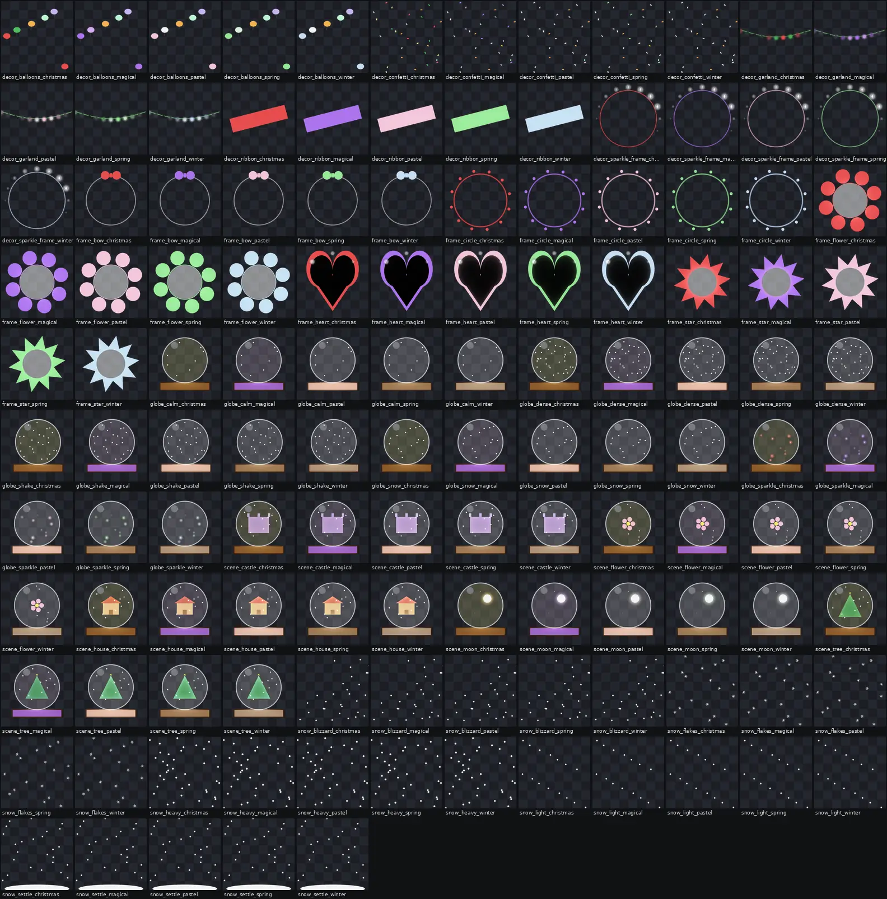

| אפקט | גרסאות | פריים | פריימים | איך נראה | במשחק |
|---|---|---|---|---|---|
| `decor_balloons` | christmas, magical, pastel, spring, winter | 512 | 24 |  |  |
| `decor_confetti` | christmas, magical, pastel, spring, winter | 512 | 24 |  |  |
| `decor_garland` | christmas, magical, pastel, spring, winter | 512 | 24 |  |  |
| `decor_ribbon` | christmas, magical, pastel, spring, winter | 512 | 24 |  |  |
| `decor_sparkle_frame` | christmas, magical, pastel, spring, winter | 512 | 24 |  | globe_frame (magical) |
| `frame_bow` | christmas, magical, pastel, spring, winter | 512 | 24 |  |  |
| `frame_circle` | christmas, magical, pastel, spring, winter | 512 | 24 |  |  |
| `frame_flower` | christmas, magical, pastel, spring, winter | 512 | 24 |  |  |
| `frame_heart` | christmas, magical, pastel, spring, winter | 512 | 24 |  |  |
| `frame_star` | christmas, magical, pastel, spring, winter | 512 | 24 |  |  |
| `globe_calm` | christmas, magical, pastel, spring, winter | 512 | 24 |  |  |
| `globe_dense` | christmas, magical, pastel, spring, winter | 512 | 24 |  |  |
| `globe_shake` | christmas, magical, pastel, spring, winter | 512 | 24 |  |  |
| `globe_snow` | christmas, magical, pastel, spring, winter | 512 | 24 |  |  |
| `globe_sparkle` | christmas, magical, pastel, spring, winter | 512 | 24 |  |  |
| `scene_castle` | christmas, magical, pastel, spring, winter | 512 | 24 |  |  |
| `scene_flower` | christmas, magical, pastel, spring, winter | 512 | 24 |  |  |
| `scene_house` | christmas, magical, pastel, spring, winter | 512 | 24 |  |  |
| `scene_moon` | christmas, magical, pastel, spring, winter | 512 | 24 |  |  |
| `scene_tree` | christmas, magical, pastel, spring, winter | 512 | 24 |  |  |
| `snow_blizzard` | christmas, magical, pastel, spring, winter | 512 | 24 |  |  |
| `snow_flakes` | christmas, magical, pastel, spring, winter | 512 | 24 |  |  |
| `snow_heavy` | christmas, magical, pastel, spring, winter | 512 | 24 |  |  |
| `snow_light` | christmas, magical, pastel, spring, winter | 512 | 24 |  | snow (winter) |
| `snow_settle` | christmas, magical, pastel, spring, winter | 512 | 24 |  |  |

## speech-emote-bubble-pack-vol1

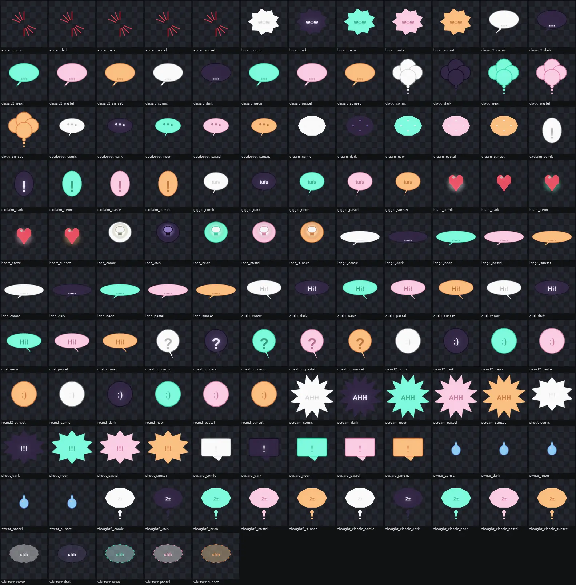

| אפקט | גרסאות | פריים | פריימים | איך נראה | במשחק |
|---|---|---|---|---|---|
| `anger` | comic, dark, neon, pastel, sunset | 512 | 24 |  |  |
| `burst` | comic, dark, neon, pastel, sunset | 512 | 24 |  |  |
| `classic2` | comic, dark, neon, pastel, sunset | 512 | 24 |  |  |
| `classic` | comic, dark, neon, pastel, sunset | 512 | 24 |  |  |
| `cloud` | comic, dark, neon, pastel, sunset | 512 | 24 |  |  |
| `dotdotdot` | comic, dark, neon, pastel, sunset | 512 | 24 |  | emote_dots (pastel) |
| `dream` | comic, dark, neon, pastel, sunset | 512 | 24 |  |  |
| `exclaim` | comic, dark, neon, pastel, sunset | 512 | 24 |  |  |
| `giggle` | comic, dark, neon, pastel, sunset | 512 | 24 |  |  |
| `heart` | comic, dark, neon, pastel, sunset | 512 | 24 |  | emote_heart (pastel) |
| `idea` | comic, dark, neon, pastel, sunset | 512 | 24 |  | emote_idea (pastel) |
| `long2` | comic, dark, neon, pastel, sunset | 512 | 24 |  |  |
| `long` | comic, dark, neon, pastel, sunset | 512 | 24 |  |  |
| `oval2` | comic, dark, neon, pastel, sunset | 512 | 24 |  |  |
| `oval` | comic, dark, neon, pastel, sunset | 512 | 24 |  |  |
| `question` | comic, dark, neon, pastel, sunset | 512 | 24 |  |  |
| `round2` | comic, dark, neon, pastel, sunset | 512 | 24 |  |  |
| `round` | comic, dark, neon, pastel, sunset | 512 | 24 |  |  |
| `scream` | comic, dark, neon, pastel, sunset | 512 | 24 |  |  |
| `shout` | comic, dark, neon, pastel, sunset | 512 | 24 |  |  |
| `square` | comic, dark, neon, pastel, sunset | 512 | 24 |  |  |
| `sweat` | comic, dark, neon, pastel, sunset | 512 | 24 |  |  |
| `thought2` | comic, dark, neon, pastel, sunset | 512 | 24 |  |  |
| `thought_classic` | comic, dark, neon, pastel, sunset | 512 | 24 |  |  |
| `whisper` | comic, dark, neon, pastel, sunset | 512 | 24 |  |  |

## spell-cast-circle-pack-vol1

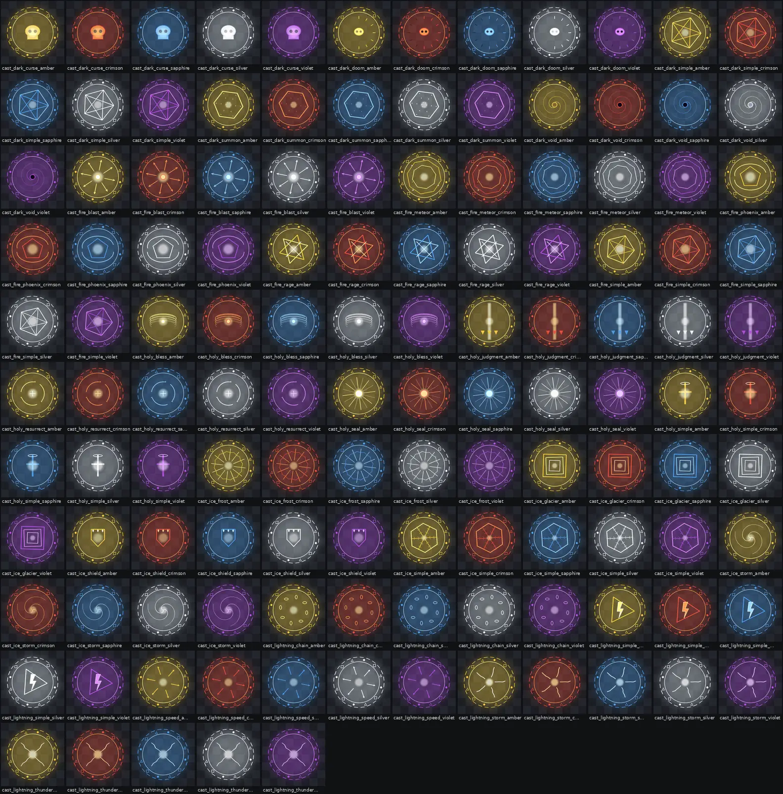

| אפקט | גרסאות | פריים | פריימים | איך נראה | במשחק |
|---|---|---|---|---|---|
| `cast_dark_curse` | amber, crimson, sapphire, silver, violet | 512 | 24 |  |  |
| `cast_dark_doom` | amber, crimson, sapphire, silver, violet | 512 | 24 |  |  |
| `cast_dark_simple` | amber, crimson, sapphire, silver, violet | 512 | 24 |  |  |
| `cast_dark_summon` | amber, crimson, sapphire, silver, violet | 512 | 24 |  |  |
| `cast_dark_void` | amber, crimson, sapphire, silver, violet | 512 | 24 |  |  |
| `cast_fire_blast` | amber, crimson, sapphire, silver, violet | 512 | 24 |  |  |
| `cast_fire_meteor` | amber, crimson, sapphire, silver, violet | 512 | 24 |  |  |
| `cast_fire_phoenix` | amber, crimson, sapphire, silver, violet | 512 | 24 |  |  |
| `cast_fire_rage` | amber, crimson, sapphire, silver, violet | 512 | 24 |  |  |
| `cast_fire_simple` | amber, crimson, sapphire, silver, violet | 512 | 24 |  |  |
| `cast_holy_bless` | amber, crimson, sapphire, silver, violet | 512 | 24 |  |  |
| `cast_holy_judgment` | amber, crimson, sapphire, silver, violet | 512 | 24 |  | ult_cast (amber) |
| `cast_holy_resurrect` | amber, crimson, sapphire, silver, violet | 512 | 24 |  |  |
| `cast_holy_seal` | amber, crimson, sapphire, silver, violet | 512 | 24 |  |  |
| `cast_holy_simple` | amber, crimson, sapphire, silver, violet | 512 | 24 |  | recall (sapphire) |
| `cast_ice_frost` | amber, crimson, sapphire, silver, violet | 512 | 24 |  |  |
| `cast_ice_glacier` | amber, crimson, sapphire, silver, violet | 512 | 24 |  |  |
| `cast_ice_shield` | amber, crimson, sapphire, silver, violet | 512 | 24 |  |  |
| `cast_ice_simple` | amber, crimson, sapphire, silver, violet | 512 | 24 |  |  |
| `cast_ice_storm` | amber, crimson, sapphire, silver, violet | 512 | 24 |  | sk_blizzard (sapphire) |
| `cast_lightning_chain` | amber, crimson, sapphire, silver, violet | 512 | 24 |  |  |
| `cast_lightning_simple` | amber, crimson, sapphire, silver, violet | 512 | 24 |  |  |
| `cast_lightning_speed` | amber, crimson, sapphire, silver, violet | 512 | 24 |  |  |
| `cast_lightning_storm` | amber, crimson, sapphire, silver, violet | 512 | 24 |  |  |
| `cast_lightning_thunder` | amber, crimson, sapphire, silver, violet | 512 | 24 |  |  |

## stamp-mood-icon-pack-vol1

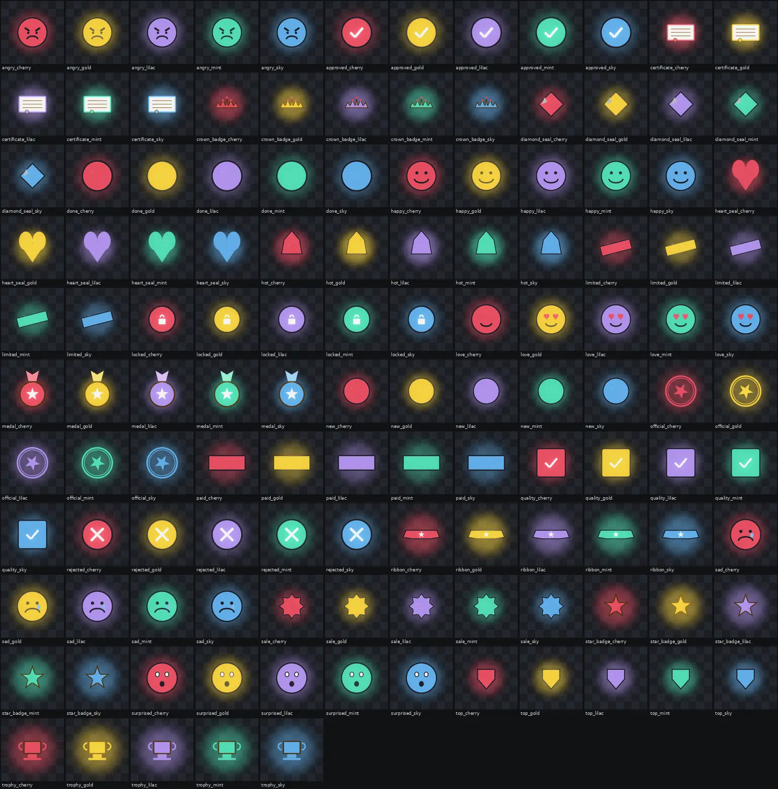

| אפקט | גרסאות | פריים | פריימים | איך נראה | במשחק |
|---|---|---|---|---|---|
| `angry` | cherry, gold, lilac, mint, sky | 512 | 24 |  |  |
| `approved` | cherry, gold, lilac, mint, sky | 512 | 23 |  |  |
| `certificate` | cherry, gold, lilac, mint, sky | 512 | 23 |  |  |
| `crown_badge` | cherry, gold, lilac, mint, sky | 512 | 24 |  |  |
| `diamond_seal` | cherry, gold, lilac, mint, sky | 512 | 24 |  |  |
| `done` | cherry, gold, lilac, mint, sky | 512 | 23 |  | stamp_done (gold) |
| `happy` | cherry, gold, lilac, mint, sky | 512 | 24 |  |  |
| `heart_seal` | cherry, gold, lilac, mint, sky | 512 | 24 |  |  |
| `hot` | cherry, gold, lilac, mint, sky | 512 | 24 |  |  |
| `limited` | cherry, gold, lilac, mint, sky | 512 | 24 |  |  |
| `locked` | cherry, gold, lilac, mint, sky | 512 | 23 |  |  |
| `love` | cherry, gold, lilac, mint, sky | 512 | 24 |  |  |
| `medal` | cherry, gold, lilac, mint, sky | 512 | 24 |  |  |
| `new` | cherry, gold, lilac, mint, sky | 512 | 24 |  |  |
| `official` | cherry, gold, lilac, mint, sky | 512 | 24 |  |  |
| `paid` | cherry, gold, lilac, mint, sky | 512 | 23 |  |  |
| `quality` | cherry, gold, lilac, mint, sky | 512 | 24 |  |  |
| `rejected` | cherry, gold, lilac, mint, sky | 512 | 23 |  |  |
| `ribbon` | cherry, gold, lilac, mint, sky | 512 | 23 |  |  |
| `sad` | cherry, gold, lilac, mint, sky | 512 | 24 |  |  |
| `sale` | cherry, gold, lilac, mint, sky | 512 | 24 |  |  |
| `star_badge` | cherry, gold, lilac, mint, sky | 512 | 24 |  |  |
| `surprised` | cherry, gold, lilac, mint, sky | 512 | 23 |  |  |
| `top` | cherry, gold, lilac, mint, sky | 512 | 24 |  |  |
| `trophy` | cherry, gold, lilac, mint, sky | 512 | 24 |  |  |

## stars-constellation-pack-vol1

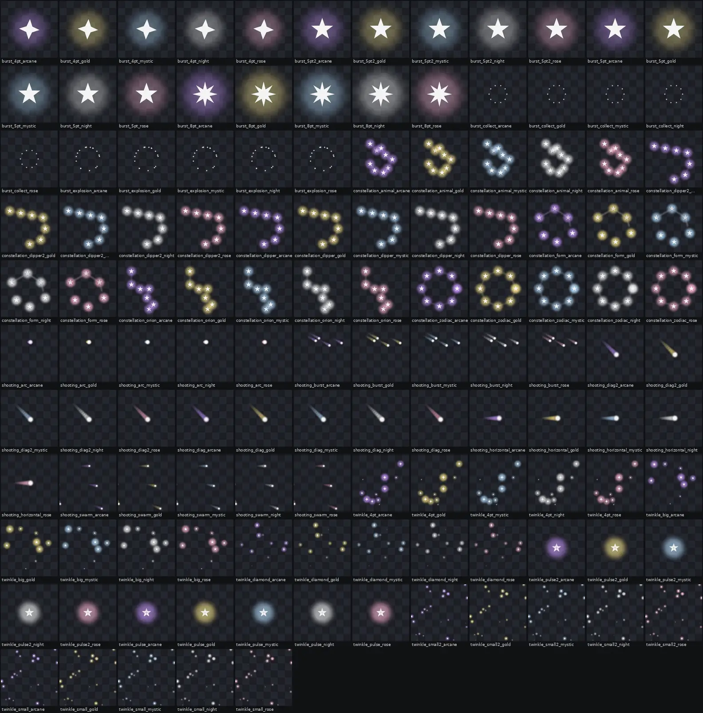

| אפקט | גרסאות | פריים | פריימים | איך נראה | במשחק |
|---|---|---|---|---|---|
| `burst_4pt` | arcane, gold, mystic, night, rose | 512 | 24 |  |  |
| `burst_5pt2` | arcane, gold, mystic, night, rose | 512 | 24 |  |  |
| `burst_5pt` | arcane, gold, mystic, night, rose | 512 | 24 |  |  |
| `burst_8pt` | arcane, gold, mystic, night, rose | 512 | 24 |  |  |
| `burst_collect` | arcane, gold, mystic, night, rose | 512 | 24 |  |  |
| `burst_explosion` | arcane, gold, mystic, night, rose | 512 | 24 |  |  |
| `constellation_animal` | arcane, gold, mystic, night, rose | 512 | 24 |  |  |
| `constellation_dipper2` | arcane, gold, mystic, night, rose | 512 | 24 |  |  |
| `constellation_dipper` | arcane, gold, mystic, night, rose | 512 | 24 |  |  |
| `constellation_form` | arcane, gold, mystic, night, rose | 512 | 24 |  |  |
| `constellation_orion` | arcane, gold, mystic, night, rose | 512 | 24 |  |  |
| `constellation_zodiac` | arcane, gold, mystic, night, rose | 512 | 24 |  |  |
| `shooting_arc` | arcane, gold, mystic, night, rose | 512 | 24 |  |  |
| `shooting_burst` | arcane, gold, mystic, night, rose | 512 | 24 |  |  |
| `shooting_diag2` | arcane, gold, mystic, night, rose | 512 | 24 |  |  |
| `shooting_diag` | arcane, gold, mystic, night, rose | 512 | 24 |  |  |
| `shooting_horizontal` | arcane, gold, mystic, night, rose | 512 | 24 |  |  |
| `shooting_swarm` | arcane, gold, mystic, night, rose | 512 | 24 |  |  |
| `twinkle_4pt` | arcane, gold, mystic, night, rose | 512 | 24 |  |  |
| `twinkle_big` | arcane, gold, mystic, night, rose | 512 | 24 |  |  |
| `twinkle_diamond` | arcane, gold, mystic, night, rose | 512 | 24 |  |  |
| `twinkle_pulse2` | arcane, gold, mystic, night, rose | 512 | 24 |  |  |
| `twinkle_pulse` | arcane, gold, mystic, night, rose | 512 | 24 |  |  |
| `twinkle_small2` | arcane, gold, mystic, night, rose | 512 | 24 |  |  |
| `twinkle_small` | arcane, gold, mystic, night, rose | 512 | 24 |  | stars (gold) |

## status-effect-pack-vol1

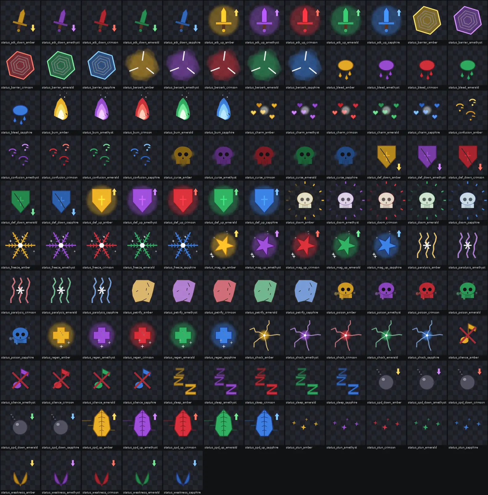

| אפקט | גרסאות | פריים | פריימים | איך נראה | במשחק |
|---|---|---|---|---|---|
| `status_atk_down` | amber, amethyst, crimson, emerald, sapphire | 512 | 24 |  |  |
| `status_atk_up` | amber, amethyst, crimson, emerald, sapphire | 512 | 24 |  |  |
| `status_barrier` | amber, amethyst, crimson, emerald, sapphire | 512 | 24 |  |  |
| `status_berserk` | amber, amethyst, crimson, emerald, sapphire | 512 | 24 |  |  |
| `status_bleed` | amber, amethyst, crimson, emerald, sapphire | 512 | 24 |  |  |
| `status_burn` | amber, amethyst, crimson, emerald, sapphire | 512 | 24 |  | st_burn (crimson) |
| `status_charm` | amber, amethyst, crimson, emerald, sapphire | 512 | 24 |  |  |
| `status_confusion` | amber, amethyst, crimson, emerald, sapphire | 512 | 24 |  |  |
| `status_curse` | amber, amethyst, crimson, emerald, sapphire | 512 | 24 |  |  |
| `status_def_down` | amber, amethyst, crimson, emerald, sapphire | 512 | 24 |  |  |
| `status_def_up` | amber, amethyst, crimson, emerald, sapphire | 512 | 24 |  |  |
| `status_doom` | amber, amethyst, crimson, emerald, sapphire | 512 | 24 |  |  |
| `status_freeze` | amber, amethyst, crimson, emerald, sapphire | 512 | 24 |  | st_freeze (sapphire) |
| `status_mag_up` | amber, amethyst, crimson, emerald, sapphire | 512 | 24 |  |  |
| `status_paralysis` | amber, amethyst, crimson, emerald, sapphire | 512 | 24 |  |  |
| `status_petrify` | amber, amethyst, crimson, emerald, sapphire | 512 | 22 |  |  |
| `status_poison` | amber, amethyst, crimson, emerald, sapphire | 512 | 24 |  | st_poison (emerald) |
| `status_regen` | amber, amethyst, crimson, emerald, sapphire | 512 | 24 |  |  |
| `status_shock` | amber, amethyst, crimson, emerald, sapphire | 512 | 24 |  | st_shock (amethyst) |
| `status_silence` | amber, amethyst, crimson, emerald, sapphire | 512 | 24 |  |  |
| `status_sleep` | amber, amethyst, crimson, emerald, sapphire | 512 | 24 |  |  |
| `status_spd_down` | amber, amethyst, crimson, emerald, sapphire | 512 | 24 |  | st_slow (sapphire) |
| `status_spd_up` | amber, amethyst, crimson, emerald, sapphire | 512 | 24 |  |  |
| `status_stun` | amber, amethyst, crimson, emerald, sapphire | 512 | 24 |  | st_stun (amber) |
| `status_weakness` | amber, amethyst, crimson, emerald, sapphire | 512 | 24 |  | st_weak (amber), sp_exhaust (amethyst) |

## sword-trail-pack-vol1

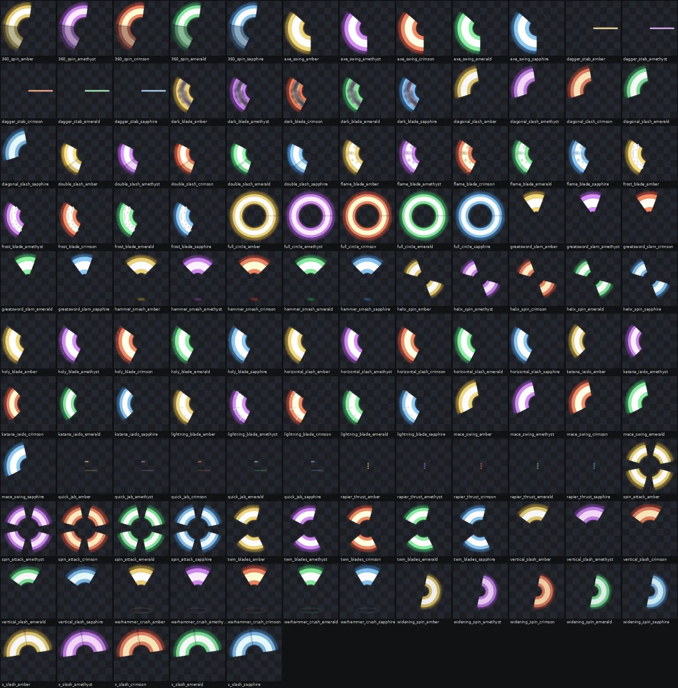

| אפקט | גרסאות | פריים | פריימים | איך נראה | במשחק |
|---|---|---|---|---|---|
| `360_spin` | amber, amethyst, crimson, emerald, sapphire | 512 | 24 |  |  |
| `axe_swing` | amber, amethyst, crimson, emerald, sapphire | 512 | 23 |  |  |
| `dagger_stab` | amber, amethyst, crimson, emerald, sapphire | 512 | 21 |  |  |
| `dark_blade` | amber, amethyst, crimson, emerald, sapphire | 512 | 24 |  |  |
| `diagonal_slash` | amber, amethyst, crimson, emerald, sapphire | 512 | 23 |  |  |
| `double_slash` | amber, amethyst, crimson, emerald, sapphire | 512 | 23 |  |  |
| `flame_blade` | amber, amethyst, crimson, emerald, sapphire | 512 | 24 |  |  |
| `frost_blade` | amber, amethyst, crimson, emerald, sapphire | 512 | 23 |  |  |
| `full_circle` | amber, amethyst, crimson, emerald, sapphire | 512 | 22 |  |  |
| `greatsword_slam` | amber, amethyst, crimson, emerald, sapphire | 512 | 22 |  |  |
| `hammer_smash` | amber, amethyst, crimson, emerald, sapphire | 512 | 22 |  |  |
| `helix_spin` | amber, amethyst, crimson, emerald, sapphire | 512 | 24 |  |  |
| `holy_blade` | amber, amethyst, crimson, emerald, sapphire | 512 | 24 |  |  |
| `horizontal_slash` | amber, amethyst, crimson, emerald, sapphire | 512 | 23 |  | sk_cleave (amber) |
| `katana_iaido` | amber, amethyst, crimson, emerald, sapphire | 512 | 22 |  |  |
| `lightning_blade` | amber, amethyst, crimson, emerald, sapphire | 512 | 24 |  |  |
| `mace_swing` | amber, amethyst, crimson, emerald, sapphire | 512 | 23 |  |  |
| `quick_jab` | amber, amethyst, crimson, emerald, sapphire | 512 | 24 |  | slash (amber) |
| `rapier_thrust` | amber, amethyst, crimson, emerald, sapphire | 512 | 8 |  |  |
| `spin_attack` | amber, amethyst, crimson, emerald, sapphire | 512 | 24 |  | sk_spin (amber) |
| `twin_blades` | amber, amethyst, crimson, emerald, sapphire | 512 | 21 |  |  |
| `vertical_slash` | amber, amethyst, crimson, emerald, sapphire | 512 | 23 |  |  |
| `warhammer_crush` | amber, amethyst, crimson, emerald, sapphire | 512 | 21 |  |  |
| `widening_spin` | amber, amethyst, crimson, emerald, sapphire | 512 | 24 |  |  |
| `x_slash` | amber, amethyst, crimson, emerald, sapphire | 512 | 23 |  |  |

## ui-notification-pack-vol1

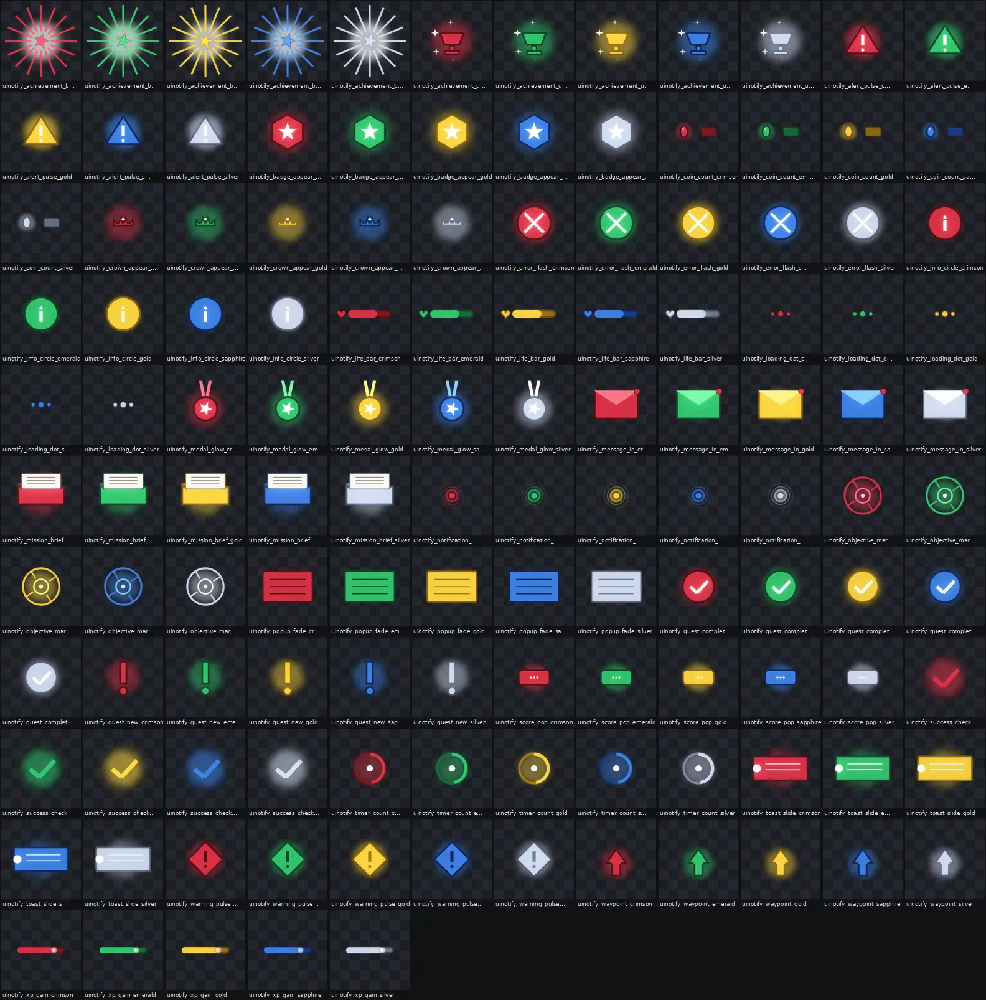

| אפקט | גרסאות | פריים | פריימים | איך נראה | במשחק |
|---|---|---|---|---|---|
| `uinotify_achievement_burst` | crimson, emerald, gold, sapphire, silver | 512 | 23 |  | ui_ach (gold) |
| `uinotify_achievement_unlock` | crimson, emerald, gold, sapphire, silver | 512 | 23 |  |  |
| `uinotify_alert_pulse` | crimson, emerald, gold, sapphire, silver | 512 | 24 |  |  |
| `uinotify_badge_appear` | crimson, emerald, gold, sapphire, silver | 512 | 23 |  |  |
| `uinotify_coin_count` | crimson, emerald, gold, sapphire, silver | 512 | 24 |  | ui_coin (gold) |
| `uinotify_crown_appear` | crimson, emerald, gold, sapphire, silver | 512 | 24 |  |  |
| `uinotify_error_flash` | crimson, emerald, gold, sapphire, silver | 512 | 24 |  |  |
| `uinotify_info_circle` | crimson, emerald, gold, sapphire, silver | 512 | 24 |  |  |
| `uinotify_life_bar` | crimson, emerald, gold, sapphire, silver | 512 | 24 |  |  |
| `uinotify_loading_dot` | crimson, emerald, gold, sapphire, silver | 512 | 24 |  |  |
| `uinotify_medal_glow` | crimson, emerald, gold, sapphire, silver | 512 | 24 |  |  |
| `uinotify_message_in` | crimson, emerald, gold, sapphire, silver | 512 | 24 |  |  |
| `uinotify_mission_brief` | crimson, emerald, gold, sapphire, silver | 512 | 24 |  |  |
| `uinotify_notification_dot` | crimson, emerald, gold, sapphire, silver | 512 | 24 |  |  |
| `uinotify_objective_mark` | crimson, emerald, gold, sapphire, silver | 512 | 24 |  |  |
| `uinotify_popup_fade` | crimson, emerald, gold, sapphire, silver | 512 | 22 |  |  |
| `uinotify_quest_complete` | crimson, emerald, gold, sapphire, silver | 512 | 24 |  | ui_toast (gold) |
| `uinotify_quest_new` | crimson, emerald, gold, sapphire, silver | 512 | 24 |  | ui_new (gold) |
| `uinotify_score_pop` | crimson, emerald, gold, sapphire, silver | 512 | 23 |  |  |
| `uinotify_success_check` | crimson, emerald, gold, sapphire, silver | 512 | 23 |  |  |
| `uinotify_timer_count` | crimson, emerald, gold, sapphire, silver | 512 | 24 |  |  |
| `uinotify_toast_slide` | crimson, emerald, gold, sapphire, silver | 512 | 24 |  |  |
| `uinotify_warning_pulse` | crimson, emerald, gold, sapphire, silver | 512 | 24 |  |  |
| `uinotify_waypoint` | crimson, emerald, gold, sapphire, silver | 512 | 24 |  |  |
| `uinotify_xp_gain` | crimson, emerald, gold, sapphire, silver | 512 | 24 |  | ui_xp (gold) |

## water-fx-pack-vol1

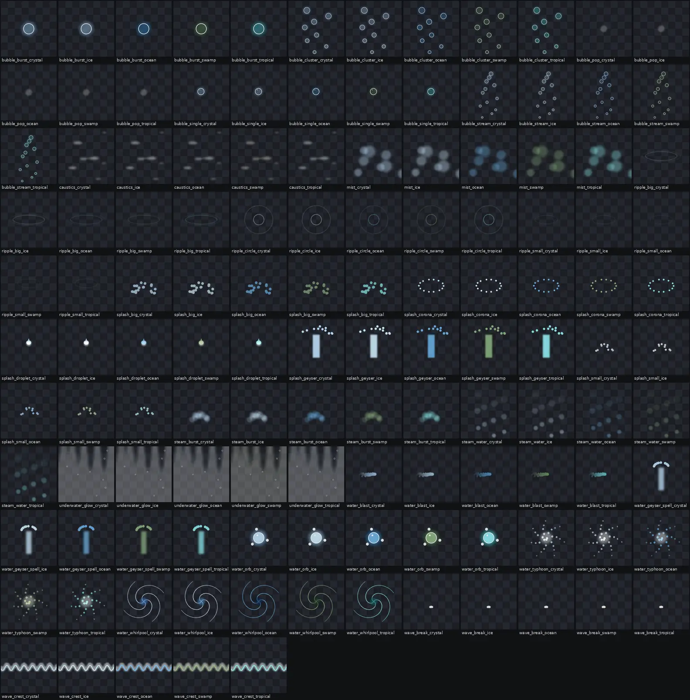

| אפקט | גרסאות | פריים | פריימים | איך נראה | במשחק |
|---|---|---|---|---|---|
| `bubble_burst` | crystal, ice, ocean, swamp, tropical | 512 | 23 |  |  |
| `bubble_cluster` | crystal, ice, ocean, swamp, tropical | 512 | 24 |  |  |
| `bubble_pop` | crystal, ice, ocean, swamp, tropical | 512 | 20 |  |  |
| `bubble_single` | crystal, ice, ocean, swamp, tropical | 512 | 24 |  | sk_bubble (ocean) |
| `bubble_stream` | crystal, ice, ocean, swamp, tropical | 512 | 24 |  | st_wet (ocean) |
| `caustics` | crystal, ice, ocean, swamp, tropical | 512 | 24 |  |  |
| `mist` | crystal, ice, ocean, swamp, tropical | 512 | 24 |  |  |
| `ripple_big` | crystal, ice, ocean, swamp, tropical | 512 | 24 |  |  |
| `ripple_circle` | crystal, ice, ocean, swamp, tropical | 512 | 24 |  | water_ripple (ocean) |
| `ripple_small` | crystal, ice, ocean, swamp, tropical | 512 | 24 |  |  |
| `splash_big` | crystal, ice, ocean, swamp, tropical | 512 | 24 |  |  |
| `splash_corona` | crystal, ice, ocean, swamp, tropical | 512 | 23 |  |  |
| `splash_droplet` | crystal, ice, ocean, swamp, tropical | 512 | 23 |  |  |
| `splash_geyser` | crystal, ice, ocean, swamp, tropical | 512 | 24 |  |  |
| `splash_small` | crystal, ice, ocean, swamp, tropical | 512 | 24 |  | hit_water (ocean) |
| `steam_burst` | crystal, ice, ocean, swamp, tropical | 512 | 23 |  |  |
| `steam_water` | crystal, ice, ocean, swamp, tropical | 512 | 24 |  |  |
| `underwater_glow` | crystal, ice, ocean, swamp, tropical | 512 | 24 |  |  |
| `water_blast` | crystal, ice, ocean, swamp, tropical | 512 | 24 |  | sk_wave (ocean) |
| `water_geyser_spell` | crystal, ice, ocean, swamp, tropical | 512 | 24 |  |  |
| `water_orb` | crystal, ice, ocean, swamp, tropical | 512 | 24 |  |  |
| `water_typhoon` | crystal, ice, ocean, swamp, tropical | 512 | 24 |  |  |
| `water_whirlpool` | crystal, ice, ocean, swamp, tropical | 512 | 24 |  |  |
| `wave_break` | crystal, ice, ocean, swamp, tropical | 512 | 24 |  |  |
| `wave_crest` | crystal, ice, ocean, swamp, tropical | 512 | 24 |  | sk_wave_crest (ocean) |

## weather-fx-pack-vol1

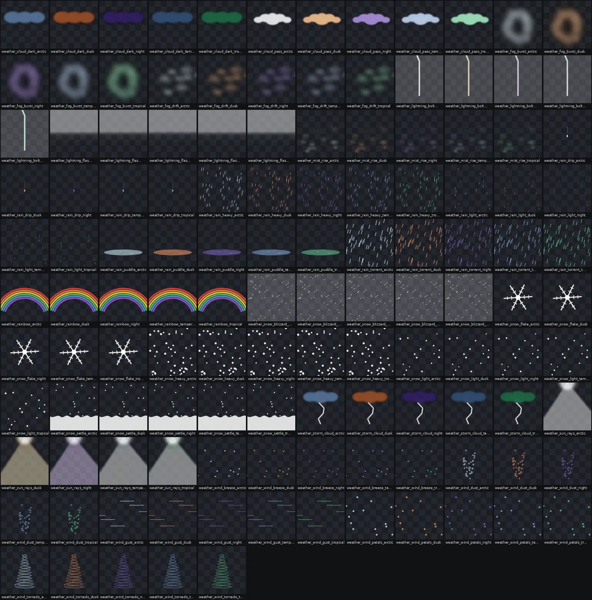

| אפקט | גרסאות | פריים | פריימים | איך נראה | במשחק |
|---|---|---|---|---|---|
| `weather_cloud_dark` | arctic, dusk, night, temperate, tropical | 512 | 24 |  |  |
| `weather_cloud_pass` | arctic, dusk, night, temperate, tropical | 512 | 24 |  |  |
| `weather_fog_burst` | arctic, dusk, night, temperate, tropical | 512 | 23 |  |  |
| `weather_fog_drift` | arctic, dusk, night, temperate, tropical | 512 | 24 |  |  |
| `weather_lightning_bolt` | arctic, dusk, night, temperate, tropical | 512 | 8 |  |  |
| `weather_lightning_flash` | arctic, dusk, night, temperate, tropical | 512 | 6 |  |  |
| `weather_mist_rise` | arctic, dusk, night, temperate, tropical | 512 | 24 |  |  |
| `weather_rain_drip` | arctic, dusk, night, temperate, tropical | 512 | 23 |  |  |
| `weather_rain_heavy` | arctic, dusk, night, temperate, tropical | 512 | 24 |  |  |
| `weather_rain_light` | arctic, dusk, night, temperate, tropical | 512 | 24 |  |  |
| `weather_rain_puddle` | arctic, dusk, night, temperate, tropical | 512 | 24 |  |  |
| `weather_rain_torrent` | arctic, dusk, night, temperate, tropical | 512 | 24 |  |  |
| `weather_rainbow` | arctic, dusk, night, temperate, tropical | 512 | 24 |  |  |
| `weather_snow_blizzard` | arctic, dusk, night, temperate, tropical | 512 | 24 |  |  |
| `weather_snow_flake` | arctic, dusk, night, temperate, tropical | 512 | 24 |  |  |
| `weather_snow_heavy` | arctic, dusk, night, temperate, tropical | 512 | 24 |  |  |
| `weather_snow_light` | arctic, dusk, night, temperate, tropical | 512 | 24 |  |  |
| `weather_snow_settle` | arctic, dusk, night, temperate, tropical | 512 | 24 |  |  |
| `weather_storm_cloud` | arctic, dusk, night, temperate, tropical | 512 | 24 |  |  |
| `weather_sun_rays` | arctic, dusk, night, temperate, tropical | 512 | 24 |  |  |
| `weather_wind_breeze` | arctic, dusk, night, temperate, tropical | 512 | 24 |  |  |
| `weather_wind_dust` | arctic, dusk, night, temperate, tropical | 512 | 24 |  |  |
| `weather_wind_gust` | arctic, dusk, night, temperate, tropical | 512 | 24 |  |  |
| `weather_wind_petals` | arctic, dusk, night, temperate, tropical | 512 | 24 |  |  |
| `weather_wind_tornado` | arctic, dusk, night, temperate, tropical | 512 | 24 |  |  |
