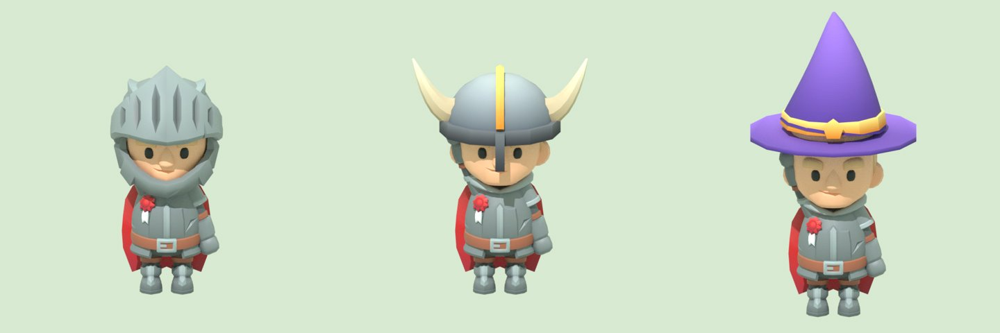
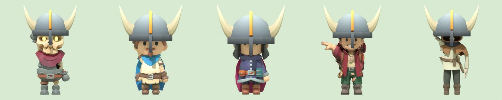
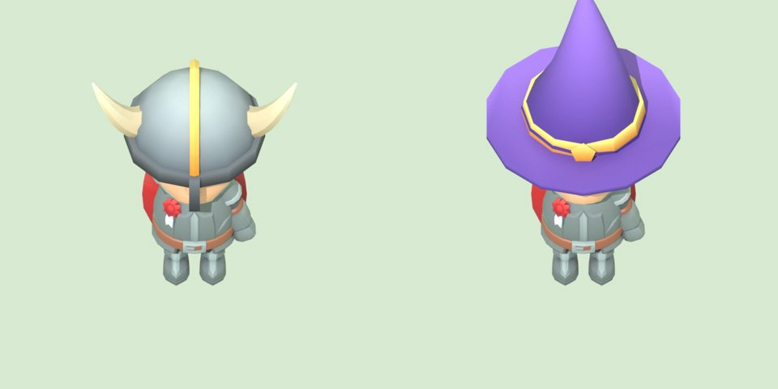
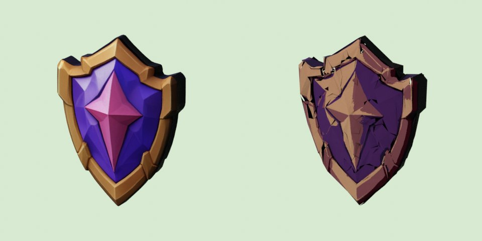

# איך עושים כובעים ופריטים בתלת-ממד משלנו (מחקר, 6.11.2026)

השאלה של ניר: איך עושים כובעים, קסדות ופריטים משלנו שנראים כמו KayKit.
השוויתי שלוש דרכים, ובכל אחת עשיתי ניסוי אמיתי. התמונות ב-[docs/refs/own-models-2026-11-06/](refs/own-models-2026-11-06/).

## ההמלצה: Blender מקוד ✅

Claude כותב סקריפט שבונה את הפריט מצורות פשוטות וצובע אותו בפלטה שלנו. התוצאה נראית KayKit לכל דבר, בחינם, ותוך דקות.

משמאל: הקסדה המקורית של KayKit. באמצע ומימין: קסדת קרניים וכובע קוסם שבניתי.

## 1. Blender בלי ממשק, מקוד ✅ מנצח

- **מה עשיתי:** התקנתי את Blender בסשן, והוצאתי מהמשחק את האביר של KayKit. הסקריפט בונה כיפה, שוליים, רכס זהב, מגן אף וקרניים, או לחלופין כובע קוסם עם שוליים, חרוט מתעקל, רצועה וכוכב. אחר כך הוא מחבר את הפריט לעצם הראש, כך שהוא זז עם האנימציה, ומצלם.
- **הסוד של המראה:** KayKit צובע כל חלק בפס צבע אחד מגיליון קטן, בהיר למעלה וכהה למטה. בניתי גיליון כזה משלנו (`palette.png`, 8 צבעים: ברזל, ברזל כהה, עצם, זהב, עור, סגול, כחול ואדום). פריט חדש רק בוחר צבעים מתוכו.
- **מה יצא:** קסדת הקרניים יצאה ב-460 משולשים ו-23KB, וכובע הקוסם ב-324 משולשים ו-13KB. הקסדה המקורית של KayKit היא כ-400 פאות. כלומר, באותו משקל ובאותו סגנון.
- **זמן ועלות:** 0 ₪. הבנייה והצילום לוקחים 3 שניות. לפריט חדש: כרבע שעה עד חצי שעה של Claude, כולל 2 עד 3 סבבי תיקון לפי התמונה.
- **החיסרון:** צורות אורגניות ומסובכות (פנים, בעלי חיים, קישוטים עדינים) קשות לבנות ככה. כובעים, קסדות, ברדסים, מגנים, נשקים, שריון ורהיטים מתאימים מצוין.

**על כל חמש הדמויות** (לוחם, צייד, קוסם, ניר ואוראל): הסקריפט `fit_hat.py` מודד את הראש של כל דמות ומתאים לו את הקסדה. בניסיון הראשון השיער בצבץ מהכיפה, ובשני הקסדה כיסתה את העיניים. בסוף הכיפה גבוהה מעט יותר מזו של האביר, והשוליים נשארים במצח:

כך זה נראה מזווית המצלמה של המשחק:

## 2. בינה מלאכותית מתמונה (TRELLIS ב-Hugging Face) ⚠️

- **מה עשיתי:** הכנתי ב-Creative Claw תמונת מקור נקייה של אותה קסדה (`tools/trellis-hat/in/horned.jpg`, 16 קרדיטים), ושלחתי אותה ל-TRELLIS דרך GitHub (`trellis-hat.yml`), כי כלי Hugging Face בסשן רק קורא ולא מריץ, ו-Hunyuan3D-2 לא זמין בו. **הריצה נדחתה:** המכסה החינמית של Hugging Face ל-GPU נגמרה להיום. היא כמה דקות ביום, ופריט אחד צורך כ-2 דקות. נקבע ניסיון חוזר כשהיא מתאפסת. בינתיים בדקתי את מה שכבר יצא מ-TRELLIS ונמצא במשחק, את המגן ואת להב הדרקון, וניסיתי לפשט אותם לסגנון KayKit.
- **מה יצא:** המודל המקורי יפה, אבל כבד: 5,000 עד 7,000 משולשים, תמונת צבע של 1024 פיקסלים וכ-1.5MB לפריט, פי 15 מקסדה של KayKit. הוא גם נראה מצויר ומבריק, ולא בצבעים שטוחים. כשפישטתי אותו ל-600 משולשים ול-8 צבעים, הוא נשבר לכתמים (התמונה מימין).
- **זמן ועלות:** חינם, אבל המכסה קטנה: כמה פריטים ביום, ומשותפת עם כל שאר עבודות ה-TRELLIS (Hugging Face PRO, ב-9$ לחודש, נותן 25 דקות ביום). רץ דרך GitHub (`trellis.yml`), כ-5 דקות לפריט, ולפעמים נכשל (קשת השמיים ומטה הכוכבים).
- **מתי כן:** לדמויות ולחיות, כשהצורה מסובכת מדי לבנייה מקוד. לא לכובעים.

## 3. אתרים בתשלום (Meshy, Tripo): רק תיאור

לא פתחתי חשבון ולא שילמתי.
- **Meshy:** כ-20$ לחודש ל-1,000 קרדיטים, ופריט עולה 20 עד 30 קרדיטים, כלומר כ-40 עד 50 פריטים בחודש. בגרסה החינמית יש 100 קרדיטים ו-10 הורדות בחודש, ברישיון שמחייב קרדיט.
- **Tripo:** כ-20$ לחודש ל-3,000 קרדיטים, ופריט עולה 15 עד 30 קרדיטים.
- שניהם יודעים להוציא גרסה עם מעט פוליגונים, אבל הצבע עדיין תמונה מצוירת, ולא הפלטה השטוחה של KayKit. כמו TRELLIS, רק יותר נקי. לא שווה כסף לכובעים.

## בשורה התחתונה

| | Blender מקוד | TRELLIS | Meshy / Tripo |
|---|---|---|---|
| נראה כמו KayKit | ✅ כן | ❌ מצויר | ⚠️ חלקית |
| משקל | 13 עד 23KB | כ-1.5MB | בינוני |
| עלות | 0 | 0, עם מכסה | כ-20$ לחודש |

**ההמלצה: כל הכובעים, הקסדות והפריטים נבנים ב-Blender מקוד.** הסקריפט (`build_hat.py`) והפלטה כבר מוכנים, ופריט חדש הוא בעיקר רשימה של צורות וצבעים. TRELLIS נשאר רק לדמויות.

**מה עוד חסר לפני שמכניסים למשחק:** (1) Blender מותקן רק בסשן הזה. סשן שבונה פריטים מתקין אותו בעצמו (`apt-get install blender python3-numpy`, כדקה), או שמוסיפים את זה להתקנה הקבועה של סביבה ייעודית ל-fun-house, ולא לסביבת ברירת המחדל. (2) לחבר את הפריט לשלד במשחק עם השם `Hat` או `Helmet` (render3d.js כבר מכיר את השמות האלה). ההתאמה לחמש הדמויות כבר נבדקה (`fit_hat.py`). (3) המודלים במשחק דחוסים (meshopt), ו-Blender 4.0 לא קורא אותם. `decompress.js` פותח אותם קודם.

מקורות למחירים: [sloyd.ai](https://sloyd.ai/blog/3d-ai-price-comparison), [costbench](https://www.costbench.com/compare/meshy-vs-tripo-ai/). המחירים נבדקו באתרים משווים, ולא בעמוד המחירים של החברות עצמן.
