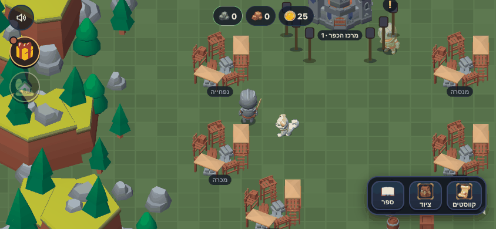
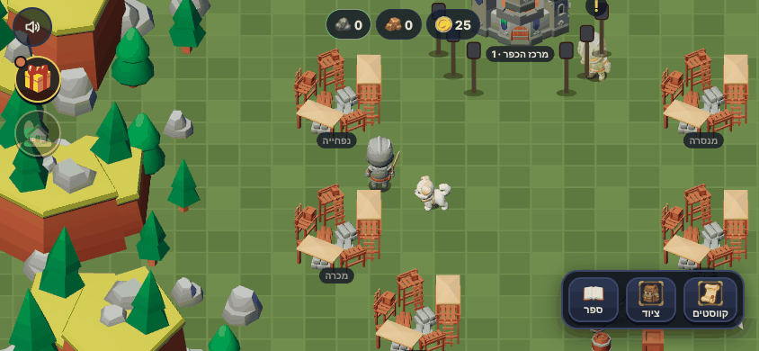
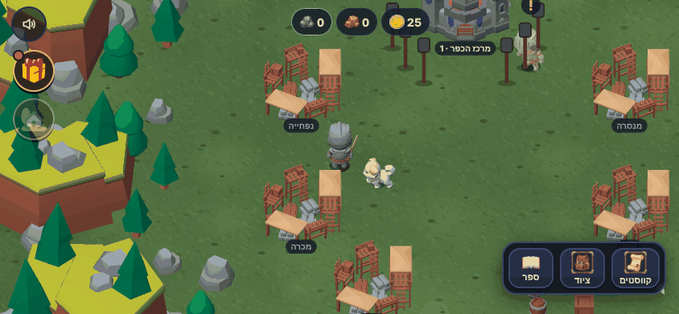
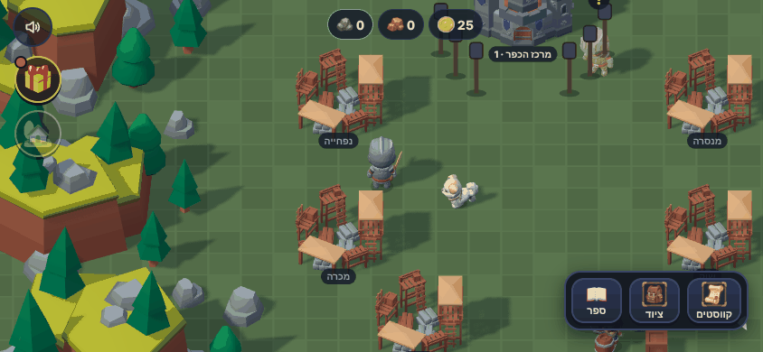
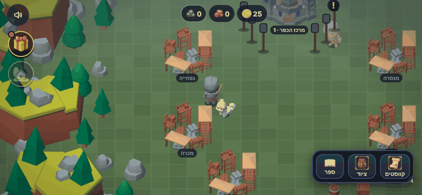
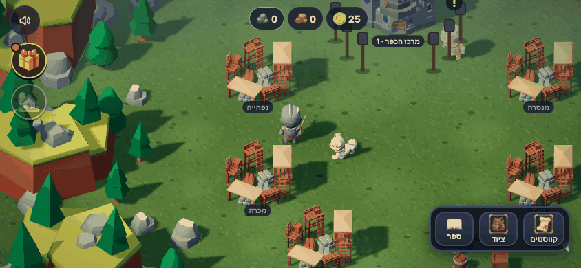
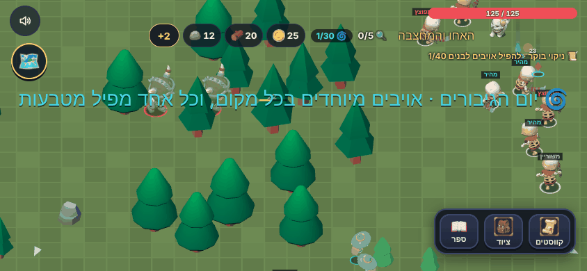
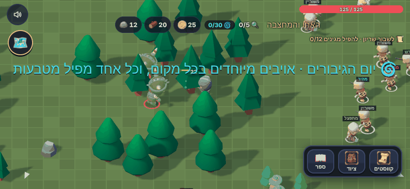
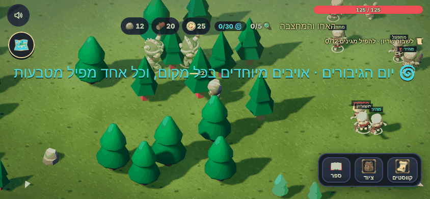

# שיפור ויזואלי: התוכנית

ניר, 1.11.2026: "שיפור ויזואלי משמעותי של המשחק (לא חייב לקרות עכשיו, אבל כן רוצה לדעת איך נעשה את זה)".
המסמך הזה מסביר מה ניסינו, מראה צילומי לפני ואחרי, כמה כל שיפור עולה, ומציע שלוש דרכים להמשיך.

## איך רואים בעצמך

הפיילוט כבר במשחק, אבל **כבוי**. מדליקים אותו רק עם תוספת לכתובת:
- `?look=hd`: כל ארבעת השיפורים, בכפר ובעולם הפתוח.
- `?look=hd&hd=light,ground`: רק חלק מהם (`light`, `ground`, `shadow`, `air`).
- להוסיף `&fps` כדי לראות את מד המהירות (perf.js).

הזירה לא משתנה (של אוראל). הקוד כולו בקובץ אחד, `js/look-hd.js`, שעוטף את התלת-ממד מבחוץ. בלי הדגל הוא לא עושה כלום.

## ארבעת השיפורים שנוסו

בחרנו את מה שנותן הכי הרבה מראה לכל מחיר בטלפון. כל צילום: אותו מקום, אותו רגע, טלפון שוכב (844×390).

| | לפני | אחרי |
| --- | --- | --- |
| **1. תאורה וצבע** (`light`): שמש חמה, שמיים כחלחלים, ומיפוי צבעים של קולנוע (ACES). הצהוב פחות צורח, והצבעים מתאחדים |  |  |
| **2. קרקע מצוירת** (`ground`): עשב, כתמים ואבנים במקום משבצות. לכל אזור נשאר הצבע שלו, ושכבת כתמים גדולים מסתירה את החזרה |  |  |
| **3. צללים אמיתיים** (`shadow`): כל דמות, בית ועץ מטילים צל רך ארוך מהשמש. **השיפור הכי מורגש**, והכי יקר |  |  |
| **4. אוויר** (`air`): אובך עדין למעלה במסך (נותן עומק) ומסגרת כהה רכה בפינות |  |  |
| **הכל ביחד, בכפר** |  |  |
| **צללים, באחו** |  |  |
| **הכל ביחד, באחו** |  |  |

## כמה זה עולה

**בביצועים.** נמדד במחשב בלי כרטיס גרפי (הדפדפן מצייר במעבד), אז המספרים עצמם נמוכים. מה שחשוב הוא ההפרש באחוזים. בטלפון אמיתי עם כרטיס גרפי הצללים בדרך כלל זולים יותר, ולכן לפני שמדליקים לכולם מודדים עם `?fps` באייפון של אוראל ובטלפון של ניר.

| | כפר: פריימים בשנייה | אחו: פריימים בשנייה | ציורים בפריים (כפר / אחו) |
| --- | --- | --- | --- |
| לפני | 12.6 | 10.9 | 42 / 79 |
| תאורה וצבע | 13.9 | 10.0 | אותו דבר |
| קרקע מצוירת | 12.5 | 10.6 | אותו דבר |
| אוויר | 13.2 | 10.8 | אותו דבר |
| צללים | 8.2 (‎-35%) | 7.2 (‎-34%) | 135 / 209 |
| הכל ביחד | 7.9 (‎-37%) | 6.4 (‎-41%) | 135 / 217 |

השורה התחתונה: **שלושה שיפורים בחינם** (ההבדלים הקטנים הם רעש של המדידה), **ואחד יקר** (צללים, בערך שליש מהמהירות).
הצללים נעשים זולים בהרבה עם שני תיקונים שלא נוסו בפיילוט: רק דמויות ומבנים מטילים צל (לא כל עץ וסלע), ומפת הצללים של הדברים שלא זזים מצוירת פעם אחת ולא בכל פריים. ובטלפון חלש: בלי צללים, לבד, לפי המדידה שכבר קיימת (`GFX_AUTO`).

**בעבודה.** הפיילוט: סשן אחד. להדליק את שלושת החינמיים לכולם: חצי סשן (איזון צבעים לכל אזור, ובדיקה שהטקסט על הקנבס עדיין קריא). צללים עם התיקונים ומדידה בטלפונים: סשן נוסף.

## מה עוד בדקנו, ולמה לא בפיילוט

| רעיון | מה הוא נותן | למה לא עכשיו |
| --- | --- | --- |
| זוהר (bloom) | פנסים, קסמים ושלל זוהרים באמת | צריך שכבת עיבוד שלמה אחרי הציור (EffectComposer), שלא קיימת אצלנו בחבילת three.js. זה האפקט הכי יקר בטלפון, וכולם ממליצים להדליק אותו רק במכשיר חזק |
| הצללה מצוירת (toon) וקווי מתאר | נראה כמו סרט מצויר | קו מתאר מכפיל כל ציור. KayKit כבר מעוצב רך, ובקו כהה הוא נראה כמו משחק אחר |
| עשב ועצים שמתנועעים ברוח | העולם "חי" | זול בכרטיס הגרפי (הכל בשיידר), אבל דורש שתילת עשב בעולם, וזה כבר שלב 2 |
| חלקיקים (עלים, גחליליות, אבק) | אווירה לכל אזור | מתאים בדיוק לקנבס שכבר מצייר ניצוצות. Kenney Particle Pack חינם (CC0) |
| אור אפוי בטקסטורה | צללים בחינם | רק לדברים שלא זזים, ודורש עבודה ב-Blender לכל מודל |

**מה עושים המשחקים שניר אוהב:** Dorfromantik עובד עם מעט צבעים לכל חפץ, פלטה נבחרת לכל אזור, ומפות הצללה רכה (ambient occlusion) שאפויות במודלים. Townscaper נשען כמעט רק על השמש: הזווית שלה וצבע חם. אצלנו זה בדיוק "תאורה וצבע" ו"צללים". Kingdom Two Crowns ו-Genshin נשענים על אובך, תאורת שעות היום והרבה חלקיקים, כלומר "אוויר" והחלקיקים מהטבלה.

## מה עולה כסף ומה חינם

| | מחיר | הערה |
| --- | --- | --- |
| ארבעת השיפורים בפיילוט | חינם | קוד בלבד |
| KayKit Forest Nature, Medieval Hexagon, Resource Bits | חינם (שלם-כמה-שבא-לך) | אותו סגנון כמו היום. עשב, פרחים, עצים מגוונים ושבילים לאחו |
| Quaternius Nature (150+ מודלים) | חינם, CC0 | סגנון קרוב, טוב למילוי |
| Kenney Particle Pack | חינם, CC0 | חלקיקים לקנבס |
| KayKit Mystery (אויבים ובוסים) | בערך ‎$13–20 לסדרה | כבר מופיע ב-[3d-assets.md](3d-assets.md) |
| Synty POLYGON (טבע, כפר) | בערך ‎$50 לחבילה, או מנוי מ-‎$30 לחודש | סגנון אחר מ-KayKit, אז מחליפים הכל או שזה נראה מעורבב. לא מומלץ |
| Creative Claw | בקרדיטים של איתי | טקסטורות קרקע ואייקונים, לא מודלים |

## שלוש דרכים להמשיך

1. **ליטוש חינם (חצי סשן):** מדליקים לכולם את התאורה, הקרקע והאוויר, בכפר ובעולם. בלי צללים. נראה טוב יותר מיד, ולא עולה במהירות.
2. **עולם חי (3–5 סשנים, חינם):** דרך 1, ועוד צללים מתוקנים שנדלקים רק בטלפון שעומד בהם, עשב ועצים שמתנועעים ברוח, חלקיקים לכל אזור (גחליליות באחו, ערפל באגם, שלג ברכס), ומילוי האחו בעשב, פרחים ושבילים מ-KayKit החינמי.
3. **סגנון חדש (הרבה עבודה, וכסף):** זוהר, הצללה מצוירת וקווי מתאר, וחבילות בתשלום (Synty). הכי שונה, הכי מסוכן לטלפון, ושובר את האחידות עם KayKit.

**ההמלצה: דרך 2, בשלבים.** מתחילים מדרך 1, כי היא חינם ומיידית. אחריה צללים עם מדידה באייפון ובטלפון של ניר, ואחר כך רוח וחלקיקים, אזור אחרי אזור. כך כל שלב מתמזג לבד, ואם טלפון מאט עוצרים בלי לאבד את מה שכבר נכנס.

מקורות: [ביצועי three.js בטלפון](https://coderlegion.com/4191/performance-of-three-mobile-devices-and-lower-end-hardware-for-games-and-creative-resumes), [Codrops: להדליק אפקטים לפי המכשיר](https://tympanus.net/codrops/?p=63363), [צללים דינמיים בטלפון (פורום three.js)](https://discourse.threejs.org/t/tarnished-house-very-first-scene/85957), [Dorfromantik: איך בנו את הסגנון](https://80.lv/articles/how-dorfromantik-expands-its-cozy-world-through-minimalist-design), [Townscaper: שליטה בשמש](https://metaphorsandmoonlight.com/game-review-townscaper-by-oskar-stalberg/), [קווי מתאר בשיטת inverted hull](https://www.github.com/microsoft/MixedReality-GraphicsTools-Unreal/blob/main/Docs/MeshOutlines.md), [עשב ברוח בשיידר](https://al-ro.github.io/projects/grass), [Synty Nature](https://syntystore.com/products/polygon-nature-pack), [KayKit Forest](https://kaylousberg.itch.io/kaykit-forest/purchase), [Quaternius Nature](https://quaternius.itch.io/150-lowpoly-nature-models/purchase).
